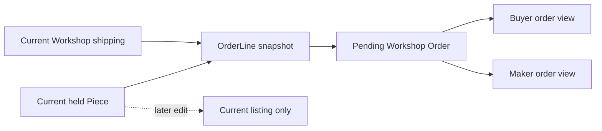

# Snapshot OrderLines

Amina can rename or archive her cushion cover after Lina begins checkout. Kareem can change the tray photo, price or shipping policy. Lina's pending Orders must still show the exact terms she accepted when all holds were secured. Build immutable OrderLine snapshots for the two Workshop Orders. Keep references to the original Piece IDs for traceability, but render the purchase agreement from the snapshot fields. A live Piece document describes today's listing, which may no longer exist when support inspects an old order.

## State the fields and owners

For each Piece, store its ID, Workshop ID, title, agreed price in integer minor units, currency, cover photo URL or durable media reference, craft or category label, and the maker or Artisan credit that was shown to the buyer. Store the Workshop display name as shown at purchase if receipts must preserve it; retain the Workshop ID for authorization. At the Order group level, store destination summary, shipping amount, shipping method and advertised delivery range. Be deliberate about private address fields: the buyer and that Workshop may need delivery details, while other Workshops and public pages do not.

The source of each field matters. Take title and craft from the Piece that this Checkout actually holds, not from the Cart's stale cached copy. Take seller ownership and shipping policy from server records. Take the buyer's chosen destination from authenticated checkout input, then validate it against the current Workshop rule. Price and shipping amount should match the buyer's acknowledged offer. If the hold succeeds after a price change, the route must unwind and ask for renewed confirmation; it must not silently capture a higher price. Add an explicit offer version or expected amount check to make that decision testable.

## Group by Workshop without merging identity

Create one pending Order for Amina and one for Kareem, both linked to Lina's Checkout. Each contains only that Workshop's lines. Amina must never receive Kareem's address notes, maker margin, OrderLine or dashboard metadata through her route. The Checkout carries the buyer-facing aggregate total and currency. Sum line amounts plus group shipping for each Order, then sum Order totals to Checkout total. Reject a mismatch before marking the attempt `pending_payment`. A rounding difference in minor units is a real mismatch; do not hide it with a floating-point tolerance.

A buyer may purchase two one-off Pieces from the same Workshop, so the group can contain multiple OrderLines. The `Piece ID` is unique within that Checkout. The build should assert that no Piece appears in two pending payable Orders at once. The hold owner check is the primary guarantee; a database uniqueness constraint for active OrderLines can add defense, but its lifecycle must account for failed and expired attempts. Do not create a blanket unique index that prevents a legitimate retry after a canceled attempt without a documented partial-index rule.

## Freeze the right facts, not all facts

The snapshot should be sufficient to explain the agreement: what was bought, from whom, for what item and shipping amount, with what delivery range. It need not copy every current Piece field. For example, a maker's unpublished draft notes or internal image moderation status are not part of the buyer's receipt. Avoid storing a mutable public photo URL if media deletion would make historical orders unreadable; choose a durable reference or retain the order thumbnail under the product's media policy. Explain that choice in the data model note and test a listing archive.

A custom commission has a separate Quote acceptance and production path. If the Cart contains a CustomRequest ID, this route should reject it or hand off to the approved quote checkout path. Do not invent a one-off Piece from a request merely to reuse OrderLine code. A handmade item can be ready-made or commissioned; the snapshot schema can share some fields, but the state transitions and promised delivery ranges differ. Keep this lesson's fixture to existing one-off Pieces so the sold-once invariant remains clear.

## Write atomically enough for the chosen design

In the compensation build, create the Orders only after every hold succeeds. If the process stops after Amina's Order insert and before Kareem's, keep the Checkout `assembling` or `rollback_pending`, never `pending_payment`. Recovery must remove or cancel the partial Amina Order, release holds by Checkout ID, and mark the attempt failed. If the project uses a MongoDB transaction instead, the Checkout and both Orders can commit together, with the Piece claims in the same transaction and a replica-set-backed session. Keep the provider call outside either database boundary.

A stable Order ID per Workshop can make retries deterministic. For instance, derive or look up the pair `(checkoutId, workshopId)` under a unique index. If a response is lost after Amina's Order insert, a retry finds the same Order rather than duplicating it. This does not replace recovery logic for the missing Kareem Order. The route must still know whether it can safely finish the plan or must unwind; use stored snapshot and current hold ownership to make that decision.

## Test an edit after the snapshot

Create a pending Checkout for Lina's cover and tray. Record the response and read the stored OrderLines. Then change Amina's Piece title and price, replace its cover photo, and archive it. Read Lina's Order again. The OrderLine should still show the agreed title, amount, craft, maker credit and chosen image reference. The live Piece page may be archived, and the buyer order page should not fail because it cannot populate a live listing. Repeat with Kareem changing his shipping amount and range; the existing Order keeps the prior shipping snapshot.

Next, test a change before the snapshot. Lina sees a cover for 2,400 minor units, but Amina changes it to 2,800 before Lina's claim. The route should return an offer conflict and create no payable Order. This is distinct from the post-snapshot edit test. One verifies consent to the current amount; the other verifies historical immutability. Write assertions for both because a system can pass one while failing the other.

Test a forged Cart line that carries `makerCredit: Lina` or a reduced shipping amount. The stored snapshot should use approved server records. Test a cross-Workshop grouping bug by creating two Orders with deliberately different Workshop names and amounts; assert each Order contains only its own Piece and shipping data. Finally, sum all Order totals and compare to the Checkout total. Include the exact values in the learning log so a reviewer can reproduce the arithmetic.

## Inspect the finished record

The final record should let a support reviewer answer why Lina paid a given amount without asking the current Piece page. It should show a held Piece, a pending Checkout, two pending Workshop Orders and frozen lines. It should also show no `paid`, `sold` or `shipped` transition yet. Those states require later payment and fulfilment lessons. Commit the snapshot schema, serializer, grouped creation and edit tests; the next chapter exposes scoped order reads without leaking Kareem's details to Amina.

## Keep status separate from history

An OrderLine's title and amount are historical terms, while Order status is a current workflow value. Freezing the title does not mean the Order can never move from pending to paid or fulfilled. Keep these different responsibilities in the schema and update paths. A payment handler should change allowed status fields after verifying Checkout and hold ownership; it should not rewrite line price or craft while doing so. Add a test that updates status through the intended service and compares all snapshot fields before and after. This prevents a broad document replacement from erasing evidence during a later state change.
