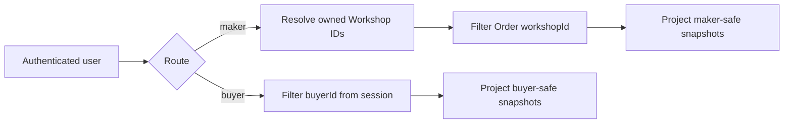

# Buyer and maker order routes

Build `GET /orders/my` for Lina and `GET /maker/orders` for Amina and Kareem. Lina should see both Workshop Orders from her Checkout, including each agreed item and shipping amount. Amina should see only the Order for her Workshop. Kareem should see only his own Order. These routes must read the frozen OrderLine data from the previous chapter rather than repopulating a live Piece and recalculating its price or shipping. The routes expose a pending checkout plan, not a paid purchase.

## Scope the buyer route at the query

The buyer's ID comes from the authentication session. Query Orders or Checkouts where `buyerId` equals that ID, then sort by creation time and apply bounded pagination. Do not fetch all Orders and filter them in JavaScript; the broad query would load another buyer's records into process memory and make logs or serialization mistakes more likely. If a route accepts a Checkout ID for detail, combine it with the same `buyerId` predicate. A random or known identifier is not authorization.

Return Checkout status, grouped Workshop names, frozen line titles, agreed amounts, shipping amount and delivery range. If a Checkout is `assembling` or `rollback_pending`, do not display its partial Order as a normal pending purchase. A response can show a clear retry or recovery message without exposing incomplete split Orders. If the Checkout expired, show its historical attempt appropriately; a later new attempt has its own ID. Be consistent about which statuses count as active in the list query.

Keep address handling deliberate. Lina may see her own delivery destination on an Order detail page, but the public order list may need only a city or country summary. A buyer's account page should not expose another household member's private instructions through a shared public route. The course's basic role model may be simpler, yet selecting fields intentionally teaches the boundary. Return normalized data rather than a raw database document that might include recovery notes or provider references.

## Resolve Workshop ownership for the maker route

Authenticate the user, query Workshops where owner ID equals the session user, then filter Orders by those Workshop IDs. If a maker owns two Workshops, return Orders from both with a clear Workshop label. If a Workshop has Artisan collaborators, their public credit on a Piece does not grant Order access. Only an explicitly authorized Workshop role should do that, and this lesson uses the owner rule already established in the data model. Never accept a request body's `workshopId` as proof of ownership.

For a maker detail route, combine `orderId` with an authorized Workshop ID in the database query. Amina could paste Kareem's Order ID into her URL; the response must be not found or forbidden under the API's disclosure policy. It must not first load Kareem's Order, log its full address and then check ownership. The authorization predicate belongs as close to the data read as practical. Test this with two real Workshop owners, not with one account owning both.

The maker view may need delivery address and buyer note for fulfilment after payment. While the Order is still pending, decide whether to expose those fields yet. A narrow default is to show item and status now and release shipping details only when the payment module marks the Order paid and actionable. Whatever rule the product uses, encode it in the serializer and a test. Do not return another Workshop's buyer note, internal price breakdown or platform fee simply because the two Orders share one Checkout.

## Handle status and snapshot consistently

Amina edits the cover title after Lina checks out. The maker route should still show the old snapshot title on Lina's Order, while Amina's listing management page shows the current title. This is not a stale cache bug; it is the distinction between an agreement and an editable catalog entry. Add a field in the API response that clearly identifies snapshot data if the frontend otherwise expects live Piece fields. Avoid a broad `populate('piece')` operation that overwrites snapshot fields in a serializer.

The status shown on a Workshop Order must agree with the Checkout state. A pending Checkout should not yield one Order marked paid and another pending in this module. Payment processing later may need careful handling of partial provider events, but the initial route should reject impossible records or surface them for recovery. Add a consistency assertion in a service test: for a newly created two-Workshop Checkout, both Orders exist, both are pending, both total to the Checkout, and each belongs to the same buyer and Checkout.

Use pagination stable enough that a newly inserted Order does not cause duplicate rows as the user pages. Cursor pagination by created time and ID is one option; offset pagination may be enough for a small course build but should have deterministic sort. Bound page size. This matters because makers may eventually have many Orders and an unbounded query can slow the dashboard. Include only fields needed for the list; load address and line details in a scoped detail route.

## Prove access with adversarial requests

Seed Lina and another buyer, plus Amina and Kareem as separate Workshop owners. Create a two-Workshop Checkout for Lina and a separate Order for the other buyer. Assert Lina's `GET /orders/my` contains exactly her two Orders. Sign in as the other buyer and confirm Lina's Checkout ID cannot be fetched. Sign in as Amina and confirm `GET /maker/orders` contains Amina's Order but not Kareem's. Pass Kareem's `orderId` to Amina's detail route and expect a safe denial. Repeat with an authenticated Artisan credited on Amina's Piece but not authorized as Workshop owner.

Now edit and archive the Piece after OrderLine creation, then call both routes. Both must retain the frozen agreed title, amount and credit. Verify they do not expose raw `hold.checkoutId`, rollback logs, idempotency key or payment-provider fields. This is a projection test as well as an authorization test. Inspect serialized JSON rather than checking only a 200 status; a route can return the right number of Orders with too many fields.

## Connect the views to the learner app

Wire the buyer account page to show Workshop cards under one Checkout heading, with each card's shipping estimate and status. Wire the maker dashboard to a list for the owner Workshop, keeping `pending_payment` visibly distinct from paid fulfilment. Do not give a maker a Ship button on a pending Order. Add empty states for no Orders and for a Checkout still recovering. These interface choices communicate the state machine to learners without inventing a sale before payment confirmation.

Capture the two route responses in the learning log using safe sample data. Explain which query predicate enforces the buyer scope and which relationship enforces maker scope. Include the cross-Workshop denial test. The next chapter tests the race from two browser sessions and verifies that these routes display exactly one pending Order for the winning Checkout, never two promises for the same Piece.

## Make forbidden data visible in a test

Give Kareem's Order a distinctive delivery note such as `blue gate`, and give Amina's Order a different note. Sign in as Amina and serialize her list and detail routes. Search the complete JSON for Kareem's note, Order ID and tray title; none should appear. A count-only assertion could pass even if one nested `checkout.orders` field includes all groups. Repeat as Kareem. If the serializer includes aggregate Checkout total for makers, consider whether that reveals another Workshop's revenue; return the maker Order total unless the product has an explicit reason to share the whole basket.
