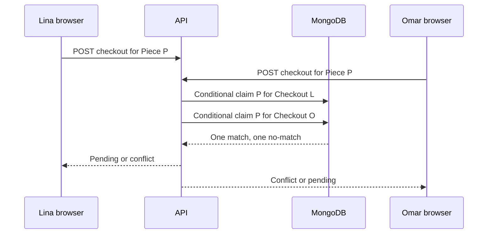

# Verify the race

Use two authenticated sessions and one available cushion cover. Lina and Omar both place that exact Piece in a Cart. They open the checkout page before either request claims it, so both browsers can honestly display the same available listing. Then submit both `POST /checkouts` requests close together. The route may choose either winner. The required result is one held Piece, one complete pending Checkout and one losing response that identifies the unavailable Piece without charging anyone.

## Make the fixture unambiguous

Create a fresh Piece with `status: available`, a known price and a Workshop that ships to both buyers. Give Lina and Omar separate accounts, Carts and request keys. Capture the Piece ID and both Checkout IDs in test output. Ensure neither request is rejected for an unrelated reason such as missing shipping policy or stale offer version. A race test that fails during preflight says nothing about the conditional claim. Reset the database between trials rather than toggling a sold Piece back to available through a route that production users cannot call.

Use a barrier so both calls are ready before release. The test does not need to force a particular database order; it needs to observe the invariant under either order. Run the real HTTP route if practical so authentication, Cart loading, claim and response shape are exercised together. A lower-level service test is also useful for isolating the conditional update, but it cannot replace the route test. Do not claim concurrency evidence from two sequential curl calls or a single browser tab that waits for one response before sending the next.

## Assert the winner and loser precisely

Exactly one response should be successful with a pending Checkout and one pending Workshop Order. The other should be 409 or the documented conflict status, naming the Piece as lost. The final Piece must be `held` with the successful Checkout ID and an expiry in the future. Count pending payable OrderLines by Piece ID; there must be one. The losing attempt must have no payable Order and no own active hold. If a partial attempt record remains for recovery, its state should be failed or rollback pending and should not appear as a normal Order in the buyer UI.

Do not assert that Lina wins because her request was started first in JavaScript. Network queues and database scheduling can reverse that order. Instead, derive the winning Checkout ID from the successful response and compare it to the Piece document and OrderLine. Run several fresh trials and verify the same count invariant each time. The loop is a way to increase the chance of exposing a race, but the correctness claim still depends on the conditional database predicate, not on statistical test runs alone.

## Add the expired-hold timeline

In a separate fake-clock fixture, let Lina claim the cover with an expiry of 10:00. At 10:01, Omar claims it through the expired-hold branch. Confirm the Piece now names Omar's Checkout and only Omar's attempt is payable. Run Lina's delayed rollback at 10:02. It must match zero and leave Omar's hold intact. Record the matched counts in the test output. A broad `updateOne({_id})` release would fail this test by clearing the new owner's claim.

Now reverse the order around the boundary. If Lina cancels at 09:59 and releases her own hold, Omar can claim the newly available Piece. If Omar tries at 09:59 before the release, he gets a conflict because Lina's hold is still active. These two cases make the expiry rule visible without a long sleep. They also test the difference between an explicit owner release and a time-based takeover. Do not use the browser countdown as the fake clock source; inject the server's decision time.

## Exercise a multi-Workshop race

Put Amina's cushion cover and Kareem's tray in Lina's Cart. Omar holds the tray just before Lina's second claim. Depending on claim order, Lina may have already held Amina's cover. The route should unwind her own cover hold, create no payable split Orders, and return the tray conflict. After rollback, a third buyer should be able to claim Amina's cover. This proves the compensation path has practical effect rather than merely changing Lina's HTTP response.

Run a forced crash after the cover claim and invoke the recovery worker. Assert that it identifies the claim by Checkout ID and releases it or reaches a documented retryable state. Repeat recovery to check idempotence. A maker may be looking at a dashboard while the process crashes; its route should never show a partial `pending_payment` Order for this attempt. Count all relevant records, not only the final Piece status. A test can hide an orphaned Order if it checks just one collection.

## Inspect the UI result

In two browser tabs, show both buyers the same Piece detail page, then submit checkouts. The winner should see one pending Checkout with a deadline and Workshop Order. The loser should see the Piece marked unavailable with a path back to browse or request a custom commission. The loser must not see the winner's name, Checkout ID or address. Refresh both tabs. The winner's pending view should be stable, and the loser should not suddenly gain an Order through a stale cached response.

Capture screenshots or safe response traces for the learning log, but use database assertions as the primary proof. Visual screenshots alone cannot show whether two OrderLines were inserted behind the page. Include the final query results for the Piece hold owner, Checkout states and OrderLine count. The gate will require these counts alongside the successful and conflicting HTTP statuses.

## Interpret failures before patching

If both requests succeed, inspect whether the claim filter omitted `status` or whether the route treated a stale preflight read as a reservation. If one request fails but both Orders exist, inspect whether Order creation happened before all holds. If rollback clears the winner's hold, inspect its owner predicate. If both requests fail, inspect unrelated validation and the fixtures before changing concurrency code. Name the broken invariant and the specific operation that crossed it. A blanket retry loop can make the test pass sporadically while hiding the core mistake.

Finish by running the single-Piece and multi-Workshop fixtures with the same data model used by the learner app. A simulator with an in-memory lock might be interesting, but the course goal is to show the actual database boundary. Commit the test traces and the fix, if any. The following chapter edits a held Piece to prove that the winning Order's agreement remains frozen despite later catalog changes.

## Keep request identity distinct

Use separate request keys for Lina and Omar, because they are distinct buyer decisions. Use one shared key only in the self-retry test for a single buyer. If the two-buyer test accidentally uses the same global idempotency key and the implementation scopes that key incorrectly, it might return one shared Checkout without ever testing Piece contention. Assert the resulting Checkout buyer ID matches the authenticated session in both response paths. This also catches a severe cross-account lookup bug.

After the conflict, retry Omar with a new key while Lina's hold is active. Omar should still lose; a new request identity is not a stock bypass. Advance the fake clock beyond expiry, then let Omar try again and inspect the old Lina attempt's state. This sequence verifies the route uses current Piece eligibility for each new attempt and keeps historical failed or expired attempts separate. Record both response IDs to show no earlier attempt was silently rewritten.
