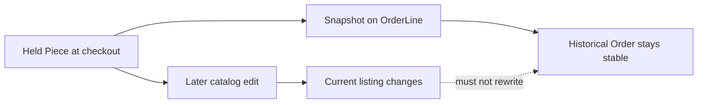

# Test snapshot immutability

Lina's pending Order is an agreement about a particular handmade cushion cover at a particular price and shipping range. Amina still owns the catalog Piece and may edit its public title, photo, craft description or price. She may archive it when the one-off Piece is no longer listed. Kareem may change a Workshop shipping policy. None of those current catalog changes should rewrite Lina's frozen OrderLines. Build tests that make the distinction visible through both stored records and the buyer and maker routes.

## Capture the baseline agreement

Seed Amina's cover with a title, cover photo, craft label, Artisan credit and price of 2,400 minor units. Seed Kareem's tray at 3,100 minor units. Set Amina shipping to 500 and Kareem shipping to 700, both in the same currency and both available to Lina's destination. Run the checkout route through successful holds and pending split Orders. Record the Checkout total of 6,700 minor units, Amina Order total of 2,900 and Kareem Order total of 3,800. If your local fixture uses different values, write out the equivalent arithmetic so the assertion is auditable.

Read Lina's buyer view and each maker's view immediately. The cover OrderLine should show the original title, amount, image reference, craft and maker credit; Amina Order should show the 500 shipping amount and selected delivery range. Kareem's Order should contain only the tray and 700 shipping. Store a test assertion object with these fields, not only a screenshot. The screenshot can support the learner log, but a field-by-field assertion finds silent serializer changes.

## Change catalog facts after checkout

As Amina, rename the cover, change its public price to 2,800, replace the cover photo, revise its craft tag and archive the listing. As Kareem, change the tray title and shipping price and pause shipping to Lina's destination. These operations may be valid for future buyers, but they should not mutate the pending Order snapshots. Fetch the OrderLine records and route responses again. Compare every frozen field to the baseline. Do not assume a database document is immutable merely because no explicit update route exists; a serializer that repopulates live Piece fields can still make the user-facing receipt drift.

The Piece ID and Workshop ID remain useful references even after archive, yet the order view must not depend on the referenced Piece being publicly retrievable. Simulate a missing or hidden Piece in the read path and ensure the OrderLine still renders. If the chosen media reference can be deleted when a listing is archived, define the product's retention rule for order thumbnails. A snapshot field that points to a disappearing resource is only partly durable. The course can use a retained order media reference or document the storage policy; it should not claim permanence from a raw URL alone.

## Change facts before checkout as a separate case

Restore a fresh Piece. Lina's Cart still displays 2,400, but Amina changes the current price to 2,800 before Lina submits checkout. The route should detect the offer difference and ask Lina to confirm 2,800; it should not create a pending payable Order for an amount she did not approve. After she accepts and retries with a new request key or offer version, the new OrderLine should snapshot 2,800. This test differs from the post-checkout edit: one guards consent at the time of purchase, while the other guards historical stability after the agreement was captured.

Repeat with the Workshop shipping policy. Lina sees 500 shipping, then Amina changes it to 650 before the claim. The route should report the new total and wait for confirmation. If Amina pauses shipping entirely, checkout must fail with no holds, even if the Cart still shows the old estimate. A server route that accepts the browser's old shipping number would pass the post-checkout immutability test yet still charge the wrong amount. Keep both sides of the time boundary in the suite.

## Check authorization while testing reads

Sign in as Amina and verify her maker route shows only Amina's frozen Order. The fact that both Orders share Lina's Checkout does not grant Amina access to Kareem's tray, shipping charge or address notes. Sign in as Kareem and verify the reverse. Sign in as another buyer and request Lina's Checkout ID; the route should deny access. These are not separate from snapshot safety: a broad serializer that loads all split Orders for one Checkout may leak another Workshop's data even while field values remain stable.

Test an Artisan credited on Amina's cover but without a Workshop seller role. Their name can remain on the frozen OrderLine, but the maker route should not grant them access based on credit alone. The user relationship in the data model determines permission; a display field does not. If the real project has explicit team roles, use that role check and add a test for it. State the rule in the learning log so a future maintainer will not reinterpret maker credit as authorization.

## Verify that no sale occurred yet

After all these edits, the Piece should still be held for the pending Checkout until its expiry, unless the test explicitly advances time. The Order statuses should remain pending. No test in this module should mark a Piece sold or an Order paid merely to read a snapshot. That transition is a payment-module responsibility and has a harder late-event problem: a provider may report success after a hold expires and another buyer takes over. Keep a test fixture for that later work, but do not claim this module has resolved it.

Make the route assertions explicit: the buyer sees two pending Workshop Orders with frozen totals; Amina sees one pending Order; Kareem sees one; the unrelated buyer sees none. After archiving the Piece, the buyer's Order still has the original agreed title and amount. After a pre-checkout change, the route returns a conflict and no new payable Order. These statements are the acceptance criteria, not just examples.

## Record evidence and clean up

Run the tests against the same database behavior the project uses for the learner build. A mock that always returns an old Piece object could hide a live-read bug in production serialization. Inspect the stored OrderLine JSON and the HTTP JSON after catalog edits. Include the original and changed values, Checkout ID, Order IDs and test names in the learning log, with private addresses redacted. Keep the seeded data disposable so the test does not pollute real instructor content.

If a snapshot field changes, locate whether the write path updated OrderLine, a populated Piece overwrote the serializer, or the frontend merged current catalog data into the order view. Fix the layer that caused the drift and rerun the same assertion. If a cover photo fails to load after archive, fix the media retention or fall back to a deliberate historical placeholder; do not silently substitute a different current Piece photo. Once the full fixture passes, the final gate will ask for race and immutability evidence together.

## Inspect the database and serializer together

A strong test checks both the stored OrderLine and the JSON response. If the stored snapshot changes, investigate a write-path bug. If storage is stable but the response changes, investigate a serializer that prefers populated live Piece fields. If both remain stable but the rendered page changes, inspect frontend state merging and cache keys. This three-layer check shortens debugging and prevents a superficial fix that hides drift in one view while leaving another wrong.

Keep the original minor-unit amounts in the test report.
