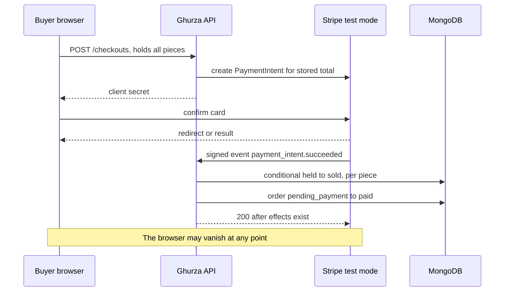

# Paid but not sold, sold but not paid

Lina has two pieces in one checkout: a stitched cushion cover from Amina's workshop and an olive wood tray from Kareem's. The total is 41,000 minor units. She types her card details, her bank asks her to confirm in its own app, and she confirms. Then her battery dies before the browser reaches any success page. The charge exists. Her Orders still say pending. Amina's Piece still says held.

Omar has a different afternoon. He presses Pay on the same cover, the success page loads, and the network drops before his payment request leaves the phone. He sees a green tick and an order number. No money moved. If the server sold the cover because a page told it to, Amina would pack a piece nobody paid for.

Those two stories are the whole subject of this module. They look like opposite bugs, but they have the same cause: a decision about money and ownership was made somewhere other than the server record that can prove it.

## Three ways to get the sale wrong

The first failure is **paid but not sold**. The buyer's card was charged, the provider holds the money, and Ghurza has not moved the Piece to sold. Maybe the webhook never reached the server. Maybe it reached a server that crashed halfway. Maybe the hold expired while the buyer was authenticating with the bank, so the handler looked for a held Piece, found nothing it recognised, and returned without doing anything. The buyer has a receipt. Amina has a Piece she believes is still available. The buyer paid for a cushion cover that can now be sold to someone else.

The second failure is **sold but not paid**. The Piece is marked sold, the Orders are marked paid, and no money arrived. A redirect, a success page, a browser promise, a client flag, or a well meaning "mark it done" button all cause this. It is the more expensive of the two, because the workshop ships a one-off object it cannot replace.

Between them sits a third, quieter failure: the wrong amount for the right purchase. The buyer agrees to 41,000 minor units on the checkout page, and the server charges 44,500 because a maker raised a price, or because the shipping amount was recomputed from a profile that changed between the cart and the card. Nothing crashed. The buyer was simply charged a number they never accepted.

Every design decision in this module exists to close one of those three gaps. The rule you will keep repeating is short. Payment state comes from a verified provider event, and it applies to a server-priced amount that the buyer already agreed to.

## The fake checkout trap

The trap is easy to fall into because it is the shortest path that makes the demo work. The payment form reports success, so the client calls `POST /checkouts/:id/mark-paid`, and the route sets every Piece to sold. It passes a manual test. It passes the demo. It fails on the first slow webhook, the first closed tab, and the first buyer who decides to call the endpoint directly with curl.

The trap has a second door, which is the amount. A client that sends `{ amount: 41000 }` is asking the server to trust a number the browser could have edited while the buyer was on the page. A learner who guards the mark-paid route but still reads the amount from the request body has moved the hole, not closed it.

Stripe is built around the same idea, and so are comparable providers. The server creates a **PaymentIntent**: a record of "this much money, in this currency, for this purpose". The provider's client-side code confirms that intent with a card. The provider then tells your server, over a separate channel, that the intent succeeded. Your server treats that message as the payment fact, and only after checking it against its own stored checkout. Nothing in that chain depends on the browser staying open, staying honest, or coming back at all.

## What a payment has to prove

A verified event proves four things at most: which intent succeeded, how much it was for, in which currency, and that the message really came from the provider. It does not prove which Piece the buyer meant, what the price should have been, or whether the workshop still owns the item. Those facts live in your database, frozen at checkout in module 19.

So the handler's job is a comparison, not a decision. Load the checkout by the intent id, compare the stored total with the amount in the event, compare currency, then apply the sold transition to the exact Pieces that checkout still holds. If the numbers disagree, stop and record why. A mismatch is an incident to investigate, never a value to correct silently.

The other half of the proof is the signature. The provider signs the request body with a secret shared only with you. You verify that signature against the **raw** body, before parsing it into an object, because the signature covers bytes, not fields. A handler that reads `req.body` after `express.json()` has already rewritten those bytes and will reject every real event or, worse, accept a forged one if the check is skipped.

## One copy means the whole stake

A shop that sells many identical copies of one design can absorb a double sale: one buyer is short, somebody apologises, and the next delivery fixes it. Ghurza cannot. A Piece is one exact object with a title, a maker credit, a price and a status. There is no quantity field to decrement and no second unit to fall back on.

That changes the shape of every failure. A hold on a Piece is total, so the loss of that hold is total. You cannot partially reserve a cushion cover. You cannot sell 0.5 of it to Lina and 0.5 to Omar. When the hold is lost and the payment arrives late, there is nothing to deliver and no partial credit that makes sense: the only honest outcomes are a full refund of what that Piece cost, or a conversation with the buyer. The arithmetic is simple; the policy is not.

Status carries the whole of availability. `available` means one copy is on offer. `held` means one buyer has a temporary claim with an expiry. `sold` means the copy has an owner and the listing becomes portfolio. `archived` means the maker withdrew it. Every rule in this module is about moving one field on one document, once, and being able to prove afterwards who moved it.

## Follow the money through the records

Four records carry this module. The **Checkout** holds the buyer, the total in minor units, the currency and the payment intent id. The **Order**, one per workshop, holds the frozen OrderLine snapshots (title, maker credit, price, shipping range) and its own status. The **Piece** holds status and the hold subdocument naming the checkout. The **payment event** record holds the provider's event id, its type, and when your server finished applying it.

Notice that two statuses must agree and one of them is the truth. The Order says the buyer paid. The Piece says the copy sold. If the handler updates one and stops, the pair disagrees and support has to guess. The transition has to be written so that a second run repairs a half-finished first run instead of failing.



The diagram's important arrow is the one that does not touch the browser. Everything after the signed event is server to server, and it has to work when the buyer has closed the tab, lost power, or run out of data.

The refused version of the same flow is worth tracing once, because it is the one a rushed build ships.

<TraceRequest title="The fake checkout, refused">
  <TraceStep actor="Buyer browser" label="Posts mark-paid" detail="The page reports a finished card confirmation" />
  <TraceStep actor="Ghurza API" label="Looks for a payment event" detail="No verified event exists for this checkout" />
  <TraceStep actor="Piece document" label="Stays held" detail="Status is not rewritten from a page signal" />
  <TraceStep actor="Order record" label="Stays pending_payment" detail="The maker sees no paid work to pack" />
</TraceRequest>

Each step in that trace is a place where the fake path either stops or leaks. It stops at the second step if the route insists on a verified event. It leaks at the third if any code believes the browser.

```quiz
type: mcq
id: handmade-payment-q1
question: A buyer confirms a test card, then the phone loses connection before any success page loads. What should move the Piece to sold?
options:
  - The success page, when the buyer opens it again from history
  - A verified event from the payment provider
  - A scheduled job that sells every held Piece after a day
  - The buyer's message to the workshop saying the card went through
correct: 1
explanations:
  - "The page may never load, and a page is not evidence of a charge."
  - "The event comes from the provider and is checked against the stored checkout."
  - "Selling on a timer would sell pieces nobody paid for."
  - "A message from the buyer proves nothing about money."
```

## What this module leaves alone

Two boundaries keep the work honest. A commission deposit is not handled here. A CustomRequest leads to a quote, a versioned acceptance and a deposit in modules 23 and 24, with its own intent, its own state machine and its own refund rules. This module prices and sells existing Pieces only. If a checkout contains a request id, reject it rather than inventing a Piece to reuse the code.

The second boundary is money leaving the platform. Ghurza records what a workshop sold and credits the Artisan on the OrderLine snapshot. It does not pay makers, does not split a charge, and does not compute fees. Stripe test mode is a simulation of collection, not a payouts system, and the course does not claim that a provider can pay out to makers in any particular country.

The next chapter takes the two workshop Orders from one checkout and turns them into one payment. You will see why two charges would be worse than one, what the server computes before the buyer ever sees a card form, and which parts of Stripe test mode you can trust as evidence for the gate.
