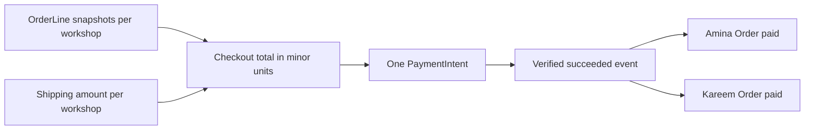

# One payment across workshop orders

Lina's checkout from module 19 created two Orders: Amina's cover at 24,000 minor units plus 4,500 shipping, and Kareem's tray at 9,500 plus 3,000 shipping. The checkout total is 41,000. She has one card. She expects to approve one payment, not two, and she expects both pieces to be reserved while she approves it.

The tempting design is one charge per Order, because one Order belongs to one workshop and the database is already split. It looks tidy and it is wrong for this buyer. Two charges mean two card confirmations, two chances for the second to fail after the first succeeded, and two sets of provider fees on a purchase the buyer thinks of as one. A partial success would leave Lina holding a tray and a broken promise about a cover.

The design this course uses is one **PaymentIntent** for the whole checkout, shared by both Orders. The intent is created on the server, for an amount the server computed, and both Orders store its id. When the provider confirms that intent, the handler sells every Piece the checkout still holds and marks both Orders paid. One payment, many workshop Orders, one sale event.



Read the left side as the server's arithmetic and the right side as the effect. No arrow in that diagram comes from the browser, and the two Orders meet only at the intent. That single meeting point is what makes "both or neither" a decision you can implement.

## The amount is a server fact

The buyer's browser never sends a total. Not on the checkout page, not on the payment request, not in a hidden field, not "just for validation". The server reads the number from what it stored at checkout.

That number is built from frozen OrderLine snapshots plus the shipping amount per workshop. The OrderLine carries the title, the maker credit, the price in minor units and the shipping range that was shown. The workshop's shipping amount comes from the ShippingProfile answer the checkout used. The server sums line prices and shipping per Order, sums the Orders, and stores that as the checkout total. The verify step from module 19 already checked that the Order totals add up to the checkout total, so by the time a card is involved there is one agreed number and a paper trail to it.

Several details matter more than they look. Prices are integers in the **smallest currency unit**: 24,000 minor units is 240.00, and a float of 240.00 has no place in this arithmetic. Floating point addition of prices and shipping will one day give 40,999.999999 and a provider that rejects the intent. Store integers, sum integers, send integers.

The shipping **range** is not the shipping amount. The range ("7 to 12 working days") is what the buyer was told about time. The amount is what the workshop charges to send the parcel there. Keep them in separate fields with clear names, because a receipt that prints a delivery range in the amount column is a support ticket waiting to happen.

Finally, the amount must come from the immutable snapshot, not from a live read of the Piece. If Amina edits her cover price after the Order snapshot was written, the checkout total does not move. That is the point of freezing it. A price change before the snapshot is a different case, handled in module 19 by an offer conflict, and it never reaches the payment step.

## The checkout record and the intent

The checkout gains payment fields before this chapter's code runs. Give the record an intent id, the stored total in minor units, the currency, the payment status, and a place for the event id that applied the result. Keep the intent id and the total together, so the handler can compare an incoming event against the exact number the buyer saw.

The creation call takes the amount and currency from the record, and an **idempotency key** derived from the checkout id. That key is what makes a double click, a browser retry, or a duplicated request create one intent rather than two. Without it, an impatient buyer on a slow connection can create two intents for the same 41,000 and confirm both.

A partial shape for the module, not a full implementation:

```js
// server/src/modules/payments/intent.service.js (partial)
export async function createIntentForCheckout(checkoutId, buyerId) {
  const checkout = await Checkout.findOne({ _id: checkoutId, buyerId });
  if (!checkout) throw new HttpError(404, "checkout_not_found");
  if (checkout.payment?.intentId) {
    return { intentId: checkout.payment.intentId, clientSecret: checkout.payment.clientSecret };
  }
  const intent = await stripe.paymentIntents.create(
    {
      amount: checkout.totalMinor,
      currency: checkout.currency,
      metadata: { checkoutId: String(checkout._id) },
      automatic_payment_methods: { enabled: true },
    },
    { idempotencyKey: `intent-${checkout._id}` },
  );
  // Store the intent id and the amount that was sent, never a client value.
  await Checkout.updateOne(
    { _id: checkout._id },
    {
      $set: {
        "payment.intentId": intent.id,
        "payment.clientSecret": intent.client_secret,
        "payment.amountMinor": checkout.totalMinor,
      },
    },
  );
  return { intentId: intent.id, clientSecret: intent.client_secret };
}
```

Two things to notice. The function takes a `checkoutId` and a `buyerId` from the session, never an amount. And metadata carries the checkout id so the webhook can find the record, then stops being trusted: the stored total still decides whether the event is legitimate.

The client receives the client secret, confirms the card with the provider's own form, and comes back with a result the server ignores. That result is for the buyer's eyes. It is not evidence.

<TraceRequest title="Who chooses the number">
  <TraceStep actor="Buyer browser" label="POST /checkouts/:id/payment" detail="Sends the checkout id and nothing about money" />
  <TraceStep actor="Ghurza API" label="Reads the stored total" detail="Uses the snapshot lines plus the workshop shipping amount" />
  <TraceStep actor="Stripe test mode" label="Creates the intent" detail="Amount 41000, currency from the checkout, checkout id in metadata" />
  <TraceStep actor="Ghurza API" label="Stores and returns" detail="Saves the intent id, returns only the client secret" />
</TraceRequest>

The trace has one author of the number, and it is not the browser. Every other participant copies it.

## Test mode, not pretend money

Stripe gives every account a test mode with its own keys. Test keys start with `sk_test_` and `pk_test_`. No real card is charged, no real money moves, and no real payout exists. Objects created in test mode are invisible to live mode, so an intent created with a test key can never be confirmed with a live one. Put the keys in `.env`, never in the client bundle beyond the publishable key, and never in Git.

The test cards are the vocabulary of this module. `4242 4242 4242 4242` succeeds with any future expiry and any three digit code. `4000 0000 0000 0002` is declined. `4000 0000 0000 9995` fails for insufficient funds. `4000 0027 6000 3184` requires authentication, which is the case that matters most here: the buyer leaves your page, approves in a bank app, and your hold expires while they are away. These are the provider's published test values; check the current list in its test documentation before the gate, because the set changes.

Test mode also gives you a way to see events without a browser. The Stripe CLI forwards real test events to your machine and prints the signing secret for that forwarding session. Keep that secret in `.env` as `STRIPE_WEBHOOK_SECRET`, and note in the learning log that it is a different secret from the dashboard endpoint's.

```bash
stripe listen --forward-to localhost:4000/api/webhooks/stripe
```

Run `stripe version` and record it. The commands in this module are the ones in current documentation, and flag names have changed before.

One honest limit: a passing test card proves the flow, not the money. The course grades the state of the Piece, the state of the Orders, the stored event, and the refund record. A screenshot of a green check on a payment page is not one of those four.

## While the buyer is on the payment page

The hold from module 19 is still ticking. Fifteen minutes, in this build. A buyer who confirms straight away stays well inside that window, but authentication can take longer, and an intent can sit unconfirmed while the buyer fetches a phone, answers a call, or loses power.

There are two ways to be wrong here. One is to treat the hold as payment protection: the Piece stays held forever because a card form is open somewhere, and Amina loses a week of selling. The other is to let the hold expire silently and let the buyer pay afterwards, which is exactly the late success case that 20.4 handles. Neither is solved by shortening or lengthening the timer alone. The timer stays as designed, and the payment module has to cope with a success that arrives after the claim is gone.

The buyer should see the deadline. A line such as "pieces are held for 15 minutes" next to the payment form is honest and cheap. What the buyer must not see is a promise that paying after that deadline still buys the cover.

```quiz
type: mcq
id: handmade-payment-q2
question: Lina's checkout holds a cover from Amina and a tray from Kareem. What does the server send to the provider as the amount?
options:
  - The total the browser calculated on the checkout page, checked once more against the same browser total
  - Two separate charges, one per workshop Order, so that each maker is paid on their own
  - The stored checkout total in minor units, from the snapshots plus shipping
  - The current live price of both pieces, read again at the moment the buyer presses pay
correct: 2
explanations:
  - "A browser total can be edited, and checking it against itself proves nothing."
  - "Two charges can succeed separately and leave the buyer with half a purchase."
  - "The stored total is the number the buyer agreed to, in integer minor units."
  - "A live read would charge a price the buyer never accepted."
```

## Why one intent and not two

It is worth stating the trade-off plainly, because a reviewer will ask. One intent per checkout buys a single buyer decision, a single total to reconcile, one place to record the paid event, and no half-paid cart. It costs you two awkward cases: a checkout whose workshops would ideally be settled separately, and a partial refund when only one workshop's Order cannot be delivered.

The alternative, one intent per Order, buys cleaner per workshop accounting and a natural partial refund boundary. It costs the buyer two card confirmations and hands you a new failure: Order A paid, Order B declined, and a Piece from A held while the buyer decides what to do. For a one-off marketplace with two or three workshops in a cart, that trade is not worth it. If Ghurza later settles with makers through a provider that supports destination charges or separate transfers, the payment structure changes and the course says so rather than pretending one intent is universal.

The chapter after this one writes the handler that turns a verified event into sold Pieces and paid Orders. Bring the intent id, the stored total and a duplicate event.
