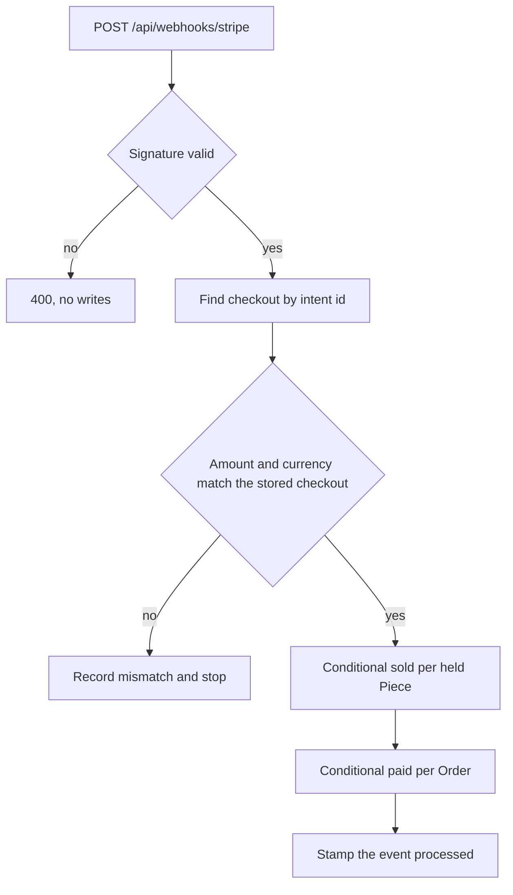

# Verify the webhook and sell the held pieces

You are building one route, `POST /api/webhooks/stripe`, plus the service behind it. When it works, a confirmed test payment moves Amina's cover and Kareem's tray from held to sold, marks both Orders paid, and records the provider event. When the same event arrives a second time, nothing changes and the route still answers 200 so the provider stops retrying.

The route has three jobs in a fixed order: prove the message came from the provider, find the checkout record, apply the effects. It must not trust the body's contents for anything except locating records.



Look at how many arrows end in a refusal. Three of the branches exist to stop the handler, and each one leaves a record instead of an effect. A webhook route that only knows the success path is the route that sells a piece on a forged request.

## The route and the raw body

Signature verification works on bytes. The provider signs the exact payload it sent, so your server must hand the same bytes to the verification function. This is where most first attempts fail: the JSON body parser has already converted the bytes into an object and re-serialising it gives different bytes, so every delivery is rejected as unsigned.

Mount the webhook path with a raw body parser before the global JSON parser, or in an order where the global one does not touch it.

```js
// server/src/app.js (partial)
app.post(
  "/api/webhooks/stripe",
  express.raw({ type: "application/json" }),
  handleStripeWebhook,
);
```

Then the handler verifies before it reads anything else:

```js
// server/src/modules/payments/webhook.route.js (partial)
export async function handleStripeWebhook(req, res) {
  const signature = req.headers["stripe-signature"];
  let event;
  try {
    event = stripe.webhooks.constructEvent(
      req.body,          // Buffer, not parsed JSON
      signature,
      config.stripeWebhookSecret,
    );
  } catch (err) {
    return res.status(400).json({ error: "invalid_signature" });
  }
  // Only now may the body be treated as a provider message.
  await applyEvent(event);
  return res.status(200).json({ received: true });
}
```

A missing header and a wrong secret both end in the same 400. Do not explain which one failed in the response; log it server side. An unsigned request must not be able to create a payment event record or touch a Piece, so keep every database write after the try block.

`applyEvent` receives the verified event and switches on its type. For this module, handle `payment_intent.succeeded` and leave the rest to a log line. A `payment_intent.payment_failed` event is worth recording, but it does not sell anything and it does not release a hold: the hold expires on its own clock.

## The event record

Store the event id. Stripe retries deliveries, and it can deliver two different events that describe the same payment. The event id is how you recognise the exact redelivery.

```js
// server/src/modules/payments/payment-event.model.js (partial)
const paymentEventSchema = new mongoose.Schema({
  eventId: { type: String, required: true },   // evt_..., from the provider
  type: { type: String, required: true },
  intentId: { type: String },
  processedAt: { type: Date },
}, { timestamps: true });

paymentEventSchema.index({ eventId: 1 }, { unique: true });
```

The order of writes matters more than the index. If you insert the event, mark it processed, and then apply the effects, a crash in between leaves a recorded event with no sale. The retry sees "already handled", returns 200, and the buyer's paid Piece stays held forever. Write the effects first, then stamp the event record as processed, and let the unique index on `eventId` catch the double delivery that arrives later.

That ordering means the effects themselves must be safe to repeat. The unique index is a second guard, not the plan. When two deliveries race, both may pass the "does this event exist" check, both may start selling, and only the conditional updates decide the outcome. The one that loses writes nothing and returns 200.

Log one line per delivery with the event id, the event type, the intent id, and the outcome of each conditional write. Do not log the signature, the secret, or the buyer's card details. That line is what you will read at the gate when a count looks wrong, and it costs almost nothing to write.

## The sold transition

The Piece update is the heart of the module. It matches one document by id, current status and hold ownership, and writes the sold state in the same operation.

```js
// server/src/modules/payments/apply-event.js (partial)
const sold = await Piece.findOneAndUpdate(
  { _id: pieceId, status: "held", "hold.checkoutId": checkoutId },
  { $set: { status: "sold", soldAt: now }, $unset: { hold: "" } },
  { new: true },
);
if (!sold) {
  // The hold moved on: another checkout owns it, or it expired and was taken.
  return { outcome: "not_held_by_this_checkout" };
}
```

Read the filter as a sentence: sell this Piece only if it is still held by this checkout. The `status` clause stops a sold Piece being sold twice. The `hold.checkoutId` clause stops a stale event stealing a Piece that now belongs to Omar's checkout. Both are needed, and neither can be checked in a separate read, because the gap between read and write is where the race lives.

The `if (!sold)` branch is not an error path to hide. It is the late success case, and the next chapter builds the refund for it. For now, record the outcome and return without touching the Order, so a lost piece never creates a paid Order.

Then the Order update, one per workshop Order in that checkout:

```js
// server/src/modules/payments/apply-event.js (partial)
await Order.findOneAndUpdate(
  { _id: orderId, status: "pending_payment", "payment.intentId": intentId },
  { $set: { status: "paid", paidAt: now, "payment.eventId": event.id } },
);
```

Again the filter is the guard. An Order already paid matches zero documents, so a duplicate delivery changes nothing. An Order whose stored intent is a different one is not this event's business. Never write `Order.updateOne({ _id })` with an unconditional `$set`, because that is how a refunded Order silently becomes paid again.

## Two orders, one event

The checkout stores both Order ids, or the handler queries Orders by checkout id. Either is fine. What matters is that the handler treats the checkout as the unit and its Orders as members.

The loop has a failure worth planning for. The cover sells, the tray sells, then the process dies before the second Order update. The retry sees the event unprocessed, runs the whole thing again, finds the cover already sold (zero rows matched, which is the correct outcome for a sold Piece), the tray already sold, and updates both Orders. Nothing is duplicated and the missing status is repaired. That is why the effects go before the processed stamp.

What if the first run sold the cover and then found the tray no longer held? That checkout is in the late success shape. Do not mark that Order paid and do not mark the other one paid either until the policy in 20.4 decides. A checkout is paid as a set, or it is refunded as a set. Half a paid checkout is the state that generates support mail.

## Prove it with the CLI

Start the API, start the forwarding session, then run a checkout in the browser with the success test card. The CLI prints each event and whether your route answered 200.

```bash
stripe listen --forward-to localhost:4000/api/webhooks/stripe
# in a second terminal, after a checkout exists and its intent is confirmed:
stripe trigger payment_intent.succeeded
```

`stripe trigger` creates its own test object with metadata that is not your checkout, so the handler should find no checkout and record nothing beyond a log line. That is a useful negative test, not a failure. To exercise the real path, confirm the intent your own checkout created, either through the browser form or by confirming it with the CLI against the intent id.

The evidence to keep is small: the event id, the intent id, the two Piece documents after the run, the two Order statuses, and the payment event record with `processedAt` set.

## Write the failing test first

Before the handler exists, write the duplicate delivery test. It should fail for the right reason, which is that no Piece is sold yet.

```js
// server/src/modules/payments/webhook.test.js (partial)
it("sells the held pieces once when one event is delivered twice", async () => {
  const checkout = await seedTwoWorkshopCheckout();   // Amina cover, Kareem tray
  const event = succeededEventFor(checkout.payment.intentId, checkout.totalMinor);

  await deliver(event);
  await deliver(event);

  const stillHeld = await Piece.find({ "hold.checkoutId": checkout._id });
  expect(stillHeld).toHaveLength(0);
  expect(await Piece.countDocuments({ _id: { $in: checkout.pieceIds }, status: "sold" })).toBe(2);
  expect(await Order.countDocuments({ status: "paid", checkoutId: checkout._id })).toBe(2);
  expect(await PaymentEvent.countDocuments({ eventId: event.id })).toBe(1);
});
```

Add a second test that changes one thing: an event whose intent amount is 40,000 against a checkout stored at 41,000. Expect no Piece sold, no Order paid, and a recorded mismatch. Add a third with an invalid signature header, expecting 400 and zero writes. Three tests cover the module's claim.

## Verify by hand

Run the checkout, pay with `4242 4242 4242 4242`, and watch the CLI. Confirm that both Pieces read `sold` with no hold subdocument, that both Orders read `paid` with the same intent id, and that the orders page shows the frozen titles and prices rather than a live Piece read. Then replay the same event from the CLI and check the four counts again. Nothing should move.

Finally, open Amina's maker dashboard. It should show a paid Order for the cover with the buyer's delivery details and the credited Artisan from the snapshot. It must not show a shipping action as complete; the tracking reference field is filled in later, when she packs and marks the order shipped in module 21. Then open Kareem's dashboard and check that he sees only his tray.

The next chapter takes the branch this one deliberately left open: a verified success that arrives when the Piece no longer belongs to that checkout.
