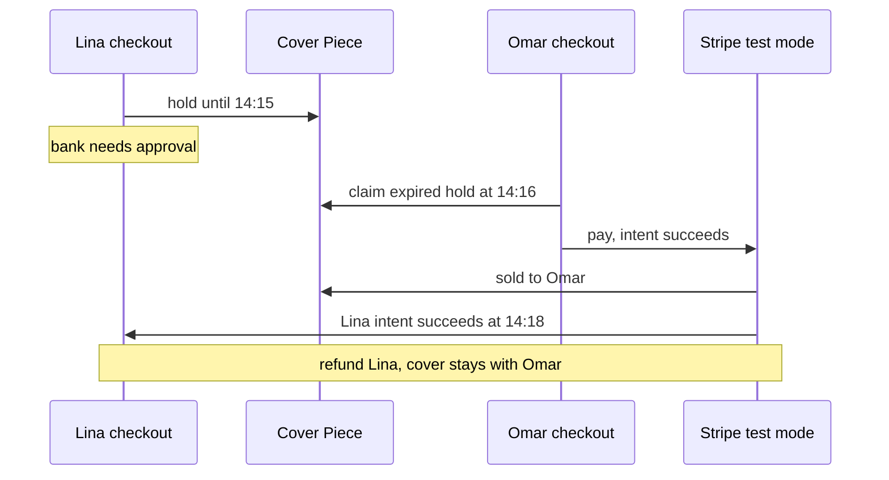

# Expired holds and a late success

Lina's checkout held the cover until 14:15. At 14:12 her bank asked her to approve the payment in its app, and she was still looking for the app at 14:16. At 14:16 Omar claimed the cover under the rule from module 19 and paid at 14:17. At 14:18 Lina approved.

Her intent succeeded. The cover is sold to Omar. The money is real, in test mode, and belongs to nobody in Ghurza. This chapter is about the two chances to fix that: cancel the intent while the hold is already lost, and refund the charge when it is too late to cancel.

## The timeline matters more than the timer

Nothing here is a bug in the hold. The hold did exactly what it was built to do: it returned an abandoned Piece to the market after fifteen minutes. The bug would be assuming that a card confirmation always lands inside the hold window. Bank authentication, a call, a dead battery and a slow connection all break that assumption, and none of them are rare.

So the module treats the late success as a normal path, not an exception. That has three consequences for the state you keep. The checkout must store the intent id permanently, not clear it when the hold expires. The Piece must keep enough history to say who owned the hold and when, because the refund decision is made from that comparison. And the Order must have a refunded state of its own, since "the buyer paid, and we gave it back" is different from "the buyer never paid".



The timeline shows why the answer cannot be "sell it to whoever paid last". Two payments succeeded. One object exists. The diagram's last note is the only policy that keeps the object honest, and it is what the rest of the chapter builds.

## Cancel the stale intent while you still can

The cheap fix applies when the hold is lost and the intent has not succeeded. A PaymentIntent that is still waiting for a payment method, a confirmation, or an action can be cancelled, and a cancelled intent cannot be charged. Cancel it as soon as you learn the claim is gone: in the checkout recovery path, or in the hold sweep from module 25.

```js
// server/src/modules/payments/lost-hold.service.js (partial)
const intent = await stripe.paymentIntents.retrieve(intentId);
if (["requires_payment_method", "requires_confirmation", "requires_action"].includes(intent.status)) {
  await stripe.paymentIntents.cancel(intentId, { cancellation_reason: "abandoned" });
  await Checkout.updateOne({ _id: checkoutId }, { $set: { "payment.status": "cancelled" } });
}
```

The status check is not defensive padding. Calling cancel on a succeeded intent returns an error, and catching that error and continuing is how a learner convinces themselves the charge was cancelled when it was not. Read the status, then act, and treat any other status as a different branch.

Cancelling is best effort. It happens after the fact, from a worker or a recovery function, and it races with the buyer's bank. There will always be a window where the cancel and the success cross. The next section is what happens then.

## When the money already moved

A succeeded intent whose Pieces are no longer held by that checkout is refunded. In test mode, through the provider's refund API, against the intent.

```js
// server/src/modules/payments/late-success.service.js (partial)
const refund = await stripe.refunds.create(
  { payment_intent: intentId, amount: amountMinor, reason: "requested_by_customer" },
  { idempotencyKey: `refund-late-${checkoutId}` },
);
```

Then the Order records the outcome in one conditional write:

```js
// server/src/modules/payments/late-success.service.js (partial)
await Order.findOneAndUpdate(
  { _id: orderId, status: "pending_payment", "payment.intentId": intentId },
  { $set: { status: "refunded", "refund.id": refund.id, "refund.reason": "lost_piece" } },
);
```

The filter carries the same protection as the paid transition. An Order already paid is not changed by a stray refund path. An Order already refunded matches zero, so a second run records nothing new. The refund id is stored so support can find the provider object without guessing, and so a second refund attempt can be recognised as a duplicate rather than issued twice.

The idempotency key does the same job at the provider. Two calls with the same key and the same parameters return the same refund instead of creating a second one. That matters because a crash after the refund call but before the Order write will make your retry call the refund endpoint again. Without the key, that retry refunds the buyer twice.

## Which amount, and which Orders

This is the judgement call in the chapter, and it deserves a plain rule.

Lina paid 41,000 for a set: a cover and a tray. The cover is gone. The tray is still on offer from Kareem, unreserved and unsold. Two policies are defensible, and they must not be mixed by accident.

The default in Ghurza is to refund the whole intent and mark every Order in the checkout refunded. The buyer agreed to one set at one price. Delivering half of it silently keeps money for goods she no longer wants at that price, and module 19 already refused to charge for a partial cart. So the refund amount is `checkout.totalMinor`, and every Order in that checkout moves to `refunded` with the same refund id.

The narrower policy allows a per Order refund when the buyer has said, in a recorded choice, that she wants to keep the remaining piece. Then the refund amount is that Order's own total: its line prices plus its shipping, in minor units. The conditional update from the previous section then applies to that one Order, and the others stay paid. Do not implement this without the recorded choice, because a server that guesses will one day keep 12,500 minor units for a tray the buyer never agreed to buy alone.

Do not refund less than the Order total by subtracting a fee you invented. Ghurza does not model provider fees, and the buyer did not agree to one.

## Marks that must not move

Three things stay exactly where they are after a late success refund.

The Piece stays sold, to Omar. It is not released, not moved back to available, and not given a fresh hold, because a physical object has one owner and Omar paid for it. The cover becomes portfolio. A refund to Lina is not a signal that the piece is free again.

Omar's Orders stay paid. His checkout is untouched by Lina's event, and his maker dashboards still show work to pack.

Lina's buyer view shows a refunded Order with the frozen title, maker credit and price. That history stays readable. It is the reason the OrderLine snapshots exist: the buyer can see what was bought, from whom, for how much, and that it was given back. The maker's view of that Order shows refunded and no packing action, so nobody packs a cushion cover for a refunded buyer.

What does change is the hold. There is nothing to release, because the hold was already gone when Omar claimed. A cleanup function that "releases the hold for the refunded checkout" is a bug looking for a race with Omar's sale.

## Test it without waiting fifteen minutes

Use an injected clock, as in module 19, rather than sleeping.

Seed Lina's checkout with both pieces held until 14:15. Set the clock to 14:16. Run the expired-hold takeover so Omar claims the cover and pays: his checkout holds and sells the cover. Now deliver Lina's `payment_intent.succeeded` event with her intent id. Expect the cover to remain sold under Omar's checkout id, her two Orders to read `refunded`, one refund record of 41,000 minor units, and one payment event record.

Then deliver the same event again. The Order count and the refund id must be unchanged. Call the late-success service directly, twice, and assert the same. A second refund object with a different id is the signal that the idempotency key or the Order guard is missing.

Run a second fixture where the tray is still claimable: Lina's checkout lost only the cover. With the default policy, both Orders are refunded and the tray's hold is released by the ordinary release path, not by the refund path. With the recorded choice policy, the cover Order is refunded at 28,500 and the tray Order stays paid. State which policy your build uses in the learning log and show the numbers.

Finally, test the cancel branch. Create an intent that never succeeds, lose the hold, run the cancel, and confirm the intent reads `canceled` and a later confirmation attempt fails. Then confirm the checkout is marked cancelled and no Order was created. Keep the provider's cancellation status in the log next to your own record, because they are two different statements.

The gate after this one asks you to run these cases in order and keep the evidence.
