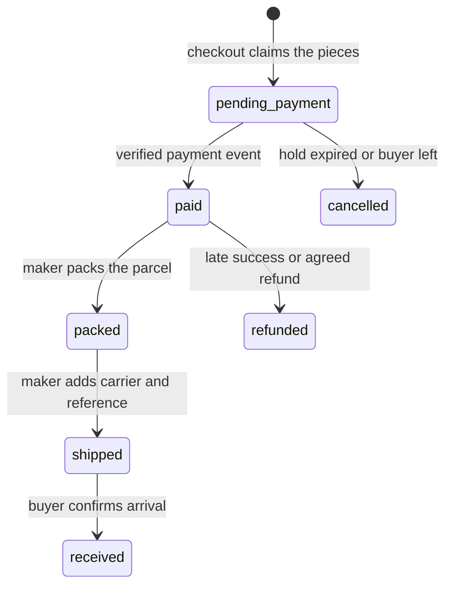

# Following a one-off order to the door

The cover Lina bought exists in one place: on Amina's workbench at Bayt al Zayt. It has been photographed, described, priced and now sold. For the next two weeks Lina will want to know one thing that the piece page cannot tell her: where is my cover now. That question has three honest answers, and none of them is "arriving Tuesday". They are packed, shipped with a carrier and a reference, and received. This module builds the two pages that carry those answers, one for Lina and one for Amina.

An order page is a record, not a product page. The difference decides most of the design. A product page shows what is true now. An order page shows what was true when the buyer paid, plus what the seller has done since. If your order page loads the current piece to fill in a title or a price, then an edit, an archive or a later sale rewrites a past purchase. That is the failure this module is built to prevent.

Module 19 already froze the purchase facts on each Order and OrderLine: title, craft, maker credit, photo reference, price in minor units, shipping amount, handling and transit ranges, and the destination the buyer chose. Module 20 turned a verified payment into a sale. Neither of those modules gave either party a page. This one does, and it adds the three movements that happen after payment, all of them driven by people rather than by a payment provider.

Read the arrows by who moves them. The arrows out of `pending_payment` belong to the payment provider and to the hold expiry rule, and Module 20 already proved them. The next two belong to the maker, and they are the reason the buyer gets a page at all. The last one belongs to the buyer. Every one of them is a decision by one named person, and every one of them can be attempted twice from two tabs, so each transition is a guarded write rather than a form that overwrites a status field.

## The snapshot is the page

A maker can rename a piece, change its care notes, reorder its photos or archive it, and none of that should move a single character on an order that was paid for before the edit. The order line holds the copy, so the order page reads the line and never joins back to the live piece. That rule is simple to state and easy to break, because a `populate("pieceId")` call is one word away and feels helpful.

The fields that must come from the snapshot are the ones that made up the sale: the title as shown, the price in minor units, the currency, the maker credit text, the cover photo reference, the craft, the shipping amount and the handling and transit ranges. The piece ID stays on the line as a reference for support and for the "request something similar" link, but it is not a source of display values. If a buyer opens an order from two years ago, the page must still read like the purchase they made.

There is one deliberate exception. If a workshop closes, the order page may show a short line saying the workshop is no longer trading, because that is current information about the counterparty and the buyer needs it to understand why nobody answers. That line is drawn from the workshop record on purpose, and it is labelled as current, not as part of the agreement.

## Three movements, three owners

Packing is a statement by the maker that the object is wrapped and ready to leave the workshop. It commits to nothing about transit. The maker may pack a cover on the day the payment clears, or three days later while the parcel waits for the weekly collection. A packed order still shows the handling range from the snapshot, because that range is what the buyer was told.

Shipping is a statement that the parcel has left the workshop's hands. It carries two free-text facts: a carrier name and a tracking reference. Both are typed by the maker. Ghurza has no carrier integration in this course, so the app must not pretend to verify a reference, format it, or claim that a carrier recognises it. Store the text, trim it, bound its length, show it back exactly as entered. A maker who ships through a local courier with a handwritten slip can still record what the buyer needs.

Received is the buyer's confirmation, and only the buyer's. It closes the order and tells the maker that the parcel arrived. It is not a review, it is not a rating, and it must not be inferred from a carrier status the app cannot see. A buyer who never confirms leaves the order open, and a later worker job may close it after the number of days the maker set. That job belongs to Module 25, and keeping it separate here is what stops the buyer's own statement from losing its meaning.

## Two pages, one truth

The buyer page lists Lina's orders across workshops, and each order expands into its snapshot lines, its shipping amount, its ranges, its current status and its tracking text once there is one. The maker page lists orders for the maker's own workshop only, with the destination and the buyer's note released after payment, plus one next action: mark packed, then mark shipped with a carrier and a reference.

Both pages read the same order document. That is the point. If the buyer page says shipped with a reference and the maker page says packed, one of them invented something. A shared read model with two projections, one for each audience, keeps the status honest and keeps private fields out of the buyer response.

Scope is unchanged from Module 19. The buyer query filters on the session's buyer ID. The maker query resolves the workshops the session owns and filters orders by those workshop IDs. A maker who owns two workshops sees both, labelled. A credited artisan sees nothing here, because credit on a piece was never ownership of an order. A pasted order ID from another workshop returns the same denial as a made-up one.

## Ranges, not promises

The transit range in the snapshot may read 7 to 14 days. The maker cannot control a border inspection, a missed flight or a local delivery round, and the course makes no claim about which routes work from any place. So the page prints the range and says what it means: the parcel usually takes this long, and the maker will answer questions if it does not.

A tracking reference is not a promise either. Some references resolve on a carrier site and some do not, and the app cannot tell the difference. Show the text, offer a copy button, and stop there. A green "on its way" badge that a buyer reads as a live position is a claim the software cannot support, and the first buyer who checks a reference that resolves nowhere will trust the next status less.

## What goes wrong without this page

Three failures are worth naming before the build. The first is the live lookup: the order page joins the current piece, the maker edits the title, and the receipt changes under the buyer. The second is the silent status jump: a maker form writes `status` straight from a dropdown, so an order moves from paid to shipped with no packing step and no reference, and the buyer's page has nothing true to show. The third is the missing confirmation: the buyer has no way to close the order, so every list fills with old paid rows and nobody can tell a delivered parcel from a lost one.

Each failure has the same shape. The page displays something the software never recorded, or records something no named person decided. A snapshot read, a guarded transition with an actor, and one buyer action per order remove all three.

Write down the four statuses your order page will display, the two fields that travel with a shipment, and the one action the buyer owns. The next lesson builds the routes and the two pages against that list, then tests a transition that two tabs attempt at the same time.
