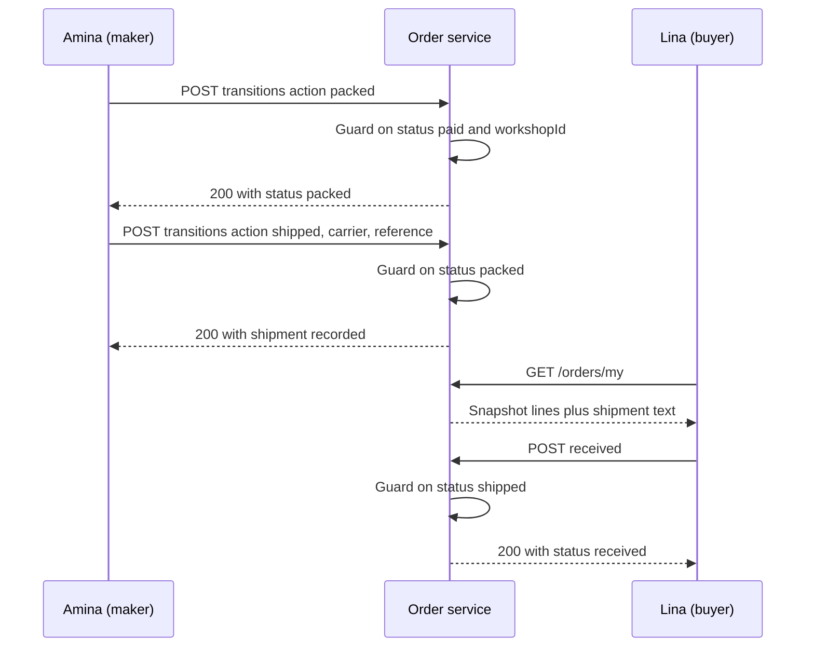

# Buyer and maker order pages, packed and shipped

Two people need two different views of one order. Lina needs to know what she bought, what it cost and where it is. Amina needs the destination, the packing list and one button that moves the order forward. The shared part is the order document, and the discipline this lesson asks for is that both views read that document rather than the live piece behind it.

Start on the server. Add four things to the Order schema: `status` with the values `pending_payment`, `paid`, `packed`, `shipped`, `received`, `cancelled` and `refunded`; a `shipment` object with `carrier`, `trackingReference`, `recordedBy` and `recordedAt`; timestamps `packedAt`, `shippedAt` and `receivedAt`; and a bounded `history` array holding `{ action, actorId, at }`. An order has a short set of transitions, so the array has a small ceiling and never grows without a bound. Do not store the carrier in a separate collection. Two text fields do not earn their own model.

```ts
type OrderStatus =
  | "pending_payment"
  | "paid"
  | "packed"
  | "shipped"
  | "received"
  | "cancelled"
  | "refunded";

interface Shipment {
  carrier: string;
  trackingReference: string;
  recordedBy: string;
  recordedAt: Date;
}

interface OrderDocument {
  buyerId: string;
  workshopId: string;
  checkoutId: string;
  status: OrderStatus;
  lines: OrderLineSnapshot[];
  shippingCents: number;
  handlingDays: [number, number];
  transitDays: [number, number];
  shipment?: Shipment;
  packedAt?: Date;
  shippedAt?: Date;
  receivedAt?: Date;
  history: Array<{ action: string; actorId: string; at: Date }>;
}
```

The `OrderLineSnapshot` from Module 19 is unchanged and must stay unchanged. Everything this lesson adds sits beside it.



Notice where the guards sit. Each request names an action, and the service derives the required current status from that action. The browser never sends a target status, because a browser that can send `shipped` can skip packing, and a browser that can send `received` on the maker's behalf stops the buyer's confirmation from meaning anything.

## Write the failing tests before the routes

Three tests fail on the current code, and each one names a real defect. Write them now, watch them fail, then build until they pass.

```js
// server/src/modules/orders/order-transitions.test.js
test("a maker cannot ship an order that is not packed", async () => {
  const res = await request(app)
    .post(`/api/maker/orders/${coverOrderId}/transitions`)
    .set("Authorization", `Bearer ${aminaToken}`)
    .send({ action: "ship", carrier: "Aqaba road courier", trackingReference: "GZ-4471" });

  expect(res.status).toBe(409);
  expect((await Order.findById(coverOrderId)).status).toBe("paid");
});

test("shipping without a tracking reference is rejected", async () => {
  await Order.findByIdAndUpdate(coverOrderId, { status: "packed" });

  const res = await request(app)
    .post(`/api/maker/orders/${coverOrderId}/transitions`)
    .set("Authorization", `Bearer ${aminaToken}`)
    .send({ action: "ship", carrier: "Aqaba road courier", trackingReference: "   " });

  expect(res.status).toBe(400);
  expect((await Order.findById(coverOrderId)).shipment).toBeUndefined();
});

test("the buyer order page keeps the agreed title after the piece is edited", async () => {
  await Piece.findByIdAndUpdate(coverId, { title: "Edited after sale", priceCents: 9900 });

  const res = await request(app)
    .get(`/api/orders/${coverOrderId}`)
    .set("Authorization", `Bearer ${linaToken}`);

  expect(res.body.lines[0].title).toBe("Stitched cushion cover");
  expect(res.body.lines[0].priceCents).toBe(2400);
});
```

The third test is the one learners pass by accident and then break in a refactor. Keep it in the suite. A projection that spreads the Mongoose document is not the same as a projection built from snapshot fields, and only a test with an edited piece can tell them apart.

## Guarded transitions, one action at a time

Build `POST /api/maker/orders/:orderId/transitions`. Authenticate, resolve the workshops the session owns, then run a conditional update that includes the order ID, the owned workshop ID and the expected current status.

```js
const result = await Order.findOneAndUpdate(
  { _id: orderId, workshopId: { $in: ownedWorkshopIds }, status: "paid" },
  {
    $set: { status: "packed", packedAt: new Date() },
    $push: { history: { action: "packed", actorId: session.userId, at: new Date() } }
  },
  { new: true }
);

if (!result) return res.status(409).json({ code: "ORDER_STATE_CHANGED" });
```

The predicate is the whole guard. If two tabs both read `paid` and both press Pack, one update matches and the other returns a document of `null`. The second caller gets 409 with a body that says the order moved on, and the UI refetches. Do not check the status in JavaScript and then write separately, because between the read and the write the other tab wins and both responses claim success.

For shipping, run the same shape with `status: "packed"`, and take `carrier` and `trackingReference` from the body. Trim both, require both to be non-empty, and bound each at 80 characters. That is the entire validation. Do not require a known carrier name, a numeric reference, a URL, or a pattern that suits one courier. A maker in Gaza may hand a parcel to a driver with a paper slip, and the course makes no claim about which carriers operate on which route.

The buyer route is `POST /api/orders/:orderId/received` with no body. Guard it on `buyerId: session.userId` and `status: "shipped"`, set `receivedAt`, and push one history entry. If the order is not shipped, return 409 and leave it alone. A buyer who taps Received twice gets one transition; the second tap finds the order already received and returns 409 without changing a field.

## Project two views from one document

The buyer projection returns the snapshot lines, the group shipping amount, the handling and transit ranges, the status, the timestamps that exist, and the shipment text when it exists. It does not return the workshop's private settings, the buyer's own authentication data, or any provider identifiers.

The maker projection returns the same snapshot lines, the destination and the buyer note, but only once the order is `paid` or later. Before payment there is no parcel to address, and a pending order should not hand a maker a buyer's address in case the payment never completes. Both projections share one builder function with a flag for the audience, so a new field is either exposed to both or to neither, and never leaks by omission.

Then wire the pages. `client/src/pages/OrdersPage.jsx` lists Lina's orders across workshops. Each card shows the workshop name, the status, the total including shipping, the transit range and one line per piece. `client/src/pages/OrderDetailPage.jsx` adds the photo, craft, maker credit and the shipment block with a copy button next to the reference.

`client/src/pages/maker/MakerOrdersPage.jsx` lists the workshop's orders with one next action per row. A `paid` order offers Mark packed. A `packed` order offers a small form with two fields, carrier and tracking reference, and a Ship button. A `shipped` order offers nothing and says the buyer has not confirmed yet. A `received` order is a record.

Disable the action while a request is in flight, and replace the row from the response rather than editing the status in local state. On 409, show one sentence that the order changed and refetch the list. On 403, say the order belongs to another workshop without naming it. On 400, keep the form open with the field message beside the input, because a maker who typed a reference and lost it will type it again and get it wrong.

```quiz
type: mcq
id: handmade-track-orders-q1
question: Amina presses Pack in two tabs at once. The second request comes back with 409. What should that tab show?
options:
  - The status she submitted, with a retry button beside it
  - The stored status from a fresh read of the order
  - A generic error page, because the order is now broken
  - Nothing, and the row quietly falls back to paid
correct: 1
explanations:
  - A retry of a request the server already refused invites a second write.
  - The guard found a newer state, so the tab repaints from what is stored.
  - A conflict between two tabs is normal and does not break the order.
  - Showing an older status would contradict the maker's own screen.
```

## Test the paths that skip a step

Four adversarial requests belong in your suite, and each one has a matching UI behaviour. Amina tries to ship an order that is still `paid`, and the server answers 409. Amina sends a shipment with two spaces in the reference field, and the server answers 400 with a field message. Kareem sends a packed action for Amina's order, and the server answers 403 without loading the destination. Lina presses Received on an order that is only packed, and the server answers 409 and leaves `packedAt` alone.

Then run the same transition from two tabs. Open the maker list twice, press Pack in both, and read the two responses. One returns 200 and the document at `packed`. The other returns 409 with the order's current status, and the tab refetches instead of showing a guessed state. Repeat for Ship with two different references. Only one reference may be stored, and the losing tab must display the stored one rather than the text it submitted. That last check is easy to skip and it is the only one that proves the history array and the shipment fields agree.

A near miss worth naming: an implementation that stores the carrier and the reference but leaves `status` untouched passes a shallow reading of the UI, because the shipment block appears. It fails the guard on the next action, because an order that is still `packed` can be shipped twice. Always assert the status and the timestamps in the same test as the shipment text.

## Keep the narrow screens usable

At 360 pixels the buyer card stacks: workshop name, status, then lines, then the money block, then the shipment text. The tracking reference must wrap rather than overflow, and a copy button has to be reachable without a long press. Test with a 40 character reference and a carrier name of three words.

The maker form is two inputs and a button, so the risk is the keyboard covering the Ship button on a phone. Put the button below the fields in normal document flow rather than in a fixed footer, and keep the field labels visible after a failed submit. Announce the result of a successful transition in a polite live region, and move focus to the new status label so a keyboard user hears the change.

Run the whole path once by hand before you write the summary. Amina packs, then ships with a carrier and a reference. Lina reloads her order, copies the reference, and marks the order received. Amina's list shows received and no next action. Then edit the piece and reload both pages to watch the snapshot hold its ground.
