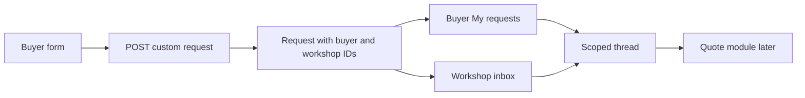

# Build a private custom-request path

A ready-made piece has a page, a price and a state. A commission begins with a question. A buyer may want a carved tray inspired by a sold piece, but the workshop has not yet agreed to the material, size, lead time or price. If the app turns that message directly into an order, it creates a promise nobody made. In this module you add a request and a conversation. Quotes and money come later, after both parties know the scope.

The first thin slice is a buyer creating a request to one workshop and seeing it in “My requests.” The second is the workshop owner seeing it in an inbox. The third is a short thread in which each party can clarify details. All three must use the same ownership boundary. A buyer can see their own request; a workshop owner can see requests addressed to their workshop. The credited artisan on a linked piece is not automatically a workshop owner.

The diagram deliberately ends at the quote boundary. A thread message can ask a question or decline the request. It cannot capture a deposit. That restriction keeps the authorization rules small enough to test before introducing payment.

## Decide what the request contains

Create `server/src/modules/custom-requests/custom-request.model.js`. Store `buyerId`, `workshopId`, `status`, `brief`, `craft`, `budgetMinCents`, `budgetMaxCents`, `wishedBy`, optional `inspiredByPieceId`, `referencePhotoIds`, `createdAt` and `updatedAt`. Start `status` at `submitted`. Treat `wishedBy` as a wish, not a delivery promise. Validate the budget range when both ends exist. The brief should have enough detail to be useful but a strict length limit, so a pasted book cannot fill one database document.

Keep a separate `CustomRequestMessage` collection keyed by `requestId`, `senderId` and creation time. Use text and optional approved photo references, not a free-form HTML field. A growing thread should not be embedded without a bound: long-running commissions may collect many messages, and a fixed-size request document is easier to query and index. Add an index on `buyerId, createdAt` for “My requests,” another on `workshopId, createdAt` for the inbox, and `requestId, createdAt, _id` for stable thread order. The tie-breaker `_id` matters when two messages get the same millisecond timestamp.

Write `docs/commission-states.md` with the initial boundary: `submitted`, `in_review`, `declined` and `quoted`. The later modules add accepted, deposit-paid, production, approval, balance-paid, shipped and delivered states. Do not expose an arbitrary `PATCH status` route. Each transition needs its own actor and precondition. For this module, a workshop owner may move `submitted` to `in_review` or `declined`; the buyer cannot do either. A buyer may withdraw a still-unquoted request. Once a quote exists, the quote module owns the next transition.

## Add routes in dependency order

In `server/src/modules/custom-requests/custom-request.routes.js`, add `POST /workshops/:workshopId/custom-requests` for a logged-in buyer. First load the workshop by ID and reject one that has paused commissions. Validate the body with the same schema used by the form. Set `buyerId` from authentication, never from JSON submitted by the browser. Check that an inspired-by piece belongs to this workshop; a buyer must not attach a piece from Workshop B while sending the request to Workshop A. Return the new request's ID and its server-held status.

Add `GET /me/custom-requests` filtered by the authenticated buyer ID, and `GET /workshops/:workshopId/custom-requests` after proving that the caller owns that workshop. Do not fetch all requests and filter them in React. The query itself must carry the authorization scope. For `GET /custom-requests/:requestId`, load the request and permit it only if the caller is the buyer or owns its workshop. If the caller has neither relationship, return the course's standard forbidden or not-found response without leaking the brief.

Add `POST /custom-requests/:requestId/messages`. After the same party check, reject messages when the request is declined or withdrawn. The message's `senderId` comes from the session. When the workshop owner declines, require a short reason, store a final message, and make later messages read-only. A stale browser can still submit a message after another tab declines; the route must check current state on the server. Use a conditional update when changing request status, so two simultaneous decisions cannot both win. MongoDB documents support atomic single-document writes; the workshop state change belongs on the request document, while message delivery can be retried if the app crashes between writes.

For buyer reference photos, keep the uploaded asset private. Link a photo record to `requestId` and `uploadedBy`, then expose it through an authorized list and view route. Check the same two-party rule before returning a photo. Do not place raw storage identifiers in the public piece serializer. A sold piece may have public photos; a buyer's reference image is different data with a different audience. Test with a buyer who knows the photo ID but is not a party to the request.

## Build the two screens

In `client/src/pages/RequestPiecePage.jsx`, show the workshop name, a description prompt, craft-specific fields and a budget range. The form should explain that a wished date is not a confirmed delivery date. After submission, navigate to the request thread and show the current status. A “Request something similar” button on a sold piece may prefill the inspiration link and a neutral sentence, but it must not copy the old listing into a cart. The buyer edits the request before sending it.

In `client/src/pages/WorkshopRequestsPage.jsx`, show the oldest unanswered request first, its craft and received date, and a clear status. The workshop owner opens one thread, can ask a clarifying question, and can decline with a reason. A buyer opening the same thread sees the messages in order but not workshop-only internal notes. Keep the UI usable on a narrow screen: show the brief before the message field, and keep the status visible after a form error.

## Verify the boundary and the failure path

Write API tests with two workshops, two buyers and one credited artisan. Buyer A can create and read their request. Buyer B gets 403 or 404 on it and cannot list its reference photos. Workshop A can reply. Workshop B gets 403 even if its owner guesses the request ID. The credited artisan gets no owner permission from the credit field. A paused workshop rejects a new request. A declined request rejects a late message from another tab. The listing view for a sold piece still permits a new request; it does not reopen the sale.

Run the tests, then use the browser to send a request and reply from both sides. Look at the database query used for each inbox. If the UI hides another user's request but the API response still contains it, the feature fails. If the status update returns success from two competing tabs, inspect the conditional predicate and its `matchedCount`. If a photo URL works without the party check, stop before writing the quote module. The next module assumes this private channel is trustworthy.

Before marking the module done, restart the API while a request thread is open. The buyer should still see the same messages and status after reloading, because the database holds the conversation. Disconnect the client briefly, type a reply, and reconnect. A visible retry or failure message is better than a silent duplicate post. If you add client retries, give each attempted message a client request ID and let the server reject or return the already-written message for a repeated ID. The core path may instead ask the buyer to retry manually; either choice must be stated in the UI and tested. This small failure exercise prepares you for the longer commission path, where a request may remain open for days.
