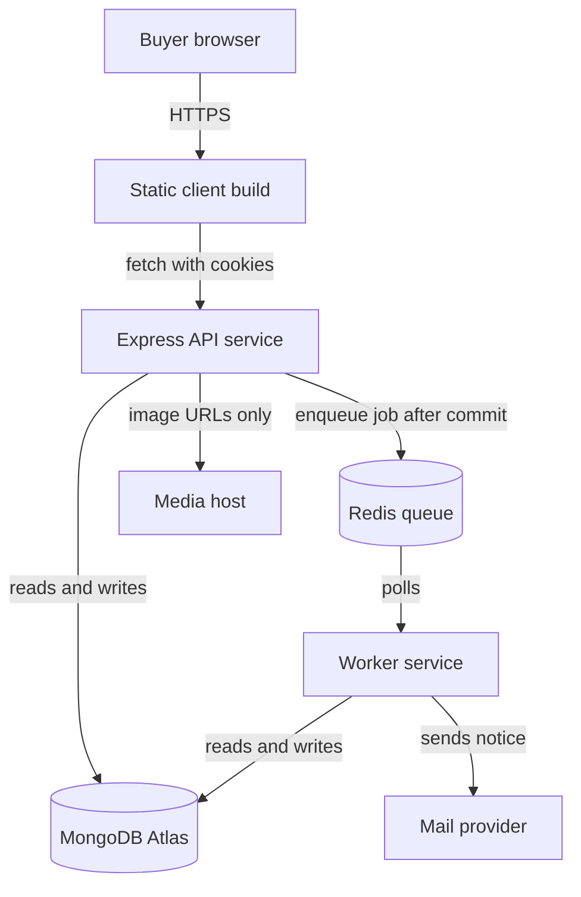

# 23.15 ,  Recap and what's next

> **[Wrap]** · Chapter 23 ,  Deploy · *Recap ,  what you built and what comes next*

Chapter 23 moved Ghurza from **localhost to a live HTTPS host**. A buyer can now open the collection from a phone, request a custom piece, and pay a deposit against a quote, while a worker process keeps running beside the API.

## What you achieved

**Production URLs** ,  the client and the API answer on HTTPS, and both are pasted into your portfolio and your learning log with the date you first deployed.

**Secrets discipline** ,  credentials live in the host's environment panel and never in the repository. `server/.env.example` documents every key a teammate needs, with placeholder values only.

**Three deployed pieces** ,  the API, the long running worker and the static client. The API and the worker are separate supervised processes that share the same code and the same database; the client is a build artifact served from a CDN.

**CORS and TLS** ,  the browser talks to the API over HTTPS with an explicit allowed origin, and `VITE_API_URL` is baked into the client at build time so no request falls back to localhost.

**Smoke tests on the live URL** ,  health, login as a workshop owner, browse the collection, and a test mode deposit, each repeated against the deployed host rather than replayed locally.

**Operational evidence** ,  correlated smoke results, a known rollback target, a measured API recovery after restart, and a queued job that survived worker downtime and still ran once.

## The deployment milestone

| Target | Status |
|---|---|
| Collection browse and Piece pages | live |
| Commission quote and deposit | live, test mode |
| HTTPS client and API | live |
| API and worker survive restart | proven |

The milestone is the deploy, not the whole final week. Compiling a project is not the same as defending it, so the remaining modules prove the parts a buyer cannot see: money that arrives without asking the buyer to trust a redirect, work that leaves the request, and reads that stay fast without lying about a sold Piece.

## What the internet changed

Running on a host changes the answers to questions that felt settled on your laptop. The environment is not a file you edited, it is a panel you fill in, and a variable added there does nothing until the process restarts. The build is not a dev server, it is a bundle built once, which is why changing `VITE_API_URL` after the build has no effect at all: that value was frozen into the JavaScript your visitors already downloaded.

Secure cookies behave differently too. On localhost you could leave `Secure` false because there is no TLS, but the live host is HTTPS and the refresh cookie needs `Secure` set or the browser will refuse to send it across a cross site request. The same site rule that was harmless in development now decides whether a silent refresh works at all, and the API needs an explicit allowed origin because the client and the API no longer share a port.

The last change is the one that catches people: nothing restarts your process when it crashes. On your laptop you watch the terminal, notice an error and press up arrow. On a host the supervisor restarts the process and you find out later from a buyer, unless you have a health endpoint and a log you actually read. That is why the operational evidence in this chapter is a screenshot of recovery rather than a promise that it would recover.

## What is actually running

Read the diagram for the things that are missing from it, because they are the design. There is no arrow from the browser to MongoDB, so a buyer cannot write to the database without passing a route. There is no arrow from the client to Redis, so the queue is invisible to the browser. And the media host only ever supplies bytes, so a photograph changes no Piece status by itself.

## Worked example: one smoke test, four answers

A smoke test is a short list of requests with an expected status and an expected body for each, run against the deployed host in order. Start with `GET /api/health` and require `readyState` connected, not merely a 200, because a process that is up with a dead database should not be reported as healthy. Then log in as a seeded workshop owner and require a 200 with an access token and a `Set-Cookie` header on the refresh cookie. Then read the collection as a buyer and require at least one available Piece with an image URL on the media host. Then create a test mode deposit against an accepted quote and require the commission to appear in the buyer's timeline after the provider event.

Run the same four with one deliberate error each and record the answers. Wrong password on login must answer 401, not 500. A buyer token on the maker dashboard must answer 403, not a filtered empty list that pretends the route worked. A quote from another workshop must answer 404 or 403 depending on your policy, and the answer has to match the policy you documented. These negative answers are what a mentor will reach for, because a build that only demonstrates the happy path has not shown that anything is protected.

## Trace one live checkout

<TraceRequest title="Smoke test on the live HTTPS host">
  <TraceStep actor="Client" label="GET /api/health on the API host" detail="Answers 200 with readyState connected, proving the service can reach the database" />
  <TraceStep actor="API" label="POST /api/auth/login as the seeded workshop owner" detail="Password compared with bcrypt, tokens issued, refresh cookie set with Secure and HttpOnly for the live origin" />
  <TraceStep actor="React" label="The deployed client loads the collection" detail="The bundle already carries the API origin, so no request falls back to localhost" />
  <TraceStep actor="Worker" label="A duplicate deposit event reaches the queue" detail="One job per fact, one notice sent, one commission timeline entry" />
</TraceRequest>

The fourth step is the one worth repeating after a restart. Deliver the same provider event twice, stop the worker between them, and start it again. If the buyer receives two notices, your job identity was not stable; if the commission never moves, the queue was not durable.

## Failure modes you will meet next

The first is a client that builds fine and calls the wrong API. If `VITE_API_URL` was missing at build time, the bundle falls back to a relative path, the static host answers 404 for `/api/...`, and the browser console shows a request to a page it never had. Rebuild, do not patch the bundle.

The second is a CORS refusal that looks like a server crash. The browser blocks the response before your code sees it, so the API log shows a successful request while the console reports a missing `Access-Control-Allow-Origin`. Allowed origin, methods and credentials have to agree with what the client actually sends, and a wildcard origin cannot be combined with credentials.

The third is a refresh that works in curl and fails in the browser. The cookie is there, the endpoint is right, and the request still answers 401 because `credentials: 'include'` was omitted or the cookie was set without `Secure` on an HTTPS origin. Check `Set-Cookie` in the network panel before touching server code.

The fourth is the worker running with the old code because only the API was redeployed. The symptom is a job that behaves like last week, and the fix is to treat both processes as one release: same commit, same environment, deployed together.

## A debugging path from the health check outward

When the live site misbehaves, work outward from the smallest request that can prove something. Call the API health endpoint from the terminal and read `readyState`. If that fails, the problem is the API process, its environment or its network access to the database, and no amount of client debugging will help. If health passes but the browser fails, check the exact URL the bundle requests and whether the response carried the CORS headers. If the request reaches the API and answers 401, the problem is credentials or cookies rather than routing.

Only after those three pass should you open the application code. This order matters because the first instinct is usually to reread the component that renders the error, and that component is the one place the bug almost never is. Write the three checks into the learning log with the answers you got on the live host. The next time the site breaks, a mentor should be able to run the same three checks in a minute.

## What this deploy does not prove

One instance is not a scaling story. The API keeps no session state, so two instances would mostly agree about who a token belongs to, but your rate limiter and any cache held in process will behave differently behind a load balancer, so say so rather than claiming horizontal scale. Restart survival proves the platform restarts a crashed process, not that your data is backed up. Media lives on a third party host, so a storage outage is outside your control and outside your recovery plan.

Money deserves the same honesty. The deposit path is test mode, the webhook was replayed deliberately, and refunds have not been exercised at all in this chapter. Say "deposit confirmed by a verified test mode webhook" rather than "payments work", because the second sentence is a claim you have not tested and a mentor can dismantle it in one question.

## Continue the final week

Your first live deploy is the midpoint of the last course week, not the end of it. Three pieces of evidence are still missing, and each has its own module.

| Next | What it proves |
|---|---|
| Module 24, production and balance | one commission from deposit to delivered, with guarded stages |
| Module 25, async jobs and queues | notices and reminders outside the request, delivered once |
| Module 26, cache and search | fast reads that never claim a sold Piece is available |
| Chapter 99, closing | README, evidence file, demo script and viva answers |

Do not skip ahead to the demo video. A recording of a working site is worth much less than a recording of a refused request with a status code and an unchanged document beside it.

## Continue to gate

**Sub-chapter 23.16:** checklist and learning log with the **live URL**, the smoke results, the rollback target and the measured recovery time.

Ghurza is on the internet. Next, prove that the money path holds: a deposit that arrives twice, a worker that stops in the middle of a job, and a buyer refresh that never asks for a password twice in one visit.
