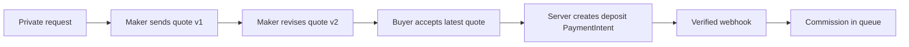

# Send a versioned quote and take one deposit

The buyer's request asked whether a workshop could make a piece. A quote answers with a promise the workshop can stand behind. It names the exact work, materials, size, included revision, production range, shipping terms and money. The buyer can ask for a change. If the workshop revises the quote, the previous version must remain visible as history but must no longer be acceptable. The accepted version becomes the evidence for a commission that may run for weeks. This module ends only when a verified deposit payment moves that commission into the workshop's queue.

The buyer does not choose the deposit amount in the browser. The quote's accepted total and deposit rule determine it. The browser can display that amount and collect payment details, but the server calculates the PaymentIntent from stored terms. A webhook, not the success-page redirect, confirms payment. A second delivery of the same success event must not create another commission, charge request or queue entry.

## Define one quote version

Create `server/src/modules/quotes/quote.model.js`. A quote has `requestId`, `workshopId`, `version`, `status`, a structured scope, total in integer minor units, currency, deposit percent, computed deposit and balance amounts, production estimate range, shipping zone and estimate, cancellation terms, valid-until time, sent-at time and the maker who sent it. Include the number of revisions in the price. Snap these terms when the maker sends the quote. Do not reference only the workshop's current default terms; those may change while the commission is in production.

Keep earlier versions immutable. A revised quote is a new document with the next version number. Put a unique index on `requestId, version`, and store the latest sent version on the request so acceptance can use a conditional update. A draft may be edited by the workshop owner. Once sent, a quote is read-only. A buyer can see every version in their own request thread, but only the latest sent, unexpired one gets an Accept action. Workshop B must not read or revise Workshop A's quote even if it guesses the ID. Buyer B must not accept Buyer A's quote.

Choose one rounding rule for money and keep it in a tested helper. For the course, calculate `depositCents = Math.round(totalCents * depositPercent / 100)` and `balanceCents = totalCents - depositCents`. Validate the percentage and positive total before the calculation. Store both amounts on the quote. For a total of 10,001 minor units at 50 percent, the deposit is 5,001 and the balance is 5,000. Their sum is always the agreed total. Do not separately round both halves: that can create or lose a minor unit. Do not use floating point currency values such as `100.01` in the database or request to Stripe.

## Accept only the version the buyer saw

Create `POST /custom-requests/:requestId/quotes/:version/accept`. Authenticate the buyer and load the request under `buyerId`. Check that the quote is `sent`, its `validUntil` is in the future, and its version equals the request's current sent version. Then use a guarded database update so only one acceptance wins if two tabs submit together. A stale version returns 409 with a message directing the buyer to the latest quote. Do not silently accept the newer quote in place of the one they clicked; its material, price or date range may differ.

Create one `Commission` from the accepted version. It stores the request parties, accepted quote ID and complete terms snapshot, with state `awaiting_deposit`. Put a unique index on accepted quote or request ID according to the workflow, so retrying Accept cannot make two commissions. The commission is not yet “in production”: the buyer may still leave without paying. A workshop dashboard can show it as awaiting deposit, separate from paid work. Its state machine grows in the next module, but the actor and quote-version checks belong here.

Create a deposit PaymentIntent on the server using the stored `depositCents` and currency. Attach a safe commission ID and payment kind as metadata for lookup, then verify against your own record when the webhook arrives. Use a stable idempotency key for the commission's deposit intent so a retry of the endpoint returns the same payment attempt rather than generating a new one. Do not reuse that key for the later balance payment; it is a separate obligation, with its own amount and PaymentIntent. Holding one card authorization for weeks is not the model taught here. The deposit and balance are two on-session test-mode payments at different stages.

In the verified webhook handler, locate the commission by its stored PaymentIntent ID and confirm amount and currency. If it is still `awaiting_deposit`, mark the deposit paid and move it to `in_queue`. Record the provider event and payment ID for investigation. If a duplicate event arrives, leave the state and paid amount unchanged. If a late event refers to a superseded or cancelled commission, do not move it into production; record an exception for a controlled refund or manual review. This is a payment boundary, so tests must cover the late path rather than assuming events arrive in screen order.

## Make the terms legible in the UI

In the workshop quote form, show the request brief beside the scope, material, total, deposit percent, balance, date range and cancellation terms. A warning appears before Send: after sending, this version becomes immutable. On the buyer page, show version number, send time, validity deadline and a line-by-line money breakdown. If the workshop sends version two while the buyer has version one open, accepting version one returns 409 and the UI loads the new terms for the buyer to review. Do not make the UI press Accept on version two automatically.

When the buyer accepts, show the deposit payment UI with the server-computed amount. After the payment form reports completion, show “Waiting for confirmation” until the commission API says deposit paid. Do not advance the timeline from a query string or redirect alone. If the webhook is delayed, the buyer needs reassurance and a support path, not a second Pay button that creates a second intent. The commission timeline should show accepted terms and verified payment as separate events.

## Verify money and concurrency

Test a quote version race: send v1, open it in Buyer A's tab, send v2, then submit acceptance of v1. Expect 409 and no commission. Accept v2 twice concurrently; expect one commission with v2's terms snapshot. Change the workshop's default deposit percent afterwards and verify the commission amounts remain the same. Submit a browser request with a forged lower `depositCents`; the server must ignore it and create the PaymentIntent for the accepted quote's stored amount.

Deliver a signed test webhook once, then again. The commission enters `in_queue` once and records one paid deposit. Deliver an invalid-signature request and an event with a mismatched amount; neither may mark the deposit paid. Turn off the browser after payment and replay the valid event: the server must still move the commission forward. If the tests fail only when run concurrently, inspect the unique index and guarded update on acceptance. If money differs by one minor unit, inspect the single rounding helper and assert deposit plus balance equals total for odd totals. Save the tests and the accepted quote snapshot in `docs/EVIDENCE.md`; Module 24 uses those exact terms to decide approval, balance and any refund.

Before moving on, ask a partner to read the accepted quote without seeing the workshop form. Can they tell what will be made, which revision is included, what dates are only estimates, when the deposit is due and what remains to pay? If not, add precise terms to the quote structure and buyer view. A technically correct PaymentIntent cannot repair an ambiguous promise between two people. The data snapshot is valuable only when its fields communicate the same agreement to both sides.
