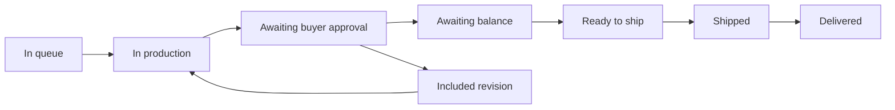

# Move a commission through production and balance

The deposit was paid yesterday. The finished piece may not exist for several weeks. During that time, the buyer needs a truthful view of progress, the maker needs room for craft work, and the platform must prevent either side from skipping a promised decision. A single “order status” dropdown is too weak. This module builds a guarded commission timeline from the paid queue to delivery, including one buyer approval and a separate balance payment.

Every arrow is a server action with an actor and a prior state. The workshop owner can start production, post progress and present finished work. The buyer can approve it or request the one included revision defined in the accepted quote. A verified balance payment moves the commission to ready to ship. The workshop can then add carrier and tracking information. The buyer can mark delivery received, or a defined support process can resolve a disputed delivery. Cancellation is a separate guarded path governed by the accepted terms and what money was actually captured.

## Model a transition as evidence

Create `server/src/modules/commissions/transition-commission.js`. Give it the authenticated actor, Commission ID, action and any required payload. Load the Commission with its accepted quote snapshot. Check actor relationship and current state, then perform a conditional update that includes the expected prior state. If two tabs send conflicting actions, one update wins and the other receives 409 with the current state. Append an audit entry with action, actor ID, server time, previous and next state and a short reason. Do not let a route accept an arbitrary target status from the browser.

Store progress updates separately or in a bounded list with stage, maker ID, text, approved photo IDs and creation time. A note saying “pattern drafted” is useful for embroidery; “bisque fired” matters for ceramics; “carving done” matters for woodwork. The fields are general, but the example and evidence must match the craft. Do not require a photo every day or publish a private buyer reference image as a public progress photo. Use the request's two-party authorization helper when listing private progress. A public product page can show selected maker-approved photos only after explicit publication.

Turn lead time into a range, not a single guaranteed date. The workshop has an active-work limit and a queue. A first estimate can combine queue position, the quoted production range and shipping range. Show the assumptions in the UI. If a material is unavailable or a power outage changes capacity, the workshop posts an update and proposes a new range rather than silently changing the accepted quote's original estimate. Preserve the original quote and the later change request, so the buyer can see what changed and decide whether to continue. A countdown that pretends a hand-made piece will be ready at one exact minute would be false precision.

## Give the buyer a real approval step

When the maker finishes, move `in_production` to `awaiting_approval` and attach the final evidence. The buyer can approve or use the one included revision if the accepted quote allows it. A revision request records a specific reason and returns the work to production. A second included revision request must be rejected or handled through a new agreed quote; the UI must not silently add unpaid work. Approval moves the Commission to `awaiting_balance`, not directly to shipped. If the maker clicks Ship before the balance is verified, the server returns 409 even if the dashboard showed an old button.

Build `POST /commissions/:id/balance-intent` from the accepted quote's stored `balanceCents` and currency. Use a new PaymentIntent and a stable idempotency key based on Commission ID and `balance`, distinct from the deposit key. The browser does not supply an amount. The webhook verifies signature, PaymentIntent ID, amount and currency and moves only a Commission currently awaiting balance to `ready_to_ship`. A duplicate success event leaves the state unchanged. A late event for a cancelled Commission goes to an investigation path rather than shipping. Test these boundaries before showing the balance button in the UI.

The buyer and maker see the same timeline with role-specific actions. Each event has a plain label, server time and the person or role that took it. The buyer sees the agreed scope, original production range, later progress, final evidence, approval action, balance status and shipping reference. The maker sees the same public-to-party events plus work actions. Do not hide a failed or pending payment behind a green “paid” chip. If the webhook is delayed, show “waiting for payment confirmation” and make the next step unavailable until the API says ready to ship.

## Decide cancellation without guessing

The accepted quote contains the cancellation terms. The Commission records its current stage and the deposit and balance amounts captured so far. A refund calculation uses those stored facts, not the workshop's current policy and not a number typed by the browser. The course test terms can define a full deposit refund before production, a partial deposit refund during production and a separately agreed outcome after approval. These are teaching terms that the workshop must show before acceptance; they are not a claim about what every marketplace should promise. Whatever the rule, a computed refund cannot exceed the remaining captured amount.

Create a refund request with a stable idempotency key and an explicit Commission state such as `refund_pending`. Stripe permits partial refunds of a captured payment up to its unrefunded remainder. The app records which deposit or balance PaymentIntent it is refunding, the amount in minor units, the accepted-terms rule used and a reason. It marks the refund confirmed only after the provider response or verified event supports that state. A failed refund stays visible for investigation; it must not be called completed in the buyer timeline. A second click must not refund the same money twice.

## Verify the complete path

Run one Commission from verified deposit through maker progress, buyer approval, verified balance, shipping and delivery. Save the timeline JSON before and after reload. Then attempt forbidden transitions: buyer starts production, maker approves their own final work, maker ships before balance, another workshop posts progress, and two tabs approve versus revise simultaneously. Each should return the expected denial or 409 without changing the timeline incorrectly. Use the test-mode provider to replay deposit, balance and refund events; no replay may duplicate a charge record or move a cancelled Commission to shipped.

When a test fails, start with the accepted quote snapshot and current Commission state. Check the action's actor, expected state, conditional update result and webhook ID in that order. A UI that hides an action cannot substitute for these checks. Record one cancellation example with the exact captured amounts, stage, terms version, computed refund and provider result. This module completes the hero workflow only when another person can repeat the end-to-end path on the live HTTPS app and explain every state change from stored evidence.

Leave a restart test in the evidence as well. Stop the API and worker after the maker posts progress but before the buyer approves. Restart both, sign in from another browser, and verify the same state, photos and accepted terms are present. Then process a delayed balance webhook from an older test Commission that has already been cancelled. The handler must recognize the stored Commission state and avoid sending that work to shipping. Long-running commissions cross process restarts, sessions and delayed events by design. A correct path cannot depend on one server process remembering what happened earlier in memory.
