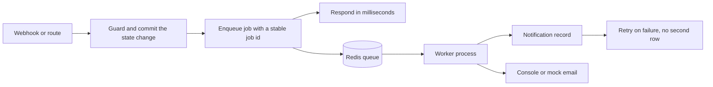

# What should not happen inside a request

A Stripe webhook arrives for Lina's deposit. The handler verifies the signature, marks the deposit paid and moves the commission into Amina's queue. Then it sends the buyer a confirmation, posts to the maker's inbox, writes an audit line, and schedules a reminder for the balance in three weeks. The handler now takes 2.4 seconds, and the payment provider waits. When the mail API is slow, it takes nine seconds. When the mail API is down, the provider marks the delivery failed and sends the same event again, and the second attempt sends a second email to Lina.

That sequence is the reason this module exists. The work that must be true in the database is small and fast. The work that talks to the outside world is slow, unreliable and allowed to happen twice. Mixing them means a slow mail server can change whether a deposit counts as paid, which is absurd when you say it out loud. Ghurza answers the provider in milliseconds and hands the rest to a worker.

The rule that follows is short enough to remember. A request does the work a caller needs to see in the response: authenticate, validate, change durable state under a guard, return the new state. Everything else leaves the request before the response is written. A worker does that other work, and the worker is designed on the assumption that it will run the same job more than once.

The diagram has one asymmetry worth noticing. The left column finishes before the right column starts, and the response does not wait for anything on the right. That is the whole design. It also shows that the worker writes a notification record before it sends anything, which is how a retry finds out that the message already went out.

## Four kinds of background work in Ghurza

The commissions in this product generate four different shapes of work, and each one needs a different scheduling decision.

A **notification** follows a fact that already happened: an order was paid, a quote was sent, a deposit was received, a production stage was posted. It runs soon, it talks to the outside world, and it must not run twice.

A **delayed job** is scheduled for a named future time. A quote that is valid until Friday at 18:00 needs a reminder on Thursday evening and an expiry on Friday evening. Both are jobs with a delay, and neither can be replaced by a request, because no request happens at those times.

A **sweep** runs on a schedule. Expired piece holds should not sit on the collection page as unavailable forever, and a stale unpaid payment attempt should be cancelled so the piece can be bought by someone else. A sweep looks for a condition and fixes what it finds, and running it twice is harmless by construction.

A **reminder** is tied to a person who has stalled: a buyer who has not paid a balance, or a maker who has posted nothing for a week. It is a notification with a clock attached, and it must stop when the underlying fact changes.

One queue and one worker process can serve all four. Four mechanisms would be four ways to forget a detail.

## The database guard stays the truth

A worker is not a source of truth, and a timer is not a rule. If the quote expiry job is late by ten minutes because the machine was busy, the buyer's acceptance route must still refuse a quote whose `validUntil` has passed. If the hold sweep is late by an hour, checkout must still treat an expired hold as claimable, because it already compares the expiry inside the same conditional update.

Read that again as a design rule. Every worker in this module does one of two things: it writes a notification about a fact that is already recorded, or it moves a record forward under the same guard the request path would use. No worker invents a state because a timer went off. A quote is expired because the clock passed its expiry and the acceptance route agrees, not because a job remembered to run.

The same rule explains why a worker may run twice. If the second run finds the state already correct, it does nothing. If it finds a notification record for the same fact, it skips the send. Idempotence lives in the data, not in a hope about the scheduler.

## Delivery happens at least once

BullMQ pushes a job to a worker and waits for the worker to finish. If the worker dies mid job, the job returns to the queue and another worker picks it up. That design is right, and it means every handler will occasionally run after a previous attempt already did part of the work. The right conclusion is not "make the worker reliable". It is "make the effect safe to repeat".

Use `jobId` to stop the same fact from being enqueued twice. A job id built from the fact itself, such as `commission-deposit-paid:<commissionId>`, means a duplicate webhook that tries to enqueue a second notification finds the first job already waiting or running. Three weeks later, when the completed job has left the queue, that same id proves nothing. So the handler also needs a durable record: one notification row with a unique index on the fact and the audience. Two guards, one for the queue and one for the database.

Retries are for the outside world, not for your own validation. A 500 from a mail provider deserves a retry with backoff. A job whose commission no longer exists will fail the same way on every attempt, so mark it unrecoverable and let it land in a failed set that a person can read. A queue that retries a permanent error eight times is a queue that hides a bug behind noise.

## What this costs

A worker is a second process. It needs the same environment variables, the same database access and the same deploy. In development that means a second terminal, and on the live host in Module 27 it means a service that restarts with the API. A learner who runs only `npm run dev` will see notifications queue up and never arrive, and that is a five minute confusion, not a mystery, if the README says so.

Redis becomes a dependency for the whole path. If it is down, enqueue fails, and the request must still succeed after the state change. The honest handling is to catch the enqueue error, log it with the fact it wanted to announce, and let a sweep find unannounced facts later. Do not roll back a paid deposit because a queue was unavailable. Payment truth outranks notification convenience.

The lighter alternative is worth naming. A single process with `setTimeout` looks simpler for a small build, and it loses every pending timer on restart, which is exactly when a reminder matters. A database polling loop with a `dueAt` field works without Redis, and it is a reasonable choice if you already have one process and low volume. This course uses BullMQ because delayed jobs, retries and job ids are the three features the commission workflow needs, and building them by hand would take longer than reading the documentation.

## The boundary you are drawing

After this module, a payment webhook returns without sending anything, and a worker sends the notification a fraction of a second later. A quote carries a scheduled reminder and a scheduled expiry. A commission posts a stage notice that reaches the buyer once, even if the maker's browser submits twice. The list is not a general queue tutorial. It is the shortest set of jobs that the commission path needs, with the failure cases that a real marketplace hits in its first month.

Write down, before you build, which facts in Ghurza deserve a notification, which need a timer, and which need a sweep. Then write the sentence for each one that says what happens when the job runs twice. The next lesson builds the worker that has to keep those promises.
