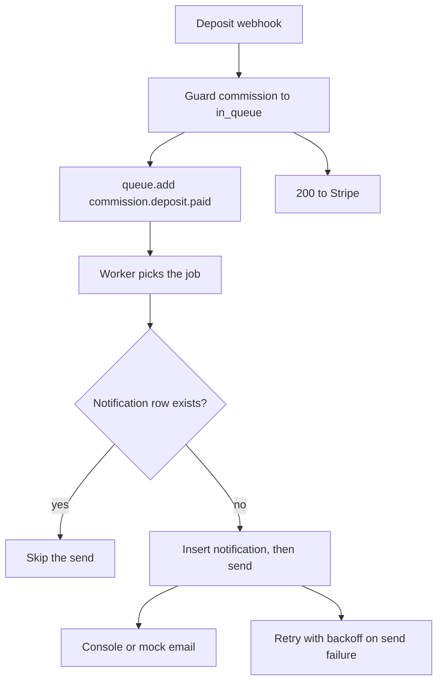

# Worker, quote reminders and production notifications

The worker is a second entry point into the same code. It connects to MongoDB and Redis, registers one handler per job name, and waits. Nothing in it knows about HTTP. That separation is what lets the API answer a webhook in forty milliseconds while the notification for the same event is still being written.

Create `server/src/queues/connection.js` for the Redis connection, `server/src/queues/index.js` for the queue names, the payload types and the enqueue helpers, and `server/src/worker.js` as the process entry point. Add `"worker": "node server/src/worker.js"` to `package.json`. In development you run `npm run dev` and `npm run worker` in two terminals. On the live host in Module 27 both run as services.

```ts
type JobName =
  | "order.paid"
  | "commission.quote.sent"
  | "commission.deposit.paid"
  | "commission.progress.posted"
  | "quote.remind"
  | "quote.expire";

interface JobPayloads {
  "order.paid": { orderId: string };
  "commission.quote.sent": { quoteId: string; version: number };
  "commission.deposit.paid": { commissionId: string };
  "commission.progress.posted": { commissionId: string; updateId: string };
  "quote.remind": { quoteId: string; version: number };
  "quote.expire": { quoteId: string; version: number };
}
```

Each payload carries identifiers, never display text. A job that holds a price, a title or a buyer name is a job that can deliver stale copy three days after the workshop changed its mind. The processor loads the current record and builds the message from it.



The branch in the middle is the whole idempotence story. The worker asks the database whether this fact has already been announced, and the unique index behind that question is what makes a second attempt harmless.

## One notification record, two guards

Add a `Notification` collection with `type`, `subjectId`, `audience` (buyer or maker), `channel`, `sentAt`, `payloadSummary` and `createdAt`. Put a unique index on `{ type: 1, subjectId: 1, audience: 1 }`. The handler inserts the row first with `sentAt` empty, sends the message, then stamps `sentAt`. A duplicate insert tells the handler that this fact is already claimed. If the stored row has a `sentAt`, the message went out and the handler returns. If it does not, an earlier attempt died between the insert and the send, so this attempt sends again and stamps the row. One row, at most a couple of sends, and no growth.

The queue side gets the same protection from `jobId`. Build it from the fact, not from the clock: `commission.deposit.paid:<commissionId>`, `commission.progress:<updateId>`, `quote.expire:<quoteId>:v<version>`. A webhook delivered twice tries to add the same id, and BullMQ keeps one job. That guard only covers jobs still in the queue, which is why the database guard exists as well. Two guards, two different lifetimes.

```js
// server/src/queues/index.js
export async function enqueueDepositPaid(commissionId) {
  await notifications.add(
    "commission.deposit.paid",
    { commissionId },
    {
      jobId: `commission.deposit.paid:${commissionId}`,
      attempts: 3,
      backoff: { type: "exponential", delay: 5000 },
      removeOnComplete: { age: 86400, count: 5000 },
      removeOnFail: false
    }
  );
}
```

`removeOnFail: false` keeps a failed job readable. A queue that deletes its failures cannot be debugged, and the first morning you need it is the morning it is empty.

## Schedule the quote reminder and the expiry

A quote sent on Monday with `validUntil` on Friday at 18:00 needs two future events: a reminder on Thursday evening, and an expiry at the deadline. Both are delayed jobs, and the delay is a number of milliseconds computed at send time.

```js
const validUntil = quote.validUntil.getTime();
const now = Date.now();

await quoteQueue.add("quote.remind", { quoteId, version }, {
  jobId: `quote.remind:${quoteId}:v${version}`,
  delay: Math.max(0, validUntil - 24 * 60 * 60 * 1000 - now)
});

await quoteQueue.add("quote.expire", { quoteId, version }, {
  jobId: `quote.expire:${quoteId}:v${version}`,
  delay: Math.max(0, validUntil - now)
});
```

The reminder handler loads the quote and sends one message to the buyer only if the quote is still `sent` and still unexpired. A quote that was accepted on Tuesday must not be reminded about on Thursday. The expiry handler is stricter: it may set `status: "expired"` only on a quote that is currently `sent` and whose `validUntil` is in the past. If a job runs early because a clock drifted or a delay was computed on a machine with the wrong time, the expiry handler does nothing and the quote stays acceptable.

The acceptance route from Module 23 keeps its own comparison against `validUntil`. That is deliberate duplication. The job exists so the buyer sees a clean state and a reminder; the route exists so a late or missing job cannot allow an expired quote to be accepted. When the two disagree, the route wins.

## Notices for orders and production stages

Four notification jobs cover the commission path. `order.paid` goes to the buyer and the maker when an order becomes paid, and it names the order and the workshop. `commission.quote.sent` goes to the buyer with the version number. `commission.deposit.paid` goes to the maker and tells them the work is in the queue. `commission.progress.posted` goes to the buyer and names the stage the maker wrote, such as pattern drafted or bisque fired.

The progress notice is the one that most easily duplicates, because the maker's form may submit twice on a slow connection. The commission update has its own `updateId`, and the job id is built from it, so the second submit finds the first job and the notification index catches the case where both run. If you build the job id from `commissionId` alone, the second stage notice overwrites the first, and the buyer never hears about the carving that happened after the firing.

Write the mailer as a small module with one function, `send(message)`, that writes a console line and, if a provider key exists in the environment, calls it. The course does not require a real email account. It requires that the send call is the only thing that can fail slowly, and that it sits behind the notification record.

## Fail, retry, and know when to stop

A send that fails with a network error or a 5xx throws, and BullMQ retries with the configured backoff. A job whose commission no longer exists, or whose payload is missing an id, throws an `UnrecoverableError` so the job lands in the failed set on the first attempt. Retrying a permanent error five times fills the log with the same line and teaches nobody anything.

Wire `worker.on("failed", ...)` to write one structured line with the job name, the job id, the attempt number and the reason. That line is how you will answer "did Lina get the deposit message" without opening a database client. Also handle `SIGTERM` and `SIGINT` by closing the worker so an in-flight job finishes instead of being re-delivered mid send.

Then test the three behaviours that matter, and expect all three to fail before you build them.

```js
// server/src/worker.test.js
test("the deposit webhook answers before the message is sent", async () => {
  const sent = [];
  mailer.send = async (message) => sent.push(message);

  await request(app).post("/api/webhooks/stripe").set("Stripe-Signature", signature).send(depositEvent);

  expect(sent).toHaveLength(0);
  await drainQueue("commission.deposit.paid");
  expect(sent).toHaveLength(1);
});

test("the same deposit event processed twice sends one message", async () => {
  await drainQueue("commission.deposit.paid");
  await drainQueue("commission.deposit.paid");

  expect(await Notification.countDocuments({ type: "commission.deposit.paid" })).toBe(1);
});

test("an expiry job that runs early leaves the quote acceptable", async () => {
  const quote = await Quote.create({ ...quoteFixture, status: "sent", validUntil: futureDate });

  await runHandler("quote.expire", { quoteId: quote.id, version: quote.version });

  expect((await Quote.findById(quote.id)).status).toBe("sent");
});
```

The first test is the one that separates a queue from a comment. If it passes only because you stubbed the mailer out of the request entirely, run your webhook once against the real console mailer and watch the order of the two log lines. The response line must appear before the notification line, and the gap should be visible without a stopwatch.

```quiz
type: mcq
id: handmade-async-jobs-q1
question: A job fails because the commission it names no longer exists in the database. What should the worker do with it?
options:
  - Retry it three times with exponential backoff
  - Fail it once and keep it in the failed set
  - Delete the job and carry on without a trace
  - Move it to the completed set with a short note
correct: 1
explanations:
  - A missing record fails the same way on every attempt, so time is wasted.
  - A permanent error is visible evidence, and the record stays readable.
  - Deleting it hides the defect that removed the commission.
  - Completed means the work happened, and here it did not.
```

## Watch the queue, not the log

Three views tell you whether the worker is healthy, and none of them is the API log. The first is the queue itself: waiting, active, delayed and failed counts per queue name. A delayed count that never falls means a delay was computed wrong, usually by mixing milliseconds with seconds. The second is the notification table: one row per fact, with a `sentAt` that is either set or null. A row with a null `sentAt` after a minute is a send that failed or a worker that is not running. The third is the failed set, which is the only place where a permanent error waits for a person.

Build a small script or a test helper that prints those three views, and run it before you record the gate. It takes a minute and it replaces an hour of reading console output in the wrong order. In Module 27 the same three checks become the smoke test for the deployed worker, because a host that runs the API and forgets the worker looks perfectly healthy from the browser until nothing arrives.

## Keep the request path clean

Enqueue after the state change commits, never before. A job that runs before its fact exists loads a pending commission, fails, retries, and may announce something that never became true. If the enqueue itself throws because Redis is down, log the fact and keep the response. A paid deposit does not become unpaid because a queue was unavailable.

Do not await `queue.add` inside a database transaction, and do not enqueue from a Mongoose pre-save hook. Both tie the job to a write that may still roll back. Call the helper from the route or the service after the guarded update returns a document.

Finally, write the runbook line in your README: how to start the worker, how to see the queue, and what to do when the API is up and nothing arrives. One sentence each. The next lesson's gate will restart the worker while a job is waiting, and the README should already say what you expect to see.
