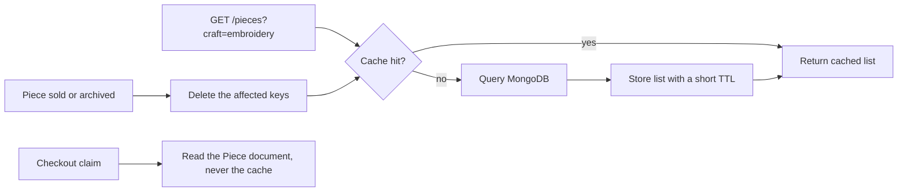

# What may be cached in a one-off catalogue

The collection page is the most read page in Ghurza and the least changed. Twelve pieces sit in the seed, a workshop edits one every few days, and a buyer scrolls the same filtered list many times in a session. That is the shape of problem a cache solves: one answer, requested often, changed rarely.

A one-off piece makes the problem harder than it looks. The list says available or sold, and that word is a claim about one physical object. If the cached list still says available for a bowl that Lina bought ten minutes ago, the page has told a lie that ends in a checkout conflict. So the rule for this module is narrow on purpose. Cache the collection. Never let a cache decide whether a piece can be bought.

This module is also where search arrives. A buyer who wants an embroidered piece, a ceramic bowl with a green glaze, or work credited to a particular artisan should find it by craft, by material, or by the workshop that made it. With twelve pieces, a scan of every document answers in milliseconds. With five thousand pieces on a phone over a slow connection, a scan is the difference between a page and a wait. The index is not there because indexes are good. It is there because of that second case, and the lesson shows how to measure which one you have.

Two arrows carry the argument. The invalidation arrow from a sale deletes the keys, so the next read rebuilds. The arrow from a checkout claim never touches the cache at all. The cache serves browsing. The claim is a decision about money, and it reads the document it is about to change.

## What belongs in the cache

A cache entry is a copy of an answer that several people want. The safe entries in Ghurza are the public collection responses: one page of pieces for a craft filter, a workshop filter, a ships-to country and a page number. Those responses are the same for every visitor who applies the same filters, and a minute of staleness changes nothing that costs money.

The unsafe entries are anything a decision depends on. A piece's availability, a hold expiry, a quote's `validUntil`, a commission's state, a cart, an order. Those reads must come from the document, because the next step after reading them is usually a guarded write. A cache can be a second behind. A guarded write cannot.

There is a middle case worth naming: the count on a filter, such as how many embroidered pieces exist. A slightly stale count is fine on a browse page and wrong in a receipt. Cache it with the list and use the same key, so the two never disagree with each other.

## A key is a promise about what the answer depends on

If two different questions share one key, one of them gets the wrong answer. The collection endpoint varies by craft, workshop, ships-to country, page and page size, so the key must carry every one of those values. A key of `pieces:page:1` ignores the country filter, and a buyer in a country that one workshop does not serve sees a list that includes its pieces. That is not a slow page. That is a false statement about shipping.

Write the key builder once, as a function that takes the same parsed query object the route uses. Then no route can invent a key by hand and forget a field. Normalise the values: lowercase the craft, sort the workshop ids, default the page size, and drop parameters that do not affect the result. A key with a random cookie or a session id in it is a key that never hits, which is a cache that costs a Redis call per request and saves nothing.

Set a short time to live, around thirty to sixty seconds, and treat it as a safety net rather than the main mechanism. The main mechanism is deletion on the events that change the answer. If a deletion is ever missed because a process crashed between the write and the delete, the TTL bounds how long the wrong answer survives.

## Delete on the events that change the answer

Four events change a collection answer in Ghurza, and each one needs a deletion rather than an update. A workshop saves or publishes a piece, which adds a row or changes a price. A piece is archived, which removes it from the default list. A piece is sold by a verified payment, which removes it from the available list. A hold is claimed or released, which may change whether the piece appears at all.

Deleting every collection key on each of those events is the simple, correct choice at this size. A finer scheme that deletes only the keys a piece could appear in is possible, and it is where cache invalidation bugs live, because the piece can appear under several crafts, several workshop filters and every country the workshop serves. Start with a version counter: keep one Redis key such as `pieces:version`, include its value in every collection key, and increment it on a change. Every old key becomes unreachable at once, the TTL clears the memory, and no filter is forgotten. It costs a version read per request and it removes a whole class of bugs.

The version counter has one trap. Two API processes that each cache the version in memory will disagree after an increment, and one of them serves stale lists until it restarts. Read the version from Redis on each request, or store it in the database, and accept the extra round trip. A local variable named `currentVersion` is how this design fails in production and passes in development.

## Search by craft, material and maker

A buyer searching "olive wood tray" is asking three different fields at once. The craft is woodwork, the material is olive wood, and the word tray appears in the title. A buyer searching a workshop name is asking about a document that is not the piece at all, because the workshop name lives on the Workshop and the credited artisan's display name lives on the Artisan.

MongoDB's text index searches the fields you declare on one collection. That means the piece document has to carry the words a buyer will type. Add a `makerText` field to Piece, built from the workshop name and the credited artisan's display name, and index it beside the title, the craft and the materials. Then one text query answers a search that spans four documents.

The honest cost of that decision: a denormalised field can go stale, and a rename in one workshop must touch every piece it owns. At the size of this course that is a loop over a handful of documents. At ten thousand pieces it becomes a background job, which is a real operational cost you should name before choosing it.

Then measure. Run the query with `explain("executionStats")` and read the winning plan. A text query on an indexed field names the index and reports a small number of examined documents. A regular expression such as `/wood/i` on the same field reads every document in the collection. You do not need to trust the word of this chapter: both plans are one line in the shell, and the difference is the whole reason the index exists.

## Failure modes worth naming

The first is a cache that answers a checkout question. If the claim route reads the cached collection to decide whether a piece is available, two buyers can both read available from a stale list and both attempt the same claim. Module 19's conditional update saves the day only because it re-checks the document. Never give the claim a cached input in the first place.

The second is the empty result cached during a deploy, when the database connection is not ready. The list is empty, the key is written, and every buyer sees an empty shop for the length of the TTL. Skip the write when the query returned nothing and the database reported an error, and log it.

The third is a shared key for a private answer. A cart, an order and a commission are not cacheable in a shared store, because the key would have to include the buyer, and one mistake in that key shows one person another person's data. Keep the cache to public collection reads and the question disappears.

## What this buys and what it costs

A cache adds a second place where the truth can live, so it adds a way to be wrong. In exchange, the browse page stops asking MongoDB for the same twelve documents on every scroll, and the database has room for the writes that matter: claims, payments, progress updates. A search index adds a write cost on every piece save and a field that must be maintained, and it turns a scan into a lookup when the catalogue grows.

Neither is required to sell one piece correctly. Both are required to keep the read path honest at the size the capstone claims to handle. Write down, before you build, which responses you will cache, which reads you will refuse to cache even when it would be faster, and the exact events that delete a key. The next lesson builds that list, then proves it with a sale.
