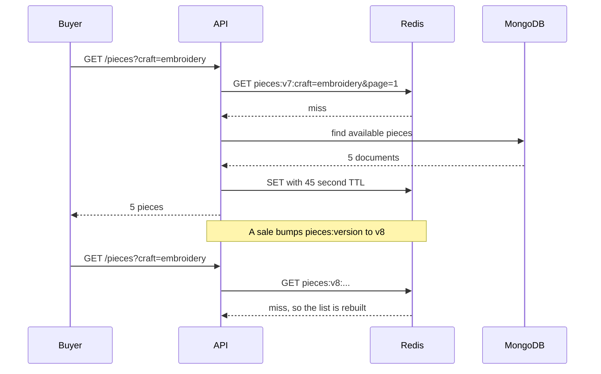

# Cache collections, invalidate on sale, search craft and maker

Build the cache behind one function, so that a route can ask for an answer without knowing where it came from. The function takes a key, a lifetime and a loader. It reads Redis, returns a hit, or calls the loader and writes the result. Every collection route then looks like a normal route with one wrapper around its query.

Create `server/src/lib/cache.js` with one exported `cached` helper and one `invalidatePieces` helper, and keep the Redis client in `server/src/lib/redis.js` so the worker and the API share one connection setup. Wrap every Redis call in a try and a catch that returns null on failure. A cache that throws when Redis blinks turns a slow page into a broken one.

```js
// server/src/lib/cache.js
export async function cached(key, ttlSeconds, load) {
  try {
    const hit = await redis.get(key);
    if (hit) return JSON.parse(hit);
  } catch (error) {
    logger.warn("cache read failed", { key, reason: error.message });
  }

  const value = await load();

  try {
    await redis.set(key, JSON.stringify(value), "EX", ttlSeconds);
  } catch (error) {
    logger.warn("cache write failed", { key, reason: error.message });
  }

  return value;
}
```

The order matters. The loader runs whenever the cache is unavailable, so a Redis outage costs speed and nothing else. A failed write is logged and ignored, because the answer is already in the response.



That diagram is the answer to "what happens after a sale". The version component in the key changes, every old key becomes unreachable, and no code has to remember which filters a sold piece appeared under.

## One version key, one deletion rule

Add `pieces:version` to Redis and an `invalidatePieces()` helper that increments it. Include the current version in every collection key, and read it from Redis on each request rather than from a module variable. A cached version in memory is the bug this design invites, because two API processes then serve two different views of the same shop until one restarts.

Build the key in one function that takes the same parsed query the route uses, so no route can invent a key and forget a field.

```ts
interface CollectionQuery {
  craft?: string;
  workshopId?: string;
  shipsTo?: string;
  q?: string;
  page: number;
  pageSize: number;
}

function collectionKey(version: string, query: CollectionQuery): string {
  return [
    `pieces:v${version}`,
    `craft=${(query.craft ?? "any").toLowerCase()}`,
    `workshop=${query.workshopId ?? "any"}`,
    `shipsTo=${query.shipsTo ?? "any"}`,
    `q=${(query.q ?? "").trim().toLowerCase()}`,
    `page=${query.page}`,
    `size=${query.pageSize}`
  ].join(":");
}
```

Call `invalidatePieces()` from every write that changes the answer: piece create, piece update, piece archive, the hold claim, the hold release and the payment webhook that marks a piece sold. Put the calls in the service functions rather than in the routes, so a future job that archives a piece gets the same behaviour as a maker pressing the button.

If you prefer to delete keys directly instead of bumping a version, use `SCAN` with a pattern and `UNLINK`, never `KEYS`. The `KEYS` command blocks Redis for every key in the database, and a marketplace does not get to block its own cache. The version approach avoids the question entirely at this size, and that is why it is the one to build.

## The tests that fail today

Write three tests before the wiring. Each one fails for a reason you can name.

```js
// server/src/modules/pieces/pieces.cache.test.js
test("a sold piece leaves the cached collection on the next read", async () => {
  await request(app).get("/api/pieces?craft=embroidery");
  await markPieceSoldByWebhook(coverId);

  const res = await request(app).get("/api/pieces?craft=embroidery");

  expect(res.body.items.map((item) => item.id)).not.toContain(coverId);
});

test("checkout ignores a cached list that still shows the piece available", async () => {
  await request(app).get("/api/pieces?craft=embroidery");
  await markPieceSoldDirectlyInDatabase(coverId);

  const res = await request(app)
    .post("/api/checkouts")
    .set("Authorization", `Bearer ${linaToken}`)
    .send({ pieceIds: [coverId], requestKey: "race-cache-1" });

  expect(res.status).toBe(409);
});
```

The second test is the one that keeps the whole module honest. It passes only if the claim path reads the Piece document, because the cached list still contains the cover at that moment. If someone later "optimises" the claim by reading the cached list, this test turns red.

```js
test("a material search uses the text index", async () => {
  const total = await Piece.countDocuments();
  const plan = await Piece.find({ $text: { $search: "olive wood" } }).explain("executionStats");
  const winning = JSON.stringify(plan.queryPlanner.winningPlan);

  expect(winning).toContain("piece_search");
  expect(plan.executionStats.totalDocsExamined).toBeLessThan(total);
});
```

Run that one against a regular expression query as well, such as `{ materials: /wood/i }`, and read a collection scan that examines every document. Seeing both plans once is worth more than remembering the word index. The text plan names the index, and the regular expression plan reads the collection from the first document to the last.

## Index the words a buyer types

Declare the text index on the fields you search, with weights that put the title first.

```js
pieceSchema.index(
  { title: "text", craft: "text", materials: "text", makerText: "text" },
  { weights: { title: 6, craft: 4, materials: 3, makerText: 2 }, name: "piece_search" }
);
```

`makerText` is the one field you have to maintain. Build it in the same service that saves a piece, from the workshop name and the credited artisan's display name in whatever form the artisan chose. When a workshop renames itself, update `makerText` on its pieces in one `updateMany`. Skip that loop and a buyer searching the new name finds nothing, while the piece page shows the new name in the header. That mismatch is the cost of denormalising, and the loop is the price.

For the collection page, combine the text search with the existing filters rather than replacing them. A query with `$text` and `status: "available"` and a ships-to condition still uses the index for the text part and filters the rest. Add the search term to the cache key, normalised to lowercase and trimmed, so "Olive Wood" and "olive wood" share one entry.

## Wire the search into the page

Add a search input to the collection page, above the filter bar, with a short debounce so a phone on a slow connection does not send a request per keystroke. Keep the query in the URL, so a buyer can share a link to a search and the back button works. Show the term in the input on load, and offer a clear control that removes it.

At 360 pixels the input takes the full width and the filter chips wrap below it. Show a result count in words, such as five pieces for olive wood, and an empty state that suggests a broader term rather than apologising. Do not hide the filters when a search is active, because a buyer who searches for a material may still want only one workshop.

Then measure the read path before and after. Log the number of MongoDB queries per request, or count them with a small test that wraps the model, and run twenty sequential requests for the same filter. Before the cache, twenty queries hit the database. After it, one does, and the rest are Redis reads. Write those two numbers in your notes, because "faster" without a count is a feeling.

## Why a lifetime alone is not enough

A short time to live feels like a complete answer, and it is the answer most tutorials give. Set forty five seconds, and the page can be at most forty five seconds wrong. That sentence is true and it hides the interesting part, because forty five seconds is long enough for a buyer to see a bowl as available, press checkout and be told it sold, while the list still shows it as available to the next shopper.

The lifetime is a safety net for a deletion that never happened. It is not the mechanism that keeps the page correct. When a payment webhook marks a piece sold, the sale is a fact with a moment attached, and the list should stop showing the piece at that moment rather than at the end of an arbitrary window. Deletion on the event gives you that. The lifetime bounds the damage when a process dies between the write and the delete.

The same reasoning explains why a longer lifetime is a bad trade even when the page is mostly stable. Doubling the lifetime halves the database reads and doubles the window in which a sale is invisible. At the size of Ghurza, the reads a collection page saves are cheap and the stale sale is expensive, so the choice is not close. Write the number and the reason in the code comment beside the TTL, because the next person will want to raise it.

## The sale, from the webhook to the list

Follow one sale through every layer, because this is the path a reviewer will ask you to trace. The payment webhook verifies its signature and calls the same claim service the checkout uses. The service runs a conditional update on the piece, sets it to sold, and writes the order line. Then the webhook handler calls `invalidatePieces()`, which increments the version key. The webhook returns to the provider. The next collection request builds a key with the new version, misses, queries MongoDB and returns a list without the piece.

Two details decide whether that works. The invalidation call sits after the write, not before it, and it runs even when the response is already decided. If the increment fails because Redis is down, the TTL still clears the stale list within the configured window, and the log line records that a manual clear may be needed. Write that log line, and make it name the version key, so a tired person at midnight can find it.

Then check the other direction. A buyer opens the list, a piece sells, and the buyer presses checkout for it. The claim reads the document, sees `sold`, and answers 409 with the piece named. The page then refetches the collection, which now misses the stale key and shows the truth. That sequence, seen twice in one session, is the clearest proof that the cache serves browsing and the database decides sales.

```quiz
type: mcq
id: handmade-cache-search-q1
question: Which of these reads may be served from the shared Redis cache in Ghurza?
options:
  - The availability flag used by a checkout claim
  - A page of the public collection for one filter
  - A quote deadline used by the accept route
  - A buyer's own cart contents after a removal
correct: 1
explanations:
  - A claim decides money, so it must read the document it changes.
  - Collection pages are public, repeated and cheap to serve a little stale.
  - An expired offer must be refused from stored data, not a copy.
  - A private answer needs a per buyer key, and one slip shows another person's data.
```

## When Redis is not there

Stop Redis and load the collection. The page must render, the response time will rise, and the log will carry one warning per request. Nothing may return a 500, and no route may fall back to a cached value in process memory, because that is a second cache with no expiry and no invalidation.

Then run the sale test again with Redis down. The piece must leave the list on the next read, because the database was always the answer. A cache outage is a performance event. A sale that does not appear is a correctness event, and the design above keeps the second one impossible.
