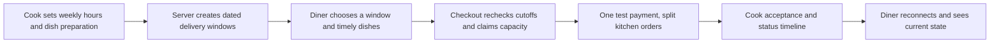

# Build Sufra, a marketplace for home-cooked meals

Lina wants lunch delivered around 13:00. She finds maqluba from Umm Yousef's Kitchen and falafel from Abu Sami's Table. Both kitchens can serve her area, and both have a delivery window that begins at 13:00. At 11:31, the falafel can still be ordered. The maqluba cannot: it needs 90 minutes to prepare and a 20-minute travel buffer, so its last safe order time was 11:10. A page that shows both dishes as available because units remain would make a promise the first cook cannot keep.

Sufra is a multi-kitchen marketplace. A cook publishes dishes, a weekly schedule, dated exceptions, capacity and a service area. A diner chooses a delivery window, sees kitchens that can still prepare food for it, builds one cart across kitchens and pays once. The platform splits the purchase into one order per kitchen. The diner then follows each order through acceptance, cooking and dispatch, even if the phone connection drops for a while.

The central constraint is cooking capacity tied to time. A shop with shelf stock can keep an item until someone buys it or it spoils. A kitchen's 13:00 lunch effort cannot be saved for tomorrow. A slow dish may close before a fast dish in the same window. Several small orders may fit until their combined load fills the kitchen. A successful browse response is only a recent view of those conditions, not a reservation.

## The promise Sufra makes

Sufra sells a dated meal promise. The diner needs to know which kitchen will prepare it, the price, what is in the dish, the chosen delivery interval, and the latest time to order. Once paid, that promise is copied into the order. A later edit to a menu, price or schedule must not rewrite what the diner bought. The cook needs a clear view of work to accept and a deadline for responding. The platform needs enough evidence to explain a rejection or refund.

The diagram shows the path from a cook's recurring rule to one paid meal. Read each arrow as a state change or a fresh server decision. The diner can leave between any two arrows, so Sufra must be able to resume or reject safely.

The most important recheck happens at checkout. A dish might be timely when added to a cart and late while the diner enters payment details. Another diner might claim the last three cooking units after the page loads. The server decides from its current clock and an atomic capacity update. It does not accept a phone's countdown or yesterday's browse result as authority. A failed checkout should tell the diner whether time or capacity caused the problem and offer a useful next window.

## One window, several kitchens

The cart is bound to one selected delivery interval. Lina can include dishes from two kitchens that both offer a matching interval. Each kitchen has its own dated window record, capacity, general cutoff and travel buffer. The platform checks every group and creates one draft order per kitchen. It starts one payment only when the whole cart can be prepared. If one kitchen is full, it releases any earlier holds and asks Lina to review a changed cart. It does not silently charge for only half of the meal.

The amount of kitchen effort is measured in load units. A tray of maqluba may use three units; a falafel wrap may use one. These numbers are a small planning model, not a claim that all cooking takes the same time. Preparation minutes determine whether an order is timely. Load units determine how many orders the kitchen can accept for that window. Both are needed. A quick dish can be too heavy for the remaining capacity, and a light dish can be too slow to finish by 13:00.

At the last spot, two diners may press checkout together. Sufra must let only one claim the units. Later, if payment fails or a short hold expires, the units must be released exactly once. A second release must not create more capacity than the kitchen offered. This is why the course asks for a parallel checkout test against real MongoDB, not only a demonstration with one browser.

## The order continues after payment

The cook has an acceptance deadline. One kitchen may accept while another does not answer in time. The diner deserves a status view that says what is known, what is delayed and which part of the shared purchase needs a refund. Sufra records a sequence of order events and sends updates through a live connection. On reconnect, the diner gets a fresh snapshot before later changes so a weak connection does not hide an important decision. A polling fallback gives a simpler path when a stream cannot stay open.

This tracking feature is deliberately status based. It does not follow a rider on a map or expose anyone's location. The hard engineering work is the state machine, event order, reconnection and honest stale-state message. A page that says "preparing" forever after the network dies is not useful. A page that says "last updated two minutes ago, reconnecting" lets the diner understand its limit.

The platform also protects people. A cook sees their own kitchen orders, not another kitchen's sales. A diner sees their own orders and addresses, not another diner's. An address is shared only with the kitchen that needs it to fulfil an accepted order. Payment card details belong to Stripe's test flow, not Sufra's database or logs. These rules are part of the product, not extras to add after the interface looks finished.

## What you will build and prove

In Week 1, both apps run, the core model exists, and you can explain the difference between a weekly rule and a dated delivery window. In Week 2, a cook publishes dishes and a schedule, and the app generates seven days of windows with correct cutoffs and exceptions. In Week 3, a diner chooses a window, builds a multi-kitchen cart, pays in test mode, and sees split orders. You prove that concurrent checkout does not overbook. In Week 4, cook acceptance, live tracking, background jobs, deployment and a two-phone demo show what happens after payment and after a connection drops.

The evidence is concrete: an ERD, dated window calculations, a clock-boundary test, a twenty-request capacity race, webhook replay tests, an authorization matrix, an order timeline trace and a live HTTPS URL. Keep the commands and outputs in `docs/EVIDENCE.md`. A reviewer should be able to ask why maqluba closed at 11:10, why only one diner won the last spot, and how a missed status event becomes visible after reconnect. Your records should answer those questions.

## Start with one dated promise

Create `docs/product-brief.md`. Write two sentences explaining whom Sufra serves and why time and capacity are the hardest constraints. Add one fictional kitchen and one fictional diner for tests. Give the kitchen an IANA time zone, a 13:00 to 14:00 dated lunch window, a general 12:00 cutoff, a 20-minute travel buffer, a slow dish and a fast dish. Calculate each dish's latest safe order time by hand. The code will come later; the numbers make the problem visible now.

Write three open questions below that example: who decides whether a dish is still timely, how are cooking units claimed when two diners act together, and what happens if one kitchen rejects after a shared payment? Keep those questions in the brief. The course will turn each into a tested decision rather than a guess. The next lesson shows how to use the chapters and gates to keep that work reviewable.
