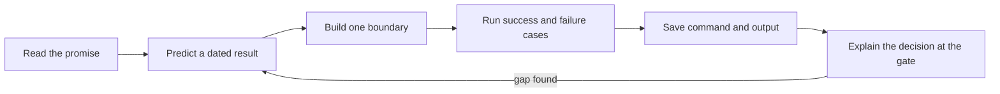

# How to use this course

Sufra grows in a specific order. First, you name the promise made to a diner. Then you build the kitchen and dish model, generate dated delivery windows, and test cutoffs. Only after that do you let a cart claim capacity and start payment. Later, you make the cook's response and the diner's live timeline reliable. You can read ahead, but build each boundary in order. A payment page built before the cutoff rule has no trustworthy answer about what it is charging for.

Each chapter asks you to do one kind of work. A Read chapter frames a product decision. A Learn chapter works through a mechanism and a small example. A Check chapter asks you to apply it to a new case. A Build chapter changes the learner project. A Verify chapter tries to make that change fail under a boundary or race. A Gate asks for evidence before the next module. The label describes the main work; a Read chapter may still ask you to write a short note, and a Build chapter should still explain why its code exists.

## Use one example across several chapters

The course returns to a 13:00 lunch window, a slow maqluba, a fast falafel and two kitchens. That repetition is intentional. In the first week, the example helps you identify data and actors. In the second, it lets you calculate 11:10 and 12:00 cutoffs. In the third, it becomes a cart, a capacity race and a split payment. In the fourth, it becomes an accepted order, a rejected order and a reconnecting diner. The numbers stay recognizable while the engineering boundary changes.

When a chapter introduces a different date or dish, write down what changed. A dated window in Gaza is not interchangeable with a weekly rule in Berlin. A three-unit tray is not three dishes. A hold is not a paid order. A status event is not a screenshot. These distinctions are easy to lose if you paste code before naming the inputs. Keep a small table in `docs/decisions.md` with the date, zone, dish preparation minutes, window cutoff and current test instant for every time example you use.

The diagram shows the learning loop for each build. It ends with saved evidence, because an unrecorded pass is hard to reproduce after a restart.

The loop may take more than one session. Save a small change and a short note after each boundary. A learner who has to stop because of power or internet should be able to resume from the last passing test and the last recorded decision, not from memory.

## Keep a useful learning log

Create `docs/learning-log.md`. At the end of a session, write the date, the last passing command, the next small task and one uncertainty. For example: "14.05 cutoff tests pass; next add a schedule exception; unsure whether a paid window can be deleted." This is more useful than a general note such as "worked on checkout." The next session begins by rerunning the last command. If it fails, you know the environment changed or an uncommitted edit remains.

You do not need to share private circumstances in the log. A neutral engineering record is enough. If a chapter offers an optional reflection about a lost connection or interrupted study session, you can use a fictional scenario instead. The graded evidence is the product decision and test, not a personal story.

Keep `docs/EVIDENCE.md` for tests that another person should rerun. A log entry says what you were doing. Evidence shows the exact command, fixture, result and interpretation. For a cutoff test, include the kitchen zone, dated UTC window start, effective cutoff and fake server instant. For a parallel checkout test, include the initial capacity, units per request, number of attempts, winners, losers and final counter. For a webhook replay, include the event type and resulting order state without storing secrets or card data.

## Treat gates as a pause to inspect

At a module gate, show the thing that should now work and one case that should fail safely. The M14 gate asks for a dated seven-day window list and exact cutoff boundaries. The M19 gate asks for a twenty-request race and recovery after a two-kitchen failure. A green test count is not enough if the command skipped the new file or the fixture did not cross the intended boundary. Read the output and explain which product promise it protects.

A gate can also reveal that an earlier model is wrong. If a dish closes at the right local label but a different UTC instant, return to the zone expansion lesson before building checkout. If a released claim restores units twice, fix the claim state transition before adding Stripe. Carrying a known invariant failure into the next module makes later bugs difficult to locate. The course is designed so you can stop at a boundary, repair it, and continue with a smaller problem.

When you are unsure, ask a peer to calculate one result independently. Give them the dated window, kitchen zone, preparation minutes and travel buffer, but not your answer. If they get a different cutoff, compare the exact assumptions. This review can catch a missing zone or an ambiguous "order by" label before a code review begins. For concurrency, ask a peer to trace the database state after one claim, one retry and one release.

## Work with the project, not only the page

The course text gives examples and acceptance criteria. Your project is the place where decisions become code, tests and a running interface. Type and adapt the small examples; do not paste a large chapter into the repository without reading it. File paths in chapters describe the intended module boundary. If your starter project uses a slightly different path, keep the responsibility and update the local name consistently. Record the mapping so a mentor can find the implementation.

Use version control after each tested step. Commit the model and its tests together when they express one decision. A commit named "guard window capacity claim" is easier to review than "more work." Before committing, inspect `git diff` for secrets, accidental generated files and unrelated changes. A test Stripe key stays in environment configuration, never in Git. Store a small local setup note that names the required variables without their values.

The live parts of Sufra should have text paths. The window-fill canvas helps you see capacity and cutoff outcomes, but the prose and tests explain the same rule. The order timeline animation may help you notice missed events, but a saved event sequence is the evidence. If an interaction does not load on a weak connection, read its written example and continue. No chapter should require a large video download before you can understand the next step.

## Your first use of the loop

Return to the 13:00 example in your product brief. Predict whether maqluba and falafel are timely at 11:31, given 90 and 30 preparation minutes, a 20-minute buffer and a 12:00 general cutoff. Write the calculation in `docs/decisions.md`. The answer is maqluba closed at 11:10 and falafel open until 12:00, if capacity remains. Now ask what the page can know at 11:31 and what checkout must check again. That distinction is the first boundary you will carry through the course.

The next lesson follows one cook and one diner for a full day. It gives the data model and screens a human purpose before you design their collections.
