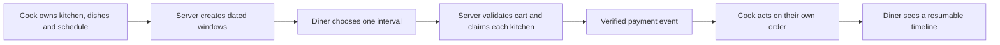

# The product and its people

Umm Yousef is preparing tomorrow's lunch menu. She can cook three maqluba trays, but each tray takes time and much of the kitchen's 13:00 capacity. She enters a weekly lunch interval, a general order cutoff and a travel buffer. She then closes one date because she will be away. Sufra must turn the weekly rule into dated windows, respect the exception, and show tomorrow's window without changing next week's plan.

Lina is ordering for lunch. She chooses 13:00 first because a dish that cannot arrive then is not useful to her. She sees a fast meal from Abu Sami and a slower tray from Umm Yousef. At 11:31, the slow tray is already past its safe preparation cutoff. Lina adds the fast meal and a sweet from Beit Hanan to a cart for the same delivery interval. She reviews one total and pays once. Each kitchen receives only its own part of the order.

These two journeys define the product's data and permission boundaries. A `Kitchen` has an owner, a local zone, service area, weekly rules and exceptions. A `Dish` belongs to one kitchen and has price, preparation time, load units, allergens and availability. A `DeliveryWindow` is a dated promise with UTC times, capacity and a general cutoff. A `CapacityClaim` uses units while payment is pending or after confirmation. An `Order` freezes what one kitchen owes one diner. A timeline records how that order moves through acceptance, cooking and dispatch.

## The cook's working day

A cook first opens a kitchen profile. They choose an IANA zone such as `Asia/Gaza` and a service area. The zone is not a decoration on the form; it tells Sufra how to turn a recurring "13:00 lunch" rule into a dated UTC instant. A fixed `+02:00` offset is insufficient when regional rules change. The kitchen also states how many load units it can handle in an interval and how long delivery preparation needs. The course validates these values rather than accepting empty or negative numbers.

The cook adds dishes. Maqluba may need 90 preparation minutes and three load units. Falafel may need 30 minutes and one unit. The menu can show allergens and a plain description. A cook can pause a dish or edit its future price. Such edits affect new offers. They do not rewrite paid orders, whose snapshots say what the diner saw and paid. The cook should be able to see why a dish is hidden for a particular window: its preparation deadline, the general cutoff, a dated closure or lack of remaining units.

The cook also needs a manageable order queue. A paid order appears with the chosen window, dish quantities, preparation notes and an acceptance deadline. The cook may accept or reject according to the policy. A rejected order triggers a diner update and a refund for that kitchen's share. The cook cannot alter another kitchen's order in a shared payment. The dashboard shows only the records owned by their kitchen, even if a guessed URL contains another order ID.

## The diner's lunch path

Lina starts with a date and interval. She may be on a phone with a weak connection, so the picker needs large targets and short, useful labels. The browse API returns kitchens that serve her area and have an open dated window with time and apparent capacity. It hides dishes past their own cutoffs. The page can show "order before 12:00" in a zone she understands. It should never imply that an earlier browse result has already reserved capacity.

At cart time, Sufra checks the selected window again. The cart is one interval, even if it includes several kitchens. If Lina changes the interval, every line must be revalidated. A slow dish might become possible in a later window, while another kitchen might not offer that later time. The cart explains each changed line and asks Lina to review a new total. It does not silently move a meal to a different time.

At checkout, the backend groups lines by kitchen, calculates load and price from trusted data, claims each dated window, and creates draft orders. If one claim fails, it releases earlier holds and does not expose payment for a partial cart. After a verified Stripe test payment event, each kitchen order becomes actionable. A redirect from the browser is not proof of payment. The diner can see a combined receipt and then follow each kitchen's status separately.

The diagram shows whose action can change each part of the promise. A line crossing the marketplace boundary must be checked on the server.

## A third actor: the marketplace

The platform is not a person browsing a page, but it makes decisions neither cook nor diner may override. It validates ownership, computes cutoffs from server time, protects capacity under concurrency, calculates the payable total, checks payment events, schedules expiry and sends status updates. It also records enough data to explain an incident. If a cook asks why an order was rejected, the system should identify the dated window, current instant and effective cutoff. If a diner asks why one kitchen was refunded, the order timeline and payment record should show the event.

This authority must be narrow and visible. A cook can change future menu and schedule settings but cannot choose the server clock used for checkout. A diner can choose an available window and remove cart lines but cannot declare that a full window has space. An administrator may help resolve a failed order but should not create a paid status without payment evidence. Permissions should follow these actions and the ownership chain, not broad role names alone.

## Follow a connection loss

After payment, Lina's phone loses its connection for several minutes. One kitchen accepts and starts cooking. The other misses its acceptance deadline. When Lina reconnects, Sufra first gives her a fresh snapshot of both orders, then later status changes. It uses sequence numbers to avoid showing the same event twice or reversing the order of events. If the live stream cannot stay connected, polling returns current state. The screen says when it last updated instead of pretending it is live.

This case matters because the product continues after the button click. A simple order badge refreshed by hand would not teach the same failure mode. The system must make the status trustworthy when events are delayed, repeated or missed. The cook dashboard also needs a clear deadline and must not treat an unpaid draft order as work to prepare.

## Map one need to one model

In `docs/product-brief.md`, write a two-column table with one cook or diner need and the data or rule that supports it. For example, "cook closes tomorrow only" maps to a dated schedule exception, not an edit to the weekly rule. "Diner sees the same lunch after reconnect" maps to a persisted order snapshot and timeline, not a browser variable. "Two diners ask for the last spot" maps to an atomic window claim and a failed-request response.

Then name one permission check for each actor. The cook may edit only their own dish. The diner may read only their own order. The marketplace may change a claim state only through its documented payment or expiry path. If you cannot say where the rule belongs, write the uncertainty in the learning log. The next chapter sets scope so the course can teach these promises deeply without adding every feature of a large delivery company.
