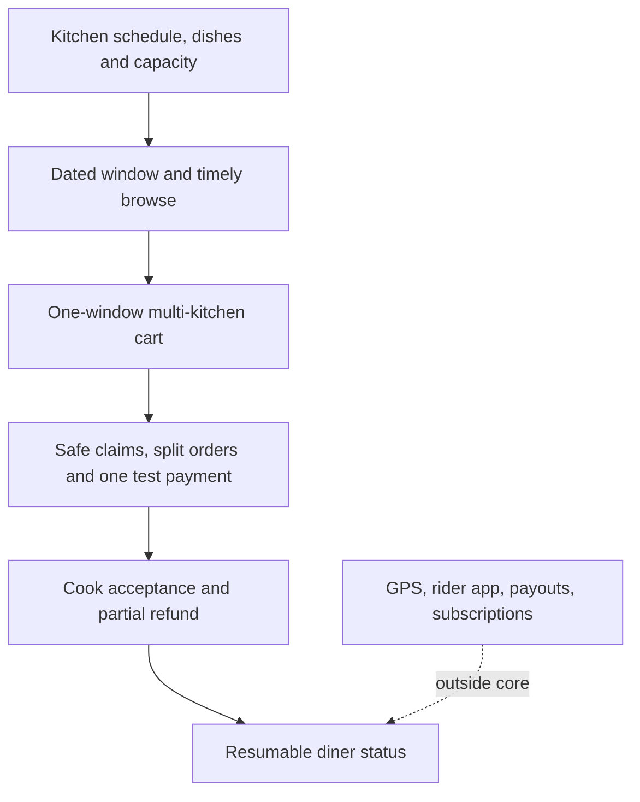

# Scope: what is in and what is out

Sufra could grow into a large delivery company. That is not the goal of this course. The core build teaches one hard promise well: a home kitchen accepts only meals it has time and capacity to prepare for a chosen delivery window. The diner pays for a whole multi-kitchen cart, then sees an honest order state even when their connection fails. Every feature in scope should help explain, enforce or recover that promise.

The product still needs ordinary marketplace foundations. People register and sign in. A cook owns a kitchen and its dishes. A diner owns a cart and orders. Prices are calculated on the server and snapped at purchase. Stripe test mode handles payment without putting card details in Sufra. A worker handles delayed tasks such as hold expiry and acceptance deadlines. The app runs over HTTPS and keeps secrets outside Git. These are not optional polish; without them the central promise can fail or leak private information.

## The core path

The cook configures a profile, service area, IANA zone, weekly schedule, dated exceptions, menu and capacity. Sufra generates seven days of dated windows. It stores UTC start and end instants, a general cutoff and remaining load units on each window. A dish has preparation minutes, load units, a maximum quantity and allergen information. A diner selects one delivery interval and sees only kitchens and dishes that can still serve it according to the current public view.

The cart can group dishes from several kitchens for that one interval. Checkout rechecks every dish cutoff and claims each kitchen's capacity with an atomic conditional update. It compensates if one kitchen fails, then prepares one order per kitchen and one payment path for the whole cart. A verified webhook makes paid orders actionable. The cook accepts or rejects within a deadline. Rejection of one kitchen can lead to a partial refund without rewriting the other kitchen's order.

After payment, the diner follows status changes. Sufra stores a sequence-numbered timeline, sends updates by Server-Sent Events and gives a snapshot on reconnect. Polling is the fallback when the stream is unavailable. The UI states when its information is stale. This is enough to teach live status without tracking a rider's precise location. The final demo uses two phones to show an order, a dropped connection, a later status change and a correct catch-up.

The diagram draws the core boundary. Anything outside it needs a reason to enter, because every extra promise needs data, permissions and failure handling.

The dotted line does not mean those features are bad. It means this course does not depend on them to prove its learning outcomes. If a team adds them later, they should state the new actors and failure modes before writing code. A rider app, for example, would need location permissions, assignment rules and a different privacy review. It would not repair an unsafe cooking-capacity claim.

## What we leave out

There is no live GPS rider map. A kitchen can mark an order dispatched and the diner can see that status, but Sufra does not collect a rider's location or predict an exact route. There is no separate rider role or rider app. These would add dispatch and privacy decisions beyond the course's focus on time-bound cooking capacity and reliable status delivery.

There are no cook payouts or marketplace transfers in the core path. The Stripe test-mode flow collects one diner payment and records each kitchen's share for orders and potential refunds. Moving real money to independent cooks would require account onboarding and additional operational rules. The course does not simulate that by putting a fake "payout completed" badge on the dashboard. The accounting snapshot is enough to explain a split order and a partial refund.

The core path also leaves out subscriptions, loyalty points, route optimization, dynamic surge pricing and a full customer-support console. A coupon module is stretch work, not a prerequisite for a safe 13:00 lunch. These features could be interesting later, but none should be allowed to obscure a missing cutoff check or a double claim. If there is spare time, improve the core tests and accessibility before adding a new purchase mode.

The fictional kitchens and dishes are teaching examples. The course does not provide food-safety, licensing, tax or delivery regulation guidance for a real food business. A production launch would need local review of those requirements. In this learner project, we still treat allergens and order details carefully: the cook enters clear information, the diner sees it before purchase, and snapshots preserve what was shown. Scope limits do not excuse careless data handling.

## Define failure behavior as part of scope

A feature is not finished when only its happy path works. A cutoff needs a strict exact-at-boundary test. Capacity needs parallel requests and an idempotent release. Payment needs webhook signature checks and replay handling. A cook acceptance deadline needs a worker retry. Live status needs reconnect and polling fallback. These failures are in scope because they are the places where Sufra's promise can become false.

The product also needs honest user copy. If a dish is past its preparation deadline, show a later window or a faster dish. If a window is full, suggest another available interval. If a cook misses an acceptance deadline, show the order's changed state and refund progress. If the connection is lost, show the last update time and that Sufra is reconnecting. Avoid a generic "unavailable" or "something went wrong" label when the backend knows a safe reason.

Keep privacy in the core. A cook can read only orders for their kitchen. A diner can read only their own carts and orders. The live stream must authorize the user before sending order events and must not expose another diner's address through a shared kitchen window. A capacity claim embedded on the window needs IDs, units and timing, not a delivery address. These choices keep the high-traffic public availability record separate from private fulfilment data.

## Use scope to decide an idea

Suppose a learner suggests showing a moving rider icon in Week 3. Ask whether it helps prove that the 13:00 maqluba cutoff and capacity claim are safe. It does not. Write it in `docs/later-ideas.md` and return to the gate. Suppose a learner suggests an acceptance deadline worker. That belongs in scope because a cook who never answers leaves the diner and payment in an uncertain state. The test should show what happens when the deadline fires twice.

Write your own scope note in `docs/product-brief.md`: three core promises, three explicit exclusions, and the evidence for each promise. Name one screen that looks attractive but cannot substitute for a backend invariant. Keep this note visible when planning the final demo. A small product with a truthful status and safe checkout is stronger than a wide product whose last lunch spot can be sold twice.

Review that note after Week 2. If a planned screen requires a new actor or a new kind of payment, pause before implementing it. Decide whether it supports a listed outcome and whether there is time to test its failures. If it belongs outside the core, keep the idea in the later list rather than hiding it inside an existing module. This makes the final demo a fair account of what the system actually supports.

The next lesson checks whether you have the JavaScript, HTTP and date foundations needed to build these boundaries. It includes a short repair path for time-zone mistakes before dated-window work begins.
