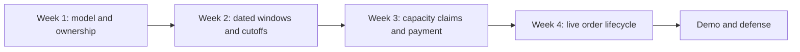

# Course outline

The course has four weekly demos. Each one shows a larger part of Sufra, but it also tests one promise that the next week needs. The first week gives both apps, the model and ownership rules a stable base. The second turns a cook's local schedule into dated, orderable windows. The third lets a diner buy from two kitchens without overselling either one. The fourth shows what happens after payment, including a connection loss, a cook decision and a deployed capacity test.

The roadmap plans about 210 core hours across four weeks, including a twelve-hour buffer. That is a demanding pace. Use the buffer for a broken test, a deployment surprise or a concept that needs another example. Do not spend it adding a rider map while the capacity race is unproven. The hours estimate includes building and debugging, not only reading chapter text. A short chapter may lead to a longer implementation session.

## Week 1: give the product a shape

Modules 1 through 8 cover the introduction, project skeleton, database choice, configuration, data model, authentication and isolation. At the end of the week, the server and client talk to each other. The seed shows kitchens, dishes and seven days of windows in MongoDB Compass. A cook and diner can sign in. An isolation test proves that one cook cannot edit another kitchen's dish and one diner cannot read another diner's cart.

The main evidence is an ERD and a seeded dataset. Draw the ownership chain from user to kitchen to dish and dated window. Separate a weekly schedule rule from an actual delivery window. A first model does not need the full live timeline, but it must leave a clear place for order events and capacity claims. Keep seed IDs and dates stable enough for tests. A fresh clone should be able to reproduce the first demo without hand-editing database rows.

If the week ends with attractive kitchen cards but no permission tests, the demo is incomplete. Ownership errors are easier to fix before checkout and streams start referencing the same records. If the model stores only `"13:00"` as a window start, the next week will not be able to compare cutoffs reliably. Fix the dated instant now. The first demo is a foundation, not a launch.

## Week 2: make the cook's clock real

Modules 9 through 14 build the cook experience. A cook opens a kitchen, publishes dishes and photos, sets a weekly schedule and enters dated exceptions. Sufra expands the rule into the next seven days of delivery windows. Each window has UTC start and end instants, a kitchen-zone snapshot, capacity and a general cutoff. Each dish has preparation minutes and load units. The app can show why a slow dish closes before a fast one.

The week-two demo uses the 13:00 lunch example. Maqluba needs 90 minutes plus a 20-minute travel buffer, so its preparation cutoff is 11:10. Falafel needs 30 plus 20, so its preparation deadline is 12:10, but a 12:00 general cutoff closes it earlier. At 11:31, the slow dish is unavailable while the fast dish may still be offered if units remain. Show the two reasons separately. Then close one dated lunch and show that the weekly rule still generates future lunches.

The evidence includes fake-clock tests one second before, at and after cutoff. A generator rerun must preserve a held window's remaining units and IDs. A controlled historical clock-change case proves that a local recurring hour is expanded separately for each date. This week prevents a common mistake: building checkout on a page that merely displays a countdown without a trustworthy dated window behind it.

The diagram shows how the weeks depend on one another. A failure in the left side travels into every later promise, so a gate is a chance to repair the dependency.

## Week 3: let the diner buy safely

Modules 15 through 21 give the diner a window-first browse path, a one-window cart, multi-kitchen checkout, payment and background jobs. A diner picks a lunch interval, sees kitchens that can serve it, adds dishes from two kitchens, reviews one server-calculated total and pays with a Stripe test card. The backend holds capacity separately for each kitchen, creates split draft orders and confirms them only from a verified payment event.

The demo needs more than one successful purchase. Start twenty parallel checkouts against a ten-unit window with three-unit orders. Exactly three may prepare, and one unit remains. Repeat a winning request with the same attempt key and show that it does not claim again. Make the second kitchen full after the first was held; the attempt must release the first and withhold payment. Let a hold expire and show that the worker restores its units once. These cases demonstrate that the page's apparent availability is not the source of truth.

Money adds an external boundary. One PaymentIntent belongs to the whole prepared attempt, with a total in integer minor currency units. The browser's success redirect is not proof that the order is paid. The payment module verifies the webhook, handles retries and confirms held claims. A late success after a released hold needs a recorded refund path. The week-three gate should show that the diner never pays for a silently reduced cart and that neither kitchen's capacity goes negative.

## Week 4: follow the order after payment

Modules 22 through 26 and the closing module build cook acceptance, live tracking, cache and search rules, deployment and load evidence. The cook accepts or rejects before a deadline. The order stores a sequence-numbered timeline. The diner receives a snapshot on connect, then live changes through Server-Sent Events. When the phone goes offline, it reconnects and catches up; polling remains available if the stream fails. A rejected kitchen's part of a shared payment is refunded with a traceable state.

The final two-phone demo shows one kitchen accepting and another missing the deadline. The diner phone goes offline while statuses change. After reconnect, it shows the current state without duplicating or reversing events. The deployed app runs over HTTPS with its worker and secrets configured. A capacity load script against the deployed service records the winner count, final units and any failed responses. A five-minute defense explains why each result follows from the design.

The final project is not judged by whether every screen is animated. It is judged by whether a reviewer can trace one order from the cook's weekly rule through a dated window, cutoff, capacity claim, payment event and status timeline. The last demo should show an honest stale-state label when the connection is lost and a correct partial outcome when one kitchen cannot fulfil its part.

## Plan your first checkpoint

Add four headings to `docs/EVIDENCE.md`, one for each weekly demo. Under Week 1, write the command that starts both apps and the seed command you expect to run. Under later weeks, write the concrete test you will save, leaving results blank until you run it. This is a plan for evidence, not a claim that the work already passes. Keep each week's outcome in view when deciding what to build next.

At each weekly review, compare the evidence with the demo target before adding a new module. If the screen works but the isolation test fails, the week-one target is still open. If the cutoff arithmetic is right but the generator duplicates a paid window, the week-two target is still open. Naming the gap early keeps the final week from becoming a collection of hidden repairs.

The next lesson sets a working rhythm for short sessions, offline references and frequent commits. That habit supports the four-week plan when power or internet interrupts a day.
