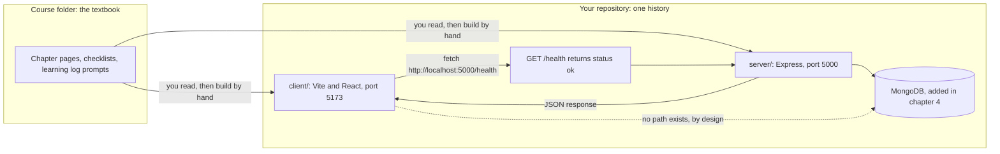

# 2.1 Set the scene

> **[Read]** · Chapter 02 · Project skeleton · *What "standing the project on disk" means*

You cleared the introduction checklist. You know what you're building, how the course gates progress, and what's in scope. **Nothing in your Sufra repository exists yet**, or it shouldn't, if you're starting clean.

<BigWordAlert term="Monorepo layout" plainEnglish="One Git repository that holds both the client app and the server app, usually in separate top-level folders." whyItMatters="Sufra keeps `client/` and `server/` side by side so you can run and deploy them together while keeping concerns separate." />

This chapter is where that changes.

<ArticleBreak title="Before you write feature code: how Sufra is wired" subtitle="A five-minute map of client, server, and the first request" readMinutes={6}>

Sufra runs as two applications: a Vite + React client and an Express + Node server. The client never talks to MongoDB directly. It calls HTTP routes on the server, and the server owns all data access.

Your skeleton chapter exists to prove that wiring works. When the home page shows a health check response, you have confirmed four things at once: the server listens on a port, the client knows that URL, CORS allows the browser request, and JSON travels both ways.

Every later chapter plugs into this same pattern. Auth adds protected routes. The browse module adds public read routes for kitchens and their dishes. Checkout adds payment routes. The skeleton is boring on purpose, and boring infrastructure is what lets the interesting features ship safely.

</ArticleBreak>

<LearningObjectives objectives={["Explain how the React client talks to the Express API.", "Create a clear folder layout for client, server, and shared code.", "Run both apps and prove the health check works."]} />

## Bridge from last chapter

Chapter 1 was about **clarity before code**. You named your product (or picked a working name), read what Sufra is for, checked prerequisites, and learned how this course gates progress: finish one chapter's checklist before opening the next. You should have completed the Chapter 1 gate and learning log on the platform. None of that required a running app; it required you to understand *what* you are building and *how* the course expects you to work.

What carries forward: your product name, your learning log habit, and the discipline of not skipping gates. What does **not** carry forward yet: any folder structure in a repository you own. The introduction told you the story; this chapter makes the story **physical on disk**.

The hat you wear now is **builder of the skeleton**. You are not designing the database, wiring login, or styling a shop. You are answering boring questions every professional team answers on day one: where does the API live, where does the React app live, how do we know both halves are alive? When Chapter 4 adds MongoDB, it slots into folders you already understand. When Chapter 7 adds login pages, they land in the `client/src/pages/` you created here. This chapter is the floor everything else stands on.

<RealWorldEvent title="Shopify's modular commerce platform" when="2006-present" summary="Shopify grew from a single-product store builder into a platform with separate admin, storefront, and API surfaces, all coordinated through clear project boundaries." lesson="Starting with a deliberate folder skeleton prevents painful renames later, when kitchen, cart, and payment code all need room to grow." />

## In plain English

| Term | Meaning |
|---|---|
| **Skeleton** | The empty but runnable shape of the app: folders, entry files, and a health check, before any real feature |
| **Monorepo** | One Git repository containing both `server/` and `client/` as separate apps |
| **Module folder** | A directory grouped by product area (auth, kitchens, dishes) rather than by technical type (all controllers together) |
| **Health check** | A simple API route that answers "is the server up?", your first proof the backend works |
| **Full-stack** | Browser UI (client) talking to a Node API (server) over HTTP |
| **Scaffold** | Create folders and stub files so later chapters have named places to add code |
| **Gate / checklist** | Tickable outcomes at the end of a chapter; you do not proceed until each box is checked |

## Think of it like…

**Building a market hall before the stalls open.** You pour the foundation, erect the frame, run the electricity and plumbing, and hang a sign that says "We're open", even though no cook has published a dish yet. The health check is that sign: it proves power and structure work. Later chapters are individual stallholders moving in: the database, then auth, then the dish catalogue. If you skip the hall and start with a counter in an open field, every next delivery has nowhere to plug in.

<MustRead
  title="Introduction to client-side JavaScript frameworks"
  url="https://developer.mozilla.org/en-US/docs/Learn_web_development/Core/Frameworks_libraries/Introduction"
  source="MDN"
  description="Short MDN primer on why frameworks like React exist and what problems they solve. Helps you understand why the client is a separate app from Express."
  readMinutes={12}
/>

## The shape you are about to build

This chapter keeps returning to one picture, so here it is on the page. Read it left to right: the textbook is separate from your repository, your repository holds two programs, and only one of those programs is allowed near data.

The solid arrow that matters most is the short one: the browser asks the server a question and receives JSON. The dotted arrow is drawn to show a relationship that must **not** exist. A browser bundle cannot hold a database driver or a connection string, so every read and write in Sufra passes through Express, where authentication, ownership checks, and validation can run before any document is touched.

The takeaway is that the health check is not decoration. It is the one request that proves the left-to-right path works before any real data exists, which is why every later chapter can assume it.

## Common questions

**Q: Why not start with MongoDB or login, the interesting parts?**  
A: Because those features need *somewhere to live*. Without `server/src/modules/` and a running Express app, every later chapter would say "add this somewhere" and you would paste into random files you do not understand. Think of it as building the market hall before the stalls open: you pour the foundation, run the wiring, and hang a "we're open" sign before any cook publishes a menu. Get the skeleton right once, and every later feature (database, auth, dishes) slots into a folder you already know.

**Q: Do I build inside the course folder (`multi-vendor-marketplace/`)?**  
A: No. That folder is the textbook; the course content lives there. Your app is a **separate Git repository** you create in sub-chapter 2.8, somewhere like `~/projects/sufra-app/`. If you build inside the course folder, your app and the course materials get tangled, commits mix together, and instructions that say "create a file in your project root" become ambiguous. Keep the book on the shelf and your workspace separate, which is what real teams do too.

**Q: I have never used Express or Vite. Is this chapter too early?**  
A: Not too early. This chapter introduces them **one small step at a time**. You install packages, create entry files, and verify with curl and the browser, so each concept appears the moment you need it. Unfamiliar errors will happen, and that is fine; use the working rhythm from Chapter 1: read the message, search the docs, fix the smallest failing piece. By the end you will not be an Express expert, and you will not need to be. You will know enough to run a server and a client, which is precisely what this chapter needs from you.

**Q: Why two terminals, can't one command run everything?**  
A: Because the client and server are **two separate programs** during development, and two terminals make it obvious which half broke. You run `npm run dev` in `server/` to start the API on port 5000, and `npm run dev` in `client/` to start the React app on port 5173. When something fails, the terminal that shows the error tells you exactly where to look, and "client works, API down" becomes a sentence you can act on. Running both from one command is possible later, but it hides the architecture you are here to learn.

**Q: What if I already have a MERN starter template?**  
A: Unless it matches this course's **module-based** layout under `server/src/modules/`, it will fight you. Every chapter names an exact path such as `modules/products/products.routes.js`, which in Sufra is the module that lists a kitchen's dishes, and if your repository has no `modules/` folder you will translate every instruction for twenty chapters or drift away from the guide. Scaffolding fresh here takes an afternoon; un-teaching a random boilerplate takes weeks. If you love your template, adapt it to the target tree in 2.3; otherwise start clean and stay aligned.

**Q: What does the health check actually prove?**  
A: The health check, `GET /health` returning `{ "status": "ok" }`, proves the wiring between Express and the browser works before you add anything complicated. When your React Home page fetches that endpoint and displays the result, you have confirmed the server boots and listens, the client renders, HTTP works between the two, and your folder conventions hold real files. It is the smallest possible proof that the full-stack loop is alive. Skip it and you would debug connection problems later with database and auth code mixed in, which is much harder.

## Where you are

| You have | You don't have yet |
|---|---|
| A name for your product (or a working name) | A Git repository with code |
| The course outline in your head | `server/` or `client/` folders |
| Chapter 1 gate cleared on the platform | A running API or React app |
| Prerequisites checked (Node, Git, editor) | MongoDB connected, which is Chapter 4 |

Chapter 1 was **mindset and product**. Chapter 2 is **the skeleton**, the physical shape of the application on disk, before databases, auth, or kitchen business logic.

## What "standing the project on disk" means

Professional teams do not start by writing a login handler. They start by answering boring questions:

- Where does the API code live?
- Where does the React code live?
- How do we start each app with one command?
- How do we know both halves are alive?

**Standing the project on disk** means that at the end of this chapter you can open your repository in an editor, see a **folder tree you understand**, run **two commands in two terminals**, and **demo something real**: the React home page calling the API health check and showing the response.

No users. No dishes on sale. No MongoDB. Still a **working full-stack skeleton**, and every future chapter attaches to it the way scaffolding attaches to a building.

## Why this chapter comes before MongoDB

Chapter 4 connects MongoDB. Chapter 5 builds schemas. You might wonder why the database does not come first.

Because the **app must exist before the app needs a database**. The health check in this chapter proves:

- Express boots and listens
- React boots and renders
- HTTP works between browser and server
- Your folder conventions hold real files

When Chapter 4 adds `MONGODB_URI`, it slots into `server/src/shared/`, a place you already created and understand. If you started with Mongoose before you had `app.js`, every chapter would say "add this somewhere" and you would paste into random files.

**Order matters:** skeleton, then config and database, then data model, then features.

## What this chapter is not

- **Not** the auth chapter: no JWT, no passwords
- **Not** the data model: no User, Kitchen, or Dish schemas yet
- **Not** a UI design chapter: one plain Home page is enough
- **Not** deployment: localhost only

It **is** the chapter where you make the **one structural decision** the rest of the course assumes: **module-based folders** in `server/src/modules/`. Change that later and every subsequent chapter's file paths stop matching.

## The milestone you'll feel

When this chapter's gate clears, you will be able to say:

> *"I built the project skeleton."*

That means:

1. One Git repository with `server/` and `client/`
2. A module-based server layout committed
3. `GET /health` returns `{ "status": "ok" }` or equivalent JSON
4. The React Home page displays the health response from your API
5. You can draw the folder tree from memory

That is Week 1's **first demo brick**. The second brick is MongoDB plus the seed data in Chapters 4 and 5.

## How this chapter is organized

You move through the usual arc:

**Open (2.1 to 2.3):** why structure matters, then a preview of the tree  
**Learn (2.4 to 2.6):** layer versus module, client versus server, the mandatory read  
**Build (2.8 to 2.16):** create the repository, server folders, the health route, the client, then connect them  
**Wrap (2.17 to 2.19):** optional practice, recap, and the checklist gate  

Sub-chapter **2.7** is a short project-structure knowledge check. Use it to confirm the client and server boundary before the build begins.

Each **build** sub-chapter is one concrete action: create this folder, create this file, verify with this command. You write the logic; the course specifies behaviour and contracts.

## Continuity promise

Every build sub-chapter opens with **where the repository stands** after the previous step. You should never wonder "what file do I touch next?", only "how do I write this function?", which is yours to figure out from the spec.

After 2.8 you will have a Git repository.  
After 2.11 the API will answer on a port.  
After 2.13 the client will render in the browser.  
After 2.15 the client will talk to the API.  
After 2.16 you will have your **first screenshot** for the portfolio.

## Before you continue

- [ ] Chapter 1 checklist cleared  
- [ ] Node 18+ and Git verified (`node --version`, `git --version`)  
- [ ] Empty directory chosen for your Sufra repository, outside the course content folder  
- [ ] Editor ready, because you will create many files this chapter  

**Estimated time:** one full work day at medium pace, faster if you have scaffolded MERN before, slower if Vite or Express are new. That is normal.

## Time and tooling expectations

| Sub-chapter range | Focus | Rough time |
|---|---|---|
| 2.1 to 2.7 | Understand structure and reads | 2 to 4 hours |
| 2.8 to 2.11 | Server repository and health API | 3 to 5 hours |
| 2.12 to 2.16 | Client plus full-stack connect | 3 to 5 hours |
| 2.17 to 2.19 | Stretch, recap, gate | 1 to 2 hours |

If Express or Vite are new to you, expect the upper end, not because the steps are complex but because unfamiliar tooling generates searchable errors. The working rhythm from Chapter 1 applies: read the error, check the docs, reduce to the smallest failing case.

## Two repositories, don't confuse them

You are reading course files in the **guides** repository (or folder) that contains `multi-vendor-marketplace/` course content. You are **building** in a **separate Git repository** you create in 2.8. Never commit your app into the course textbook folder unless your mentor explicitly uses a monorepo for both; the default is a separate app repository.

One consequence is worth stating early: a command that works in your app repository does nothing useful in the guides folder, and the reverse is also true. If `npm install` complains that there is no `package.json`, check which of the two you are standing in before you debug anything else.

## Key ideas

- Chapter 2 is **skeleton on disk**, not features  
- **Server and client** both exist before MongoDB  
- **Module folders** are decided here  
- **The end demo** is the browser showing the API health response  
- **A separate app repository** keeps course materials away from your product  

## Mentor checkpoint

Before sub-chapter 2.8, confirm that an empty directory is chosen, Node 18+ and Git are installed, and the Chapter 1 learning log is written. Missing any of these is cheaper to fix now than after you have scaffolded the wrong folder.

Next: why folder structure is a real decision, and not a question of aesthetics.
