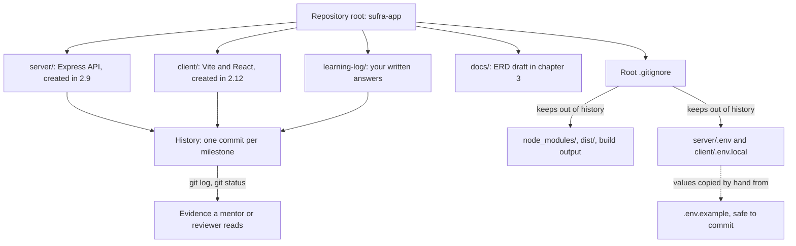

# 2.8 Create the repo

> **[Build]** · Chapter 02 · Project skeleton · *Init git; root `.gitignore`; `README.md` stub*

**Why this step matters:** Everything you build for Sufra lives in a repo you own, not in the course guides folder. This step creates that root with Git, ignore rules, and a learning log so every later sub-chapter has a committed home and secrets stay out of history from day one.

<BigWordAlert term="Git repository" plainEnglish="Version-controlled project folder where every change is tracked and reversible." whyItMatters="Sufra lives in one repo from day one, so commits mark chapter milestones you can demo or roll back." />

**Where the project is now:** You have no application repository, only the course materials you read. After this sub-chapter you will have a Git root with ignore rules and a place for the learning log.

**After this step:** You own a Git repository with a root `.gitignore` that keeps secrets out, a README stub, and a `learning-log/` folder. That is the committed home every later sub-chapter builds inside.

## What you must do

Create a **new directory** for your Sufra application, **not** inside the course guides folder. Initialize Git, add a root `.gitignore`, and stub `README.md`.

Three commands and two small files. The work is not in the typing; it is in the three decisions those commands record. Where the repository lives decides what a commit means for the rest of the course. What the ignore rules exclude decides whether a database password ever reaches a remote. What the README promises decides whether a reviewer can run your project without asking you anything.

## The decisions this step records

**The repository is the unit of history.** A Git repository is not a folder with a `.git` directory inside it; it is a boundary. Everything inside the boundary shares one timeline, one set of commits, and one `git log`. Everything outside is somebody else's timeline. Sufra's timeline must hold your Express API, your React client, and the notes you write about them, because a single commit that adds a login route and its button should read as one change. If your app lived inside the course guides folder, that timeline would also contain content updates to the textbook, and "create a file at the project root" would stop having one obvious answer.

**The ignore file is a decision you can read.** A `.gitignore` is not housekeeping. It is the written statement of what your project treats as generated, as private, or as reproducible from something else. Dependencies are reproducible from `package.json`, build output from source, and secrets from a value that only you and your deployment hold. Writing that boundary down means a teammate can audit it in ten seconds instead of guessing which files in a commit are noise.

**The first commit is the smallest proof that the repo works.** A commit proves Git can read your ignore rules, that your identity is configured, and that the tree you think you have is the tree you actually have. Later chapters add to that proof at every milestone, which is why the commit habit starts here and not after the interesting code arrives.

The diagram below shows how those three decisions relate. The root owns both applications, one ignore file guards the whole history, and the learning log sits beside the code rather than in a separate document tool.



Read the two arrows leaving `.gitignore` as a pair. Neither one is about tidiness. The first keeps history small enough to clone on a phone hotspot, and the second keeps a credential out of every machine that ever clones the repo. The dotted arrow is the point of the pair: a committed `.env.example` describes the shape of the secrets, while the values themselves travel by hand from your machine to your deployment, never through Git.

## Step 1 · Create the project directory

Choose a name that matches your product. Examples: `sufra-app`, `sufra-kitchens`, `umm-yousef-kitchens`. Lowercase, hyphenated names avoid case-sensitivity surprises on other people's machines and in URLs.

```bash
mkdir sufra-app
cd sufra-app
```

This directory is the **monorepo root**. `server/` and `client/` are created in the next sub-chapters as siblings inside it, never as parents of one another. Run `pwd` before you continue: it should print the new directory, not the course folder above it and not your home directory. That single command prevents the most common mistake in this chapter, which is building a repository in the wrong place and discovering it three steps later.

## Step 2 · Initialize Git

```bash
git init
```

`git init` writes a `.git/` directory that holds every version of every tracked file. Inside that directory, Git keeps an object database, a branch pointer, and the index that stages your next commit; nothing in your own folder structure changes, and nothing is tracked yet.

Use the default branch name your Git version provides. Recent versions print `main`; older ones print `master`. What matters is consistency: if you decide on `main`, keep that name in every instruction, every screenshot, and every deployment setting so a later command does not fail on a branch that does not exist.

`git status` at this point should report that you are on your branch with no commits yet and nothing to commit. That empty state is correct and expected. The next two steps fill it with two files before anything else is committed.

## Step 3 · Root `.gitignore`

Create `.gitignore` at the **repository root**, beside `.git`, with at least:

```gitignore
# Dependencies: reinstall from package.json
node_modules/

# Environment files: secrets never enter Git
.env
.env.local
.env.*.local

# Logs
npm-debug.log*
*.log

# OS and editor
.DS_Store
Thumbs.db
.idea/
.vscode/*
!.vscode/extensions.json

# Build output
dist/
build/

# Optional: coverage
coverage/
```

Each section answers a question a reviewer would otherwise ask in a code review. `node_modules/` holds tens of thousands of files and platform-specific binaries that nobody should ever download from a repository, because `npm install` rebuilds them exactly from `package.json` and the lockfile. `.env` and its variants hold the private values a running process needs: the database connection string in Chapter 4, the JWT secret and token lifetimes in Chapter 6. Build output is regenerated by a single command, and a committed `dist/` folder is the classic source of a bug where a deployed bundle is older than the source beside it. The editor section keeps personal settings out of the shared tree while still allowing a team to commit shared extension recommendations.

The pattern list is short because the boundary is short. If you find yourself adding a line for every generated file in the project, ask whether that file is really project output; the correct answer is usually to configure the tool to write somewhere already ignored.

**✅ Do:** Verify the ignore works *before* your first commit:

```bash
touch .env
git status    # .env should NOT appear as untracked; if it does, fix .gitignore first
rm .env       # you will recreate server/.env in Chapter 4
```

**❌ Don't:** Run `git add -f .env` "just once". Force-adding defeats the rule you just wrote, and a secret in history survives even if you delete the file in a later commit, because the earlier commit still contains it.

## Step 4 · Stub `README.md`

Create a minimal root README you will expand through the course:

```markdown
# Sufra

Multi-vendor home-kitchen marketplace, MERN stack.

## Structure

The repo is split into two top-level folders, one per process, each with
its own dependencies, config, and lifecycle:

- `server/`: Express API
- `client/`: React (Vite) frontend

## Run locally

(Completed in Chapter 2, filled in after sub-chapter 2.16)

### API
cd server && npm install && npm run dev

### Client
cd client && npm install && npm run dev

## Author

Your name, Sufra course project
```

The README is the only file in the repository written for a reader who has never seen your terminal. A mentor opens it first, so it should say what the product is, how the tree is organised, and how to start each half. Write the structure section now, while the tree is small enough to describe honestly, and leave the run section marked as incomplete on purpose: a promise you have not yet earned is better written down and finished at 2.16 than half-remembered later. Replace the product name with your own before you commit.

## Step 5 · Learning log folder

```bash
mkdir -p learning-log
```

The learning log is where your gate answers live. Every chapter ends with questions that ask you to explain a decision in your own words, and those answers are the difference between a working project and a project you can defend in a review. Keeping them inside the repository rather than in a chat window or a notebook means they travel with the code, they show up in your commit history, and they are still there when a later chapter depends on a decision you made in week one.

## Step 6 · Optional `docs/` folder

```bash
mkdir -p docs
```

An empty folder is fine here. Chapter 3 drafts the entity relationship diagram for kitchens, dishes, and delivery windows, Chapter 5 finalises it, and Chapter 8 adds an authorization matrix. Creating the destination now costs one command and saves the small decision, later, of where that document should go. If you skip it, add it in Chapter 3; nothing in this gate depends on it.

## Step 7 · First commit

```bash
git add .
git status    # review: no .env, no node_modules
git commit -m "chore: initialize repository with gitignore and learning log"
```

`git add .` stages every untracked file that your ignore rules allow. The `git status` before the commit is the important half: read the staged list and confirm it names only `.gitignore`, `README.md`, and the empty marker files that keep a folder in history. If the list is longer than a screen, stop and find out why before you commit, because a commit is easier to fix before it exists than after.

The message follows a common convention: a type (`chore`), a colon, and a short description in the imperative mood. Later commits in this course use the same shape with `feat` and `fix`, which makes `git log --oneline` readable as a project history rather than a list of apologies.

## Verify

| Check | Expected |
|---|---|
| `git log --oneline` | One commit |
| `git status` | Clean working tree |
| `.gitignore` lists `.env` | Yes |
| `ls -a` | `.git`, `.gitignore`, `README.md`, `learning-log/` |
| `git ls-files` | No `.env`, no `node_modules` |

Read the fourth row as a structure check and the fifth as a leak check. `git ls-files` prints exactly what Git tracks, which is the only definition of "in the repository" that matters. If `node_modules` appears there, you committed before writing the ignore rule and need to untrack it:

```bash
git rm -r --cached node_modules
git commit -m "chore: untrack dependencies"
```

Submit the repository once the first commit is pushed. A private repository is fine, but your mentor must already have access to open it.

```openquestion
prompt: Paste the GitHub repository URL for your Sufra project and briefly confirm that the first commit is pushed and no secrets are tracked.
submissionMode: url_required
allowUrl: true
urlRequired: true
urlLabel: Sufra repository
urlHint: Paste a public or mentor-accessible GitHub repository URL. If it is private, give your mentor access before submitting.
minWords: 0
required: true
```

## How a reviewer reads this step

Your mentor opens the repository URL from the submission box and reads three things in order. First, the landing view of the repository, to confirm the README names the product and describes two top-level folders. Second, the commit history, to confirm the first commit exists and carries a message that describes what changed. Third, the file list at the root, to confirm a `.gitignore` sits beside the README rather than buried inside one of the applications.

They are not checking whether you typed the commands correctly. They are checking whether the repository already tells the story of what you built, which is the same skill Chapter 3 needs when the entity diagram has to explain a data model to someone who was not in the room.

## Failure modes you will actually meet

`git status` listing thousands of files means you initialised Git in your home directory or in a parent folder. Run `pwd` to see where you are, `cd` into the intended project folder, and if a stray `.git` sits above it, remove that directory and initialise again inside `sufra-app/`.

`fatal: not a git repository` means the opposite problem: you are in a folder that Git does not know about, usually a terminal opened somewhere else. Move into the root before running any Git command, and remember that every command in this chapter runs from the root unless it says otherwise.

`.env` appearing in `git status` after you created it means your ignore pattern did not match. Check for a leading slash, a trailing space, or a file saved as `.gitignore.txt`. If `.env` was already committed, the ignore rule will not retroactively remove it: run `git rm --cached .env`, commit the removal, and rotate whatever secret it held, because the value is still in history.

A commit that fails with `Author identity unknown` is Git asking who you are. Set `git config user.name` and `git config user.email` once in this repository, then run the same commit again. The files you staged are untouched by the failure.

An empty `git status` right after `git add .` usually means you are in the parent of the folder that holds the files, or that the files were never created. The verifier is the same in both cases: `git ls-files` shows what Git can actually see, and `ls` shows what exists on disk.

## ✅ Do / ❌ Don't

**✅ Do:** Commit after each major sub-chapter through Chapter 2 (2.11, 2.15, 2.16).

**❌ Don't:** Clone someone else's marketplace repository and erase their code. Start empty; the course builds it with you, and an empty history is a fair starting point.

**❌ Don't:** Put `server/` or `client/` outside this repository root. One product, one history, or the next chapter's paths stop matching your tree.

## Hint

If `git status` shows thousands of files, you accidentally initialised Git in your home directory or a parent folder. `cd` to the intended project folder only, remove the mistaken `.git` if needed, and re-init **inside** `sufra-app/`.

## What's next

**Sub-chapter 2.9:** Create the `server/` folder skeleton: `src/app.js`, `src/server.js`, `modules/`, and `shared/`.

Continue when the first commit is done.
