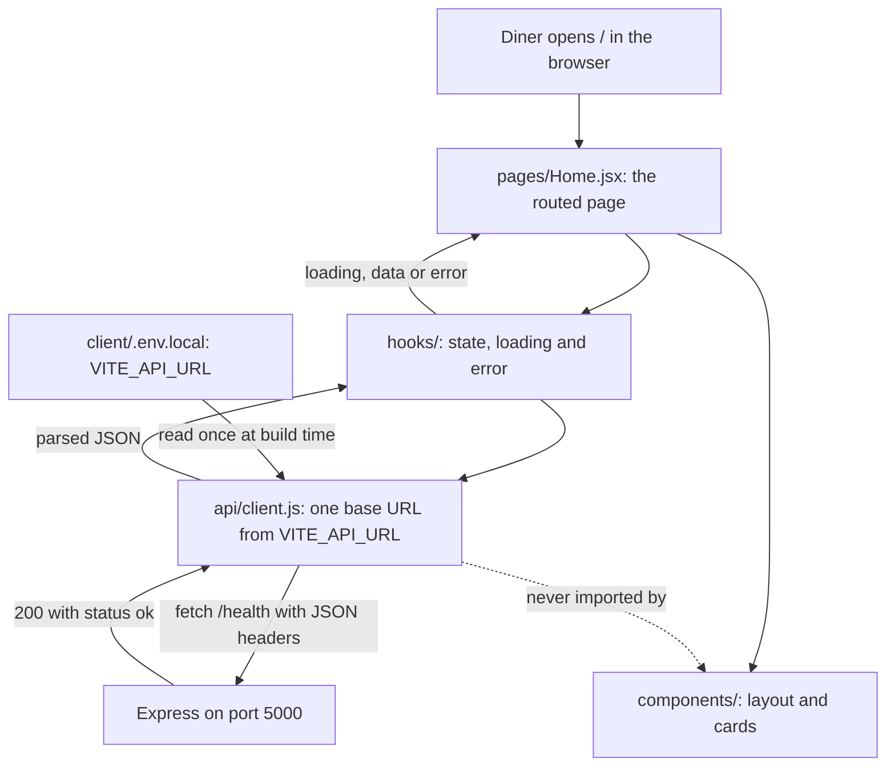

# 2.12 Scaffold client folders

> **[Build]** · Chapter 02 · Project skeleton · *Vite React app in `client/`; `src/pages/`, `src/components/`, `src/api/`, `src/hooks/`*

**Why this step matters:** Sufra is a product diners see in a browser, not a headless API. Scaffolding Vite + React now establishes where login pages, kitchen screens, and API helpers live for the rest of the course.

<BigWordAlert term="React SPA shell" plainEnglish="A single-page app with routing and layout components but minimal pages, the UI skeleton." whyItMatters="Sufra's client starts as a shell; browse, cart, and kitchen dashboard pages plug into the same router later." />

**Where the project is now:** The server runs and `GET /health` returns 200 JSON via curl.

**After this step:** A Vite + React app exists in `client/` with `pages/`, `components/`, `api/`, and `hooks/` folders.

## What this step decides

The server can already answer a request, but nobody can see it. This sub-chapter gives Sufra a face: one browser application that a diner opens on a phone to find lunch, and a cook opens on a laptop to publish a dish.

The scaffold is a Vite project with the React template. Vite gives you a development server with hot module replacement, a production build, and a preview command, all configured by a file you can read. React gives you components and the state model the rest of the course assumes. Neither choice is the lesson. The lesson is the four folders you add inside `src/`, because those folders are where the next six chapters put their work without asking you to invent an address.

There are four, and each answers a different question. `pages/` holds one component per route, the things a URL can point at. `components/` holds the pieces those pages assemble, from a `Layout` wrapper to a `DishCard`. `api/` holds the code that talks to Express, so the base URL and the headers live in one place instead of in twenty event handlers. `hooks/` holds reusable stateful logic, which is where Chapter 7's `useAuth` will live.

The rule that makes the four folders worth having is a rule about direction. A page may import a component, a hook, and an API helper. A component may import another component and, occasionally, a hook. A component must not read environment variables or build a URL, because then the address of your API is spread across the UI and a single port change becomes a search-and-replace across the whole client.

## The request path these folders encode

The diagram below traces one health check from the browser to Express and back, with the folder that owns each step. It is the path every later feature will repeat with a different URL.



Two things in that picture are worth arguing about. The dotted arrow is a rule, not a missing feature: components receive data as props and never import the API helper, so a card can be rendered in a test or a storybook page without a running server. The arrow from the environment file is drawn once, into `api/client.js`, because Vite inlines environment values at build time; if three files read `VITE_API_URL`, then three files have to be rebuilt and three files can drift apart.

The takeaway is that the folders are a contract about who is allowed to know what. Pages know routes, hooks know state, the API helper knows the server's address, and components know only their props.

## Step 1 · Create the Vite React app

From the **repository root**, not from inside `server/`:

```bash
npm create vite@latest client -- --template react
```

When prompted for a variant, choose **JavaScript**, not TypeScript, to match this course's MERN JS stack. The template writes `index.html`, `package.json`, `vite.config.js`, `public/`, and a `src/` folder with `main.jsx` and `App.jsx`. `main.jsx` is the entry point that mounts React onto the `#root` element in `index.html`.

```bash
cd client
npm install
```

`npm install` reads the template's `package.json` and downloads React, React DOM, and Vite into `client/node_modules/`. That download is the slowest part of this sub-chapter and the only part that needs the network. If it fails, the error names the package and the registry it tried to reach, and the usual causes are an offline machine, a proxy, or a Node version below 18. Run `node --version` before retrying.

Notice that `client/` now has its own `package.json` and its own `node_modules/`. That is deliberate and it is the difference between a monorepo and one big application: two processes, two dependency trees, two lifecycles. The server's dependencies are not the client's dependencies, and a version bump in one half should not force a reinstall of the other.

## Step 2 · Target client tree after this sub-chapter

```
client/
├── index.html
├── package.json
├── vite.config.js
├── public/
└── src/
    ├── main.jsx
    ├── App.jsx
    ├── index.css          (from the Vite template; trim later)
    ├── pages/
    │   └── .gitkeep
    ├── components/
    │   └── .gitkeep
    ├── api/
    │   └── .gitkeep
    └── hooks/
        └── .gitkeep
```

Compare that tree with what the template wrote. The difference is four folders and four empty files. Everything else is the untouched Vite template, which means a reader who knows Vite already knows ninety percent of your client, and a reader who does not can find the documentation for every file in the tree.

## Step 3 · Create the course convention folders

```bash
cd client/src
mkdir -p pages components api hooks
touch pages/.gitkeep components/.gitkeep api/.gitkeep hooks/.gitkeep
```

The `.gitkeep` files exist because Git tracks files, not directories. An empty folder is invisible to Git, so a teammate who clones your repository would receive a client with no `pages/` folder at all, and Chapter 2.13's instruction to create `pages/Home.jsx` would fail on a path that does not exist. A one-byte marker file makes the folder real in every clone until the first real module lands beside it. Once `pages/Home.jsx` exists, you may delete `pages/.gitkeep`; leaving it does no harm.

Remove or ignore the Vite template's default `App.css` and logo assets if you prefer a cleaner tree. Nothing in the gate depends on that cleanup, so do it now or in the styling pass, but do not let it delay the commit.

## Step 4 · Verify the Vite dev server

```bash
cd client   # if you are not already there
npm run dev
```

**Expected:** the terminal prints a Local URL, typically `http://localhost:5173`, plus a Network URL for testing on a phone over the same wifi. The browser shows the Vite + React welcome content with a counter button.

That screen proves a specific and narrow set of things: Vite compiled your `src/main.jsx`, React mounted a component tree, and the dev server is listening on a port. It does not prove the client can reach your API, because it has not tried. That gap is closed in 2.14 and 2.15, and the gap is worth naming now so the welcome page never gets mistaken for a finished milestone.

Click the counter button once. React re-rendered in place without a page reload, which is the behaviour hot module replacement and useState give you. Stop the dev server with `Ctrl+C` after confirming.

## Step 5 · Client `.gitignore`

The Vite template may include `client/.gitignore`. Ensure it ignores:

```
node_modules
dist
.env
.env.local
```

The root repository `.gitignore` from 2.8 already covers these patterns for the whole tree, so a second file inside `client/` is a duplicate rather than a necessity. It is harmless and it keeps the client folder self-contained if anyone ever lifts it out of the monorepo. What matters is that `client/node_modules/` and `client/.env.local` never reach a commit.

Vite reads environment values from `.env.local` at build time and exposes only names that start with `VITE_`. Chapter 4 uses that prefix to hand the client its API address, and the prefix is also the boundary: a server secret written into a client env file would be compiled into a public bundle, which is why the two env files never share values.

## Step 6 · Commit

From the repository root:

```bash
git add client/
git commit -m "chore(client): scaffold vite react app with folder convention"
```

Staging `client/` rather than everything keeps this commit about one decision. If `git status` shows server files as modified, they belong in a different commit with a different message, and a reviewer reading `git log --oneline` will thank you for the separation.

## npm scripts (from the template)

| Script | Purpose |
|---|---|
| `npm run dev` | Development server with hot module replacement |
| `npm run build` | Production bundle into `dist/` |
| `npm run preview` | Serve the production build locally |

You will use `build` in the Chapter 25 deploy, and `preview` is how you check a production bundle on your machine before it reaches a host. The dev server and the production build behave differently in one way that catches people later: the dev server reloads your source on every save, while the build runs once and writes static files. A page that works in dev and fails in preview usually depends on something only the dev server provides.

## What each client folder holds later

| Folder | Chapter 2 | Later |
|---|---|---|
| `pages/Home.jsx` | 2.13 to 2.15 | Browse, Cart, Login, Kitchen dashboard |
| `components/` | empty | DishCard, DeliveryWindowPicker, Layout |
| `api/client.js` | 2.14 | Central fetch, base URL, auth header |
| `hooks/` | empty | `useAuth.js` in Chapter 7, cart hooks in Chapter 18 |

Read the last column as a promise the folders are making. Every screen a diner or a cook uses in this course has a named home in that table, which is why the four folders exist before the pages do.

## Verify

| Check | Expected |
|---|---|
| `client/package.json` exists | Yes |
| `npm run dev` shows the React page | Yes |
| `src/pages`, `src/api`, `src/hooks`, `src/components` exist | Yes |
| `client/.env.local` absent from `git ls-files` | Yes |
| Committed to Git | Yes |

The third row is the one a reviewer checks by opening the repository rather than reading your terminal, which is the reason the `.gitkeep` files matter. The fourth row is the leak check: `git ls-files client | grep env` should return nothing.

## Failure modes you will actually meet

`npm create vite` failing with a version error means your Node version is too old for the current template. Check `node --version`, upgrade to a supported LTS release, and rerun the command in the repository root.

A `client/client/` folder means you ran the scaffold from inside a directory that already contained `client/`. Remove the inner folder before continuing, and run the command from the root so the path argument stays unambiguous.

A blank page with an empty `#root` element usually means React could not mount: open the browser console and read the first error, which normally names a missing import or a component that throws before rendering.

`EADDRINUSE` on port 5173 means another process, often an earlier dev server you forgot to stop, already holds the port. Stop it with `Ctrl+C` in its terminal, or start this one with `npm run dev -- --port 5174` and note the new URL.

A `pages/` folder that exists on your machine but not in a fresh clone means the `.gitkeep` file was never committed. Add it, commit again, and confirm with `git ls-files client/src`.

## ✅ Do / ❌ Don't

**✅ Do:** Keep `client/` as a sibling of `server/`, not nested inside the server.

**✅ Do:** Run the client and server dev scripts in **separate terminals** from Chapter 2.15 onward, so an error message belongs to exactly one process.

**❌ Don't:** Proxy the API through Vite in this chapter unless you document it and skip the CORS teaching, because the course uses an explicit `VITE_API_URL` plus CORS for clarity.

**❌ Don't:** Put Express code inside `client/`, ever. The browser bundle cannot run a server, and a `require` in a client file fails at build time with an error that reads like a mystery.

## Hint

If `npm create vite` fails, check that Node is version 18 or newer. The alternative is a manual Vite setup following the official guide, which ends with the same tree and the same scripts.

## Next

**Sub-chapter 2.13:** React Router shell and a `pages/Home.jsx` stub. Minimal on purpose; the health fetch arrives in 2.15.
