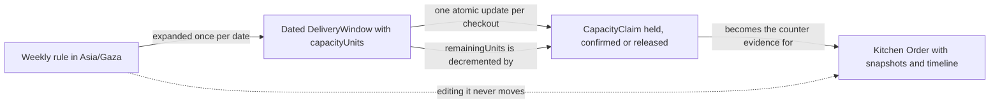

# Rules, windows and claims are three kinds of time data

Umm Yousef cooks lunch on most weekdays between 13:00 and 14:00 in Beit Hanan. At 11:31 on a Thursday, Lina opens Sufra and asks for a tray of maqluba in today's lunch window. Before the app can answer, three different records must agree. One says what the cook normally does. One says what she is actually offering today. One says how much of today's offer Lina would consume if she ordered.

Teams that squeeze all three meanings into one field usually meet the difference in production. The cook pauses on Thursday and the app quietly removes her Thursday schedule for every future week. Two diners both read "three units left" and both believe the kitchen saved the last tray for them. A cook starts preparing food for a diner who closed the payment page. Each of those bugs comes from answering a scheduling question with the wrong record, so this module names the three records before you write a single schema.

The order matters. You are about to choose a database and defend the choice, and that argument only works if you can say what each record is for. Picking MongoDB because the rest of the stack is JavaScript is not a defence. Picking it because a window and its claims are read and changed together, while a cook's weekly plan is a small repeating document, is a defence you can explain in a viva.

## A rule repeats, and it is written in the cook's clock

The weekly template is the first kind of time data. It stores a weekday, a local start, a local end, a planned capacity and a general cutoff lead, for example Monday to Friday, 13:00 to 14:00, ten load units, with orders generally closing sixty minutes before the start. The kitchen also stores a named zone, `Asia/Gaza`, so the local 13:00 can be resolved to a real instant on each date.

A rule is a statement about a pattern, not about a meal. It cannot answer whether Lina can eat today, because the same sentence describes every weekday since the kitchen opened. It also cannot answer how many units remain, because that number is consumed by real diners and must be counted once per date. What the rule can do is generate dated offers and explain to the cook what she has promised to consider.

Because the rule repeats, editing it must not rewrite the past. If Umm Yousef changes Monday lunch to 12:30 next month, this month's paid orders keep their promised times. The rule feeds future generation only. That single sentence already tells you the rule and the promise cannot be the same document field, or an edit would move a meal a diner has already paid for.

## A window is one dated occurrence with one counter

The second kind of time data is the delivery window. It names one kitchen and one interval that really exists: a UTC start, a UTC end, the kitchen zone used when it was generated, a local date label, a general cutoff, a capacity and a remaining count. The seed in Module 5 creates these directly. Module 14 generates them from the weekly template.

A window is where capacity lives, and it is consumed exactly once. Ten units on Thursday 13:00 belong to that Thursday. Friday has its own ten, and spending Thursday's units cannot touch them. The database also needs to prevent two copies of the same occurrence, which is why the course puts a unique index on the kitchen and the UTC start.

This is also the record a cook can close. Closing a date stops new claims on that occurrence. It must not delete the row, because paid orders point at it and a deleted row would erase the evidence of what was promised. A closed window is a window with a status, not an absence of a window.

## A claim is a counted promise inside one window

The third kind of time data is the capacity claim. At checkout, Lina wants three of Umm Yousef's ten units held while she pays. The claim records a stable identity, the checkout attempt, the units, a state of `held`, `confirmed` or `released`, and an expiry. The important detail is where it lives in the Sufra design: inside the window document, beside the counter it changes.

That placement is a decision, and Module 3 is where you record it. Two writes, one for the counter and one for the claim, can be separated by a crash, and then nobody knows which units to release. One document update that decrements `remainingUnits` and appends the claim cannot be half applied. The claim is not an order either. A hold may expire without payment, and a draft order may point at a claim that never becomes a purchase.

## The clock is an input, not a record

One more thing about time: none of those three records knows what time it is now. A window says its cutoff was 12:00, but only the server clock can tell you that 12:00 has passed. That is why Sufra never asks the browser to decide whether a dish is still orderable. A phone with a wrong clock, or a diner who changes the clock to buy a late lunch, would otherwise get a different answer from the same data.

The server reads one instant and compares it with the stored instants. That comparison happens on every browse request, every cart addition and again inside the checkout claim. The repetition is deliberate. A window that was open when Lina opened the app may be closed by the time she pays, and the last check must run against stored state rather than against a page that was rendered a minute ago.

## The order is the promise a diner can read

A kitchen order is a fourth record, but it does not schedule anything. It records what one kitchen sold: the diner, the kitchen, the window times frozen at purchase, and item snapshots with name, price, preparation minutes and load units. It also carries a status timeline with sequence numbers so a reconnecting phone can catch up.

The timeline is a log of what happened, not a source of availability. It answers "what did the cook do at 13:12", not "can I still order". Keeping that boundary clear stops a tempting mistake: reading the newest timeline event to decide whether a window is open. Availability comes from the window and the clock; history comes from the order.

## One diagram, three commitments

The diagram below puts the three kinds of time data in order and labels what changes at each step. Read the arrows as different kinds of commitment, not as a data flow you can rerun.

Notice the dotted arrow. A cook editing the weekly template must not reach through the window and change a paid order. Notice also that the claim sits between the window and the order. That position is what makes a hold reversible without touching the diner's purchase record.

## The bug each confusion creates

| Confusion | What breaks | Where the fix belongs |
|---|---|---|
| Rule treated as today's offer | A Thursday pause deletes every Thursday | A dated exception, not a template edit |
| Window without a unique identity | Two rows describe the same lunch and split the units | Unique index on kitchen and UTC start |
| Claim kept outside the window | Counter and claim disagree after a crash | One conditional update on one document |
| Claim treated as an order | A cook prepares food nobody paid for | Order created only after verified payment |
| Timeline read as availability | A closed window still looks orderable | Availability reads the window and server clock |

The table is short because each row names one owner for the value. A counter that leaks usually has two writers. A closed date that reopens usually has a generator that resets state. A cook who cooks for a hold usually has a query that treated `held` as `paid`.

## What this module asks you to decide

By the end of this module you will commit a decision, not only an opinion. You will compare a relational shape and a document shape for the same kitchen schedule, name where each one wins, and defend the choice for Sufra with a dated example. Then you will draft `docs/erd-draft.md` with the four records above and their ownership arrows.

Be honest in that draft about the weak spots. A document store gives you a natural boundary around one window and its claims, and around one order with its timeline. It does not give you a declarative rule that two windows for the same kitchen may not overlap, and it does not give you a single query that sums claims across every kitchen in the city without an aggregation stage. The next lesson puts those costs on the table next to the benefits.

Keep one running example in your notes: Lina, Umm Yousef, Beit Hanan, Thursday 13:00, ten units, a maqluba tray worth three units, and a general cutoff at 12:00. Every claim you make about the model should be testable against that example. If a sentence about your design cannot be checked against Lina's tray, it is probably too general to help you later.

References: [MongoDB BSON date type](https://www.mongodb.com/docs/manual/reference/bson-types/), [MongoDB write operations and atomicity](https://www.mongodb.com/docs/manual/core/write-operations-atomicity/).
