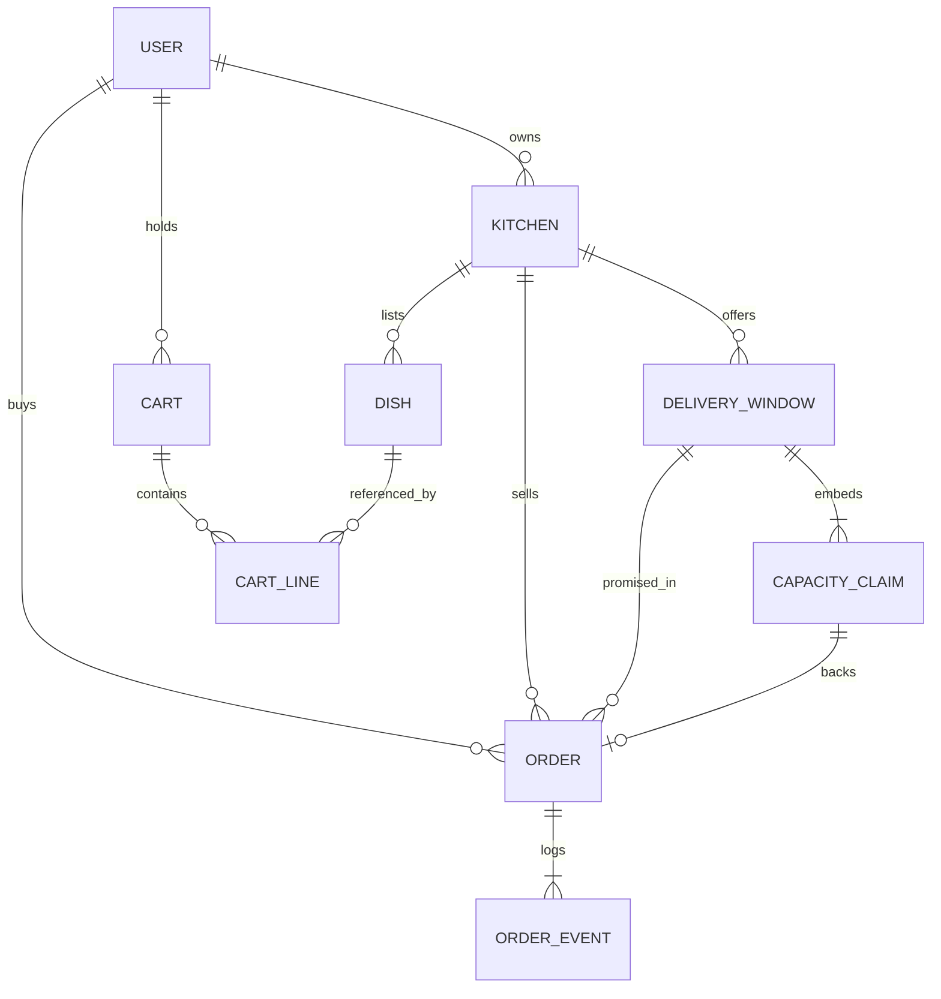

# The decision for Sufra and the first ERD

A decision you cannot defend in a viva is a preference. By now you have seen that PostgreSQL would beat MongoDB on one rule in this domain, and that MongoDB fits the boundary the course actually changes. The work in this lesson is to write the choice down in a form a reviewer can attack, then draw the first ERD that supports it.

You are not building the final model. Module 5 owns the finished schemas and the seed, Module 14 owns generated windows, and Module 19 owns the claim transition. What you commit today is `docs/erd-draft.md`, a draft that names the records, the ownership arrows, the chosen shape and the cost you accept. A draft that names its own weak point is worth more than a tidy one that hides it.

## Write the decision as one paragraph

Start the file with a short decision record. It should say what object store Sufra uses, which four records the store must hold, and which two guarantees the application must supply because the database will not. Keep it to four or five sentences so a reader cannot escape into detail.

A usable version reads like this. Sufra stores its domain in MongoDB because a dated delivery window and its capacity claims change together, an order and its status timeline change together, and both are read as one document by the screen that shows them. The cost is that the database will not reject two overlapping windows for the same kitchen, so the generator owns that rule and the unique index on kitchen and start only catches exact duplicates. The cost is also that summing claim units across many kitchens is an aggregation rather than a grouped query, which the course accepts because no core screen needs it.

Notice what that paragraph does not say. It does not claim MongoDB is faster in general, and it does not claim relational databases cannot model time. It names a boundary, a benefit and two costs. A reviewer can disagree with a specific sentence rather than with the whole choice.

## Put each decision in the table

The table is the part a reviewer will read first, because it shows that you compared rather than repeated. Add a row only when the row changes a design choice. A row that says "MongoDB is popular" is not a decision.

| Decision | Shape chosen for Sufra | Relational alternative | Cost accepted |
|---|---|---|---|
| Window identity | Unique index on kitchen and UTC start | Unique constraint on the same pair | Overlap needs generator logic |
| Capacity counter | Field on the window, changed conditionally | Column with a check constraint | Every update must carry the filter |
| Claim identity | Embedded in the window | Row with a window foreign key | Claim array must stay bounded |
| Claim and counter write | One document update | One transaction | Cross-kitchen work is not atomic |
| Order contents | Item snapshots inside the order | Item rows joining the dish | Duplicate data by design |
| Order timeline | Embedded event array with sequence | Event table with an index | Document growth needs a cap |
| Per-dish cutoff | Computed from window start and dish fields | Same formula in SQL | No stored cutoff to index |
| Browse by window | Two indexed reads | Joins across five tables | Aggregation for cross-kitchen totals |
| Cross-kitchen checkout | Compensating release with claim IDs | A single transaction | Recovery path must be tested |

The two rows that will be challenged in a viva are the claim write and the cross-kitchen checkout. Be ready to say what happens when the process stops between two kitchens. The answer is not "MongoDB handles it". The answer is a deterministic claim ID, a recorded attempt state and a release path that is safe to repeat.

## Draw the first ERD

The diagram shows the entities you must draw today, with the claim marked as embedded inside the window. It is deliberately small. A draft that fits on a phone screen can be reviewed in one sitting, and you can add order event fields later without redrawing the ownership arrows.



Two arrows deserve a note in the file beside them. The order points at a window and a claim, but it also stores frozen copies of the window times and item fields, so a later edit cannot rewrite the purchase. The cart points at dishes but owns no capacity, because a line in a cart is a request and not a hold.

Do not draw the status as a field on the window. A closed window is still a window, and a paid order still points at it. If your first sketch deletes the window when the cook pauses, fix that before you write anything else.

## List the fields you are sure about

You do not need every field today. You do need the fields that carry an argument, because those are the ones a reviewer will check against the lessons that follow.

```ts
// Draft field list for docs/erd-draft.md. Types are indicative, not final.
interface KitchenDoc {
  ownerUserId: string;
  name: string;
  zone: string;              // IANA name, for example Asia/Gaza
  serviceAreas: string[];
  weeklyRules: Array<{ weekday: number; localStart: string; localEnd: string; capacityUnits: number; cutoffLeadMinutes: number }>;
}

interface DishDoc {
  kitchenId: string;
  name: string;
  priceMinor: number;
  prepMinutes: number;       // drives the per-dish cutoff
  loadUnits: number;         // drives the shared capacity claim
  maxPerOrder: number;
}

interface DeliveryWindowDoc {
  kitchenId: string;
  startAt: Date;             // UTC
  endAt: Date;               // UTC
  cutoffAt: Date;            // UTC, general cutoff
  kitchenZone: string;       // zone used at generation
  capacityUnits: number;
  remainingUnits: number;
  claims: Array<{ id: string; attemptId: string; units: number; state: string; expiresAt: Date }>;
}

interface OrderDoc {
  kitchenId: string;
  dinerUserId: string;
  windowId: string;
  claimId: string;
  windowTimesAtPurchase: { startAt: Date; endAt: Date; zone: string };
  items: Array<{ dishId: string; nameAtPurchase: string; priceMinorAtPurchase: number; prepMinutesAtPurchase: number; loadUnitsAtPurchase: number; quantity: number }>;
  events: Array<{ seq: number; status: string; at: Date; actorUserId: string }>;
}
```

Read the four shapes together and find the missing counter. There is no `quantityLeft` on the dish, and no other per-dish number that goes down. The window owns the only number that is consumed, and the dish owns only the inputs that turn a portion into work. If a draft still carries a per-dish counter, delete it and explain in one line why the window is the owner.

## Prove one rule with a failing test

A decision without a failing test is a sentence. Write the smallest test that shows the database refusing a duplicate dated window, run it before you build the index, and keep the output as evidence.

```js
// tests/model/window-uniqueness.test.js
import { describe, it, expect, beforeAll, afterAll } from 'vitest';
import { connect, disconnect, Window } from '../../src/db.js';

beforeAll(connect);
afterAll(disconnect);

it('rejects a second window for the same kitchen and start', async () => {
  const kitchenId = 'kitchen-umm-yousef';
  const startAt = new Date('2026-11-05T11:00:00.000Z');
  await Window.create({ kitchenId, startAt, endAt: new Date('2026-11-05T12:00:00.000Z'), capacityUnits: 10, remainingUnits: 10 });
  await expect(
    Window.create({ kitchenId, startAt, endAt: new Date('2026-11-05T12:00:00.000Z'), capacityUnits: 4, remainingUnits: 4 })
  ).rejects.toThrow(/E11000/);
});
```

On a fresh database without the index, the second insert succeeds and the runner reports the failure you want to see once.

```text
FAIL  tests/model/window-uniqueness.test.js
AssertionError: promise resolved "null" instead of rejecting
  at tests/model/window-uniqueness.test.js:14:5
```

Add the compound unique index on `kitchenId` and `startAt`, drop the two window documents created by the failed run, and run it again. The same test now passes because the database, not the test helper, refuses the duplicate. This is the pattern for the rest of the course: write the rule as a test, then make the store enforce it.

## Where a reader will push back

Three challenges arrive every time this draft is reviewed, so answer them in the file before someone asks. The first is about overlap. Someone will point out that the unique index does not stop a 13:00 to 14:00 window and a 13:30 to 14:30 window for the same kitchen, and they are right. Write down that the generator creates windows from one template per date, that it upserts on the exact start, and that a manual window added through any future admin tool must call the same validator. The rule lives in one function, and the index is a second net for the common case.

The second challenge is about the claim array growing without limit. A busy window with hundreds of small holds would make the window document large and every update heavier. The course caps capacity per window and keeps claim history bounded, which makes the array safe at this scale. Say so, and name the condition that would force a change: a window that regularly takes hundreds of holds would move claims to their own collection and pay for a transaction.

The third challenge is about the diner's address. It must not sit on the window, because the window is public offer data, and it must not sit on the kitchen, because the address belongs to one purchase. The draft should place it on the order, protected by the same ownership check that guards the rest of the order, and note that a cook sees only the fields needed to deliver. That single sentence saves a privacy bug later in Module 8.

You can also pre-empt a smaller question: why not keep a per-dish counter for display, so the menu can show "three trays left"? Because the counter would describe one shared pool while pretending to describe each dish. Two dishes would show three trays each, and the kitchen would appear to have twice the work it can do. If a screen needs scarcity, it should read the window's remaining units and label them as the window's, not the dish's.

## Draft the file

Create `docs/erd-draft.md` with five sections in this order: the decision paragraph, the decision table, the ERD, the field list, and the open questions. The last section is not optional. Write at least two questions you cannot answer yet, such as where a diner's delivery address lives and how many claims a window may retain before the array becomes a problem.

Fill one worked row so the draft is concrete. Take Umm Yousef's Thursday lunch window, capacity ten, remaining ten, cutoff 12:00 UTC for a 13:00 start, and Lina's three-unit maqluba claim at 11:31. Show the window before and after the claim, and show the accounting line that must still balance.

Commit the draft with the test file and the failing output. Do not commit a database connection string. The gate in the next lesson asks you to defend the draft, so leave your reasoning visible rather than cleaning it up into a summary.

## Acceptance criteria

- [ ] `docs/erd-draft.md` opens with a decision paragraph that names one benefit and two costs.
- [ ] The decision table has a row for window identity, the counter, the claim, the order snapshot and the timeline.
- [ ] The ERD shows cook ownership of kitchen and dish, diner ownership of cart and order, and the claim inside the window.
- [ ] The field list has no per-dish quantity counter and no cutoff stored as a local string on the order.
- [ ] The uniqueness test fails before the index exists and passes after it.
- [ ] The open questions section names at least two unsolved problems with a sentence each.

If the draft answers every question, it is probably hiding one. A model this young has at least two unknowns, and the honest version names them.

References: [MongoDB compound unique indexes](https://www.mongodb.com/docs/manual/core/index-unique/#unique-compound-index), [Mongoose schema indexes](https://mongoosejs.com/docs/guide.html#indexes).
