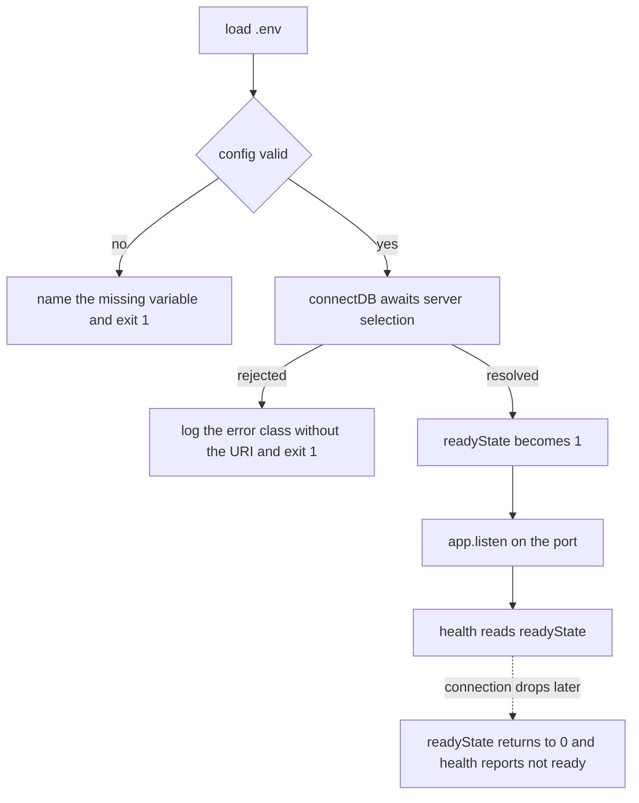

# 4.6 ,  Prime your thinking

> **[Learn]** · Chapter 04 ,  Config & database · *Mandatory read: Mongoose connection docs*

Before you write `shared/db.js`, read how **Mongoose** expects connections to work in modern Node (async/await, connection events, disconnect). This sub-chapter is a **mandatory reading assignment** ,  not optional skimming.

<BigWordAlert term="Twelve-factor config" plainEnglish="Store config in the environment, not in code ,  so dev, staging, and production differ by env vars only." whyItMatters="Sufra follows this pattern: one codebase, many deployments, secrets injected at runtime." />

You already decided *why* MongoDB (Chapter 3). This read covers *how* the driver connects ,  so your boot sequence in 4.11-4.12 matches official patterns.

```predict
prompt: "MongoDB is unavailable when Sufra starts. Which boot sequence tells the truth?"
options:
  - id: listen-first
    label: "Start listening first, then connect in the background"
  - id: connect-first
    label: "Connect to the database first, then start listening"
correctOptionId: connect-first
explanation: "Connecting first prevents the API from accepting requests it cannot complete. A failed connection should stop startup with a clear error instead of exposing a misleading healthy process."
allowRetry: true
```

## Why this matters

Connection bugs feel mystical ,  "Mongoose buffering timed out" with no context. Twenty minutes on the Connections page tells you **await connect before listen**, what `readyState` means, and why `db.js` should be shared with the Chapter 5 seed script. You are not memorizing API surface ,  you are preventing the most common Week 1 backend stall.

## The boot order decides what a failure looks like

Two Sufra deployments can run identical code and behave completely differently at startup, because the order of four steps decides whether a wrong credential appears in the boot log or hides until a diner's order fails ten minutes later. The order is environment, then validated config, then connection, then listener. Each step consumes the guarantee the step before it established: `shared/config.js` cannot validate `MONGODB_URI` before `.env` has been loaded, `connectDB()` cannot open a pool before config has approved that URI, and `app.listen()` should not accept a single request before a pool exists.

This ordering feels fussy only until you see what the alternative looks like from the outside. A process that calls `listen` first looks healthy to everything that matters: the platform accepts the port, the release is marked live, the health probe may even pass because the HTTP server is genuinely up. Only the diners notice, because every Kitchen lookup hangs or returns an empty array while the connection is still being negotiated. Failing before `listen` converts a silent user-facing outage into one operator-facing crash on one screen, which is a much cheaper place to discover a typo in a connection string.

The diagram below follows the same four steps and draws every arrow that leaves them. Notice that exactly one path reaches `listen`, and that both failure paths end the process instead of leaving a running server that cannot serve.



The takeaway is the shape of the graph rather than any single box: startup is a chain of preconditions, and a server that reports readiness is only telling the truth if the left-hand column of that chain actually completed.

## What `connect()` is really waiting for

`await mongoose.connect(uri)` does not open one socket. It starts server selection, opens a connection pool, and resolves once the driver has found a server it can talk to. That distinction explains the strangest error of a first backend week. Model calls made before the promise resolves do not throw straight away; Mongoose buffers them, queuing each operation against a connection that is still being established, then fails the whole queue when the wait expires. The wait is governed by `serverSelectionTimeoutMS`, thirty seconds by default, so a misspelt hostname in development looks like a hang rather than a rejection.

Lowering that timeout in development is a debugging convenience, not a production opinion. The number answers a real question: how long should this process behave as if it is about to succeed? On a managed cluster that disappears for twenty seconds during an election, a generous window is correct and buys you an uneventful failover. On a laptop pointing at a database that was never started, a short window gets you to the real message while you still remember what you changed.

## Worked trace: one cold boot

Trace the Sufra server starting against a cluster that is reachable but slow to elect a primary. Each step is a line you should expect to see in the boot log, and the reason the order matters is that steps three and four can otherwise be waiting at the same moment.

<TraceRequest title="Boot against a cluster that is slow to elect a primary">
  <TraceStep actor="Server" label="config: load .env, then validate" detail="MONGODB_URI and JWT_SECRET are present, so config returns a frozen object" />
  <TraceStep actor="DB" label="connectDB: await server selection" detail="Pool opens, the driver waits for a primary, readyState moves from 2 to 1" />
  <TraceStep actor="API" label="server: mount routes, then listen" detail="The listener starts only after the awaited connection resolves" />
  <TraceStep actor="Server" label="health: report readyState" detail="Health answers 1 while the pool is up and 0 after a drop" />
</TraceRequest>

Read the trace backwards to see why the order is not cosmetic. Health can only report a connection that connectDB established, listen can only serve routes that expect a connection, and connectDB can only use a URI that config has already validated. Break one link and the later steps do not fail loudly; they keep serving requests that cannot complete.

## Failure modes and the path through them

Nearly every startup failure in this chapter falls into four groups, and each one has a different first move. "Mongoose buffering timed out" means something ran a query or started listening before the connection resolved, so the fix is ordering, not the URI. An authentication failure means the username, password or auth database inside the URI is wrong, which is the one case where you must read the URI carefully and then avoid logging it. A server selection timeout with no other detail usually means the host is not reachable at all: the Atlas network access list, a VPN, or a wrong cluster name. A refused connection on a local address means nothing is listening on that port, so check that the local database process is running before you touch application code.

The debugging path is the same for all four. Print `connection.readyState` on every transition instead of printing the URI, run a five-line script that calls `connectDB()` and nothing else so the HTTP layer cannot confuse the result, and only then compare against the values config resolved. Working this way separates "my config is wrong" from "my connection is wrong" from "my ordering is wrong", which are three different bugs that share the same vague symptom.

## Common questions

**Q: Can I copy the Mongoose docs sample server verbatim?**  
A: Don't copy it wholesale ,  adapt the pattern to your project's structure. The docs show a complete server with the connection inline, but your course layout already decided that config lives in `shared/config.js` and the connection helper is `connectDB()` in `shared/db.js`. What you *should* take from the docs is the concept: `await mongoose.connect(uri)` before you start listening, and how the connection events behave. Think of the docs as the recipe and your modules as your kitchen ,  same ingredients, arranged the way your project already does things.

**Q: Should health use `readyState` or a boolean I set?**  
A: Either is correct, as long as the health JSON always reflects the real connection state. `connection.readyState` is Mongoose's own answer ,  `0` disconnected, `1` connected, `2` connecting, `3` disconnecting ,  so reading it costs nothing and can't go stale. A boolean you set right after `connectDB()` succeeds is simpler, but it only captures the moment you connected; if the database dies later, that boolean still says "true." For a health check whose whole job is telling the truth, `readyState` is the more honest signal.

**Q: Why read disconnect if MVP never shuts down gracefully?**  
A: Because "my dev machine never restarts" is a lie you'll meet in production, and disconnect is the flip side of connect ,  understanding it makes the whole connection model click. When a deploy platform restarts your server, it sends a shutdown signal; handling it with `mongoose.disconnect()` lets pending writes finish and closes the connection pool cleanly instead of dropping the database mid-request. It's optional for the gate, so don't stress, but skimming that section now means later you'll recognize what `SIGTERM` handlers and graceful shutdown are for.

**Q: What is "Mongoose buffering timed out" and why does it happen?**  
A: It's Mongoose's way of saying "your code asked me to touch the database before I ever connected." While a connection is being established, Mongoose *buffers* operations ,  it queues them up, waiting for the connection to complete. If the connection never succeeds, those queued operations time out with that error, and it usually means your app tried to run a query (or started `listen`) before `mongoose.connect()` finished. The fix is the ordering this chapter keeps repeating: load env → validate config → connect → listen. If `MONGODB_URI` is wrong or the database is down, fail at boot with a clear error instead of mystery timeouts later.

## Mandatory read

**Primary:** Mongoose ,  Connections  
https://mongoosejs.com/docs/connections.html

**Focus on these sections:**

1. **Connecting to MongoDB** ,  `mongoose.connect(uri)` basics  
2. **Connection states** ,  `readyState` values (disconnected, connected, etc.)  
3. **Error handling** ,  connection errors vs query errors  
4. **Disconnection** ,  `mongoose.disconnect()` for graceful shutdown  
5. **ESM note** ,  if using `"type": "module"`, import style matches your Chapter 2 setup  

**Secondary (skim):** Connection string format  
https://www.mongodb.com/docs/manual/reference/connection-string/

Enough to understand `mongodb://` vs `mongodb+srv://` ,  you already picked URI in 4.5.

## What to extract for your implementation

While reading, note answers to these ,  you'll implement in 4.11:

| Question | Why it matters |
|---|---|
| Does `connect()` return a Promise? | `server.js` will `await connectDB()` |
| What happens if URI is invalid? | Fail-fast behaviour at boot |
| How do I know connection succeeded? | Log once; health check reads state |
| Should I pass options to `connect()`? | e.g. `serverSelectionTimeoutMS` for clearer failure in dev |
| Is one connection pool shared? | Yes ,  default; one connect per process |

**Do not copy-paste** the docs' entire sample server into your repo ,  adapt to your `config.js` + module structure.

## Connection states cheat sheet (from docs)

Mongoose tracks `connection.readyState`:

| Value | State |
|---|---|
| 0 | disconnected |
| 1 | connected |
| 2 | connecting |
| 3 | disconnecting |

Health endpoint in 4.13 may use this ,  or a boolean you set after successful `connectDB()`. Either is valid if accurate.

## Common beginner mistakes (read before coding)

1. **Calling `listen` before `connect` completes** ,  race: first request hits DB before ready.  
2. **Multiple `connect()` calls** without checking ,  duplicate connection attempts.  
3. **Ignoring connection errors** ,  empty catch block; server runs without DB.  
4. **Logging full URI** on error ,  leaks password in terminal logs.  
5. **Forgetting to load `.env`** before reading config ,  `MONGODB_URI` undefined.  

Chapter 4 build steps explicitly order: load env → validate config → connect → listen.

## Optional deep read (not gate)

- **Buffering:** Mongoose queues operations while connecting ,  know it exists; don't rely on it for health semantics.  
- **Server selection timeout:** Tuning Atlas vs local failure messages.  

One paragraph in learning log if you tune timeouts ,  optional.

## Reflect ,  write in notebook or learning log draft

After reading, answer without opening the docs:

1. What is the difference between a **connection error at startup** and a **query error** after connected?  
2. Why should `connectDB()` live in `shared/db.js` instead of inline in `server.js`?  
3. What does `mongoose.disconnect()` do and when would you call it?  

If you can't answer #2, re-read the "Connections" page section on best practices.

## How this connects to Chapter 5

Chapter 5 creates **models** ,  `User`, `Product`, etc. Models require an **active connection** before `Model.create()` works. Same `connectDB()` helper will be imported by `scripts/seed.js`.

If `db.js` is wrong, every schema chapter fails for the same reason ,  fix connection once, everywhere benefits.

## Time box

**Minimum:** 25 minutes focused reading + reflect questions.  
**If rushed:** Read "Connecting" + "Error handling" + disconnect section ,  skip advanced pooling.

## ✅ Do / ❌ Don't

**✅ Do:** Read official Mongoose docs ,  version matches your `npm install mongoose` major version.

**✅ Do:** Keep docs tab open while writing `db.js` in 4.11.

**❌ Don't:** Use deprecated callback-only patterns from old Stack Overflow answers.

**❌ Don't:** Skip reading because "I'll figure it out when it breaks" ,  boot bugs waste evenings.

## Next

**Sub-chapter 4.7:** Configuration and database knowledge check ,  complete it before **4.8** starts the build.

Reading done → hands on keyboard in the build cluster.
