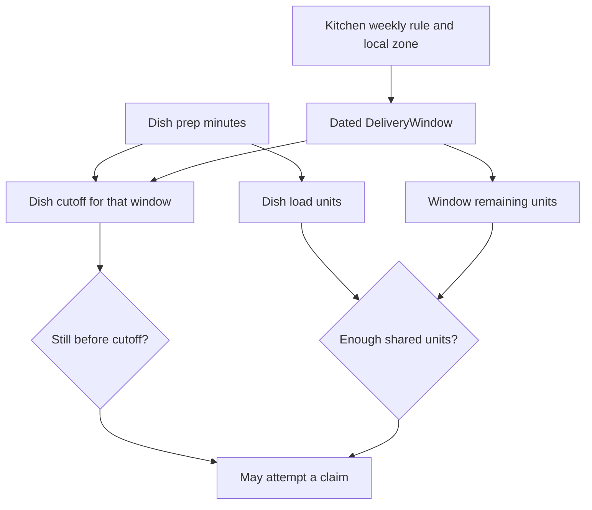

# Time is the inventory

Umm Yousef can prepare lunch for a limited number of diners between 13:00 and 14:00. A tray of maqluba takes longer and uses more of her kitchen's effort than a falafel wrap. When that interval passes, unused effort cannot be placed on a shelf and sold tomorrow. Sufra therefore models capacity on a dated delivery window, not as stock on each dish. The menu describes what the cook can make; the window says when and how much work the kitchen can accept.

This module turns that distinction into data. You will model kitchens, dishes, dated windows, claims, carts and orders. Then you will seed three fictional kitchens, seven days of dated examples and two diners. You will inspect the documents and draw an ERD that explains ownership and references. Later modules add full schedule generation, checkout concurrency, payment and live tracking. A good foundation makes those steps possible without pretending they already exist.

## A dish can be listed without being orderable

Maqluba may appear on Umm Yousef's menu every week. Today at 11:31 it is too late for a 13:00 lunch if it needs 90 preparation minutes and a 20-minute travel buffer. The dish record has not disappeared. Its price, name and preparation setting are still valid. The dated window and current server time decide whether this particular order can be promised. A later 18:00 window may still be possible, subject to the cook's schedule and capacity.

Falafel may be timely at 11:31 but unavailable because the kitchen's remaining load units are zero. That is the other half of the model. `prepMinutes` helps calculate a per-dish deadline; `loadUnits` helps calculate whether the shared capacity pool can fit the cart group. Both belong to the dish, but neither is a stock counter. `remainingUnits` belongs to the dated window and changes when checkout holds or releases work.

The diagram shows the two paths to an orderable offer. The cutoff and capacity paths meet at checkout; one does not replace the other.

The last box says "may attempt" because browse and cart do not reserve units. Two diners can see the same available meal. The M19 claim update makes the final decision. This module only creates the fields and relationships that let that update be expressed. It does not use a `stockQty` on the dish to simulate cooking capacity.

## One kitchen has many dated windows

A kitchen keeps its named time zone and weekly schedule. A schedule rule might say lunch runs Monday through Friday at 13:00 local time. A dated window is one specific occurrence: a UTC start and end, a local-date label, a cutoff, a capacity and a status. The cook may close one occurrence without deleting the weekly rule. A paid order points to the dated occurrence and snapshots its promised times, so a future schedule edit does not move the old meal.

This is why the window has a unique identity. The seed and later generator must not create two copies of the same kitchen's 13:00 occurrence. A compound unique index on kitchen and UTC start protects against duplicate inserts. The generator also uses an idempotent upsert that leaves existing `remainingUnits` and claims alone. The index catches a race between two generator processes; the upsert expresses which fields are set only on first creation.

The kitchen's zone is an IANA name such as `Asia/Gaza`, not a guessed fixed offset. A local 13:00 rule needs that zone and a date before it becomes a UTC instant. The seed in this module uses explicit historical dated UTC fixtures so you can inspect relationships without building the full conversion engine yet. M14 will replace those static fixtures with a seven-day generator and test a clock-change date. Do not mistake static seed data for a production scheduler.

## Claims belong to the window counter

At checkout, a diner needs a short hold on cooking units. The counter decrement and its claim identity must be recorded together. If they are separate writes, a process stop between them can leak capacity. Sufra uses a compact `CapacityClaim` subdocument embedded in its `DeliveryWindow`. It stores a stable claim ID, checkout attempt ID, units, state and expiry. The window update can decrement `remainingUnits` and append the held claim atomically because both live in one MongoDB document.

The active accounting rule is `remainingUnits + heldUnits + confirmedUnits = capacityUnits`. Released claims contribute zero to used units. This rule is simple enough to inspect in a seed fixture, even though the claim transitions arrive in M19. The claim array is bounded by the course's window capacity and retained only for the useful window history. A much larger marketplace would review document growth and perhaps choose a transaction-backed separate claim collection.

The claim is not an order. A hold may expire without payment. An order is the kitchen's customer-facing promise with item snapshots, price, window times and a status timeline. A draft order points to a claim; a verified payment event later confirms it. This separation prevents the cook dashboard from treating a diner who merely opened payment as a meal to prepare.

## One cart, separate kitchen orders

The cart belongs to one diner and one chosen delivery interval. It can contain dishes from several kitchens whose dated windows match that interval. Each line references a dish and the kitchen's matching window. Checkout groups lines by kitchen, calculates load and price on the server, claims each window, then creates one draft order per kitchen. The diner sees one total and one payment path. Each cook sees only their own order after payment is confirmed.

An order item freezes the dish name, price in minor currency units, preparation minutes and load units. The order also freezes the chosen UTC window times and the kitchen zone used to explain them. A cook can edit future menu settings, but the paid order remains an account of what the diner bought. A status timeline will later keep acceptance, cooking and dispatch changes in sequence, so a reconnecting diner can see current truth.

This module defines the fields, references and indexes. It does not implement the full payment or live event flow. Keep that boundary honest in seed data: seeded draft orders are examples, not proof of a Stripe payment. If you include an example paid order for UI work, mark it clearly as a fixture and never confuse it with a verified webhook result.

## Start the model with a question

In `docs/erd-draft.md`, draw User, Kitchen, Dish, DeliveryWindow, CapacityClaim, Cart and Order. Give each relationship one sentence: who owns it, what dated promise it represents, and what must stay immutable after payment. Use the 13:00 lunch example to fill one sample window row. Give it ten capacity units, no claims and ten remaining. Then show how a three-unit hold would change the row. The sum should still be ten.

If you find yourself adding `stockQty` to a dish or storing only `"13:00"` on a paid order, stop and explain what event would make that field stale. The next lesson works through the stock trap directly. It shows why the grocery model cannot be renamed into a cooking model without changing the constraint.

Keep the ERD small enough to read on a phone. Put the stable IDs and ownership arrows first, then the fields needed for the lunch promise. You can add a detailed status timeline later without redrawing every menu field. A model is useful when a teammate can use it to answer where a cutoff, a capacity counter and a paid snapshot belong.

References: [MongoDB BSON Date](https://www.mongodb.com/docs/manual/reference/bson-types/), [MongoDB single-document atomicity](https://www.mongodb.com/docs/manual/core/write-operations-atomicity/), [MongoDB compound unique indexes](https://www.mongodb.com/docs/manual/core/index-unique/).
