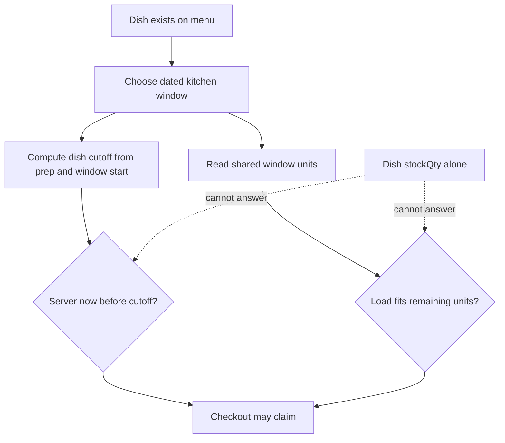

# The stock trap

An earlier grocery marketplace may store `stockQty` on a product. It sounds tempting to put `stockQty: 3` on maqluba and decrease it when a diner orders. That field answers the wrong question. Umm Yousef can make three trays for one lunch only if there is enough time and shared kitchen effort. A slow tray and several quick dishes compete for the same 13:00 capacity. An unused lunch slot vanishes after lunch; it does not become tomorrow's stock.

To see the trap, give the kitchen ten load units for the 13:00 window. A maqluba tray uses three units, a falafel wrap uses one. If four diners each order one tray, a dish-level stock counter might allow all four when `stockQty` is four. The kitchen would owe twelve units of work against ten offered units. If a diner orders eight falafel wraps first, only two units remain; a separate maqluba counter still says trays are in stock, but one tray cannot fit. The counter must belong to the shared dated window.

## Time can close a dish while units remain

The same ten-unit window has a 12:00 general order cutoff and a 20-minute travel buffer. Maqluba needs 90 minutes to prepare, so it closes at 11:10. Falafel needs 30 minutes, so its preparation deadline is 12:10 and the general 12:00 cutoff wins. At 11:31, all ten units may remain, yet maqluba is no longer orderable for that lunch. A `stockQty` field cannot express this dated per-dish deadline. It might display "3 left" while checkout must reject the request.

Another dated window at 18:00 may accept maqluba at 11:31. It has separate capacity and a separate cutoff. A single dish stock value cannot say "too late for lunch, possible for dinner" without extra date-specific data. The menu can list the dish, but an offer is the combination of dish, kitchen, dated window and current server instant. Store those inputs and calculate availability from them.

The diagram contrasts a dish-level stock read with the two independent window checks. The bottom path can fail for time or capacity even when the dish exists.

The arrows into "may claim" do not mean browse has reserved anything. They mean both checks must be true when checkout performs its atomic update. A page can show a recent hint; it cannot lock the kitchen while a diner thinks. If two people request the last three units, the database update must choose one. This is why the model needs a remaining counter and claim identity on the dated window.

## Model effort without pretending it is perfect

Load units are an estimate the kitchen sets. They express relative effort and let the platform enforce a simple limit. One tray may use three units because it occupies more preparation and packing capacity than one wrap. The number is not a measurement of every cook's exact speed. Travel and preparation minutes also come from kitchen settings and may be wrong in real life. Sufra can enforce the published model consistently, but it cannot guarantee that traffic or a power cut never delays a meal.

This limitation is a reason to make inputs visible and editable for future windows. A cook who finds that a tray consistently needs longer can increase its preparation minutes. New offers use the new value. Paid orders keep the old snapshot so support can see what was promised. Do not rewrite yesterday's order by reading today's dish settings. A data model that cannot explain what changed is difficult to trust.

The capacity pool also needs a clear unit. `capacityUnits: 10` means ten units of combined kitchen load for that dated window. `remainingUnits: 4` means six units are held or confirmed. It does not mean four dishes remain, four diners can order, or the cook has four minutes. Name fields and UI copy accordingly. A diner may see "few places left" as a simple message, while the backend keeps the precise unit accounting.

## Compare two implementation choices

One model stores a separate `remainingUnits` counter on each dish. It is simple for a menu item but fails to represent shared kitchen effort and different dated windows. Another model stores a counter on each `DeliveryWindow` and a load value on each dish. The second can answer whether a proposed kitchen cart group fits, whether two groups contend, and how a released hold restores units. It also requires the checkout service to sum line loads on the server and use an atomic conditional update. That extra work matches the real constraint.

You could model every minute of every cook's work as individual slots. That might fit an appointment marketplace, but Sufra's lunch window is a shared pool. Many diners can share the same 13:00 interval until total load is reached. A slot-per-minute design would be more detailed than the course can justify and might imply precision the kitchen has not supplied. The load-unit pool keeps the promise reviewable: every successful claim has a unit amount, a dated window and a cutoff.

## Work a late and a full case

Case one: at 11:31, the lunch window has ten units. Maqluba is late because its effective cutoff was 11:10. Falafel is timely until 12:00. The API should not call maqluba "sold out"; it should say this lunch window is too soon and suggest a later one. Case two: at 11:00, maqluba is timely but only two units remain. A three-unit tray does not fit. The API should report `WINDOW_FULL` or equivalent, even though the preparation deadline has not passed. In both cases the dish record and its menu description remain available.

Add a third case yourself: two dishes from one kitchen in one cart, with quantities that sum to eleven units for a ten-unit window. A handler that checks each line separately against ten might accept both. The claim must use the group total. If another kitchen is also in the cart, that kitchen has its own counter and claim. One shared payment does not make the capacity pools one counter.

Write these cases in `docs/model-decisions.md` with a table of date, window ID, server time, dish prep, load, remaining units and outcome. Calculate the two cutoffs by hand. The table should let a peer find any place where you have confused time with capacity or a dish with a dated offer. Do not write a grocery-style `stockQty` in the first schema and plan to rename it later; the wrong field tends to spread into browse, cart and checkout code.

## Debug the model before the route

If a diner sees a slow dish that checkout rejects, inspect whether browse used the dated cutoff or only the dish's active flag. If a window accepts too many orders, inspect the group load and atomic filter on `remainingUnits`. If a cook changes tomorrow's capacity and yesterday's paid order appears to change, inspect whether the order reads mutable window fields instead of its purchase snapshot. These are separate bugs with separate owning records.

The next lesson draws the ownership chain. It will show where a cook's settings, a dated window's counter, a diner's cart and a kitchen's order live. That chain is the basis for both authorization and the final ERD.

Before moving on, explain the difference to a learner who has built a grocery cart: a grocery product's stock is an amount of that product available to sell, while Sufra's window capacity is shared effort for a dated interval. A dish contributes a load and a preparation deadline, but it does not own the pool. If your explanation needs the phrase "stock of time," add the actual fields so the metaphor does not hide the data rule.
