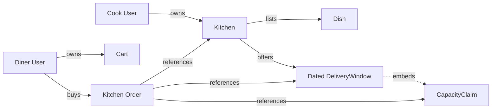

# The ownership chain

An ID in a URL does not tell Sufra who may read or change the record behind it. A cook may edit dishes for their own kitchen, but not a neighbor's. A diner may read their own cart and orders, but not another diner's address. A capacity claim belongs to a dated window and is changed by the checkout service, not by either person's form. The model must make those relationships explicit before routes make authorization decisions.

Start with `User`. A cook user may own one or more kitchens according to the course policy; a diner user may own a cart and orders. A `Kitchen` has an `ownerUserId`. A `Dish` has a `kitchenId`. A `DeliveryWindow` has a `kitchenId` and dated UTC times. A compact `CapacityClaim` is embedded in the window and has an attempt ID and units. A kitchen `Order` has a `kitchenId`, `dinerUserId`, `windowId`, `claimId` and item snapshots. The cart has `dinerUserId` and lines that point to dishes and matching kitchen windows.

The ERD below shows references with solid arrows and embedding with a dotted arrow. Keep a separate line from diner to order even though the order also points to a kitchen. One order has two interested parties, but their permissions differ.

The order's reference to a claim is an ID used for accounting and recovery. The order also keeps its own purchase snapshot. A future change to `Dish.name` or `Window.cutoffAt` cannot change the paid promise. The window's claim does not hold a diner address; the private address belongs on the order or a protected fulfilment record. Keeping public availability data separate from private details makes access rules easier to review.

## Trace a cook request

Suppose a signed-in cook sends `PATCH /kitchens/K1/dishes/D7`. The handler should load the dish, follow `dish.kitchenId` to K1, and verify `kitchen.ownerUserId` equals the authenticated cook's ID. It should not accept a client body field such as `ownerUserId` as proof. It should also ensure the dish actually belongs to K1, rather than trusting that both IDs were placed in the URL. If the check fails, no update occurs and the response does not reveal private kitchen data.

The same chain applies to a window exception. A cook can close their own kitchen's future lunch occurrence. They cannot close another kitchen's window by guessing its ID. If a paid order exists, closing the occurrence stops new claims but does not delete the historical window or rewrite the order. Authorization and data lifecycle meet at this point: even an authorized cook cannot erase evidence of a paid promise.

<TraceRequest title="A cook changes one dish">
  <TraceStep actor="API" label="Read signed-in user" detail="Use authenticated identity, not a body owner field" />
  <TraceStep actor="Dish" label="Find D7 and kitchenId" detail="The dish must belong to K1" />
  <TraceStep actor="Kitchen" label="Find K1 ownerUserId" detail="Only that cook may edit future dish settings" />
  <TraceStep actor="Order" label="Keep purchase snapshot" detail="Past paid item name and price do not change" />
</TraceRequest>

Now transfer the trace to a diner reading an order. The signed-in diner's ID must equal `order.dinerUserId`. A cook may read the order only if they own its kitchen, and even then the response should include only fields needed for fulfilment. An administrator path, if added, needs its own explicit permission and audit trail. A broad rule such as "any logged-in user can read order by ID" is unsafe.

## Place the capacity claim carefully

The claim is embedded on `DeliveryWindow` so an atomic update can subtract units and record the claim identity in one document. It has a stable ID, units, state and expiry. It does not need a top-level endpoint that lets a diner edit it directly. Checkout creates it after validating the diner's cart, then a payment webhook or expiry worker changes its state through trusted services. The order refers to the claim so a reviewer can connect a paid kitchen promise to the consumed capacity.

This embedding is a deliberate course-scale choice. Mongoose subdocuments can be validated as part of their parent, and MongoDB's single-document atomicity covers an update to the window counter and embedded claim together. The claim array must stay bounded; set a maximum window capacity and do not treat the document as an unlimited ledger of every historical event. M26 will reconcile active claims against remaining units. A larger system might use a separate collection plus a transaction, but that is a different implementation with a different failure boundary.

The claim's ID must be unique within the window. The checkout service uses a deterministic ID from the attempt and kitchen group so retries can find it. A filter on the window's embedded IDs prevents a duplicate debit. A unique index on `kitchenId` plus window start prevents duplicate dated windows, but it does not make IDs inside one array unique. Keep those two protections separate in the ERD notes and tests.

## Draw the cart without claiming too early

The cart belongs to one diner. It stores one selected dated interval and line references to dishes and matching kitchen windows. A cart line is a request, not a capacity claim. A dish may become late after it is added. Another diner may fill the window. Checkout revalidates and claims later. Do not put a permanent `reservedUnits` field on the cart; that would imply the diner owns capacity while they browse.

Each cart line includes quantity, but the server rereads current dish `loadUnits` and price before preparing checkout. A changed price requires review. The eventual order snapshots the accepted values. Two kitchen windows may have different IDs and zones while covering the same selected UTC interval. The cart groups them for display, but the capacity counters remain separate. If one kitchen cannot serve the interval, the cart cannot be silently reduced and paid without the diner reviewing it.

## Explain the split order

One checkout attempt can create two kitchen orders. Each order points to one kitchen and one window, while both share the same attempt and payment reference. A cook sees only their kitchen's order. The diner sees both under one purchase. If one cook rejects after payment, Sufra can refund that order's recorded share without guessing today's prices. The order's item snapshots include name, price, preparation minutes, load units and window times at purchase.

The order timeline is embedded because the events describe one order's lifecycle and are read with that order. Each event has a sequence number, status, time and actor. Later live delivery uses the sequence to deduplicate and catch up after reconnect. The ERD need not draw every event field now, but it should show that the timeline belongs to the order, not to the kitchen's menu or the diner's browser memory.

## Practice an authorization proof

In `docs/erd-draft.md`, annotate three arrows with a route and a denied case. For example, cook A tries to edit cook B's dish, diner A tries to read diner B's order, and a client tries to set a claim state to confirmed. State the trusted identity and the record you follow for each. Then describe one legitimate request that crosses the same chain. This tests whether your references support real permission checks rather than only making the diagram look complete.

If a model relies on client-supplied kitchen ownership, change it before building routes. If a claim contains a diner address, move the address to a protected order record. If the order reads a live dish name instead of a snapshot, add the purchase field. The next lesson builds the first two schemas, `Kitchen` and `Dish`, using these ownership and promise boundaries.

Review the diagram with a second person and ask them to point at the record that changes during a capacity hold. If they point at `Dish`, the shared pool is still unclear. Ask where a status event is saved after the diner disconnects. If they point at the browser, the order timeline is missing. These short questions expose model gaps before code spreads them through routes.

References: [Mongoose subdocuments](https://mongoosejs.com/docs/subdocs.html), [MongoDB single-document atomicity](https://www.mongodb.com/docs/manual/core/write-operations-atomicity/).
