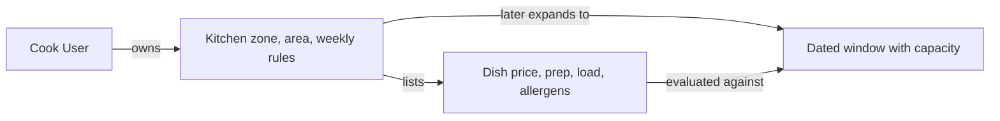

# Kitchen and Dish models

The cook's settings and menu need separate records. A kitchen owns a time zone, service area, weekly schedule and default capacity. A dish belongs to that kitchen and describes a price, preparation time, load units, maximum quantity and allergens. Neither record says that a particular 13:00 lunch is still available. The dated window and server clock will answer that later. Keeping the menu separate lets a cook pause or edit future offers without rewriting paid orders.

Start with the ownership field. `Kitchen.ownerUserId` points to the authenticated cook. `Dish.kitchenId` points to the kitchen. Do not store a browser-supplied `ownerUserId` as truth on a dish. The service that creates a dish should load the kitchen and verify its owner before writing. A cook's role alone is not enough; two cooks can both have the role while owning different kitchens.

## Define a kitchen's local rule

Create `server/src/modules/kitchens/kitchen.model.js`. A weekly rule uses a weekday, a local start and end label, and a stable rule key. The kitchen stores an IANA zone such as `Asia/Gaza`. Do not convert the weekly rule into one UTC timestamp at schema creation. M14 will expand each occurrence for a particular date using current zone data. The kitchen also stores a service-area code and a validated travel buffer. M9 starts a separate ScheduleException record for a one-day closure; M14 extends it for rule-specific closures and special windows.

This example shows the field shape. Add route-level checks for schedule overlap, start-before-end and zone-aware conversion later. A schema's simple minimum and required rules cannot prove every relationship among fields.

The diagram locates the boundary between a cook's reusable settings and a dated offer. It helps you avoid copying `remainingUnits` into the kitchen or dish schema just because those screens display availability.



The weekly rule is an input to generation, while the dish is an input to a per-window offer. Neither is a paid promise on its own. A cook can edit future settings, but a dated window with a claim and an order snapshot needs its own lifecycle.

```js
import mongoose from 'mongoose';
const { Schema } = mongoose;

const weeklyRuleSchema = new Schema({
  key: { type: String, required: true },
  weekday: { type: Number, min: 0, max: 6, required: true },
  localStart: { type: String, required: true },
  localEnd: { type: String, required: true },
  capacityUnits: { type: Number, min: 1, max: 100, required: true },
  cutoffLeadMinutes: { type: Number, min: 1, max: 1440, required: true },
}, { _id: false });

const kitchenSchema = new Schema({
  ownerUserId: { type: Schema.Types.ObjectId, ref: 'User', required: true },
  name: { type: String, trim: true, required: true },
  timeZone: { type: String, required: true },
  serviceAreaCodes: [{ type: String, required: true }],
  travelBufferMinutes: { type: Number, min: 0, max: 240, required: true },
  weeklySchedule: [weeklyRuleSchema],
  status: { type: String, enum: ['draft', 'open', 'paused'], default: 'draft' },
}, { timestamps: true });

export const Kitchen = mongoose.model('Kitchen', kitchenSchema);
```

Validate `timeZone` with `Intl.DateTimeFormat` in the service and reject an unknown name. Validate `localStart` and `localEnd` as exact `HH:mm` strings, not loose text such as `"13ish"`. Check that rule keys do not repeat within one kitchen. A schema array does not automatically enforce that cross-item uniqueness. Use a small service function and a test. For this course, service-area codes are fictional locality tokens; a real delivery boundary would need a reviewed address and geometry model.

For example, a rule for Monday 13:00 to 14:00 with a 60-minute general cutoff lead means the kitchen stops accepting new lunch orders at 12:00 on each dated Monday. It does not mean the database should save one `cutoffAt` on the recurring rule. The rule saves the lead duration; M14 resolves each dated start in the named zone and subtracts the lead to make a UTC cutoff. If a clock changes between two Mondays, the local 13:00 promise remains, while the UTC instant may differ. Test the formatter on a historical change week rather than guessing future local policy.

Do not accept overlapping weekly rules for the same kitchen and local day without a defined policy. Two rules that both claim 13:00 can generate duplicate or conflicting dated windows. For the core course, reject overlap and ask the cook to edit one rule. A special one-day window belongs to a dated exception, which can override that week's normal occurrence. This keeps the recurring template simple and lets support explain why one lunch was different.

## Make a dish stockless

Create `server/src/modules/dishes/dish.model.js`. A dish has the fields a diner needs to decide and the fields the server needs to enforce the cooking promise. Store money as integer minor units with an explicit currency. Store allergen labels as a controlled list or validated strings, and do not claim an empty list means a dish is medically safe for everyone. A cook can mark a dish paused without deleting old order references.

```js
import mongoose from 'mongoose';
const { Schema } = mongoose;

const dishSchema = new Schema({
  kitchenId: { type: Schema.Types.ObjectId, ref: 'Kitchen', required: true },
  name: { type: String, trim: true, required: true },
  description: { type: String, trim: true, default: '' },
  priceMinor: { type: Number, min: 0, required: true },
  currency: { type: String, required: true },
  prepMinutes: { type: Number, min: 1, max: 1440, required: true },
  loadUnits: { type: Number, min: 1, max: 100, required: true },
  maxPerOrder: { type: Number, min: 1, max: 20, required: true },
  allergens: [{ type: String }],
  dietaryTags: [{ type: String }],
  activeWeekdays: [{ type: Number, min: 0, max: 6 }],
  status: { type: String, enum: ['draft', 'active', 'paused'], default: 'draft' },
}, { timestamps: true });

dishSchema.index({ kitchenId: 1, status: 1 });
export const Dish = mongoose.model('Dish', dishSchema);
```

There is deliberately no `stockQty`. The amount of work a kitchen can accept belongs to a dated window. Validate price and all count fields as safe integers in the request service, because a simple Mongoose `Number` type can hold a fraction. Do not allow a negative price or quantity. If a dish's `loadUnits` exceeds the kitchen's maximum window capacity, show a cook-facing warning before it becomes active.

Consider the maqluba example when a cook enters `prepMinutes: 90`, `loadUnits: 3`, `maxPerOrder: 2` and `priceMinor: 1800`. The dish can be listed without deciding whether it fits tomorrow's 13:00 window. At 11:31, the preparation deadline may already have passed. At 11:00, it may be timely but the window may have only two units left. The dish schema supplies stable inputs to those decisions; it should not store a dated `isAvailable` boolean that will become false as the server clock advances.

The allergen and dietary-tag fields need honest copy. A controlled list can help a diner identify known ingredients or filter by a stated preference, but an empty list must not mean "safe for every allergy." The UI can say "No allergens listed by this kitchen" and allow the diner to ask the cook. A dietary tag is a kitchen-provided label, not a certification. Keep the original listing information in an order snapshot if it affected the purchase decision. Do not put private diner health information on a public dish or window document.

## Keep updates prospective

Test a dish edit after a draft order snapshot has been made. Change the dish name and preparation time. The dish document should show new values for future offers, while the order item should still have `nameAtPurchase` and `prepMinutesAtPurchase` from the old promise. The model alone does not make that happen; the checkout service will copy the fields. The schema's job is to keep the source fields typed and owned so the copy is meaningful.

Test a kitchen time-zone edit carefully. Changing the zone of an open kitchen can change how future weekly rules expand. It must not silently shift dated windows with held or paid orders. For this course, require a reviewed change that affects future unclaimed windows and leaves paid order snapshots intact. A route that blindly updates `timeZone` and regenerates every window risks moving a diner’s lunch. Record this rule in `docs/model-decisions.md` even before M14 implements the migration path.

## Verify ownership and validation

Create one kitchen for cook A and one for cook B. Ask cook A to create a dish under B's kitchen ID; the service must deny it. Ask a diner to create a dish; deny that too. Try `prepMinutes: -5`, fractional `loadUnits`, an unknown time-zone name and a weekly rule with end before start. The service must reject each. Then create a valid maqluba and falafel for A's kitchen and read them back by kitchen ID.

Inspect the saved documents. They should have ObjectId references for ownership, integer minute and load fields, and no `stockQty`. A kitchen's weekly rule should still be a local rule with a zone, not a UTC date pretending to recur. Save the command, request and response in `docs/EVIDENCE.md`. The next lesson creates dated windows and embedded claims, the records that answer whether these dishes can actually be ordered for lunch.

Before continuing, check the indexes expected by your queries. A kitchen list filtered by owner needs an owner index; a dish list filtered by kitchen and status needs a matching compound index. Create those indexes through a migration or controlled setup in production rather than relying on an expensive automatic build at application startup. An index does not replace the authorization check: a fast query for another cook's dish is still an unauthorized query.

References: [Mongoose schemas and indexes](https://mongoosejs.com/docs/guide.html), [Mongoose validation](https://mongoosejs.com/docs/validation.html).
