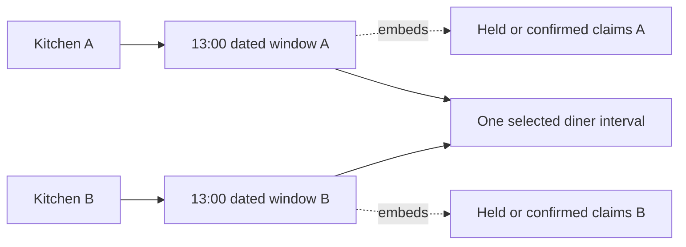

# DeliveryWindow and CapacityClaim models

A kitchen's weekly rule does not hold capacity. One dated `DeliveryWindow` does. It names a specific UTC start and end, a general cutoff, total and remaining load units, and whether new orders are open. A `CapacityClaim` records a temporary or confirmed use of those units. For the course's bounded windows, the claim is a subdocument of the window. That lets one MongoDB update decrement the counter and append the claim identity atomically in M19.

The model must also survive regeneration. A worker may run a seven-day generator twice or retry after a lost response. It must not create a second copy of the same kitchen's lunch or reset units on a window that already has a hold. Put a compound unique index on `kitchenId` and `startAt`. M14 will use an upsert that sets capacity only on first insert. The index is a database guard against concurrent duplicate creation, not merely a hint to a query planner.

## Separate local explanation from UTC comparison

The window saves `startAt`, `endAt` and `cutoffAt` as BSON Date values, which represent UTC instants. It also saves `localDate`, `sourceRuleKey` and `kitchenZoneAtGeneration` so a cook or support person can explain how a recurring local rule produced this occurrence. Do not compare `"13:00"` strings in checkout. The service can format UTC instants in the kitchen zone for screens, but the stored instants are what cutoff and order code compares.

The diagram shows two kitchen windows for one diner-selected interval. Each counter and claim list stays under its kitchen, even though the cart will later create one payment.



The two windows may share UTC start and end but have different IDs, zones, cutoffs and capacity. A claim on A does not reduce B's units. An order from each kitchen will point at its own window and claim. That distinction is essential when one kitchen fails and the checkout service compensates by releasing an earlier hold.

## Define the embedded claim

Create `server/src/modules/windows/delivery-window.model.js`. Use a stable claim ID generated from a checkout attempt and kitchen group. Give every claim `units`, `state`, `createdAt` and `expiresAt`. `orderId` can be filled when a draft kitchen order exists. Avoid private diner address or card fields in this busy window document.

```js
import mongoose from 'mongoose';
const { Schema } = mongoose;

const claimSchema = new Schema({
  id: { type: String, required: true },
  attemptId: { type: String, required: true },
  units: { type: Number, min: 1, required: true },
  state: { type: String, enum: ['held', 'confirmed', 'released'], required: true },
  createdAt: { type: Date, required: true },
  expiresAt: { type: Date, required: true },
  orderId: { type: Schema.Types.ObjectId, ref: 'Order' },
}, { _id: false });

const windowSchema = new Schema({
  kitchenId: { type: Schema.Types.ObjectId, ref: 'Kitchen', required: true },
  localDate: { type: String, required: true },
  sourceRuleKey: { type: String, required: true },
  kitchenZoneAtGeneration: { type: String, required: true },
  startAt: { type: Date, required: true },
  endAt: { type: Date, required: true },
  cutoffAt: { type: Date, required: true },
  travelBufferMinutes: { type: Number, min: 0, required: true },
  capacityUnits: { type: Number, min: 1, max: 100, required: true },
  remainingUnits: { type: Number, min: 0, required: true },
  status: { type: String, enum: ['open', 'closed'], required: true },
  claims: { type: [claimSchema], default: [] },
}, { timestamps: true });

windowSchema.index({ kitchenId: 1, startAt: 1 }, { unique: true });
export const DeliveryWindow = mongoose.model('DeliveryWindow', windowSchema);
```

The field `cutoffAt` is the general kitchen cutoff. A dish's effective cutoff is computed later from this value, `startAt`, its preparation minutes and the window's travel buffer. Do not store a single `effectiveCutoffAt` on the window because different dishes close at different times. The claim's `expiresAt` is chosen by checkout from its short payment timer and the earliest dish cutoff in that kitchen group.

## Validate relationships outside simple field types

Require `startAt < endAt` and `cutoffAt < startAt` under the course policy. Check all three are valid dates and that `remainingUnits` starts equal to `capacityUnits` for a new window. A Mongoose `min` on each field cannot prove those relationships. The generation service validates them before insert. The checkout service never accepts a client body with a new `remainingUnits` value. It changes the counter only through guarded claim and release operations.

Also require `capacityUnits`, `remainingUnits` and claim units to be safe integers. A schema `Number` can represent fractions, but half a cooking unit is not part of this course model. Set a maximum capacity so the embedded claim array stays bounded. As a window passes, keep its paid history long enough for order support and reconciliation. Do not delete a window because its expiry time passed if an order points at it.

Mongoose validates subdocuments when saving the parent, but query updates have different validation behavior. M19's `$push` and `$inc` path must validate its own inputs and match enough remaining units in the database filter. Do not assume a schema minimum alone prevents `remainingUnits` from going negative under a concurrent raw update. The database conditional update is the mechanism that protects that invariant.

## Verify uniqueness and accounting

Insert one dated window for a kitchen and UTC start. Try a second with the same pair. Expect a duplicate-key error after the index exists. Insert another kitchen at the same UTC start and expect success. Insert the same kitchen at a later start and expect success. These cases prove the index scopes occurrences correctly. Run them against an actual MongoDB database, not only an in-memory array.

Begin with ten capacity units and ten remaining. Add a fixture claim of three held units and set remaining to seven. Check `remaining + held + confirmed = capacity`. Mark the claim released and restore three; the equation still holds. M19 will implement these as one-document state transitions and run them under parallel requests. At this stage, the fixture helps you inspect the shape and catch a missing field or wrong relationship.

## Check a generator retry without resetting a promise

Prepare a fixture with one held three-unit claim and seven remaining units. Run the seed or a later generator a second time for the same kitchen and start. The same window ID should remain, with the same claim and seven remaining. An upsert using `$set` for `remainingUnits: 10` would make the three units available twice. Use `$setOnInsert` for fields that should exist only when a new dated window is created. A real cook edit to future capacity needs its own reviewed operation that considers existing claims, not a hidden side effect of generator retry.

Now close that dated window. Its status changes to `closed`, so new claims fail, but its rows and claims remain for explanation. If a diner has already paid, the order still points to this window. A support person can see the original 13:00 promise and any later cancellation. Deleting the window would break that trail. Closing tomorrow's lunch also should not delete the kitchen's weekly rule, so the following week can still generate normally. M14 introduces the date-specific exception model that coordinates this behavior.

Try the opposite mistake: change the kitchen's weekly capacity from ten to twelve and expect every existing dated window to change. That would rewrite a held promise. The new setting can govern future unclaimed windows after review; an existing window's `capacityUnits` and `remainingUnits` are part of its dated state. If an administrator must increase one window's capacity, use an explicit operation with an audit event and invariant check. Do not use a broad `updateMany` against all windows for that kitchen.

## Distinguish index safety from claim safety

The compound unique index makes two documents with the same kitchen and start impossible. It does not prevent two identical claim IDs inside one window's array. The claim service must match `'claims.id': { $ne: claimId }` while it pushes a claim and subtracts units in one atomic update. A retry with the same ID then reads the existing claim instead of subtracting again. This is a different invariant from window uniqueness, and it deserves a separate test.

If a claim release runs twice, the window must restore units once. The release update matches a claim in `held` state and changes it to `released` while incrementing the stored units. A second release sees the different state and cannot match. If a payment webhook confirms first, an expiry worker cannot release that confirmed claim. The schema lists allowed states, but the conditional transitions enforce this state machine under concurrency.

Inspect the index build in the test database. A schema declaration does not mean the index is already ready when a parallel generator test starts. In local development, await index creation before asserting duplicate rejection. In production, apply indexes through a controlled migration and check the result. If old duplicate windows already exist, the index build may fail; clean and reconcile those rows before claiming the protection is active.

Finally, inspect document growth in the seed. A ten-unit window should not contain thousands of old retry entries. Reusing stable claim IDs and keeping one embedded record per actual claim keeps the array bounded. The course cap of 100 units per window is a teaching limit, not a universal MongoDB tuning rule. If a real kitchen model needs much larger or longer-lived claims, reconsider the embedded design with measured document size and a different transaction boundary.

In `docs/model-decisions.md`, explain why claim identity and the counter share one window document. Name the trade-off: document growth must remain bounded. Explain why the unique kitchen-start index and the claim-ID retry filter solve different problems. The next lesson adds a diner cart and split kitchen orders, which reference these dated windows without pretending cart lines have reserved them.

References: [MongoDB unique indexes](https://www.mongodb.com/docs/manual/core/index-unique/), [MongoDB atomicity](https://www.mongodb.com/docs/manual/core/write-operations-atomicity/), [Mongoose subdocuments](https://mongoosejs.com/docs/subdocs.html), [Mongoose validation](https://mongoosejs.com/docs/validation.html).
