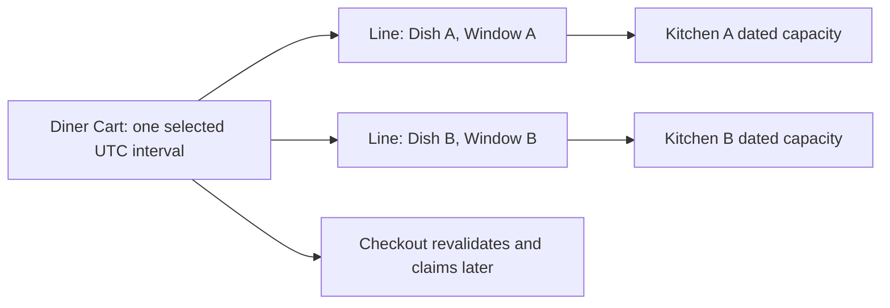

# Cart and Order models

The diner sees one cart, but the cooks receive separate orders. A cart is an editable request for dishes in one selected delivery interval. It does not own capacity. A kitchen order is a record of what one cook owes after a shared checkout, with item and window snapshots. The models should make that difference visible. If a cart line looks like a paid claim, or an order reads today's menu for yesterday's price, the boundary is wrong.

Lina chooses the 13:00 to 14:00 interval and adds falafel from Abu Sami and sweets from Beit Hanan. Each kitchen has a separate `DeliveryWindow` ID for that interval. The cart stores both IDs and one selected UTC start and end. Before checkout, a service verifies that every referenced window matches the selected interval, belongs to the line's kitchen and is still usable. A line added earlier may become late or full. This model supports revalidation; it does not promise that add-to-cart permanently reserves the food.

## Keep one selected interval

Create `server/src/modules/cart/cart.model.js`. Give the cart a `dinerUserId`, selected UTC start and end, lines and a revision number. A line points to a dish, kitchen and matching dated window, with a positive integer quantity. The revision helps checkout bind an idempotency attempt to the version the diner reviewed. When the diner changes the interval, the cart service must revalidate every line and report which ones no longer fit. It must not silently move one kitchen to dinner while the others remain at lunch.

The diagram shows one diner view splitting into kitchen-specific window references. The cart has no arrow that changes a capacity counter; that happens only when checkout prepares a hold.



Use a schema that captures references without copying mutable dish prices as authority. The interface may display an estimated total, but the server pricing module recalculates before a payment attempt. An old displayed price becomes a review-required change, not an excuse to charge a new amount without telling the diner.

```js
import mongoose from 'mongoose';
const { Schema } = mongoose;

const cartLineSchema = new Schema({
  dishId: { type: Schema.Types.ObjectId, ref: 'Dish', required: true },
  kitchenId: { type: Schema.Types.ObjectId, ref: 'Kitchen', required: true },
  windowId: { type: Schema.Types.ObjectId, ref: 'DeliveryWindow', required: true },
  quantity: { type: Number, min: 1, max: 20, required: true },
}, { _id: true });

const cartSchema = new Schema({
  dinerUserId: { type: Schema.Types.ObjectId, ref: 'User', required: true },
  selectedStartsAt: { type: Date, required: true },
  selectedEndsAt: { type: Date, required: true },
  revision: { type: Number, min: 0, default: 0 },
  lines: { type: [cartLineSchema], default: [] },
}, { timestamps: true });

cartSchema.index({ dinerUserId: 1 });
export const Cart = mongoose.model('Cart', cartSchema);
```

Validate quantity as a safe integer in the route. Check the diner owns the cart before returning it or changing a line. Check a dish belongs to the stated kitchen and that the window belongs to that kitchen. These cross-record checks do not arise automatically from ObjectId references. A forged `kitchenId` in the browser body must not let a diner borrow another kitchen's window or avoid its cutoff.

Increment `revision` when the diner changes the selected interval, quantity or lines. Checkout reads one revision, validates it and binds the attempt to its canonical snapshot. If another tab edits the cart after that read, the service should detect the mismatch before preparing payment and ask the diner to review. A revision is not a capacity lock. It prevents a different cart from being charged under an attempt that the diner opened for an earlier version. The server still needs fresh cutoff and capacity checks.

For a concrete case, Lina opens checkout with one falafel and one sweet. Another tab adds a second sweet. If the first tab's payment amount silently changes, Lina may pay more than she reviewed. If it silently stays old while the order includes the new line, the kitchen order and payment disagree. Reject the stale revision, show the changed lines and request a new confirmation. Store the accepted snapshot hash on the checkout attempt in M19 so retries can identify the original purchase.

## Freeze the kitchen order

Create `server/src/modules/orders/order.model.js`. One order belongs to one kitchen and one diner. It references the dated window and the capacity claim for accounting. It stores one `attemptId` so two kitchen orders can be shown together under one checkout. Its item snapshots retain name, price in integer minor units, preparation minutes, load units and quantity. The order stores the window start and end at purchase, kitchen zone at purchase, total, currency and a private delivery address snapshot in the protected order record.

An order also embeds a status timeline. Each event has a sequence number, state, timestamp, actor type and a stable event key for idempotency. The first draft event can say `awaiting_payment`; a verified webhook later appends `paid`. Cook acceptance, cooking, dispatch, rejection and refund changes arrive in later modules. A reconnecting diner can read a snapshot and then apply only events after the last sequence they saw.

```js
const orderLineSchema = new Schema({
  dishId: { type: Schema.Types.ObjectId, ref: 'Dish', required: true },
  nameAtPurchase: { type: String, required: true },
  priceAtPurchaseMinor: { type: Number, min: 0, required: true },
  prepMinutesAtPurchase: { type: Number, min: 1, required: true },
  loadUnitsAtPurchase: { type: Number, min: 1, required: true },
  quantity: { type: Number, min: 1, required: true },
}, { _id: false });

const statusEventSchema = new Schema({
  seq: { type: Number, min: 1, required: true },
  state: { type: String, required: true },
  at: { type: Date, required: true },
  actor: { type: String, required: true },
  eventKey: { type: String, required: true },
}, { _id: false });

const orderSchema = new Schema({
  attemptId: { type: String, required: true },
  dinerUserId: { type: Schema.Types.ObjectId, ref: 'User', required: true },
  kitchenId: { type: Schema.Types.ObjectId, ref: 'Kitchen', required: true },
  windowId: { type: Schema.Types.ObjectId, ref: 'DeliveryWindow', required: true },
  claimId: { type: String, required: true },
  windowStartsAtPurchase: { type: Date, required: true },
  windowEndsAtPurchase: { type: Date, required: true },
  kitchenZoneAtPurchase: { type: String, required: true },
  lines: { type: [orderLineSchema], required: true },
  currency: { type: String, required: true },
  totalMinor: { type: Number, min: 0, required: true },
  status: { type: String, required: true },
  timeline: { type: [statusEventSchema], default: [] },
}, { timestamps: true });

orderSchema.index({ attemptId: 1, kitchenId: 1 }, { unique: true });
export const Order = mongoose.model('Order', orderSchema);
```

The example order schema keeps the needed references and snapshots together. Add a protected delivery-address snapshot once the fulfilment flow defines its fields; do not copy raw address data into a public window. The unique compound index on `{ attemptId, kitchenId }` prevents a retry from creating a second order for the same kitchen. M19 will use an idempotent insert and verify the immutable snapshot before exposing payment. Do not use a unique index on `attemptId` alone, because one attempt may legitimately create two kitchen orders.

## Make sequence and snapshots deliberate

The timeline is embedded because it belongs to one order's lifecycle and is read with that order. A query update that appends an event must also advance a stored sequence under an atomic condition. A simple array push from two workers can duplicate or reorder events. M22 builds that transition logic. For now, the schema records the intended shape and a seed can show one draft event with `seq: 1`. Do not imply that a Mongoose array alone guarantees event order.

The status field is a current summary of the same event history. It should not be changed independently from the timeline in production code. If `status` says `dispatched` but the last event says `paid`, a reconnecting client will receive conflicting answers. Later, one order update will check the expected state, append the next sequence and set the summary status together. This chapter establishes the fields and an example fixture; the lifecycle chapter supplies the transition rules and tests.

The order snapshot must remain stable after edits to kitchen, dish or window settings. Test by creating a draft fixture, then changing the dish name and price. Read the order again and expect the old name and price. Change the kitchen zone or future schedule; the order's UTC window times and zone snapshot remain. This does not mean the cook can always fulfil the order; it means the record still says what was agreed so cancellation and refund can be explained.

Keep sensitive fields out of public records and logs. A delivery address belongs to the protected order, not the `DeliveryWindow` that browse queries. A cook may see the address for their own accepted order, while another kitchen in the same purchase may see only its own fulfilment details. The diner may read both kitchen orders because they own the purchase. Implement those checks in services and tests, not by assuming that knowing an order ID is enough.

## Verify the split with a fixture

Create one cart with two lines pointing to different kitchen windows for the same selected UTC interval. Validate it and create two draft order fixtures with the same attempt ID and distinct kitchen IDs. The sum of their `totalMinor` values must equal the attempt's trusted total. Try a line whose window begins at a different instant; reject it before a draft exists. Try a second order for the same attempt and kitchen; the unique index must reject or idempotently return the first.

Save the cart and both order documents in `docs/EVIDENCE.md` with private address values removed. Label the orders `awaiting_payment`. A seeded draft is not a verified paid purchase. The next lesson seeds three kitchens and seven days of windows so a reviewer can inspect the whole chain in MongoDB Compass before routes become more complex.

References: [Mongoose subdocuments](https://mongoosejs.com/docs/subdocs.html), [MongoDB compound unique indexes](https://www.mongodb.com/docs/manual/core/index-unique/), [MongoDB BSON Date](https://www.mongodb.com/docs/manual/reference/bson-types/).
