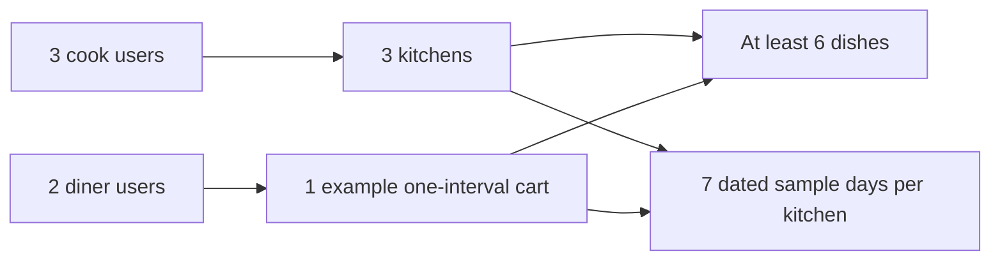

# Seed three kitchens and seven days

An ERD is easier to judge when it has real-looking documents. Seed three fictional home kitchens with different dishes and effort settings, then create dated sample windows for seven days. Add two diner accounts for later ownership tests. Run the seed twice and inspect the same window IDs, counts and remaining units. The second run must not reset a claim or create duplicate lunches. This is an idempotency test for data setup, not yet the full recurring-window generator built in M14.

Use fictional names and contact details. Umm Yousef's Kitchen lists a slow maqluba tray and a quicker soup. Abu Sami's Table lists falafel wraps and hummus plates. Beit Hanan Sweets lists small pastries and a larger tray. Give dishes distinct `prepMinutes`, `loadUnits`, `maxPerOrder`, prices and allergen entries so a reviewer can see why the fields exist. Avoid a seed where every dish has one unit and thirty minutes of preparation; it would not expose the stock trap or a per-dish cutoff.

## Fix the dates for this inspection seed

Choose a short historical seven-day range and store the exact UTC start and end for each sample window. Label each with its intended kitchen-local date and `kitchenZoneAtGeneration`. For the illustrative January 2024 Gaza lunch fixture used in M14, a 13:00 local start is represented by 11:00 UTC on the chosen date. Check the label with a zone-aware formatter before saving. Do not construct a `Date` from an unzoned `"13:00"` string and let the seed machine choose its own locale.

Historical fixtures let a mentor rerun this model lesson next year without the server clock making the windows disappear. They are for schema and relationship inspection. The live browse demo in Week 2 will use M14's next-seven-days generator with the current kitchen zone rules and an injected clock in tests. Label the two seed modes clearly so someone does not mistake fixed January rows for orderable current lunches.

The diagram is a seed count map. Use it to catch an omitted collection or a cart line pointing at a window from the wrong kitchen.



The example cart is optional for the first database screenshot, but it is useful for the ownership gate. It should be a draft request, not a paid order. If you seed an order, mark it as an explicit fixture and do not say Stripe confirmed it. The first demo only needs the model, not a fabricated payment history.

## Write idempotent seed steps

Create `server/scripts/seed-sufra.js`. Use stable fixture keys for users, kitchens and dishes. The script should upsert each record by a unique fixture key or other stable indexed identity, then use the saved IDs for references. Do not match a kitchen only by a display name that a cook may edit. Keep a `seedKey` on development fixtures or use a separate mapping for the seed run. In production data, the same display name can belong to different cooks.

For each dated window, use kitchen ID and UTC start as the upsert filter. Set immutable initial fields only when inserting. The outline below shows the important write. The generator module will add schedule expansion and exception rules later.

```js
await DeliveryWindow.updateOne(
  { kitchenId: kitchen._id, startAt },
  { $setOnInsert: {
    localDate,
    sourceRuleKey: 'lunch',
    kitchenZoneAtGeneration: kitchen.timeZone,
    endAt,
    cutoffAt,
    travelBufferMinutes: kitchen.travelBufferMinutes,
    capacityUnits: 10,
    remainingUnits: 10,
    status: 'open',
    claims: [],
  } },
  { upsert: true },
);
```

Do not use `$set` for `remainingUnits`, `status` or `claims` on rerun. A later M19 hold would change those values. The seed should leave it alone. The compound unique index on kitchen and start catches two seed processes racing to insert the same occurrence. If a duplicate-key error occurs, reread the existing window instead of creating another timestamp with a small offset. Two almost-identical lunch rows would be worse than a visible retry error.

## Inspect each ownership link

Open MongoDB Compass or use a small read script. Check that every kitchen's `ownerUserId` points at one cook, every dish's `kitchenId` points at the intended kitchen, and every window's `kitchenId` matches its dish group. Inspect seven dated samples for each kitchen. Their IDs should be unique, their starts and ends should be UTC dates, and each should begin with `remainingUnits === capacityUnits`. The kitchen's weekly rule should remain a local rule; do not replace it with the seven UTC rows.

Look at dish variety. Maqluba should have a longer preparation time and larger load than a small wrap. A kitchen's capacity might be ten units for lunch, but the quantity of dishes is not stored as ten units of stock. If the seed sets `stockQty` on every dish, remove it and repeat the schema review. Use an allergen example to check the field shape, but do not imply an unlisted allergen is absent or medically safe.

The two diners should have different user IDs and separate carts. Try reading diner B's cart while authenticated as diner A through the service layer; it must be denied. If authentication routes are not built yet, record this as a required test for M6 to M8 and inspect that the model has `dinerUserId` needed to enforce it. Do not claim an authorization test passed just because two documents have different IDs.

## Make reruns prove something

Save the first run's window count and IDs. Insert a fixture held claim of three units on one window and lower remaining to seven, keeping the accounting equation true. Run the seed again. The count, ID, claim state and seven remaining units must stay the same. Then remove the fixture hold through a deliberate test cleanup. A seed that resets remaining to ten would make the same units available twice when used in a real environment.

Run a third seed after editing one dish description. Decide whether development seed data should update descriptive fixture fields or preserve local edits. Document the rule. Whatever you choose, the script must not rewrite historical order snapshots. It should never set a paid order status to a convenient value merely to make a demo screen populated. Use separate explicit fixtures for state-machine screens when those modules exist.

## Keep the seed safe to run

Require an explicit development database name or an environment guard before the script writes. Print the target database name and fixture mode before starting, without printing credentials. A learner should not accidentally run a destructive reset against the database used for a deployed demo. Prefer upserts with stable keys to a blanket `deleteMany`. If a clean database is needed for a test, use a separate test connection and a clearly named reset command. This distinction keeps ordinary reruns safe while still allowing a deterministic test fixture.

Create indexes before launching two seed processes in an idempotency test. The schema declaration alone may not mean the database has finished building its compound unique index. Check the index list in Compass or with a database command, then run the concurrent seed. If one process gets a duplicate-key result, it should reread the winning row and continue. Do not catch every database error and call it a harmless duplicate; a network or validation failure needs a visible stop.

Verify a local label with a time-zone-aware formatter, not with the machine's default `Date.toString()` output. Print the UTC start and the formatted kitchen-local date and time side by side for one fixture. If they disagree with the intended 13:00 lunch, correct the fixture before using it to teach cutoffs. Save the runtime zone-data version if available. The historical fixture should stay stable, while the future generator in M14 must use current rules.

Record a table in `docs/EVIDENCE.md`: expected and actual counts for users, kitchens, dishes, windows and carts; the first and second run command; the preserved held-window values; and one denied cross-user read when the service supports it. Include a small text export of one kitchen, one dish and one dated window with any private fields removed. The next gate asks you to turn these observed relationships into a final ERD and explain the chain without notes.

References: [MongoDB unique indexes](https://www.mongodb.com/docs/manual/core/index-unique/), [Mongoose schemas](https://mongoosejs.com/docs/guide.html), [MongoDB BSON Date](https://www.mongodb.com/docs/manual/reference/bson-types/).
