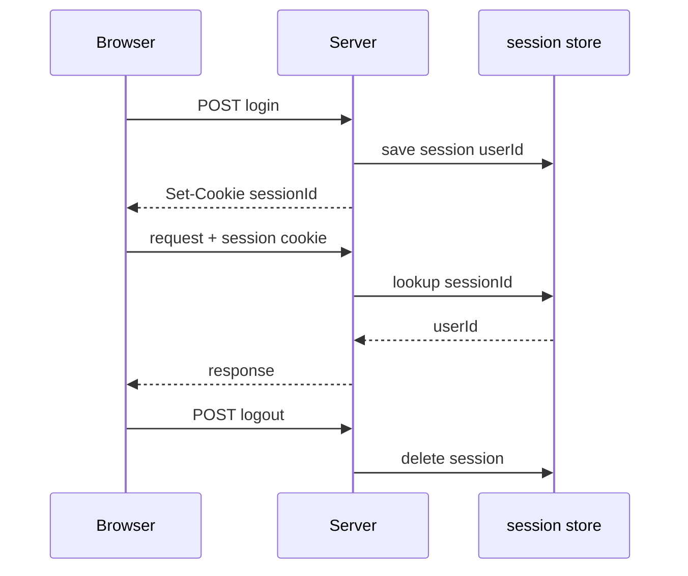
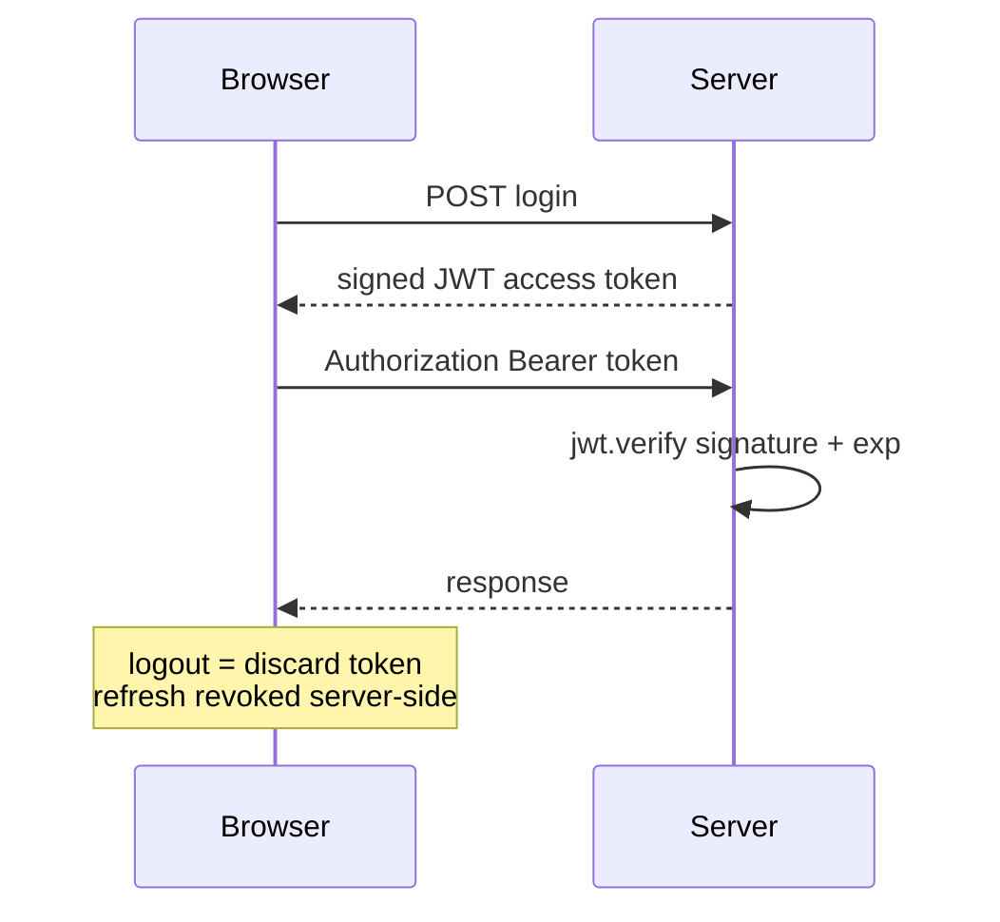

# 6.4 ,  Sessions vs JWT

> **[Learn]** · Chapter 06 ,  Authentication API · *Stateful vs stateless; pros/cons; **JWT for this course***

Every authenticated API must answer: **how does the server remember who sent this request?** Two dominant patterns ,  **server-side sessions** and **JWT (JSON Web Tokens)**. This course mandates JWT for Sufra.

<BigWordAlert term="Stateless JWT" plainEnglish="A signed token the client sends on each request ,  server validates signature without storing session in memory." whyItMatters="Sufra uses JWTs so the API scales without a central session store ,  good fit for a Node + React split." />

## Why this matters

Sessions and JWT are not interchangeable labels ,  they change **where state lives** (server store vs signed token), how logout works, and how SPAs send credentials. Picking one without understanding the other leads to "why doesn't logout kill access instantly?" confusion. This course picks JWT + hashed refresh ,  know what you traded vs Redis sessions.

## Think of it like…

**Hand stamp vs driver's license at a festival.** Session: venue keeps a list at the door, you show a wristband number. JWT: you carry a signed pass with expiry printed on it ,  gate staff verify signature, not a lookup list (until refresh revocation).

<ComparePanel title="Sessions vs JWT">
  <CompareColumn label="Sessions">
    Server stores session in Redis/DB. Client holds session cookie. Logout deletes server-side session immediately. Requires session store at scale.
  </CompareColumn>
  <CompareColumn label="JWT (this course)">
    Server signs token; client sends Bearer header. Logout revokes refresh token. No central session lookup per request ,  scales horizontally.
  </CompareColumn>
</ComparePanel>

## Common questions

**Q: Are JWTs encrypted?**  
A: No ,  they're *signed*, which is a different thing. Anyone with a token can decode the payload and read its contents (paste one into jwt.io to see). What they can't do is change it, because the signature only verifies if the payload is untouched. So never put secrets, passwords, or anything sensitive in a JWT ,  treat the payload as public and use the signature only as tamper-evidence.

**Q: Why short access token if refresh exists?**  
A: To limit the blast radius of a leak. The access token is what the browser keeps in memory and sends with every request, so it's the most likely thing for a script to steal. If it's short-lived (say 15 minutes), a stolen token becomes useless almost immediately. The refresh token lives somewhere safer ,  an httpOnly cookie ,  and can be revoked server-side, which is why it can afford a long lifetime.

**Q: Why not sessions with Express default memory store?**  
A: For this course, two reasons. First, the default memory store keeps sessions in the server's RAM, so a second server process doesn't know about them ,  that falls over the moment you restart or scale. Second, the SPA + Bearer token pattern is what the rest of the course (and most real MERN apps) uses, so teaching that pattern here sets you up for the chapters ahead. Sessions are fine for tiny apps; they're just not the pattern this course is built on.

## Where the state lives on each request

The whole comparison reduces to one question about a single request. When a diner taps track order and that request reaches the API, does the server already know who they are, or does it have to look them up? With sessions it looks up: the cookie carries an opaque id and the meaning of that id lives in a store the server controls, which is exactly why deleting a session row revokes access instantly. With a JWT it does not look up: the token carries the identity claim plus a signature the server can check using a secret it already holds. Nothing has to be remembered between requests, so a second API process answering behind the same load balancer gives the same verdict as the first.

That difference is the mechanism behind every practical trade-off in this chapter. Instant revocation is a property of the store, because deleting a row is instantaneous and the next request finds nothing. Statelessness is a property of the signature, because a valid signature plus an unexpired claim is the entire proof. Once you hold those two sentences, logout, horizontal scaling and cookie handling all follow from them instead of needing to be memorised separately.

## Server-side sessions



```
Login → server stores session in Redis/DB → returns session ID cookie
Each request → server looks up session → loads user
Logout → delete session server-side
```

| Pros | Cons |
|---|---|
| Instant revoke ,  delete session | Stateful ,  needs session store |
| Small cookie ,  just session id | Horizontal scaling needs shared store |
| Server controls lifetime tightly | Extra infra (Redis) for sessions at scale |

Classic choice for monolithic apps with server-rendered pages.

## JWT (stateless access token)



```
Login → server signs JWT with secret → client stores token
Each request → client sends Bearer token → server verifies signature + expiry
Logout → client discards token; server may revoke refresh only
```

| Pros | Cons |
|---|---|
| No session DB lookup per request | Hard to revoke access token before expiry |
| Works across microservices | Payload visible if not encrypted (signed, not secret) |
| Mobile/SPA friendly | Secret rotation requires care |

**Hybrid used here:** Short-lived JWT access + long-lived refresh stored hashed in DB ,  revoke refresh kills renewal.

## Worked trace: one diner, four requests

Follow a diner called Huda through a session that outlives her access token. The trace is worth reading closely because only two of the four steps involve any server-side state at all: login writes the refresh hash, and refresh reads and replaces it. Everything in between is a signature check.

<TraceRequest title="Huda's session across a 15-minute access token">
  <TraceStep actor="Client" label="Huda logs in" detail="Password compared, access JWT signed for 15 minutes, refresh hash written to the User document" />
  <TraceStep actor="API" label="GET /api/orders" detail="Bearer token verified with JWT_SECRET, no identity lookup against the database" />
  <TraceStep actor="API" label="Minute 16 arrives" detail="verify throws TokenExpiredError and the client receives a 401" />
  <TraceStep actor="Client" label="POST /api/auth/refresh" detail="Refresh token hashed and compared, new access token returned with a rotated refresh token" />
</TraceRequest>

That ratio is the reason the pattern scales: four requests, two touches of stored state. It is also the reason logout feels less absolute than a session logout, and the next section is about exactly that gap.

## The revocation gap you accept

Suppose Huda taps logout at minute 12. The server clears `refreshTokenHash` and the client forgets its access token, but any copy of that access token taken before logout still verifies until its `exp` claim passes. The gap is not a bug in your code; it is the width of the access lifetime, and it is the price of not looking anything up.

Two habits follow. First, keep the access lifetime short enough that the gap is measured in minutes rather than days, which is why fifteen minutes appears throughout this chapter instead of an hour. Second, treat refresh revocation as the real kill switch: it cannot recall a token already in flight, but it guarantees that no new access token can be minted, so the exposure ends at the next expiry instead of continuing indefinitely.

Some systems close the gap completely with a `tokenVersion` field on the User document, incremented on logout or password change and compared on every request. It works, and it is worth knowing, but notice what it costs: a database read on every request, which is the single thing statelessness was buying. Choose deliberately rather than adding the field by habit.

## Rotation races and how they look

Refresh rotation introduces a failure mode that looks like random logouts. A diner opens the Sufra menu in two tabs. The refresh cookie is shared by the browser, so both tabs hold the same refresh token. At minute 16 both tabs fire `/api/auth/refresh` within a few hundred milliseconds. The first arrives, rotates the token, and writes a new hash. The second arrives with the old token, its hash no longer matches the stored one, and the API answers 401. One tab continues and the other throws the diner to the login screen.

The tell is in your logs: two refresh attempts for the same user with timestamps under a second apart. That pattern means the client is racing itself, not that the server is broken. The cheap fix is a single-flight refresh in the API client, one shared promise that both callers await, which you will build in Chapter 7. The server-side alternative is a short grace window where the previous hash is still accepted, or a token family where reuse of a rotated token invalidates the whole family. Either way, decide before you write the interceptor, because retrofitting rotation into a client that refreshes per request is messy.

## Debugging a rejected token

A 401 from `/api/orders` while holding a token you believe is valid has four common causes, and they are worth checking in order because each one is cheaper than the next. Does the header actually say `Bearer ` with a space, and is the token present at all? Did the process that signed the token and the process verifying it read the same `JWT_SECRET` value, including the same trailing whitespace and the same `NODE_ENV` file? Is the token expired rather than malformed, which you can tell by catching `TokenExpiredError` separately from `JsonWebTokenError`? And is the machine clock sane, because `exp` is compared against the wall clock of whatever verifies it?

Log the error name and the claim timestamps, never the token itself. An `invalid signature` line in a boot log means the two sides disagree about the secret, and in practice that is either a secret that was rotated on one side only or a `.env` file that was loaded in one process and forgotten in the other.

## Why JWT for this course

| Factor | Sufra choice |
|---|---|
| MERN SPA client | Bearer token in memory fits React |
| Module monolith | No separate session Redis until Ch 21 cache |
| Learning goal | Industry-standard JWT + refresh pattern |
| Pair with Ch 7 | 401 refresh loop teaches real client auth |

Redis in Chapter 21 is for **catalogue cache**, not sessions.

## What goes in JWT payload

**Include:**

- `sub` or `userId` ,  MongoDB User _id
- `role` ,  vendor | customer  
- `iat`, `exp` ,  issued/expiry  

**Never include:**

- passwordHash  
- email (optional ,  prefer /me endpoint)  
- refresh token inside access token  

Keep access payload minimal ,  reduces leakage if token stolen.

## Refresh token pattern

The two tokens do very different jobs ,  one proves you're still logged in for minutes, the other proves you're still logged in for days:

| | Access JWT | Refresh token |
|---|---|---|
| Lifetime | 15 minutes | 7 days |
| Sent how | Authorization header | httpOnly cookie (Ch 7) or body (Ch 6 curl) |
| Stored server | Not stored | Hash in User.refreshTokenHash |
| Revoke | Wait for expiry | Clear hash on logout / rotation |

**Rotation (recommended):** New refresh on each refresh call ,  invalidate old hash.

## Comparison table

Side by side, the practical differences that matter on a real codebase:

| Concern | Sessions | JWT access + refresh |
|---|---|---|
| Revoke all sessions | Easy | Clear refresh hashes; access until expiry |
| DB hit per request | Yes (lookup) | No for access verify |
| XSS steals token | Session cookie httpOnly | Access in memory reduces XSS vs localStorage |
| CSRF | Cookie session risk | Bearer header less CSRF on API |

## Decision record

Document in learning log:

*"Sufra uses JWT access tokens verified with JWT_SECRET and refresh tokens hashed on User. Access is stateless; refresh revocation provides logout. Session store deferred."*

## ✅ Do / ❌ Don't

**✅ Do:** Keep access lifetime short ,  15m default.

**✅ Do:** Hash refresh token before DB storage ,  like passwords.

**❌ Don't:** Put JWT_SECRET in git or client.

**❌ Don't:** Store access token in localStorage if avoidable ,  Ch 7 uses memory.

## Reflect

What happens if user clicks logout but access JWT still unexpired? How does refresh revocation help?

## Next

**Sub-chapter 6.5:** Password hashing ,  bcrypt, salt, cost factor.

Architecture chosen ,  password storage mechanics next.
