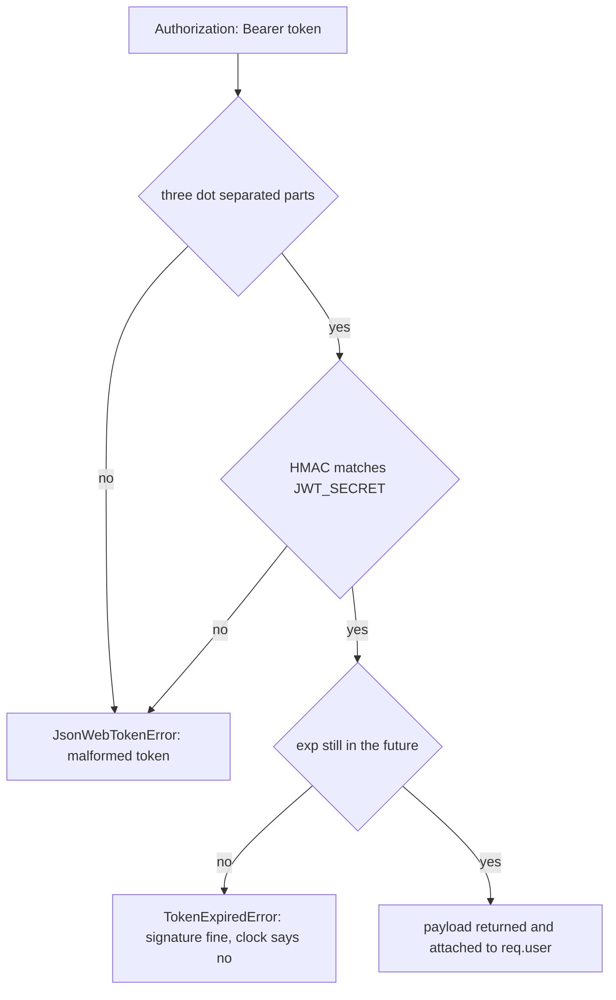

# 6.7 ,  Prime your thinking

> **[Learn]** · Chapter 06 ,  Authentication API · *Mandatory reads: bcrypt, JWT intro*

Before scaffolding auth routes, read how bcrypt and jsonwebtoken behave in Node ,  especially async APIs and error types. Thirty minutes prevents "invalid signature" loops.

<BigWordAlert term="Access vs refresh token" plainEnglish="Short-lived access token for API calls; longer refresh token to get new access tokens without re-login." whyItMatters="Sufra access tokens expire in minutes; refresh tokens keep shoppers logged in across tab sessions." />

```predict
prompt: "A diner's access token expires while their refresh token is still valid. What should Sufra do?"
options:
  - id: extend-expired
    label: "Keep accepting the expired access token until logout"
  - id: rotate-access
    label: "Use the refresh token to mint a new access token"
correctOptionId: rotate-access
explanation: "Short-lived access tokens limit exposure. A valid refresh token is the credential used to mint a replacement; an expired access token must not become valid again."
allowRetry: true
```

## Mandatory reads

Read these four in order. The first two are the tools you'll type into `server/src/` this chapter ,  read their official READMEs so you use the APIs the way the maintainers intend, not the way an old blog post remembers them.

| Resource | Focus |
|---|---|
| [bcrypt npm readme](https://www.npmjs.com/package/bcrypt) | hash + compare async API |
| [jsonwebtoken readme](https://www.npmjs.com/package/jsonwebtoken) | sign, verify, expiresIn |
| [JWT.io introduction](https://jwt.io/introduction) | structure recap |
| Express [Router mounting](https://expressjs.com/en/guide/routing.html) | `/api/auth` prefix |

Optional: [OWASP Authentication Cheat Sheet](https://cheatsheetseries.owasp.org/cheatsheets/Authentication_Cheat_Sheet.html) ,  password storage section.

## bcrypt API notes

```javascript
// hash ,  async preferred
const hash = await bcrypt.hash(password, 10)
// compare
const match = await bcrypt.compare(password, user.passwordHash)
```

Sync variants exist ,  use async in Express handlers to avoid blocking event loop.

## What bcrypt is doing with your password

The stored value is not an encrypted password, and that difference decides half the code you are about to write. When you call `bcrypt.hash(password, 10)`, bcrypt generates a fresh random salt, runs its key schedule many times over the salt and password together, and returns one string that carries everything needed to check the result later: the algorithm marker, the cost, the salt and the derived digest. Two diners who both choose the same password end up with completely different stored strings, which is precisely why a leaked table of hashes cannot be attacked by comparing rows against each other.

Because the salt travels inside the hash, `compare` needs the stored hash rather than a separate salt column, and it re-derives the digest using the cost and salt it finds there. The consequence for Sufra is concrete: there is no step anywhere that turns a hash back into a password, so no support flow can ever show a cook their old password, and a forgotten password can only be replaced. That is not a limitation to work around; it is the property you are paying for.

## Choosing a cost factor

Cost is the log of the number of rounds, so every increase of one doubles the work. Ten is the usual starting point and lands somewhere between fifty and a hundred and fifty milliseconds on a typical laptop, which is fast enough that a cook signing in does not notice. The trade-off is symmetric and worth stating plainly: a higher cost makes an offline guessing attack against a stolen dump slower, and it also makes every login on your own server slower while consuming event loop time that other requests need.

Pick the largest cost your deployment machine can absorb while a login stays comfortably under a quarter of a second, then write the number down in the learning log so future you can tell whether it was chosen or inherited. The good news is that cost lives inside each stored hash, so raising it later is safe: old hashes keep verifying at their old cost, and you re-hash the password on the next successful login.

## jsonwebtoken API notes

```javascript
const token = jwt.sign({ sub: userId, role }, secret, { expiresIn: '15m' })
const payload = jwt.verify(token, secret) // throws if invalid/expired
```

Error names to catch in middleware:

- `TokenExpiredError`
- `JsonWebTokenError`

Return 401 with `{ message: 'Unauthorized' }` ,  don't leak error details to client in production.

## How `verify` decides a token is good

A JWT is three base64url segments joined by dots: a header naming the algorithm, a payload of claims, and a signature. `jwt.sign` hashes the first two segments with your secret and appends the result, so the signature covers the exact bytes the client later presents. `jwt.verify` reverses the process: it splits the token, recomputes the signature from the first two segments, compares, and only then inspects `exp` and `nbf`. Either the signature check fails or the time check fails, and the library reports those as two distinct error classes rather than one generic rejection.

The ordering matters for how you handle failure. A tampered payload fails the signature check no matter what it claims, so an attacker cannot extend their own expiry by editing the payload and re-encoding it. A genuine token that has simply aged out passes the signature check and fails the time check, which is the case your refresh flow exists to handle. Collapsing both into one 401 without distinguishing them is how teams end up unable to tell an expired session from a misconfigured secret.



The takeaway is that only one path reaches `req.user`, and the two failure paths are separate classes for a reason: one of them is routine and recoverable through refresh, while the other usually means two processes disagree about a secret.

## Worked trace: register, log in, guarded read

Trace a cook called Lina from registration through a guarded request, and watch which step needs which library. The interesting detail is that bcrypt appears twice and jsonwebtoken appears twice, but never in the same step, which is why the two sections above are worth reading separately.

<TraceRequest title="From registration to a guarded read">
  <TraceStep actor="Client" label="Lina POSTs /api/auth/register" detail="Password hashed at cost 10, User written with passwordHash and no plaintext copy" />
  <TraceStep actor="API" label="POST /api/auth/login" detail="compare re-derives with the stored salt, then a 15-minute access token is signed" />
  <TraceStep actor="API" label="GET /api/kitchens/mine" detail="requireAuth verifies the signature, attaches the payload to req.user, route reads the role" />
  <TraceStep actor="Server" label="Same request after expiry" detail="verify throws TokenExpiredError and the handler answers 401 rather than 500" />
</TraceRequest>

Read the failure step again, because it is the one people get wrong: an unhandled `TokenExpiredError` that escapes the middleware becomes a 500 with a stack trace, and the client reads that as a server outage rather than as a signal to refresh.

## Failure modes that look like bugs

Five mistakes account for almost every hour lost in this chapter, and each one has a distinctive symptom once you know what to look for. Calling `compare` with `undefined` because the user lookup returned null throws "data and salt arguments required", so always answer 401 before comparing when no user matched. Forgetting to `await` a bcrypt call returns a promise, which is truthy, so every password appears to be correct. An "invalid signature" on a token that was just issued means the signing and verifying processes read different secrets, usually a trailing space in the `.env` value or a variable loaded in one process and missed in another. Passing `expiresIn: 15` instead of `expiresIn: '15m'` gives a token that lives fifteen seconds, because a bare number is interpreted as seconds. And signing a payload without `sub` gives middleware that works but leaves `req.user.userId` undefined, so ownership checks quietly fail much later.

None of these will be caught by reading the code once, so do not try. Test each library in isolation before wiring it into a route: hash a string and compare it, sign a token and verify it, then verify an expired token and log the error class. Ten minutes of that catches all five.

## Express middleware order preview

```
app.use(express.json())
app.use('/api/auth', authRoutes)
// later: app.use('/api/stores', requireAuth, storeRoutes)
```

`requireAuth` applied per-route or router ,  not globally on health.

## HTTP validation pattern

`auth.schema.js` decides what each route is allowed to receive. Every field you list here is something a real marketplace API validates ,  garbage in, garbage out is how bad APIs start.

| Route | Body fields |
|---|---|
| register | email, password, role, displayName? |
| login | email, password |
| verify-otp | email, otp |
| refresh | refreshToken (if body mode) |

Return 400 with field errors before service layer.

## OTP implementation options (pick one)

Both options store the code on the User document; they differ in how much damage a leaked database does. Plain text is fine for a dev-only demo; hashed is what you'd ship.

| Option | Storage |
|---|---|
| Plain OTP + expiry | otpCode, otpExpiresAt on User ,  dev only OK with short TTL |
| Hashed OTP | otpHash like password |

Dev delivery: `console.log('OTP:', otp)` when NODE_ENV=development.

An OTP is a password with a five-minute life, so the same reasoning applies with one extra twist: the code space is tiny, only six digits, which means brute force is cheap unless you limit attempts. Store the hash plus an expiry and a small attempt counter, then compare with the same `bcrypt.compare` you already wrote for passwords. A plaintext code is defensible only while the delivery channel is a console log on your own machine, because at that point there is no real secret to protect.

The expiry check belongs on the server and it belongs before the comparison, since an expired code should fail without spending bcrypt rounds on it. Resending a code should replace the previous hash and reset the counter rather than adding a second valid code, otherwise every resend widens the window an attacker can guess inside. These are small decisions now, and they are the ones that turn an OTP screen from a demo into something you would put in front of a real cook.

## Note-taking template

```
Register service steps:
1. validate
2. duplicate email check
3. hash password
4. create user + profile
5. generate OTP
6. return { message, ...(dev otp) }

requireAuth:
- header parse
- verify
- attach req.user
```

## Time box

| Activity | Minutes |
|---|---|
| bcrypt readme | 10 |
| jsonwebtoken readme | 15 |
| OWASP skim | 10 |
| Map routes to service functions | 15 |

## ✅ Do / ❌ Don't

**✅ Do:** Test jwt.verify with expired token manually.

**✅ Do:** Keep Postman/curl collection notes for 6.18.

**❌ Don't:** Implement handlers before env JWT_SECRET in config.

## Self-check before build cluster

- [ ] I can sign and verify a JWT in isolation
- [ ] I can hash and compare a password
- [ ] I know 401 vs 403 usage ,  unauthenticated vs verified/authorized

## Next

**Sub-chapter 6.8:** Authentication and token-safety knowledge check.

Reading done ,  build starts at 6.9.
