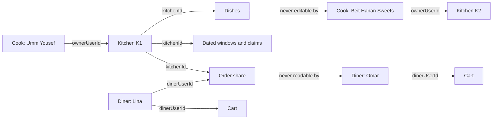

# Whose kitchen, whose order?

At 13:05 Lina opens her order tracking screen and sees that Umm Yousef has started cooking. At the same moment Umm Yousef's kitchen board shows the same order with the tray count and the handover note. Two people, one record, and they are allowed to see different parts of it. A third person must see nothing at all.

Authentication told Sufra who each caller is. It did not tell Sufra which record belongs to that caller, and it certainly did not decide which fields inside the record are theirs to read. That second job is authorization, and in a marketplace it fails in a specific and expensive way: a valid user changes one ID in a URL and reads or edits somebody else's business.

## A token proves identity, not permission

When Lina logs in, the API returns a token. Every request carries it, and the server resolves it to a user ID and a role. That is all the token proves. It does not prove that the order in the URL belongs to her, because the order ID came from her, and a caller can type any ID they like.

The same is true for Umm Yousef. Her token says she is a cook. It does not say she is the cook of the kitchen in the request. Sufra will have at least two cooks in the seed, Umm Yousef at her Beit Hanan kitchen and a second cook at Beit Hanan Sweets, and both hold exactly the same role. A check that only asks "is this caller a cook" passes for both of them, which is the bug this module exists to prevent.

So there are two questions on every protected route, and both need an answer. What kind of caller is this, and does this specific record belong to them? The first is a role check. The second is an object check, and it needs a path from the record to the person through fields you can name.

## The ownership chain, in Sufra terms

The cook owns the kitchen. Through the kitchen, the cook owns the dishes listed under it and the dated windows the kitchen offers. When a diner pays, the purchase splits into one order per kitchen, and the cook owns their kitchen's share of that order. That last phrase matters: the cook does not own the diner's purchase, only the part their kitchen cooks and hands over.

The diner owns the cart and the orders they bought. An order record is therefore read by two different people with two different reasons. Lina needs the cooking status, the kitchen name and the promised window. Umm Yousef needs the items, the quantity, the handover detail and enough contact information to complete the delivery. Neither needs everything.

The capacity claim belongs to neither of them. It is written by the checkout service and changed by payment or expiry. No diner route should accept a claim state from a request body, and no cook route should be able to release a claim to free up a window for a friend.

The diagram shows the two chains and the point where they meet. Notice that the order sits between the cook's chain and the diner's chain, and that the claims hang off the window, not off the person.

Read the two dotted arrows as the tests you will write in lesson 8.3. Everything else in the diagram is a path you can follow with a field name, which is the only kind of path an authorization check can use.

## Why a role check alone is not a security control

It is worth being concrete about what a role-only API allows. A cook-only middleware on `PATCH /api/kitchens/:kitchenId/dishes/:dishId` lets any cook edit any dish in the city, as long as they know or guess two IDs. MongoDB identifiers are hard to guess in bulk, but they leak: a public menu response contains dish IDs, a shared link contains a kitchen ID, and a screenshot in a support thread contains both. Obscurity is not a control.

There is a second failure that is easier to miss. A route may check ownership of the kitchen in the URL and then update a dish by an ID taken from the request body. The kitchen check passes because the cook does own the kitchen in the path, and the update lands on a dish from another kitchen. Every identifier that selects or changes a record has to be proven to belong to the same scope.

## Need to know, field by field

The hardest part of this module is not the status code. It is the field list. An order document holds data that two participants need for different reasons, plus data that only the platform needs. A response should be built from a projection that names the fields, not by deleting a couple of keys from a full document.

For the cook, the useful fields are the items with their quantities, the window times, the handover mode, and a contact channel for the diner. The cook has no business reading the diner's payment method, their order history, their other carts or the total the platform charged in fees. For the diner, the useful fields are the kitchen display name, the item snapshots, the promised window, the status timeline and their own total. The diner has no business reading the cook's private phone number, the cook's home address, internal kitchen notes or another kitchen's share of the same purchase.

Write those lists down before you write a serializer. A projection is a design decision, and it is far easier to review as a short list in a document than as a spread of `delete` calls in a controller.

## A valid request can still be the wrong request

Some failures look authorized because every ID belongs to the caller. Lina's cart holds dishes from two kitchens. A route that removes a cart line must check that the line is in her cart, which it will. It must also check that the dish it removes is the one the line names, and that the quantity is hers to change. If the route accepts a `kitchenId` from the request body and deletes every line for that kitchen, a bug in the client can empty half her lunch, and the server will have done exactly what it was told.

The same shape appears on the cook side. A route that closes a window should close the window named in the path, owned by the kitchen named in the path, on the date that window actually covers. If it takes the date from the body instead, a cook can close a date their kitchen never offered and learn whether another kitchen has a window that day from the difference between the two responses.

The pattern to keep: the record that changes is the record that was loaded and checked. Nothing in the body chooses the target after the check has passed.

## 403 or 404, and why it matters

Status codes are part of the security model here. A wrong owner is not an unauthenticated caller, so 401 is wrong; the token is valid and a 401 sends the client into a refresh loop that hides the real problem. The choice is between 403 and 404, and the deciding question is whether the caller is allowed to know that the record exists.

For a public object, the answer is usually yes. A kitchen profile is visible to diners when it is open, and a dish is on a public menu. If cook B tries to edit cook A's dish, returning 403 tells them nothing they could not learn from the menu. The record is public, the action is refused, and the response body carries no dish fields.

For a private object, the answer is no. An order ID is not public. If diner B requests diner A's order and receives 403, that response confirms the order exists, and a caller can walk IDs to learn how many orders a kitchen sold. Return 404 for those routes, using the same body and the same timing profile as a real missing record.

This policy gives a rule you can apply without debate. Public records answer 403 on a failed ownership check. Private records answer 404. Both responses omit the record, both are logged with the caller and the target, and neither explains which check failed to the caller.

## What this module will build

The next lesson writes the two guards: a role middleware and an ownership helper that follows a record to its owner. Lesson 8.3 turns the policy above into an authorization matrix and a test suite with two cooks and two diners, including the order event stream test that must fail here and pass in Module 23.

Keep Lina's 13:05 screen in mind while you build. The goal is not to make her request work. The goal is to make Omar's identical request fail, and to make that failure look exactly like a record that never existed.

References: [OWASP API Security Top 10, broken object level authorization](https://owasp.org/API-Security/editions/2023/en/0xa1-broken-object-level-authorization/).
