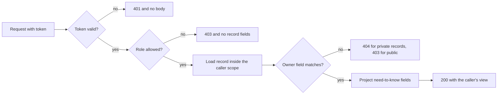

# Object checks on kitchens, dishes and orders

Three routes carry almost all the risk in Sufra. A cook edits a dish. A cook reads an order. A diner reads an order. Each route has a different path from the record to the person, and each one fails differently when the check is missing. This lesson builds the two guards that cover all three, then proves one failure with a test that returns 200 today.

The recipe has two layers, and they do different work. A role guard runs before the handler and refuses whole categories of caller. An ownership helper runs inside the handler, loads the record, and decides whether this particular record belongs to this particular user. Neither alone is enough, and a route that has only the first is the bug you will write a test for.

## Start with the route signatures

Write the contract down before the code. The table is the list of routes this module protects, and the scope column is the part the ownership helper must prove.

| Route | Role | Ownership scope to prove |
|---|---|---|
| `GET /api/kitchens/:kitchenId` | any signed-in user | public fields only; owner fields omitted |
| `PATCH /api/kitchens/:kitchenId` | cook | `kitchen.ownerUserId` equals caller |
| `PATCH /api/kitchens/:kitchenId/dishes/:dishId` | cook | `dish.kitchenId` equals the path kitchen, and that kitchen is owned by caller |
| `GET /api/kitchens/:kitchenId/orders` | cook | order list filtered by the caller's kitchen, never a client-supplied kitchen |
| `GET /api/orders/:orderId` | diner | `order.dinerUserId` equals caller |
| `PATCH /api/kitchens/:kitchenId/orders/:orderId/status` | cook | order belongs to a window and kitchen owned by caller |

Every row has a field name in it. That is the test for a useful matrix: if a scope cell cannot name a field, the route has no check to write.

The diagram shows where each check sits in the request. The role guard is a filter at the edge, and the ownership decision happens after a record is loaded in a scope the caller cannot influence. Nothing after the refusal line runs for a caller who failed, which is why the response cannot leak a field from the record.



The last two boxes are the part teams forget. A correct check with an over-wide projection still hands the diner's payment method to a cook, and that is a data leak even though the caller was allowed to read the record.

## The role guard is a filter, not a decision

The role guard is small on purpose. It reads the authenticated user, compares the role with an allowed list, and either continues or ends the request. It must not load a record, because a route may need a different scope for a different record, and a guard that half-checks is worse than one that does not check at all.

```js
// server/src/modules/auth/require-role.js
export function requireRole(...allowed) {
  return function roleGuard(req, res, next) {
    const user = req.user;
    if (!user) return next(httpError(401, 'AUTH_REQUIRED'));
    if (!allowed.includes(user.role)) return next(httpError(403, 'ROLE_NOT_ALLOWED'));
    return next();
  };
}
```

Two details are worth copying. The guard refuses a missing user with 401 and a wrong role with 403, because those are different situations for the client. And it returns a small error code rather than a sentence about what the user would need to be, because a helpful denial is still a disclosure.

## The ownership helper loads and decides

The helper's job is to turn a record and a user into a decision. Its interface takes the record, the user and the scope name, and either returns the record or throws a typed error. Keeping the error typed matters, because the route needs to map it to 403 or 404 without guessing.

```js
// server/src/modules/auth/ownership.js
export const OWNERSHIP_SCOPES = ['kitchen-owner', 'kitchen-order', 'diner-order'];

export async function assertOwned(scope, record, user, { Kitchen }) {
  if (scope === 'kitchen-owner' && record.ownerUserId.equals(user.id)) return record;
  if (scope === 'diner-order' && record.dinerUserId.equals(user.id)) return record;
  if (scope === 'kitchen-order') {
    const kitchen = await Kitchen
      .findOne({ _id: record.kitchenId, ownerUserId: user.id })
      .lean();
    if (kitchen) return record;
  }
  throw ownershipError('NOT_OWNER', record);
}
```

The three scopes map to the three paths in the table. `kitchen-owner` compares the kitchen's owner field. `diner-order` compares the order's diner field. `kitchen-order` takes the one hop from the order to its kitchen and matches the owner in the same query. The rule is the same in each case: follow a stored field, never a field from the request.

## Prefer a scoped query where you can

There is a stronger pattern for simple cases, and it removes the chance of forgetting the check. Put the ownership condition into the query itself. The database returns nothing when the condition fails, so there is no branch in the handler that a later edit can delete.

```js
const order = await Order.findOne({ _id: orderId, dinerUserId: req.user.id }).lean();
if (!order) return next(httpError(404, 'ORDER_NOT_FOUND'));
```

The filter is the authorization. For a private record this is the whole answer, because the caller has no right to learn whether the order exists. A kitchen profile is the opposite case. It is public while it is open, so a cook who asks to edit a kitchen they do not own should be told the action is refused with 403, not that the kitchen is missing. That route loads the kitchen by ID, returns 404 only when no such kitchen exists, and returns 403 when the owner field does not match.

The scoped query has one limit. It works when the condition is a field on the record you are loading. For a dish, the condition is one hop away, on the kitchen. For that case you need two loads, and the second load must be scoped by the first.

## Where the check must not live

Three places feel like authorization and are not. The client is the first. Hiding the edit button in the cook dashboard stops an honest mistake and does nothing to a caller with curl, because the token still works and the route still exists. The second is a shared middleware that checks only the role, which is the bug this lesson started with. The third is a Mongoose hook that filters reads by a user ID set somewhere else in the request. It looks thorough, and it fails when a route forgets to set the value, because an unset user filter often becomes "no filter" rather than "no results".

The rule to keep is dull and reliable: every handler that reads or writes a private record loads that record through a condition the caller cannot supply, and the condition names an owner field. A helper can wrap the rule, a scoped query can express it, and a test can prove it. A convention that relies on remembering to call something on every route will eventually meet a route where someone forgot.

There is a useful side effect of writing the condition into the query. When the query matches nothing, you cannot tell whether the record is missing or owned by someone else, so the 404 comes out of the same code path in both cases. That is exactly the behaviour you want for private records, and you get it without a special case.

## Follow the dish to its owner

The dish route is where most learners ship a bug, because the path contains two identifiers that must agree. The handler must confirm that the dish's `kitchenId` equals the kitchen in the path, and that the kitchen belongs to the caller. A check on either one alone passes for a request that should fail.

The order of the loads matters. Load the kitchen with the caller scoped in, so a failure stops before the dish is touched. Then load the dish by both its own ID and the kitchen ID together, not by the dish ID alone. If the second query finds nothing, the dish is either missing or from another kitchen, and both answers should look identical to the caller.

Write the two conditions as one sentence in your notes: the cook may change a dish only when the dish and the path kitchen and the caller all resolve to the same kitchen. Then write the test that fails when any one of the three is wrong.

## Prove the gap with a failing test

Write the test before the guard. Two cooks, two kitchens, one dish, one forbidden request. The assertion is not "the update is refused"; it is "the dish is unchanged after the request".

```js
// tests/authz/cross-kitchen-dish.test.js
import { describe, it, expect } from 'vitest';
import { api, seedTwoCooks, loginAs } from './helpers.js';

describe('cook B cannot edit cook A dishes', () => {
  it('returns a refusal and leaves the dish unchanged', async () => {
    const { cookA, cookB, dishA } = await seedTwoCooks();
    const token = await loginAs(cookB);
    const res = await api()
      .patch(`/api/kitchens/${dishA.kitchenId}/dishes/${dishA.id}`)
      .set('Authorization', `Bearer ${token}`)
      .send({ priceMinor: 1 });
    expect([403, 404]).toContain(res.status);
    expect(res.body.name).toBeUndefined();
    const after = await api().get(`/api/dishes/${dishA.id}`).set('Authorization', `Bearer ${await loginAs(cookA)}`);
    expect(after.body.priceMinor).toBe(dishA.priceMinor);
  });
});
```

Run it against the current route and read the failure carefully. The interesting part is not the status code. It is that the second expect, the one that reloads the dish, may already be failing: a 200 with a changed price means the maqluba tray now costs one minor unit for every diner in Beit Hanan.

```text
FAIL  tests/authz/cross-kitchen-dish.test.js
AssertionError: expected 200 to be one of [ 403, 404 ]
```

## Wire the guard into the route

The diff below is the shape of the fix, not the finished handler. It adds the role guard to the route registration and replaces the unscoped update with a scoped one. Error mapping is one function in the error module and is not repeated per route.

```diff
- router.patch('/kitchens/:kitchenId/dishes/:dishId', updateDish);
+ router.patch(
+   '/kitchens/:kitchenId/dishes/:dishId',
+   requireAuth,
+   requireRole('cook'),
+   updateDish
+ );
```

Inside the handler, the change is a filter, not an `if`. Replace the bare dish lookup with a lookup scoped to the kitchen that the caller owns. If the kitchen load fails, return the refusal before the dish query runs, so the response time does not reveal whether the dish exists.

## Keep the refusal quiet

Every refusal in this module returns a small body with an error code and nothing else. No record fields, no owner ID, no list of fields that would have been allowed, and no hint about which condition failed. The server log records the caller, the route and the target ID, because you will need that during an incident. The response does not.

There is one more field to protect on the success path. A cook reading their own order should receive the projection from lesson 8.1, not the whole document. A guard that stops the wrong person and then hands the right person too much has only done half the job.

The next lesson turns these guards into a matrix and a suite. It includes the two order reads that must look identical to the caller: a cook asking for another kitchen's order and a diner asking for another diner's order both receive the same 404 as a record that never existed.

## Acceptance criteria

- [ ] `requireRole` refuses an unauthenticated caller with 401 and a wrong role with 403.
- [ ] The kitchen edit route returns 403 when another cook owns the kitchen and 404 only when no kitchen has that ID.
- [ ] The dish edit route proves the dish, the path kitchen and the caller resolve to one kitchen.
- [ ] Cook B's request leaves cook A's dish unchanged, proven by reloading the dish after the request.
- [ ] Refusal bodies contain no record fields, no owner ID and no explanation of the failed check.
- [ ] The order routes use the participant projections from lesson 8.1 rather than the full document.

References: [Mongoose queries](https://mongoosejs.com/docs/queries.html), [Mongoose `lean()`](https://mongoosejs.com/docs/tutorials/lean.html).
