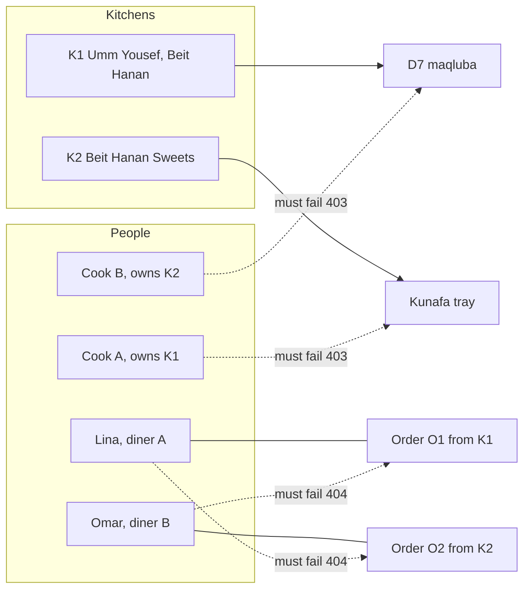

# The authorization matrix and cross-kitchen tests

A guard you wrote is not a permission model until someone can read the model and disagree with it. The matrix is that readable form. Each cell says who may do what to which record, and the test suite is the evidence that the code agrees with the table rather than with the author's memory.

This lesson writes both. The fixture is deliberately small: two cooks, two diners, two kitchens, one dish each, one order each. Small fixtures catch more, because every crossed request is easy to name and every state change is easy to check afterwards.

## Draw the fixture before the matrix

The diagram is the test topology. Solid arrows show the two legitimate reads. Dashed arrows show the requests that must fail, and each one crosses exactly one boundary, so a failure points at one check rather than at three.



Two cooks cross the public boundary and two diners cross the private one, which is why the expected codes differ. A dish is on a public menu, so refusing cook B with 403 tells them nothing new. An order is a private record, so the same refusal must look like a record that does not exist.

## Fill the matrix

Put this table in `docs/authz-matrix.md`. Keep one row per action, not one row per route, because a route may read for one participant and write for another. The scope column names the field the check follows, and the last column names the test that proves it.

| Actor | Resource | Action | Scope field | Expected | Proof |
|---|---|---|---|---|---|
| Anonymous | any private route | read | none | 401 | `auth-required` |
| Diner A | own order | read | `order.dinerUserId` | 200, diner view | `own-order-read` |
| Diner B | diner A order | read | `order.dinerUserId` | 404, no fields | `cross-diner-order` |
| Diner A | own cart | write | `cart.dinerUserId` | 200 | `own-cart-write` |
| Diner B | diner A cart | write | `cart.dinerUserId` | 404, no fields | `cross-diner-cart` |
| Cook A | own dish | write | `dish.kitchenId` to `kitchen.ownerUserId` | 200 | `own-dish-write` |
| Cook B | cook A dish | write | same chain | 403, no fields | `cross-kitchen-dish` |
| Cook A | own order | read | `order.kitchenId` to `kitchen.ownerUserId` | 200, cook view | `own-order-read-cook` |
| Cook B | cook A order | read | same chain | 404, no fields | `cross-kitchen-order` |
| Cook A | kitchen schedule | write | `kitchen.ownerUserId` | 200 | `own-schedule-write` |
| Cook B | cook A schedule | write | `kitchen.ownerUserId` | 403, no fields | `cross-kitchen-schedule` |
| Diner A | capacity claim | write | not a user scope | 404, no route | `claim-not-user-writable` |

The last row is not a mistake. There is no user-facing route that changes a claim, and the test asserts that a request to one does not change window state. A model that lists only the routes you built will miss the routes an attacker invents.

## Write four kinds of test

Every row in the matrix belongs to one of four families, and each family asserts something different. Mixing them gives a suite that reports a status code and proves nothing.

The first family is the owner's success. Cook A edits their own dish and the response contains the changed field. This catches a guard so strict that it refuses legitimate work, which happens when a scope compares the wrong field, for example a user ID against a kitchen ID.

The second family is the crossed request. Cook B sends the same request against cook A's dish. The assertions are the status, the absence of record fields, and the state of the database afterwards. That third assertion is the one that catches a handler which returns a refusal after it has already written.

The third family is the escalation attempt. A diner sends a cook route with their own token, and a cook sends a diner route. The role guard handles both, and the test proves the guard is registered on the route rather than only imported in the file.

The fourth family is the projection. The right person reads the right record and must still not see fields outside their need. Cook A reads their own order and the response has no payment method and no fee breakdown. Diner A reads their own order and the response has no cook phone number and no internal kitchen note.

## Assert the absence, not only the status

A test that checks `res.status === 403` will pass against an implementation that returns a full order document with a 403 code, which is a real bug because many clients log and display error bodies. Assert the shape as well.

```js
// tests/authz/cross-diner-order.test.js
it('diner B cannot read diner A order', async () => {
  const token = await loginAs(fixture.dinerB);
  const res = await api().get(`/api/orders/${fixture.orderA.id}`).set('Authorization', `Bearer ${token}`);
  expect(res.status).toBe(404);
  expect(res.body).toEqual({ code: 'ORDER_NOT_FOUND' });
  expect(JSON.stringify(res.body)).not.toContain(fixture.dinerA.name);
});
```

The last assertion looks crude and is worth keeping. It fails when a future error handler adds the requested record to the error context, which is the most common way a clean refusal starts leaking.

Add the mirror test for the cook side, where the expected code is 403 and the assertion is that no dish field appears. Then add the state check: reload the dish as its owner and assert the price is unchanged. If the price moved, the status code in the other test was a lie.

## Write the stream isolation test now

Module 23 builds the live order stream. The roadmap asks for its isolation test here, in Module 8, while the authorization model is fresh. The test is short and it must fail today, because there is no stream route yet.

```js
// tests/authz/stream-isolation.test.js
it.fails('diner B receives no events from diner A order', async () => {
  const stream = await openStream({ token: await loginAs(fixture.dinerB) });
  await advanceOrder(fixture.orderA, 'cooking');
  const events = await stream.nextEvents(1000);
  expect(events).toHaveLength(0);
});
```

`it.fails` is deliberate. The suite stays green, and the gap stays visible in the report, so nobody can claim the stream is isolated before it exists. When Module 23 serves `text/event-stream`, the same test becomes a normal `it` and must pass without edits. If it needs editing to pass, the stream was designed around the test rather than around the user.

Write one sentence beside the test explaining why the stream cannot use a plain `Authorization` header and what will replace it. That sentence becomes the start of the ADR in Module 99.

## Keep the matrix alive

A matrix written once becomes fiction within two modules. Every lesson that adds a mutating route from here, including the kitchen schedule, the dish editor, the cart and the checkout, adds at least one row and one crossed test. Make that a habit now: the pull request that adds a route also adds the row, and a reviewer can reject it for a missing row the same way they reject it for a missing test.

The cheapest way to keep this honest is to derive the route list from the router itself and compare it with the matrix headings. A short script that prints every registered route and fails when a route has no matrix row takes twenty lines and catches the route someone added in a hurry. It will not tell you whether the check is right, but it will tell you where to look.

Do the same for the projections. Keep the allowed field list for each participant in one module, next to the serializers, and let the tests import it. When someone adds a field to an order, the projection list forces a decision about who may see it, rather than leaking it by default through a spread of the whole document.

## Run the suite and save the evidence

Run the auth tests and capture the summary, not the whole log. Save it in `docs/EVIDENCE.md` with the date, the branch and one line per family: how many owner successes, how many crossed refusals, how many escalations, how many projections.

```text
✓ tests/authz/own-dish-write.test.js (2)
✓ tests/authz/cross-kitchen-dish.test.js (2)
✓ tests/authz/cross-diner-order.test.js (2)
✓ tests/authz/projection-fields.test.js (4)
↓ tests/authz/stream-isolation.test.js (1 skipped, expected failure)
```

The skipped line is not a defect in this module. It is a scheduled failing test with a named module that will make it pass. Record it that way, because a reviewer who sees a skip without an owner will assume it was forgotten.

## What the matrix cannot cover

The matrix covers records a user owns. It does not cover aggregate leaks: a public endpoint that returns the number of orders per kitchen, or a search that reveals a dish from a hidden kitchen, or an error message that reports how many claims a window has. Those need their own review, and the honest place to write that limit is the bottom of the matrix file.

Nor does it cover the case where a cook is also a diner. A single account may hold both roles in the seed, and the tests should include one such account, because a scope check written as "if the user is a cook, use the kitchen path" will pick one identity and silently ignore the other. The matrix has a row for that account, and the row says which check runs first.

Add that row before you close the file. It is the row most likely to be missing, and it is the one a real marketplace hits in its first week.

## Acceptance criteria

- [ ] `docs/authz-matrix.md` has one row per action, a scope field for every row and the name of the test that proves it.
- [ ] The fixture creates two cooks, two diners and one account that holds both roles.
- [ ] Every crossed request asserts a status, the absence of record fields and the unchanged state of the target.
- [ ] Cook B's attempt on cook A's dish answers 403 and leaves the price untouched.
- [ ] Diner B's attempt on diner A's order answers 404 with an identical body to a missing order.
- [ ] The projection tests prove a cook cannot read payment fields and a diner cannot read cook contact details.
- [ ] The stream isolation test exists, is marked as an expected failure, and names Module 23 as its owner.
- [ ] `docs/EVIDENCE.md` records the run summary with a date and a branch.

References: [Vitest `test.fails`](https://vitest.dev/api/#test-fails), [OWASP authorization cheat sheet](https://cheatsheetseries.owasp.org/cheatsheets/Authorization_Cheat_Sheet.html).
