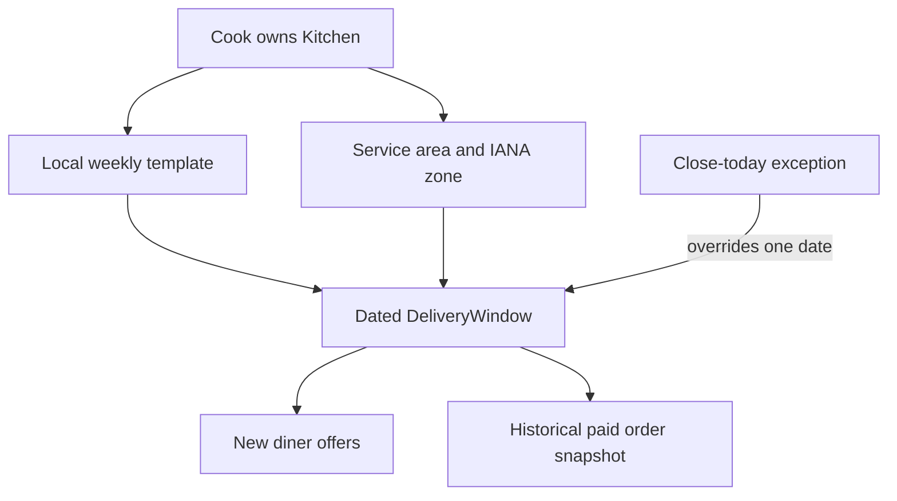

# A kitchen is a schedule

Umm Yousef can prepare lunch for her neighborhood on most weekdays. On Thursday she has a family commitment and will not cook. Her kitchen profile still exists, its dishes still have names and prices, and next week's lunch may still be offered. The API must close this Thursday's offer without deleting the kitchen or changing every future Thursday. That decision starts with a schedule, a named time zone and a dated pause.

A grocery shop API might focus on an address, opening hours and products on shelves. Sufra needs those ideas in a different form. A diner asks, "Who can feed me around 13:00?" The answer depends on whether a kitchen serves their area, whether it works that dated interval, whether the dish can finish before the cutoff and whether enough load units remain. A street address alone answers none of those. The kitchen's profile and schedule are inputs to dated windows, not a direct availability flag.

## Give the cook control of future offers

The cook owns their kitchen name, short description, service-area codes, IANA time zone, travel buffer and weekly template. A weekly rule names a weekday, local start and end, general cutoff lead and capacity units. It says what the cook normally offers. The system later expands the rule into dated `DeliveryWindow` records. A dated exception can close one occurrence or add a special interval without changing the template. This module builds the profile, template and a simple close-today path. M14 builds full seven-day expansion and exception reconciliation.

The kitchen can be `draft`, `open` or `paused`. A draft is not visible to diners. An open kitchen can have future dated windows, but a particular window may still be closed or full. A broad pause can hide future offers while the cook reviews their settings; a close-today exception affects only one local date. Do not use one boolean `isOpen` for all these meanings. If the cook closes today's lunch, existing paid orders remain visible and need a resolution, while new claims stop.

The diagram separates reusable settings from dated promises. The pause does not erase the weekly rule, and a paid order does not move when a cook edits the profile.

Read the two outgoing arrows from the dated window carefully. A closure can stop new diner offers. It must not remove the historical order snapshot. The latter records the time and price promised earlier. If the cook can no longer fulfil a paid order, the order lifecycle handles contact, cancellation or refund. Deleting the window would hide the problem rather than resolve it.

## Service area is a product boundary

For this course, a kitchen lists neighborhood codes it can deliver to. The API compares a diner's selected area with that list. It should normalize codes consistently and reject empty or duplicate entries. Do not let the browser invent a kitchen's service area in a checkout request. The cook may change the list for future offers; a paid order keeps its delivery address and kitchen snapshot. A real map polygon or route-time engine is outside the core path. The simple list is enough to teach scoping and filter behavior.

The service-area record also has a privacy side. The public API can show which neighborhoods a kitchen serves. It does not need to show a cook's private home address. The kitchen's display name and area are public offer data; the owner's account details are not. A diner delivery address belongs to a protected order after purchase, not to a public kitchen window. Design response objects from these distinctions instead of serializing the whole MongoDB document.

## Time zone is not a preference label

The cook enters an IANA zone such as `Asia/Gaza`. It tells Sufra how to interpret a recurring local 13:00 rule on each date. A fixed `+02:00` string cannot represent rule changes over time. The API validates the zone name and stores it on the kitchen. Generated dated windows keep the zone that was used to create them, along with UTC start and end instants. A paid order snapshots those times, so a later profile edit does not silently shift delivery.

Changing a kitchen zone after windows exist is not a simple text edit. It can change the UTC instants generated from future local rules. For the core course, require a reviewed zone-change operation: reject it while held or paid future windows would be affected, or explicitly migrate only unclaimed future windows with a dated audit note. Do not bulk update all windows and hope the old orders remain meaningful. Lesson 9.4 makes this rule testable.

## The weekly template is not capacity yet

A rule may say Monday 13:00 to 14:00 with ten load units. It is a plan for future dated windows. It does not hold ten reusable units that can be decremented forever. Each generated Monday gets its own `capacityUnits` and `remainingUnits`. A diner selecting next Monday cannot consume this Monday's pool. A generator retry must not reset a dated window that already has claims. M14 handles expansion and idempotency, while this module validates the template from which those windows will be made.

The cook should be able to see a preview of the next seven local dates before saving. A preview is not a paid promise, but it helps catch an accidental Tuesday-only schedule or a wrong zone. On a phone screen, the app should show the local day and time, capacity and cutoff in plain text. The backend still validates the submitted rule because client previews can be stale or bypassed.

## Work one Thursday pause

Suppose Umm Yousef normally offers a Thursday 13:00 lunch. On Wednesday evening she closes Thursday. The API records a dated exception for the kitchen's Thursday local date. It stops new claims on that occurrence and leaves the weekly Thursday rule intact. The following Thursday remains eligible. If a diner already paid for this week's lunch, the order stays and the cook must resolve it through the lifecycle. The API should not report that deleting the schedule fixed the paid promise.

Create `docs/kitchen-api-decisions.md` with one row for profile data, one for recurring schedule data, one for a dated exception and one for a generated window. Write who may edit each, what date it applies to and whether a paid order may depend on it. That table will guide the routes and tests in this module. The next lesson implements the public profile and service-area boundary before the schedule fields are exposed.

Try a second example with Beit Hanan Sweets. It serves two neighborhoods and offers an evening window on Friday, but no lunch. A diner who selects Friday lunch should not see Beit Hanan merely because its kitchen status is `open`. A diner who selects Friday evening may see it if the dated window is generated and serves their area. The distinction keeps kitchen-level visibility from becoming an accidental promise about every time of day.

Try a third example with a cook who pauses the whole kitchen while editing its menu. Future unclaimed windows should stop appearing as orderable. A paid order still needs a visible status and a cook response. If the cook resumes, the API should not automatically reopen a dated occurrence whose cutoff already passed. Resumption affects future eligible offers; it does not move the server clock backward. These cases will become route tests so a single `open` field cannot hide multiple lifecycle rules.

Write the expected HTTP behavior beside the table. An unauthorized edit to another kitchen's schedule returns a denial without changing data. A malformed IANA zone returns validation feedback. A duplicate area code is normalized or rejected consistently. Closing today's window twice should return the same closed state and leave the following week's rule intact. This small contract will make the later mobile onboarding form easier to build because its errors name the actual rule that failed.
