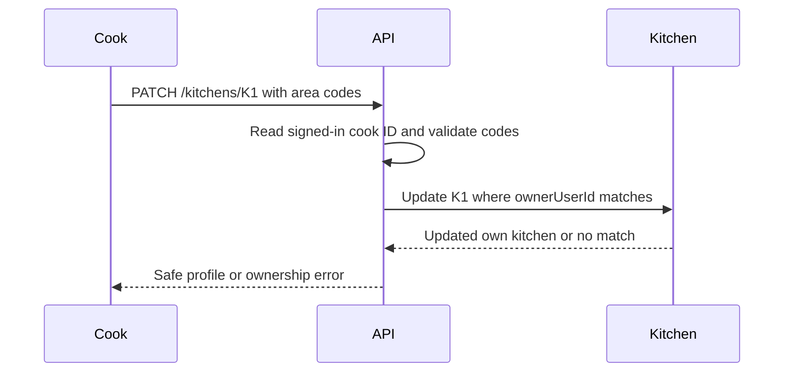

# Kitchen profile and service area

A cook needs a kitchen profile before they can publish dishes or schedule lunch. The profile gives diners a public name and a service area. It does not expose the cook's private account fields. The API takes the authenticated cook ID from the session, validates the submitted neighborhoods, and saves a kitchen in `draft` state. A diner can later see public kitchen details only when the kitchen is open and offers a matching dated window.

Use simple area codes in this course, such as `al-rimal` and `tel-al-hawa`. A real delivery product would need address geocoding and route limits, but those are not required to teach window and capacity constraints. The same normalized codes must be used for kitchen settings and diner browse filters. A kitchen that serves `Al-Rimal` should not disappear because one request sends `al-rimal` with different case. A duplicate code should not count as two service areas.

## Put ownership on the server

Create `server/src/modules/kitchens/kitchen.routes.js` and `kitchen.service.js`. The route requires a signed-in cook. It passes the authenticated user ID to the service rather than accepting `ownerUserId` from the request body. The service creates a draft kitchen with that owner, a trimmed name, short description and normalized area codes. For updates, it matches both kitchen ID and owner ID. A cook role alone is insufficient, because any other cook has the same role but does not own this record.

The diagram traces an edit through the trust boundary. The second cook's request follows the same route, but the owner condition prevents its update.



Do not distinguish "kitchen does not exist" from "you do not own this kitchen" in a way that leaks another cook's private record. A public profile route can reveal public kitchens intentionally, but an edit route should not reveal hidden schedule or account details while reporting a denial. Log the denial with a request ID for review without writing the full account object to application logs.

## Normalize before saving

Create `server/src/modules/kitchens/area-codes.js`. Keep the accepted format small and explicit. This function rejects an empty list, duplicates, overlong codes and non-string values. It returns the normalized list; the route can turn its error into a field-specific response that the mobile form can show.

```js
export function normalizeAreaCodes(input) {
  if (!Array.isArray(input) || input.length < 1 || input.length > 12) {
    throw new Error('INVALID_SERVICE_AREA');
  }
  const codes = input.map(value => {
    if (typeof value !== 'string') throw new Error('INVALID_SERVICE_AREA');
    const code = value.trim().toLowerCase();
    if (!/^[a-z0-9-]{2,40}$/.test(code)) {
      throw new Error('INVALID_SERVICE_AREA');
    }
    return code;
  });
  if (new Set(codes).size !== codes.length) {
    throw new Error('DUPLICATE_SERVICE_AREA');
  }
  return codes;
}
```

Test `[' Al-Rimal ', 'tel-al-hawa']` and expect normalized codes. Test `['al-rimal', 'Al-Rimal']` and expect a duplicate error after normalization. Test an empty list, a number, an overlong string and a code with whitespace inside. The explicit regex is a course convention for fictional area keys, not a rule for how neighborhood names must be written in every language. Keep a separate display label if the product needs Arabic or other human-readable names; do not force those labels into a narrow key format.

## Create and edit a draft

On creation, set `status: 'draft'`. Require a reasonable name length and description length. Do not accept `status: 'open'` from the same request until zone and schedule validation are complete. If a client retries creation after losing a response, use a stable idempotency key or a unique owner-and-client-key field to return the first draft. Do not create a second kitchen only because the phone asked twice. Keep the rule in the service, not as an instruction that depends on a perfect network.

For an edit, allow a cook to change public name, description and service-area codes. Match `Kitchen.findOneAndUpdate({ _id: kitchenId, ownerUserId: cookId }, { $set: safeFields }, { new: true })`. Build `safeFields` explicitly. Passing the whole request body to `$set` could let a client change `ownerUserId`, `status`, `weeklySchedule` or internal fields through the profile route. Separate schedule and pause routes own those transitions.

After an area edit, new browse responses should use the updated list. A paid order keeps the address and kitchen promise it was sold with. If a cook removes an area while future paid deliveries exist there, the product needs an operational resolution path. For the core course, show a warning and keep paid orders intact. Do not retroactively hide them by reading only the current area list in the order page.

## Keep route responses predictable

A successful create response should return the new kitchen ID and draft status. A validation error should identify the field and preserve the cook's typed form values on the client. An ownership denial should not include another cook's kitchen document. An unexpected database error should have a request ID in the server log and a calm generic response to the cook. Do not catch every database failure and call it `INVALID_SERVICE_AREA`; a connection failure needs a different investigation path.

Use the same normalization function when saving and when filtering public kitchens by area. If creation saves lower-case codes but browse compares an untrimmed query parameter, diners can miss valid kitchens. Validate the query parameter as a single code before it reaches MongoDB. Avoid a regex built directly from user text; exact normalized matching is enough for the course's area keys. If the product later needs fuzzy neighborhood search, give it a separate reviewed endpoint and tests.

Test a cook who edits K1 from a second device. The update must still use authenticated ownership and explicit allowed fields. A form can be old, so a description save should not overwrite a schedule changed elsewhere. Restrict this route to profile fields and use a revision or updated-at precondition if conflicting profile edits matter. That decision can be small in this course, but it should be visible rather than relying on the last request to win silently.

Public availability can change while a diner reads a profile. A kitchen that was open when the profile loaded may pause before the diner chooses lunch. The public profile may remain readable, but checkout must use current dated-window state. This separation lets a diner understand the kitchen without mistaking an old card for a reserved meal. It also gives the cook a way to pause new offers without deleting a public identity or losing order history.

## Return only public fields

Create a response mapper for diner-visible kitchen data. Include ID, display name, description, approved service-area labels and a public status. Exclude owner email, password fields, private home address, raw schedule edit history and internal claim data. A cook's own authenticated dashboard can receive more fields, but it still should not receive secrets. Write a test that compares the public response to an allowlist, not only a test that searches for one forbidden field. A new private schema field should not accidentally appear because the route serialized the entire Mongoose document.

The public kitchen profile is not a general promise that food is available now. A diner browse query in M15 combines it with a dated window and timely dishes. The profile route may say the kitchen exists and serves an area, while the window query says there is no lunch today. Keep those messages separate. A name and neighborhood card without a valid window should not invite checkout.

## Verify permission and area matching

Create cook A, cook B and diner C. Cook A creates K1. Cook B tries to change K1's name and areas and receives a denial; the saved row remains unchanged. Diner C tries the same and is denied by role. Cook A updates `Al-Rimal` to the normalized code and reads it back. A public read does not contain owner email or account fields. A diner filtering `al-rimal` can match K1's area once an open dated window exists, while an unrelated code does not match.

Save the request, response and database state in `docs/EVIDENCE.md`, with fictional names and no private address. If the ownership test fails, inspect the update filter before adding UI restrictions; hiding an Edit button cannot secure the route. If the area filter fails, print normalized keys on both sides rather than comparing display labels. The next lesson adds the cook's weekly schedule template, which is the other input needed to generate dated windows.
