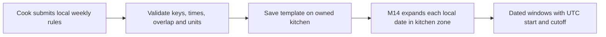

# The weekly schedule template

Umm Yousef works lunch on Monday through Thursday from 13:00 to 14:00. She can handle ten load units in each lunch interval and stops taking new orders one hour before it begins. This is one weekly template, not four dated windows and not one UTC time reused forever. The API stores the cook's local rule with a stable key. M14 will expand it for the next seven dates using the kitchen's IANA time zone.

The template must be precise enough to generate windows and simple enough to edit on a phone. A rule has `key`, `weekday`, `localStart`, `localEnd`, `capacityUnits` and `cutoffLeadMinutes`. Use the weekday numbering already chosen in M5 and document it in the API contract. `localStart` and `localEnd` are exact `HH:mm` labels, not JavaScript Date values. The kitchen's `timeZone` supplies the region for later date expansion. A rule's capacity is copied to a new dated window only on first generation; a template edit cannot reset a held window.

## Validate the whole set together

Build `server/src/modules/kitchens/weekly-rules.js`. Validate individual ranges and the set. A valid start is before its end for this course's same-day intervals. Capacity and cutoff lead are safe positive integers within documented limits. Rule keys are unique within the kitchen. Two rules on the same weekday must not overlap. Reject a duplicate Monday 13:00 rule rather than asking the generator to decide which one owns the capacity.

The diagram shows where validation stops and generation begins. The API stores a template only after it can be expanded without ambiguity. The later generator owns dated UTC values.



Write a small parser for `HH:mm`. It returns minutes after local midnight and rejects loose values such as `"1pm"`, `"25:00"` or `"13:60"`. Comparing these minute numbers is safe for detecting same-day overlaps in the local template. It is not a substitute for zone-aware conversion on a specific date, where an hour may be missing or repeated.

```js
function localMinute(value) {
  if (typeof value !== 'string' || !/^([01]\d|2[0-3]):[0-5]\d$/.test(value)) {
    throw new Error('INVALID_LOCAL_TIME');
  }
  const [hour, minute] = value.split(':').map(Number);
  return hour * 60 + minute;
}

export function validateWeeklyRules(rules) {
  if (!Array.isArray(rules) || rules.length > 28) {
    throw new Error('INVALID_WEEKLY_RULES');
  }
  const keys = new Set();
  const byDay = new Map();
  for (const rule of rules) {
    const start = localMinute(rule.localStart);
    const end = localMinute(rule.localEnd);
    if (!Number.isInteger(rule.weekday) || rule.weekday < 0 || rule.weekday > 6 ||
        start >= end || !Number.isSafeInteger(rule.capacityUnits) ||
        rule.capacityUnits < 1 || rule.capacityUnits > 100 ||
        !Number.isSafeInteger(rule.cutoffLeadMinutes) ||
        rule.cutoffLeadMinutes < 1 || rule.cutoffLeadMinutes > 1440 ||
        typeof rule.key !== 'string' || !rule.key.trim() || keys.has(rule.key)) {
      throw new Error('INVALID_WEEKLY_RULE');
    }
    keys.add(rule.key);
    const intervals = byDay.get(rule.weekday) ?? [];
    if (intervals.some(([a, b]) => start < b && a < end)) {
      throw new Error('OVERLAPPING_WEEKLY_RULES');
    }
    intervals.push([start, end]);
    byDay.set(rule.weekday, intervals);
  }
  return rules;
}
```

An empty schedule is allowed for a draft kitchen; it means there is nothing to generate or browse. Before the kitchen becomes open, require at least one valid rule. Keep this validation in the service as well as the form. The browser may help the cook see a conflict, but the API must reject a direct request that bypasses the form.

Check the cutoff lead against the window duration and dish preparation expectations. A 13:00 start with a 60-minute general lead means a 12:00 general cutoff, but a 90-minute dish with a 20-minute travel buffer closes at 11:10. The weekly rule does not need to list a cutoff for every dish. It provides the general deadline, while the dish and dated window provide the earlier preparation deadline. If a cook enters a general lead that makes every listed dish impossible, show a warning before opening the kitchen. Do not silently shorten the dish's preparation time to make the schedule look usable.

The same-day rule is a course scope decision. A kitchen that wants a midnight-spanning window needs a different date ownership policy for its end and cutoff. Reject `23:30` to `00:30` here with a clear message instead of treating the end as earlier on the same day. A later specialization can add overnight windows with explicit next-day semantics and clock-change tests. For the lunch product, same-day intervals make the mapping from local date to dated window easier to defend.

## Save only a cook's own template

Add `PUT /kitchens/:id/weekly-schedule`. It replaces the complete weekly template after validation. Match both kitchen ID and authenticated `ownerUserId` in the update. A diner cannot use this route. Another cook cannot set your Thursday capacity. Build the `$set` object with `weeklySchedule` only; do not pass through a client `remainingUnits` field or change dated windows here.

Use a revision or `updatedAt` precondition if two devices may edit the schedule concurrently. Without it, a stale form on one phone can overwrite a newer rule saved on another. Return the new revision and normalized rules after a successful update. If the revision is stale, return a conflict and let the cook compare versions. This is a usability issue as well as a data issue: a missing Friday window might otherwise look like a generator bug when a second device removed it.

The API should preview the next local dates with the saved rule keys and zone, but the full dated UTC generator belongs to M14. A preview may show "Monday lunch 13:00, capacity 10" and warn that a dish's 90-minute preparation time needs an earlier order. It should not claim that a paid window has been created merely because the template saved. Save the template first, then let a separate generator insert dated occurrences idempotently.

## Do not rewrite existing promises

Suppose a cook changes Monday lunch capacity from ten to twelve. New unclaimed windows can use twelve after a reviewed regeneration policy. A dated window with a held claim cannot simply reset its `remainingUnits` to twelve. Its capacity and active claims must remain consistent. A paid order's window times and price snapshots must not move when the cook changes the weekly start time from 13:00 to 13:30. The schedule edit is prospective; reconciliation of existing future windows is a separate operation that checks claims and orders.

This separation is why the template has a stable rule key. A dated window records `sourceRuleKey` and `localDate`. If the cook changes the rule's start time, the system can identify which old occurrence it came from and decide whether an unclaimed window may be replaced. Without that link, two generated windows could appear for the same intended lunch under different UTC starts. M14's generator and exception flow will make the rule explicit.

Ask what happens if the cook removes a rule entirely. Future unclaimed occurrences from that rule should stop appearing after a reviewed reconciliation. A paid order or held claim tied to one occurrence cannot vanish. The API should report how many future windows are affected before applying the edit and warn about any with claims. This is why the schedule route saves the template but does not run an unguarded `deleteMany` against windows. Keeping the local rule and dated state separate gives the product a place to pause and explain the consequence.

Ask what happens if a worker runs generation while the cook saves a new template. A rule version or kitchen schedule revision lets the generator know which snapshot it read. It should use one validated schedule version for a run, then upsert dated occurrences with stable source keys. If the version changes before reconciliation finishes, rerun or report the conflict. A worker that mixes old Monday capacity with new Monday times can create a confusing dated offer even when each field was individually valid.

## Verify overlap and ownership

Test one valid Monday lunch and dinner pair, then two overlapping Monday lunches. A boundary where one ends exactly when the next begins is allowed by the strict overlap formula. Test bad `HH:mm` strings, fractional capacity, zero cutoff lead, duplicate keys and a weekday outside 0 to 6. Save one valid rule and inspect it as local labels and integers on the kitchen. It should not contain a UTC date or `remainingUnits`.

Have cook B call the route for cook A's kitchen. Expect a denial and an unchanged rule set. Have a diner call it and expect a role denial. Then simulate a stale revision and confirm it cannot erase the newer schedule. If a test saves invalid rules through a direct API call, move validation into the service. If an edit changes a dated window with a claim, separate template write from generation and add the missing lifecycle guard.

Record the request bodies, response codes and saved kitchen rule in `docs/kitchen-api-decisions.md`. The next lesson validates the kitchen's IANA zone, the input that gives each local weekly label a meaning on a particular date.

References: [MDN ZonedDateTime and named zones](https://developer.mozilla.org/en-US/docs/Web/JavaScript/Reference/Global_Objects/Temporal/ZonedDateTime), [MongoDB single-document atomicity](https://www.mongodb.com/docs/manual/core/write-operations-atomicity/).
