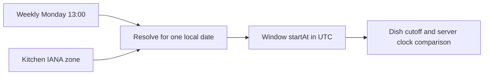

# Time zone on the kitchen

Umm Yousef says lunch begins at 13:00. Sufra needs the kitchen's IANA zone and a date to turn that local label into a UTC instant. A fixed offset such as `+02:00` says how one clock relates to UTC at one moment. It does not carry the region's future rules. Store a named zone such as `Asia/Gaza` on the kitchen and validate it before opening a schedule. M14 will use that zone for each dated window it generates.

The cook should choose and confirm the zone. The browser can suggest its own zone, but the device may be elsewhere. A cook in Gaza may set up a kitchen while travelling, and a helper may use a phone in another region. The kitchen zone describes where its local schedule applies, not the current browser location. The API stores the confirmed name and returns it in the cook dashboard so a 13:00 rule is never shown without its context.

## Validate the name at the API

Create `server/src/modules/kitchens/time-zone.js`. Use the runtime's IANA time-zone support to reject unknown names. This is input validation, not a guarantee that future government time rules will never change. Store the accepted name rather than replacing it with a numeric offset. Keep error copy specific: "Choose a named time zone for this kitchen" is more useful than a generic server error.

The diagram shows that the recurring rule and named zone are inputs to a dated conversion. The resulting UTC instant is what later checkout compares.



Use a small function for validation. `Intl.DateTimeFormat` throws a `RangeError` for an unsupported zone name in current JavaScript runtimes. Trim surrounding whitespace, reject an empty value, and preserve the named zone returned by the runtime. Test the exact runtime used by the learner project rather than relying on a browser's zone list.

```js
export function validateKitchenZone(input) {
  if (typeof input !== 'string' || input.length > 80 || !input.trim()) {
    throw new Error('INVALID_TIME_ZONE');
  }
  const timeZone = input.trim();
  if (!timeZone.includes('/') || timeZone.startsWith('Etc/')) {
    throw new Error('INVALID_TIME_ZONE');
  }
  try {
    const formatter = new Intl.DateTimeFormat('en', { timeZone });
    return formatter.resolvedOptions().timeZone;
  } catch (error) {
    if (error instanceof RangeError) throw new Error('INVALID_TIME_ZONE');
    throw error;
  }
}
```

Test `Asia/Gaza` and `Europe/Berlin` as named zones. Test an unknown name and a raw `+02:00` input. If the runtime accepts an offset identifier, the explicit region check still rejects it because the kitchen's recurring schedule needs regional rules. The course also excludes `Etc/` fixed-offset style names. Document any exception needed for a real jurisdiction. Do not infer that any string accepted by a formatter is a suitable long-term kitchen zone.

## Use the zone when opening a kitchen

The profile starts in `draft`. A cook may enter a name and areas before choosing a zone. Before changing the kitchen to `open`, require a valid zone and at least one validated weekly rule. A draft with no zone does not generate orderable windows. The open transition should check these prerequisites on the server. If a direct API request sends `status: open` without them, reject it rather than trusting the onboarding form.

Store the zone on the kitchen and copy it to `kitchenZoneAtGeneration` on each dated `DeliveryWindow`. The copy explains the rule used when that occurrence was created. The window also stores `startAt`, `endAt` and `cutoffAt` as UTC dates. A paid order later snapshots its chosen window times and kitchen zone. That chain lets support answer why a diner saw a particular lunch hour even after a cook edits settings.

The process's default `TZ` is not the kitchen zone. Tests should pass if the API process runs under UTC or another host setting because conversion takes an explicit IANA input. Use a zone-aware date library for local-rule expansion; do not construct `new Date('2024-01-15 13:00')` and hope the host chooses Gaza. M14 will test a historical clock-change date to prove that a recurring local hour can map to different UTC hours on different dates.

Work the difference on paper with a controlled Berlin example. A Monday 13:00 local window on 25 March 2024 corresponds to 12:00 UTC in Berlin. A Monday 13:00 window on 1 April 2024 corresponds to 11:00 UTC after the spring clock change. The cook's local rule did not change. A fixed `+01:00` offset would generate the later window one hour wrong. This is why the database saves the named zone on the kitchen and the dated UTC result on each window. The exact historical dates are test fixtures; future regional rules still come from current time-zone data.

Now transfer that reasoning to the Sufra kitchen. Do not memorize a current Gaza offset and subtract it from every 13:00 lunch. Ask the zone library to resolve each dated local start. If the local start falls in a gap or overlap under that date's rules, follow a documented policy instead of guessing. M14 rejects ambiguous or nonexistent local boundaries in the course example and asks the cook to choose a valid schedule. The API should report the affected local date and rule key so a cook can correct it.

## Treat a zone edit as a migration

Add `PATCH /kitchens/:id/time-zone` for an owned kitchen. If no dated windows exist, an authorized cook can correct a draft zone. If future unclaimed windows exist, the change needs a preview and regeneration plan because their UTC instants may move. If a future window has a held claim or a paid order, reject a silent zone edit with a conflict and route the cook to an explicit support resolution. Do not update the kitchen string and leave incompatible dated promises behind.

This is stricter than a typical profile text edit because the zone changes the meaning of every recurring local rule. A cook might select `Asia/Qatar` accidentally, see a different UTC lunch, then correct it to `Asia/Gaza`. Before diners pay, unclaimed future rows can be reviewed and replaced. After payment, the old order must keep its promised UTC interval. The system may need to cancel or contact a diner; it cannot pretend the promise moved with a settings field.

Use a compare-and-swap condition on the kitchen schedule or zone revision so two devices do not make conflicting changes. Record the old and new zone, actor, time and affected future window count in an audit note. The full reconciliation workflow belongs to M14, but this route must not present a zone change as complete while dated state remains unresolved. A 409 with a clear explanation is safer than a successful response that quietly shifts the next seven lunches.

A zone edit can also affect a cook's daily pause. A close-today request is interpreted as a calendar date in the kitchen zone. If the zone changes between preview and submission, the phrase "today" can name a different local date. Require a current kitchen revision and send back the resolved local date in the response. The cook can verify that the intended Thursday is closed. Do not infer the date from the server host's timezone or the browser's clock without showing it.

If the runtime's time-zone database is updated, previously paid orders keep their stored UTC window times and zone snapshot. New unclaimed occurrences may resolve differently under a changed regional rule. Monitor generated previews and review changes before publication. A generator that silently rewrites paid windows would change the diner promise even though no cook touched the profile. The data model's dated snapshot is what gives you a stable reference during such a review.

## Verify a controlled change

Create a draft kitchen in `Asia/Gaza`, save a Monday 13:00 rule and open it only after validation. Ask another cook to change the zone; expect a denial. Create an unclaimed dated fixture and try an authorized zone edit; expect a review-required outcome with the affected window ID. Add a held claim and try again; expect a conflict and an unchanged zone. A paid order snapshot should remain unchanged after any later profile edit.

For conversion evidence, use historical Berlin Mondays before and after a clock change. Both should display as 13:00 in `Europe/Berlin` while their UTC hours differ. Do not hard-code a guessed future Gaza transition date as a unit assertion. For the actual Gaza kitchen, show a smoke preview of the next seven dated windows with current runtime zone data before publishing them. If that preview changes after a runtime update, review the effect on unclaimed windows and paid promises.

Save the accepted zone, rejected inputs, ownership denial and affected-window response in `docs/kitchen-api-decisions.md`. The next lesson closes one local date without deleting the weekly rule, using the date and zone as explicit inputs.

References: [MDN `Intl.DateTimeFormat` time zone option](https://developer.mozilla.org/en-US/docs/Web/JavaScript/Reference/Global_Objects/Intl/DateTimeFormat/DateTimeFormat), [MDN ZonedDateTime](https://developer.mozilla.org/en-US/docs/Web/JavaScript/Reference/Global_Objects/Temporal/ZonedDateTime).
