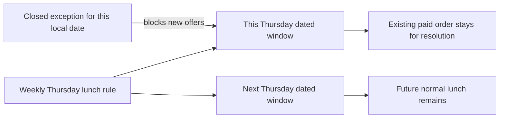

# Pause the kitchen for today

Umm Yousef cannot cook today. She needs one action that stops new lunch orders, but she still wants the weekly Thursday rule next week. A broad profile deletion would lose the kitchen's identity and history. A permanent schedule edit would remove every future Thursday. The correct record is a dated closure for the kitchen's current local date, followed by reconciliation of that date's generated windows. Existing paid orders remain visible for an explicit resolution.

The word "today" is ambiguous until the server uses the kitchen's IANA zone. A cook's phone may be in another region or show the wrong date. The API reads its injected server clock, converts that instant to the kitchen zone and returns the resolved local date in the response. The cook can confirm which date was closed. Do not let the browser send an unreviewed UTC date and call it the kitchen's today.

## Start the exception model here

Create `server/src/modules/kitchens/schedule-exception.model.js`. M9 needs a `closed` exception for one local date. M14 will extend the same model with rule-specific closures and replacement windows. Use a compound unique index on kitchen, local date and source rule key. For the whole-day pause, use a reserved `sourceRuleKey: '*'` that means every normal rule on that date. The later generator must check this wildcard before inserting any dated window.

The diagram shows why the exception and weekly rule coexist. A paid order points to its dated row, even when new offers for that date are closed.



Use the field names already introduced in M5 and M14. A minimal schema can store kitchen ID, `localDate` as `YYYY-MM-DD`, `sourceRuleKey`, kind, actor ID and creation time. Keep a reason or note for the cook if useful, but do not require them to disclose a personal hardship. A neutral reason such as "Kitchen unavailable" is enough. Do not place a diner's address or order details in the exception document.

```js
import mongoose from 'mongoose';
const { Schema } = mongoose;

const exceptionSchema = new Schema({
  kitchenId: { type: Schema.Types.ObjectId, ref: 'Kitchen', required: true },
  localDate: { type: String, required: true },
  sourceRuleKey: { type: String, required: true },
  kind: { type: String, enum: ['closed', 'replacement'], required: true },
  createdByUserId: { type: Schema.Types.ObjectId, ref: 'User', required: true },
}, { timestamps: true });

exceptionSchema.index(
  { kitchenId: 1, localDate: 1, sourceRuleKey: 1 },
  { unique: true },
);
export const ScheduleException = mongoose.model('ScheduleException', exceptionSchema);
```

M14 will add replacement-window fields and validation. Do not create a second `KitchenPause` collection for the same dated rule. One exception model and one lookup convention make pause, generator and checkout agree about whether the date is closed. A kitchen-level `status: paused` remains available for a broader pause; it is not the mechanism for "today only." The date-specific exception answers that request without altering next week's template.

## Resolve the local date on the server

Create `POST /kitchens/:id/pause-today`. Load the kitchen with both ID and authenticated owner ID. Reject another cook and a diner. Use the injected `clock.now()` and a zone-aware library to calculate the kitchen's local date. Upsert the wildcard closed exception for that date, using `$setOnInsert` so a retry returns the same record rather than creating a second closure. Return the local date and number of dated windows affected.

After writing the exception, mark existing unclaimed windows for that kitchen and local date `closed` to new orders. For windows with held claims or paid orders, also stop new claims but retain the row and report that fulfilment needs follow-up. Do not delete an order or mark it refunded here. The cook acceptance and payment modules own those transitions. A closure response should say, for example, "New orders stopped for Thursday; one paid order needs review" rather than "Everything cancelled."

The write across exception and windows is not one database transaction in this core path. Make the operation repeatable. If the process stops after creating the exception, a retry or reconciliation worker finishes closing the dated rows. Public browse and the checkout claim path must consult the exception or a reconciled closed status before offering payment. A window update that races with the closure needs a final guard before payment; release a new hold if the date is now closed. Document this boundary instead of pretending an exception insert instantly changed every other document.

For a concrete race, Lina starts checkout while the cook presses Pause. The claim may read an open window before the exception is inserted. Before Sufra exposes a payment path, it rechecks the dated closure and releases that hold if the pause won. If payment was already completed before the pause, the paid order remains and needs the cook's response. The API must not convert a paid order into an unpaid draft just because a new exception exists. These outcomes use the same dated row but occur on different sides of the payment boundary.

Use a stable response shape: `localDate`, `exceptionId`, `closedWindowIds` and `paidOrdersNeedingReview` as a count. The cook's own dashboard can link to their affected orders after authorization. The general public API should show only that new offers are closed, not the number of diners or their details. A retry returns the same exception ID and the current reconciliation state. If the first call stopped midway, the retry can show progress without making the cook wonder whether the button worked.

If reconciliation fails, keep the exception and return a status that says closure is being applied. Alert the worker or operator with the kitchen and local date, but no private order details in a broad log. Do not report complete closure while an open dated row remains available for checkout. The job can rerun safely because marking a closed row closed again has no effect and the unique exception key prevents duplicates. This is a small recovery path that prepares the learner for later hold-expiry and acceptance jobs.

## Keep the weekly template intact

Run the generator after pausing today. It should skip all normal rules for the wildcard exception date. It should still generate the following Thursday according to the weekly template. If today's row was already present, generation should not reopen it because its status changed; `$setOnInsert` must leave an existing row alone. A cook who resumes tomorrow does not need to recreate their kitchen or dishes. A later explicit "reopen today" action would need to check cutoffs and existing orders, so do not add a blind delete-exception button here.

For a cook who wants to close only lunch but keep dinner, M14's rule-specific exception uses the lunch `sourceRuleKey` rather than `'*'`. The whole-day pause is a deliberate shortcut with clear scope. The response should name the local date and all affected windows so the cook does not mistake it for a permanent kitchen closure.

Do not add an automatic midnight unpause job that deletes the exception. The exception is a historical record explaining why that date differed from the weekly template. On the next local date it simply no longer matches; normal rules can generate again. Keeping the row is helpful if a diner or cook later asks why Thursday lunch was unavailable. Retention policy can archive old exceptions after the useful support period, but a new day does not require erasing yesterday's explanation.

## Test a pause and a retry

Create a kitchen in `Asia/Gaza` with a Thursday lunch rule. Freeze the server clock on a Thursday in that kitchen zone. Call pause-today twice. Expect one exception row, an unchanged weekly rule and a closed dated lunch. Move the clock to the following Thursday and generate again; expect the normal lunch. Change the test process `TZ` and repeat; the resolved kitchen-local date must be the same because the route uses the explicit kitchen zone.

Add a held claim and a paid order fixture before pausing. The dated row remains in the database, but new claims fail. The response reports the need to resolve the paid order. A different cook's pause request must be denied before reading private order details. A diner cannot call the route. Simulate a process stop after exception insertion and rerun; the reconciliation closes the row without creating a duplicate exception or deleting history.

Save the exception row, closed window state, unchanged weekly rule and denied ownership response in `docs/EVIDENCE.md`. The next gate reviews the whole Kitchen API: profile, service area, weekly template, IANA zone and date-specific pause. A peer should be able to explain why each field lives where it does.

References: [MongoDB unique indexes](https://www.mongodb.com/docs/manual/core/index-unique/), [MongoDB atomicity limits across documents](https://www.mongodb.com/docs/manual/core/write-operations-atomicity/), [Luxon zone conversion](https://moment.github.io/luxon/api-docs/index.html).
