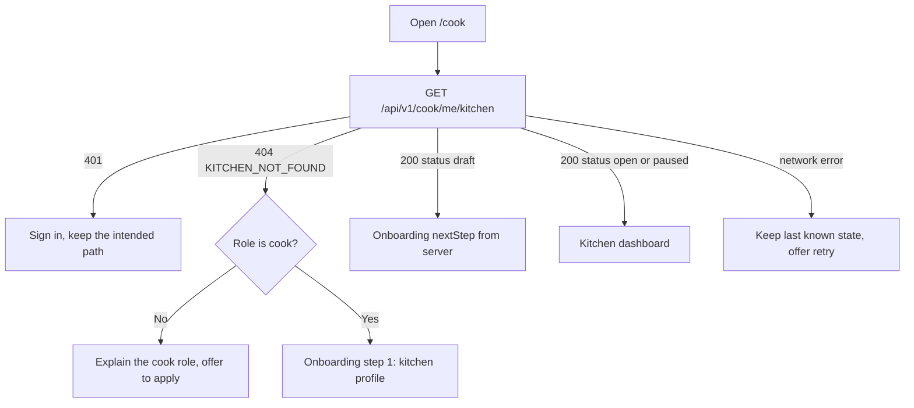

# The cook who has no kitchen page

Umm Yousef finishes the sign-up form, chooses the cook role, and taps a button that says "Start selling lunch". The app opens the address `/cook`. The dashboard asks the server for her kitchen. The server answers that this account has no kitchen, and the page renders nothing useful: a heading, a grey body, and a spinner that stops spinning. She does not know whether she did something wrong, whether the app is broken, or whether a form is waiting somewhere she has not found.

That empty screen is the first surface every new cook meets, and it decides how the next ten minutes feel. The same address also serves a cook who started a kitchen last night and left it half finished, a cook who paused her kitchen before the weekend, and a diner who followed the wrong link. Each of them needs a different next step. The answer has to come from the server, because a browser cannot tell "no kitchen" apart from "kitchen exists but the menu is empty yet". Both cases give the same empty list of dishes.

This lesson defines one route that answers the question honestly, the router rules that read the answer, and four failures that make an onboarding redirect look broken even when every line of it runs. The next lesson builds the form that the redirect leads to, and the lesson after that asks you to demonstrate the whole path on a phone.

## One route answers one question

Add `GET /api/v1/cook/me/kitchen`. It resolves the kitchen from the authenticated account and never from a parameter in the URL. The response has three shapes, and the client branches on the shape rather than on a body that happens to be empty.

```txt
GET /api/v1/cook/me/kitchen

200 {
  "kitchenId": "65f1c0a2a91b4c0012f0e111",
  "name": "Umm Yousef's Kitchen",
  "status": "draft",
  "onboarding": { "nextStep": "schedule", "profileComplete": true,
                  "scheduleComplete": false, "hygieneDeclaredAt": null }
}

404 { "code": "KITCHEN_NOT_FOUND" }
401 { "code": "UNAUTHENTICATED" }
```

The `onboarding` object is the part that saves work later. A cook who saved her name, area and time zone but closed the app before the schedule step has a kitchen row and an unfinished path. Without `nextStep`, the client has to infer the step by fetching the schedule and counting rules, which duplicates the validation rules that the schedule route already owns. Let the server name the next step, and let the client open the screen for that step.

The same route returns the kitchen `status`. `draft` means the cook has not opened the kitchen to diners. `open` means diners may see her future windows. `paused` means she stopped new offers on purpose. A dash-panel for a paused kitchen must not look like the dashboard for a missing one, because the difference is a decision the cook made, not a step she skipped.

## Four accounts, four destinations

A diner who has no kitchen must stay a diner. She may read her orders, browse windows and pay. Showing her a cook onboarding form is worse than showing nothing, because she will fill five fields and then receive a role denial from the save route. The route should return `404 KITCHEN_NOT_FOUND` with a role hint, or a dedicated `403 NOT_A_COOK`, and the client should offer a page that explains what the cook role does before it offers a form.

A cook with no kitchen should land on the first onboarding step. That is the case this module exists for. She gets a short explanation, one button, and a save that creates a draft kitchen owned by her account.

A cook with a draft kitchen and an unfinished step should land on that step, not on step one. Re-asking for a name and an area that the server already stores teaches her that the app does not remember anything, and on a phone with a weak connection it invites duplicate saves.

A cook with a paused or open kitchen belongs on the dashboard. A pause is not an unfinished setup. If the guard sends her to onboarding because her kitchen has no active dishes, the redirect is using the wrong signal entirely.

The diagram below is the decision the router follows after the resolve call returns. Notice that every branch is a server value, and that no branch is chosen from a local cache of form fields.



The last branch is the one most teams forget. A dropped request is not a missing kitchen.

## The failure that creates a second kitchen

Treat a timeout as `KITCHEN_NOT_FOUND`, and a cook who already owns a kitchen is pushed into the creation form. She fills it again, taps save, and the server has to decide what to do with a second kitchen owned by the same account. Some implementations create the duplicate. Then her dishes live in one kitchen, her windows in another, and the dashboard shows half her work depending on how the query sorts.

Prevent the duplicate at the storage layer, not only in the form. Create a unique index on `Kitchen.ownerUserId`. The create route then returns `409 KITCHEN_EXISTS` with the existing `kitchenId`, and the client follows that identifier back to the dashboard. Two taps on a slow connection, two browser tabs, and a double submit all collapse into one kitchen.

The client rule is the other half: a transport error keeps the last known answer and shows a retry. Only a parsed `404` with the `KITCHEN_NOT_FOUND` code may start onboarding. Write that distinction as a test, because it is the kind of branch that survives review and dies in production.

## Do not redirect in circles

The most common onboarding bug is a loop. The guard runs on `/cook`, sees no kitchen, and sends the browser to `/onboarding`. The onboarding page sits inside the same guarded layout, the guard runs again, and it sends the browser to `/onboarding` again. The learner sees a flicker and a blank page.

There are two clean answers. Either the onboarding routes live outside the guarded subtree, so the guard never runs against them, or the guard holds a resolved flag for the current navigation and skips the check once it has answered. Pick one and write it down, because mixing them produces a guard that sometimes skips and sometimes loops.

A deep link makes this harder. If she tapped a link to `/cook/dishes` from a message, the guard sends her to onboarding and then should return her to `/cook/dishes`, not to the dashboard. Carry the intended path in a `next` parameter, accept only internal paths, and drop the parameter after the redirect so a shared link cannot become an open redirect.

## What a redirect must never decide

Three decisions do not belong in the router. The first is whether the kitchen profile is valid: only the save route can answer that, and its errors name the field that failed. The second is whether the cook has declared hygiene practices: that is a stored record with a version and a server timestamp, not a checkbox the client remembers. The third is whether the kitchen may open: the schedule and the profile both have to be complete, and the open action is a server transition with its own rules.

Keeping those decisions on the server has a second benefit on a phone. The client can be closed, the tab can be killed by a power cut, and the next launch re-reads one small response and lands in the right place. State that lives only in a React context disappears with the tab, and a cook who returns after a power cut should not have to rediscover where she was.

## Write the table before the code

Create `docs/onboarding-decisions.md` with four rows: an account with no kitchen, a draft kitchen with an unfinished step, an open kitchen, and a paused kitchen. For each row write the account role, the server response, the destination, and what the cook sees as the reason she is there. Add a fifth row for a network failure, because that row is where most of the mistakes live.

Then add a short note on the create route. Write the unique index you rely on, the conflict code, and the response body that lets the client recover. If the answer to "what happens on a double tap" is a sentence about a disabled button, the design is not finished; the database has to hold the rule.

The next lesson builds the kitchen form and the schedule grid that the onboarding redirect leads to, both of them sized for a 360 pixel screen. Keep the resolve route as it is while you work on them. A form that saves is not evidence that a cook can find it.
