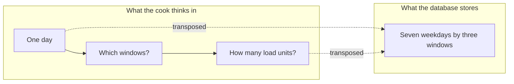

# Kitchen form and the phone-width schedule grid

The onboarding redirect now lands Umm Yousef on the right step. The step itself is a screen with three jobs: describe the kitchen, say which windows she cooks and how much, and record one declaration about how she works. The first job is a form of five fields. The second is a matrix of seven weekdays by three platform windows, twenty one capacity numbers in total. The third is a checkbox with a version and a timestamp behind it.

Twenty one inputs is not a design problem on a laptop. It is a design problem on the phone Umm Yousef actually owns, held in one hand, on a connection that costs her money, in a kitchen where the light is poor and the screen is 360 pixels wide. This lesson builds the form, transposes the matrix so it fits, and writes the declaration so it does not pretend to be something Sufra cannot deliver.

## The profile form has five fields

The kit starts with `POST /api/v1/cook/kitchen` and continues with `PATCH /api/v1/cook/kitchen`. Both act on the kitchen resolved from the session, so neither takes a kitchen identifier in the path. The body carries only the fields a cook may change.

```txt
PATCH /api/v1/cook/kitchen
{ "name": "Umm Yousef's Kitchen",
  "serviceAreaCodes": ["rumal", "shujaiya"],
  "pickupNote": "Ground floor, green door. Knock twice, no bell after 20:00.",
  "timeZone": "Asia/Gaza",
  "revision": 3 }

422 { "code": "VALIDATION_FAILED",
      "fields": [{ "field": "timeZone", "code": "INVALID_TIME_ZONE" },
                 { "field": "pickupNote", "code": "PICKUP_NOTE_TOO_LONG", "max": 140 }] }
```

`name` is what a diner reads on a browse card, so keep it short and reject blank or whitespace only values. `serviceAreaCodes` is a list of neighborhood tokens from a server list, not free text, because browse compares them exactly and a typo quietly removes a kitchen from a diner's results. `timeZone` is an IANA name validated with `Intl.DateTimeFormat`, and a raw offset such as `+02:00` is rejected, for the reasons lesson 9.4 gave: an offset cannot express a change of rules across dates.

`pickupNote` is new in this module and it deserves its own rule. It is the instruction a diner needs when collecting a meal: which door, which floor, what to do with the intercom. It is not a public field. The public kitchen response from M9 omits it, and a diner sees it only after their order is placed, copied into the order snapshot so it cannot change later. That is also why the note is capped at 140 characters and why the form warns against putting a phone number in it: a snapshot keeps what she typed today for every order she has ever taken.

The form keeps the five values in local state and sends only changed fields. After a save the server returns the stored kitchen with an incremented `revision`. If a second device saved a newer revision, the response is `409 STALE_REVISION`, and the screen reloads and shows both versions rather than overwriting the newer one. On a shared family phone that happens more often than a laptop-only designer expects.

## Why the matrix does not fit

The obvious editor is a table: seven rows for the weekdays, three columns for the platform windows, one number in each cell. At 360 pixels the arithmetic almost works. With 16 pixel page padding each side there are 328 pixels of content. A weekday label of 56 pixels and two 8 pixel gaps leave 256 pixels, which is about 85 pixels per cell. A number fits in 85 pixels.

What does not fit is everything else the cell needs. A cook has to know the unit, so each cell wants a small label. When a save fails, the error for Monday lunch needs somewhere to appear, and inline error text under a cell of 85 pixels wraps into four lines that push the other six rows off screen. The numeric keypad on a phone covers roughly the bottom third of the display, so the cook edits Thursday while seeing Monday. And a 44 pixel tap target inside a table row of 44 pixels, with a header row above it, is the floor of usability rather than a comfortable target.

The failure is not the width alone. It is that a table shows twenty one things at once when the cook is thinking about one day. Umm Yousef does not sit down to consider the whole week. She opens the app on Sunday evening and asks "am I cooking tomorrow lunch, and how many units". The grid is a storage shape. It does not have to be a screen shape.



The diagram states the trade this lesson makes. The stored shape stays a weekday by window matrix, because that is what the generator in M14 expands. The screen shows one day at a time, and a summary strip keeps the rest of the week visible.

## Transpose the grid, keep the data

Build the editor as a day strip plus three window rows. The day strip is seven chips, Monday to Sunday, each at least 44 pixels tall, with today's chip marked by a label and not only by color. Each chip carries a small count of how many windows are enabled that day, so the cook can see the whole week without opening it. Below the strip, one row per platform window shows the window name, its local start and end, and a capacity control.

```txt
[ Mon ][ Tue ][ Wed ][ Thu ][ Fri ][ Sat ][ Sun ]     day strip
 Mon  13 Nov   14:00 to 15:00 local     3 windows set

  Lunch     13:00 to 14:00     [ - ]  10  [ + ]
  Afternoon 16:00 to 17:00     [ - ]   0  [ + ]
  Dinner    19:00 to 20:00     [ - ]   6  [ + ]
```

A capacity of zero means the cook does not work that window on that day, which removes the rule rather than saving a rule with no capacity. The stepper is one control with two 44 pixel buttons and a 44 pixel read only field, so the cook can work without the keyboard. The field stays editable for a cook who wants to type 40, and the typed value is validated on blur, with the error appearing in the row it belongs to instead of under a cell that has scrolled away.

The platform windows themselves come from the server, not from a constant in the client. `GET /api/v1/platform/windows` returns the three window definitions with an `id`, a `localStart` and a `localEnd`. If Sufra adds an iftar window for Ramadan, the editor picks it up without a client release, and a cook who already has rules for the other three sees a fourth empty row.

```js
// client/src/features/onboarding/scheduleDraft.js (excerpt)
// The draft is the 7 x 3 matrix. The screen shows one weekday slice of it.
export function toRulesByDay(rules, windows) {
  const byDay = new Map();
  for (const day of [1, 2, 3, 4, 5, 6, 0]) {
    const row = windows.map((w) => {
      const saved = rules.find((r) => r.weekday === day && r.windowId === w.id);
      return { windowId: w.id, capacityUnits: saved ? saved.capacityUnits : 0 };
    });
    byDay.set(day, row);
  }
  return byDay;
}

export function toSavePayload(byDay, windows, revision) {
  const rules = [];
  for (const [day, row] of byDay) {
    for (const cell of row) {
      if (cell.capacityUnits > 0) {
        const w = windows.find((x) => x.id === cell.windowId);
        rules.push({ key: day + '-' + cell.windowId, weekday: day, windowId: cell.windowId,
                     localStart: w.localStart, localEnd: w.localEnd,
                     capacityUnits: cell.capacityUnits, cutoffLeadMinutes: w.defaultCutoffLead });
      }
    }
  }
  return { rules, revision };
}
```

The save route is the `PUT /api/v1/cook/kitchen/weekly-schedule` from lesson 9.3, unchanged. That matters: the onboarding editor is a second view of the same validated rules, not a second storage format. If the editor invents a `windows: { lunch: 10 }` object, the generator in M14 has two shapes to understand and the validation from 9.3 runs on neither.

## Test the width, not the intention

Write the layout test before the screen looks good. The assertion is about the viewport, not about the stylesheet.

```js
// client/test/onboarding/schedule.spec.js (failing first)
it('edits the week at 360 pixels without sideways scrolling', async ({ page }) => {
  await page.setViewportSize({ width: 360, height: 640 });
  await page.goto('/onboarding/schedule');
  const scrollWidth = await page.evaluate(() => document.documentElement.scrollWidth);
  expect(scrollWidth).toBeLessThanOrEqual(360);           // the 7 by 3 table returns 412
  const tooSmall = await page.evaluate(() =>
    [...document.querySelectorAll('[data-capacity-control]')]
      .map((el) => el.getBoundingClientRect())
      .filter((r) => r.height < 44 || r.width < 44).length);
  expect(tooSmall).toBe(0);
});
```

Run it against the table version first and watch it fail at 412 pixels. Then replace the table with the day strip and the three rows and run it again. A passing width test is cheap evidence, and it survives the next person who adds an error message under a cell.

Add a second test for the state that is easy to break: open the editor on Monday, set lunch to 10, switch to Thursday, set dinner to 6, switch back to Monday. Monday must still show 10. That is a draft state test, and it catches the component that rebuilds its local copy of the matrix from props on every render.

## The declaration is a record, not a checkbox

The third step is a short declaration about how the cook handles food in her home kitchen. Sufra stores what she declared, when, and against which text. It does not inspect her kitchen, does not certify it, and does not give advice about food safety law, because the rules differ by place and are not ours to teach.

```txt
POST /api/v1/cook/kitchen/hygiene-declaration
{ "declarationVersion": "sufra-kitchen-declaration-2026-01" }

201 { "declarationVersion": "sufra-kitchen-declaration-2026-01",
      "acceptedAt": "2026-11-03T08:12:41.000Z" }
```

The server sets `acceptedAt` from its own clock and ignores any timestamp in the body. A client clock is a suggestion, and a declaration that says it was accepted next year is worse than no record. The `declarationVersion` is stored beside the timestamp so that a later change to the wording can require a fresh declaration from every cook, without touching the older records that were made against the older text.

The wording itself has three jobs, and each maps to a test. It must say what the cook affirms, in her own name and in plain sentences. It must say what Sufra does not do: no inspection, no certificate, no legal advice. And it must not ask for medical or personal information about her or her family, because none of that belongs in an onboarding record.

```jsx
// client/src/features/onboarding/HygieneStep.jsx (excerpt, copy only)
<p>
  By continuing you confirm that you prepare food in a home kitchen you control,
  that you follow the cleaning and storage practices listed above, and that you
  will tell diners about allergens you know about.
</p>
<p className="text-sm">
  Sufra records this declaration and the date you made it. Sufra does not inspect
  or certify your kitchen, and this is not legal or food safety advice.
</p>
```

Two product rules fall out of that. The declaration does not block a cook from editing her profile, because a cook who has not declared yet should still be able to fix a typo in her name. It does block opening the kitchen, because opening is the moment diners start trusting the record. And no route may render an existing declaration as a claim about safety. A dashboard badge that says "hygiene verified" is false, and a diner-facing badge that says the same is worse.

## Verify the three steps together

Seed a cook account with no kitchen. Walk the redirect from lesson 10.1, save a profile with a bad time zone and read the field error, then save a valid one. Open the schedule editor at 360 pixels, set Monday lunch to 10 and Thursday dinner to 6, and confirm the saved rules carry `windowId`, `weekday`, capacities and the platform window's default cutoff lead. Declare, then read the stored record and confirm the timestamp came from the server.

Then break it deliberately. Send a `PATCH` with an `acceptedAt` field in the body and confirm the server ignores it. Send a schedule with a duplicate `key` and confirm a 422 rather than a silently dropped rule. Open the editor with a stale `revision` and confirm a conflict instead of a lost Monday. Save those requests and responses in `docs/EVIDENCE.md`.

The gate lesson asks you to repeat this walk on an actual phone and to show the hygiene record. Keep the screen in one piece until then.

References: [MDN `Intl.DateTimeFormat`](https://developer.mozilla.org/en-US/docs/Web/JavaScript/Reference/Global_Objects/Intl/DateTimeFormat), [Web Content Accessibility Guidelines, target size](https://www.w3.org/WAI/WCAG22/Understanding/target-size-minimum.html).
