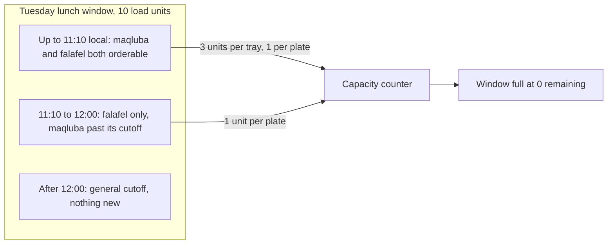

# A dish is a promise of time

Umm Yousef lists two dishes for Tuesday lunch. Maqluba takes her ninety minutes from the moment she starts, and it fills her largest pot. Falafel takes twenty minutes and one frying basket. Both appear on the same browse card for the same 13:00 delivery window. A diner looking at that card sees two names, two prices and two photographs, and nothing that says one of them stopped being orderable at 11:10 while the other stays available until noon.

The missing information is not decoration. It is the whole product. A kitchen sells cooking time inside a fixed delivery interval, so every dish has to declare how much of that time it consumes in two separate senses: how early the cook must start, and how much of the window's capacity one order takes. Sufra stores those as `prepMinutes` and `loadUnits`. Neither one is a quantity of food, and neither one belongs to the kitchen as a whole. They belong to the dish, because the dish is what a diner chooses.

This lesson reads the two fields carefully with maqluba and falafel side by side. The next two lessons validate them and make the promise enforceable at the API.

## Two fields, two different questions

`prepMinutes` answers "how long before the delivery window must the cook start?" It is a duration, in whole minutes, and it feeds the cutoff formula from lesson 14.5: subtract the preparation time and the kitchen's travel buffer from the window start, then take the earlier of that instant and the window's general cutoff.

`loadUnits` answers "how much of this window's cooking can one order take?" It is an integer weight against the window's `capacityUnits` counter. A dish with three load units consumes three of the window's units for each one ordered.

```js
/**
 * @typedef {Object} DishPromise
 * @property {number} prepMinutes    whole minutes from start of cooking to handoff
 * @property {number} loadUnits      weight of one order against window capacity
 * @property {number} maxPerOrder    most one diner may take in a single order
 * @property {number[]} activeWeekdays  weekdays this dish is cooked, 0 is Sunday
 */
```

Read the two fields as answers to different questions and the rest of the module follows. A dish can be fast and heavy, like a large tray of rice that needs forty minutes of chopping and fills the whole oven. It can be slow and light, like a stew that simmers for two hours while other work happens and costs one unit at the end. Sorting dishes by either field alone will mislead the cook, so the dashboard shows both.

## Work the Tuesday lunch

Fix one window and both dishes and the arithmetic becomes concrete. The window runs 13:00 to 14:00 local in `Asia/Gaza`, which is 11:00 to 12:00 UTC on 2026-11-03. The kitchen's general cutoff lead is 60 minutes, so the window closes to new orders at 12:00 local. The travel buffer is 20 minutes. There are 10 capacity units.

| Dish | prepMinutes | loadUnits | maxPerOrder | Effective cutoff |
|---|---|---|---|---|
| Maqluba, chicken | 90 | 3 | 2 | 11:10 local (09:10 UTC) |
| Falafel plate | 20 | 1 | 4 | 12:00 local (10:00 UTC) |

Maqluba closes at 11:10 because 13:00 minus 90 minus 20 lands there, and 11:10 is earlier than the general noon cutoff. Falafel computes to 12:20 for preparation, and the general cutoff at 12:00 is earlier, so noon wins. At 11:31 a diner can still order falafel for the same window and cannot order maqluba. The two dishes share a window and a cook, and their deadlines differ by fifty minutes.

Capacity tells a second story in the same window. Ten units accept three maqluba trays (nine units) with one unit left over, or ten falafel plates, or two trays and four plates. If a diner adds two maqluba to a cart, she consumes six of the ten units alone, which is why `maxPerOrder` is 2 for that dish and 4 for falafel. The limit is not about politeness. It is the difference between one diner finishing the window and four diners eating.



The diagram puts time and capacity in one picture for a reason. A window can be closed by the clock with capacity left, and it can be full with an hour of ordering time remaining. The diner sees one message, but the server keeps two separate conditions and two separate error codes.

## Why not minutes of capacity

The tempting simplification is one number instead of two: let each dish declare ninety minutes, and let the window declare that the cook has, say, three hundred minutes of work in it. One field, one counter, nothing to explain.

It fails because minutes of prep do not add up across a batch. Maqluba simmers for forty of its ninety minutes while the cook fries falafel in the same kitchen. Adding ninety plus twenty says the kitchen is busy for a hundred and ten minutes, and the cook knows that is false. It also fails because a cook cannot estimate the minutes for a batch of six trays, and a field a cook cannot fill honestly is a field that will hold guesses. When the number is wrong, the overbooking happens in a real kitchen with real diners waiting, and the API has no way to detect it.

Load units exist because the honest question is comparative, not absolute. A tray of maqluba costs about three times the effort of a falafel plate, and a cook can answer that question reliably even on a bad day. The course fixed this choice in the roadmap as open decision 5, and it is worth restating the alternative: portions would be simpler still, and they ignore the fact that one tray takes more work than one sandwich. If Sufra ever moves to an effort model measured in seconds, the window counter changes meaning and the migration needs a versioned recalculation, not a silent reinterpretation of stored integers.

## The three promises a dish makes

Put together, a dish declares three promises and one limit. The preparation time promises a deadline: order before this instant or the cook cannot start in time. The load promises a share of the batch: this much of the window disappears when a diner orders. The weekdays promise availability on a pattern: this dish is cooked on Sunday through Thursday, not on Friday, because that is when the cook makes it.

The limit is `maxPerOrder`, and it protects the window from a single cart. It also gives the cook a defensible answer when a diner asks for six trays for a family gathering: the API refuses the sixth with a code that names the limit, and the cook can take the order privately if she wants to.

Notice what is absent. The dish has no availability flag, no "sold out today" switch, and no counter of its own. Those belong to the dated window, where the clock and the claims live. A dish that carries its own remaining quantity becomes a second, competing source of truth, and the window counter and the dish counter drift apart the first time two requests arrive together. The data model lesson made this point at the schema; this module makes it at the API, where every route that touches a dish has to leave dated state alone.

## Two dishes that promise the impossible

The first failure is a dish that no window can ever accept. Set `loadUnits` to 12 in a kitchen whose largest window capacity is 10 and the dish can never be ordered, no matter how empty the window is. The browse query will show it, the cart will refuse it, and the diner sees a dish that looks available and never is. Lesson 11.3 makes this a rejected publish rather than a mystery.

The second failure is a dish whose preparation time pushes its cutoff before most diners are awake. A dish with `prepMinutes: 240` in the 13:00 window closes at 08:40 local, since 13:00 minus 240 minus 20 is 08:40. That dish is technically orderable for about two hours in the morning, and practically never sold. It is not invalid, and the API should not reject it, because a cook might genuinely want a pre-order dish for a celebration. The form should warn, and the dashboard should show the cutoff beside the dish so the cook can see the consequence of the number she typed.

Those two cases separate a hard rule from a warning. A dish that can never fit any window breaks a structural constraint, and the API must refuse it. A dish with an early cutoff is a business judgement, and the API must show it clearly and let the cook decide.

## Write the comparison down

Create `docs/dish-decisions.md` and put the Tuesday lunch table in it, with the local and UTC instants for both cutoffs and the capacity split for the mixed order. Then answer three questions in a sentence each: which field decides whether a dish can be cooked at all in this window, which field decides how much of the window disappears, and which field stops one diner from taking the batch.

The answers should use the words "can be cooked in time" and "can be cooked at all", because they are not the same test. Maqluba at 11:31 fails the first and passes the second. A twelve unit dish in a ten unit kitchen fails the second before any diner arrives.

The next lesson turns this reading into field level validation and an ownership rule that stops one cook from editing another cook's menu.
