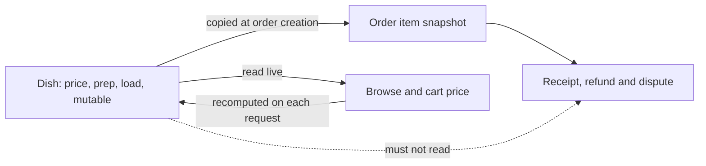

# A dish that cannot fit, and a price that can change

Two edits break a menu in ways the cook cannot see. The first is a dish that is too heavy for every window the kitchen offers, so it appears on the menu and can never be ordered. The second is a price change, which is legal, expected and cheap, and which silently rewrites the receipts of orders placed last week if the code joins to the dish when it reads them.

The two problems look unrelated. They are the same problem: the API must separate what a cook may change from what a diner already bought. Capacity is a property of the kitchen at the moment of the claim, so a dish heavier than any window is unusable. Price is a property of the dish at the moment of the order, so a later edit must not reach back into a stored purchase.

## The largest window decides

A dish with 12 load units in a kitchen whose largest window holds 10 can never be ordered. The browse query will list it, the cart will refuse it, and the diner will see a dish that looks available and never is. The publish route has to refuse it instead.

Compute `maxWindowUnits` from the kitchen's weekly template, taking the highest `capacityUnits` across the rules. That number is the largest batch the kitchen ever plans, and it is the honest threshold for "can this dish be cooked at all here". Reject the publish with a specific body so the form can explain the number.

```txt
POST /api/v1/cook/dishes/:dishId/publish

422 { "code": "DISH_CANNOT_FIT",
      "fields": [{ "field": "loadUnits", "dishLoadUnits": 12, "largestWindowUnits": 10 }] }
```

The units rule is the only hard one, and it is worth being explicit about why the time case is not. A slow dish is not a broken dish. Maqluba needs 90 minutes and a 20 minute buffer, so in the 13:00 lunch window its own cutoff is 11:10 local, well before the kitchen's general noon cutoff. That dish is orderable all morning and impossible to order at 11:31, and both of those facts are exactly what a cook expects. A dish with 240 minutes of preparation closes its ordering at 08:40, which is early, unusual and legal. Refusing it would be the API overriding a business decision that belongs to the cook, and lesson 11.1 already made that argument.

So the second rule is a warning carried on the publish response, not a refusal. The route computes the preparation lead the dish will have in the kitchen's longest window and returns it, so the form can show the consequence of the number the cook typed.

```js
// server/src/modules/dishes/publish.js (excerpt)
export function fitVerdict({ loadUnits, prepMinutes }, { maxWindowUnits, travelBufferMinutes }) {
  if (loadUnits > maxWindowUnits) {
    return { ok: false, code: 'DISH_CANNOT_FIT', largestWindowUnits: maxWindowUnits };
  }
  const leadMinutes = prepMinutes + travelBufferMinutes;
  const warnings = leadMinutes > 60
    ? [{ code: 'EARLY_CUTOFF', cutoffLeadMinutes: leadMinutes }]
    : [];
  return { ok: true, warnings };
}
```

A dish with 12 load units is refused because no window can ever accept it. A dish with 90 minutes of preparation is published with `EARLY_CUTOFF` and a dashboard label of "order by 11:10" for the lunch window. The first is a defect in the menu. The second is a property of the dish that both the cook and the diner need to see.

## When the kitchen shrinks under the dish

The check has a direction that is easy to miss. A cook publishes a 12 unit dish while her Monday lunch window holds 12, then opens the schedule editor and lowers Monday lunch to 10 because she has less help that week. Every active dish with 12 load units is now stranded, through no action taken on the dish itself.

Do not respond by silently unpublishing those dishes. The cook would find her menu shorter than she left it, with no explanation, and a diner browsing mid week would see a card change for reasons nobody recorded. Instead, the schedule save response reports what it broke.

```txt
PUT /api/v1/cook/kitchen/weekly-schedule

200 { "revision": 7,
      "rules": [ { "key": "mon-lunch", "weekday": 1, "capacityUnits": 10 } ],
      "affectedDishes": [ { "dishId": "65f1c0a2a91b4c0012f0e331",
                            "name": "Maqluba, family tray",
                            "loadUnits": 12,
                            "reason": "DISH_CANNOT_FIT" } ] }
```

The schedule still saves, because the cook's intent is clear and the template is her decision. The dashboard marks the affected dishes with a short sentence and a link to the editor, and the publish route re-checks the fit every time it runs. A dish that was active before the schedule changed stays visible in the cook's list with a warning, so she can lower its load, raise Monday's capacity, or hide it deliberately.

This is a knowledge problem, not a safety problem. A stranded dish cannot be ordered and therefore cannot overbook anything. The real protection against overbooking is the conditional claim in the checkout module, which refuses a request when the window's units are gone regardless of what any dish says. Keep the two mechanisms separate: the fit check protects a cook from a menu that cannot work, and the claim protects the window from two diners at once.

## Price belongs to the order once it is sold

Now the second edit. A cook raises the price of falafel from 600 to 700 minor units on Tuesday evening. On Wednesday a diner opens the receipt for an order placed on Monday and, if the receipt joins to the dish, the total changes. Money that was charged at 6.00 becomes a document claiming 7.00, and the difference between the receipt and the payment record becomes a support case nobody can settle.

The fix is a copy at checkout time and no joins afterwards. Every order item stores the fields that mattered when the diner paid: `nameAtPurchase`, `priceAtPurchase`, `prepMinutesAtPurchase`, `loadUnitsAtPurchase`, and the window times. The dish becomes a template for future orders only.

```diff
// server/src/modules/orders/receipt.js
- const total = items.reduce((sum, i) => sum + i.dish.priceMinor * i.quantity, 0);
+ const total = items.reduce((sum, i) => sum + i.priceAtPurchase * i.quantity, 0);
```

That diff is small and it is the whole lesson. The left version reads the current menu to describe a past purchase. The right version reads the purchase. A reviewer who sees a `populate('dish')` on a receipt path should ask why, because the only defensible answer is showing a photograph, not a price.



Follow the two outgoing paths from the dish. Browse and cart read the live dish, because a diner deciding now should see today's price. Receipts, refunds and disputes read the snapshot, because those are questions about a past decision. The dotted arrow is the one the diff removes.

## Edit a price and watch what does not move

Write the test before the fix. Place an order for two falafel at 600, change the dish to 700, and read the order again.

```js
// server/test/dishes/price-change.test.js (failing first)
it('keeps the purchased price after the dish price changes', async () => {
  const order = await placeOrder({ dishId: falafel.id, quantity: 2 });
  assert.equal(order.items[0].priceAtPurchase, 600);
  await request(app).patch('/api/v1/cook/dishes/' + falafel.id)
    .set('authorization', 'Bearer ' + cookToken).send({ priceMinor: 700 });
  const again = await Order.findById(order.id).lean();
  assert.equal(again.items[0].priceAtPurchase, 600);
  assert.equal(again.totalMinor, 1200);
});
```

Then add the neighbours of that case, because a price edit touches more than a receipt. The order's capacity claim must not change, since the claim was about units and not about money. The order's `prepMinutesAtPurchase` must not change either, because a cook who slows a dish down on Thursday has not moved Monday's cutoff. And the dish's own `revision` must increase, so a stale editor tab cannot overwrite the new price with the old one.

There is a fourth case and it is the one diners feel. A cart holds falafel at 600, the cook raises it to 700, and the diner pays. The server re-prices the cart at checkout and shows the new total before the payment form. It does not charge 700 while the screen still says 600, and it does not silently charge 600 and lose the difference. If the diner does not accept the new total, the lines stay in the cart and the payment step does not start.

## Keep currency and rounding boring

Store money as an integer in minor units, with an explicit currency on both the dish and the order. Adding a second currency to a Sufra order is out of scope; the field exists so that an order cannot be re-interpreted later, not so that a cart can mix shekels and dollars. Every total is computed from integers and formatted only at the edge, in the client, where a decimal separator cannot affect an amount the server has already decided.

Rounding appears in one place only, a multi item order whose line totals are already integers. If a later module adds a percentage fee, it rounds once at the end, on the total, and stores the rounded result. A receipt recomputed from a rounded intermediate value will disagree with the payment by a unit and create a dispute that takes an hour to explain.

## Verify both rules

Seed a kitchen whose largest window holds 10 units. Publish a dish with 12 load units and expect `DISH_CANNOT_FIT` with the two numbers in the body. Publish one with 130 preparation minutes and expect `201` with an `EARLY_CUTOFF` warning of 150 minutes, since the 20 minute buffer is added. Publish 9 units and 40 minutes and expect success with no warning, then show the dashboard label for the slow dish: in the 13:00 lunch window it reads "order by 10:30" in the kitchen's zone.

Then lower the Monday window to 8 and read the schedule response. The 9 unit dish must appear in `affectedDishes`, stay active, and remain visibly flagged. Confirm that no window, claim or order changed during the schedule save.

Finish with the price test, the receipt assertion and the cart re-price. Save the publish responses, the schedule body and the order before and after in `docs/EVIDENCE.md`. The gate next lesson asks you to run the ownership suite and these two rules together, because a menu API that is only correct when nobody else is using it is not finished.
